> **Historical detailed walkthrough.** Preserved from the optical extension edition. For the current research status, model definition and complete proof index, see [README](README.md). Edition labels and historical totals below refer to the stages in which they were recorded.

# The Hadamard Null Cone: Eight Triforce Vortices and Their Collective Core

## Current extension — four-port optical resonator

**[Optical four-port proof and model](OPTICAL_FOUR_PORT_RESONATOR.md)** · [Verifier](verify_optical_ports.py) · [108 passing checks](optical_ports_verification_output.txt).

Twelve coherent channels split into four bright and eight dark modes under the symmetric read. The exact Flower overlap matrix admits a rank-one central-mediated branch, which defines a conditional lossless optical filter on the existing whole-field diamond network. The unfiltered model transmits winding modes; only five of the eight initially row-dark modes are permanently dark to the isolated Field Origin. This does **not** establish eight individually sealed neighbours.

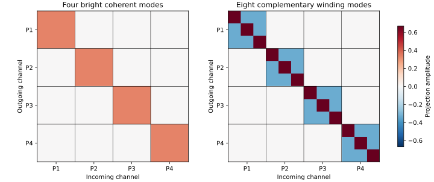

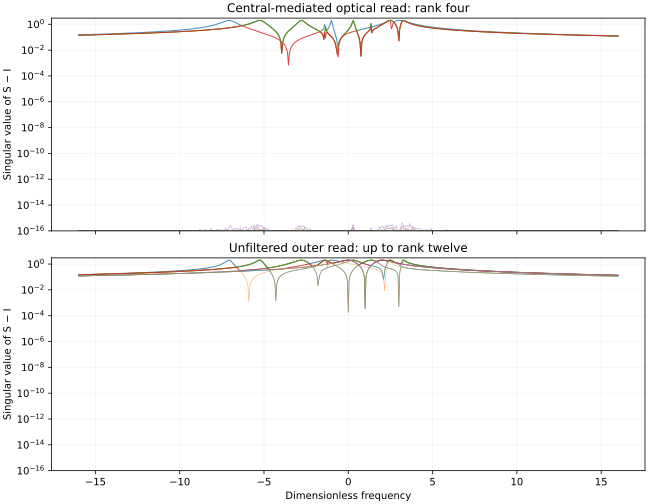

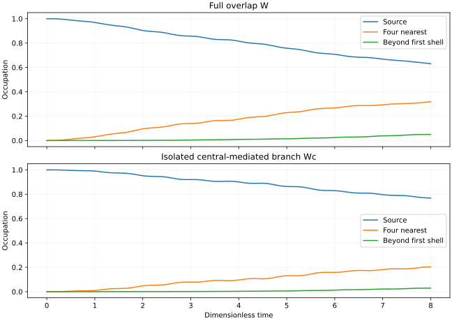

108 new assertions; 3,873 earlier recorded assertions retained, not rerun; 3,981 cumulative.

## Unified research — Hadamard–Flower field dynamics

**[Read the unified technical synthesis](UNIFIED_HADAMARD_FIELD_DYNAMICS.md)** · [New network verifier](verify_unified_flower.py) · [316 passing checks](unified_flower_verification_output.txt).

One complete stellated octahedron per field, eight constituent vortices, one directional Field Origin and four reciprocal external ports. The exact Flower Triforce area matrix is now embedded into the 36-coordinate vortex Hamiltonian. A conservative network of 54 complete fields (1,944 amplitudes) propagates an eight-ring state beyond its nearest neighbours, preserving the local occupation ledger. The original cubic-centre/junction lattice and overlapping-origin diamond model are distinguished; 12 total neighbours with 4 active and 8 inactive remains open. Nuclear capture remains a separate nonlinear research target.

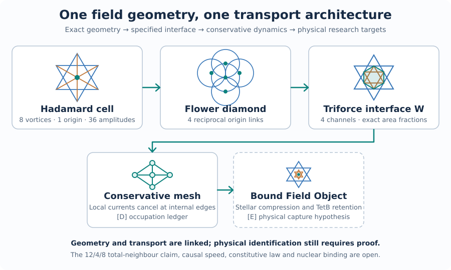

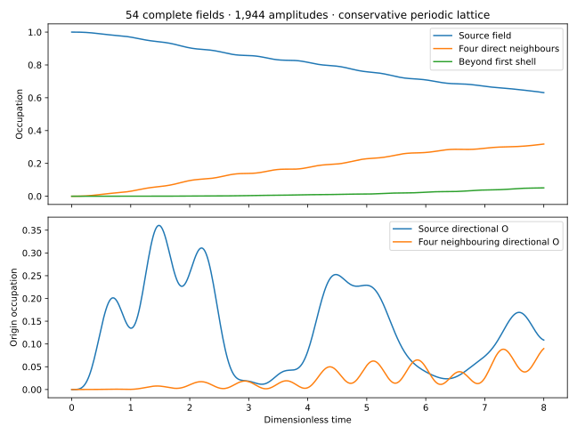

The 316 new checks pass; 3,557 earlier recorded checks are retained, not rerun (3,873 cumulative).

## Earlier result — corner-first packing theorem

[Exact corner-first packing proof](CORNER_FIRST_PACKING.md) · [Verifier](verify_corner_first.py) · [43 passing checks](corner_first_verification_output.txt).

With four prescribed regular Hadamard tetrahedral contacts, at most eight congruent, rigid, non-overlapping spheres can touch the central sphere. Four active and four complementary contacts attain this bound. The earlier FCC 12/4/8 graph is a distinct construction and cannot have four exact tetrahedral contact directions. GFD's overlapping closure envelopes or other adjacency rules remain possible research directions; the physical port selection has not been derived.

> **New geometric extension:** [Whole-field four-port packing](FOUR_PORT_PACKING.md) models each FCC node as one complete stellated octahedron, with twelve geometric neighbours and explicit reciprocal four-of-twelve selectors. Includes the [rotatable packing explorer](four_port_packing_explorer.html), exact limitations and 348 fresh checks.

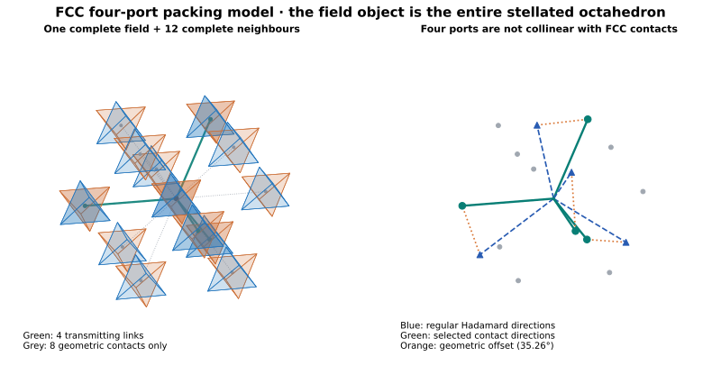

> **Current edition — Stage IX.** [Coupled directional Field Origins](COUPLED_FIELD_ORIGINS.md) extends the eight-vortex Triforce graph with a scalar and polar triplet at O, matches two identical cells across an actual four-tile face, proves exact interface conservation and integrates full neutral axial back-reaction. A closed pair exchanges occupation but cannot sustain indefinite one-way drainage. Stage VIII remains the driven open-boundary witness; all 2,737 earlier checks have been rerun and 115 new checks pass.

> **Next research direction — stellar-forge binding [E].** [Bound Field Capture](BOUND_FIELD_CAPTURE.md) distinguishes ordinary conservative propagation from capture of a complete Hadamard cell through the receiving Field Origin into TetB, with mutual vortex back-reaction. This is a research specification, not an additional validated stage.

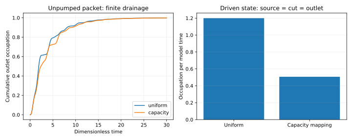

*Gravity Field Dynamics (GFD) · Field Dynamics Research · November 2026 · Illustrated synthesis and reproducible mathematical research*

**One Hadamard null cone. Eight constituent vortex stellations. One emergent collective octahedral circulation.**

The starting point of GFD is the dual-tetrad geometry: TetA and TetB interlock to form the stellated octahedron inside the Hadamard cube. The eight constituent vortices are the eight stellations themselves, one on every triangular face of the octahedron. The central core vortex is their collective response, not an extra oscillator inserted into the geometry. This document explains how the Triforce subdivision supplies the mechanism, what has been proved about the corresponding finite graph, and which physical questions remain open.

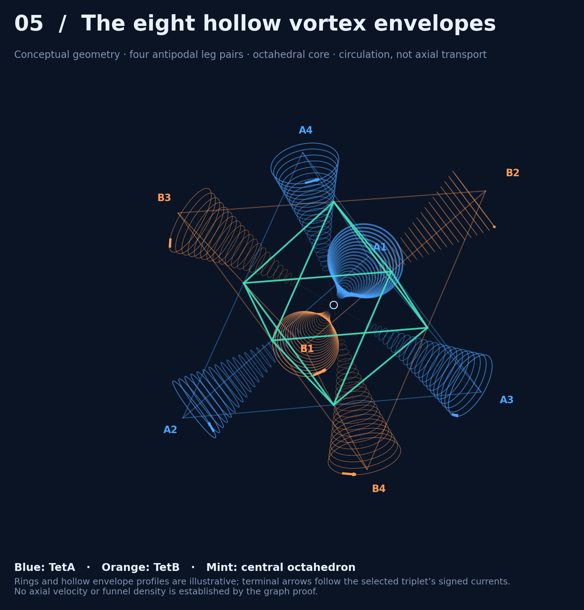

*Conceptual rendering of the integrated geometry. Funnel profiles and axial through-flow are not derived by the current graph theorems.*

**Start here:** read this synthesis, then open the [exact dynamics explorer](sustained_explorer.html) locally in a browser. For rotatable geometry and Walsh/current controls, open the [geometry explorer](explorer.html). GitHub renders the Markdown and static figures; serve the HTML through GitHub Pages or the documentation site for browser interaction. Both explorers are standalone.

## 1. Geometry: why there are eight constituent vortices

[T] In the specified geometry, the cube has eight corners \(s=(\pm1,\pm1,\pm1)\), split by the sign of \(xyz\) into two four-corner tetrahedra. Their common octahedron is

$$|x|+|y|+|z|\le 1.$$

For each sign triple \(s\), its triangular face has vertices \(s_x e_x,s_y e_y,s_z e_z\) and outward normal \(s/\sqrt3\). The cube corner \(s\) is the apex of the corresponding stellation. There is a one-to-one correspondence between the eight Hadamard directions, eight triangular core faces and eight stellations.

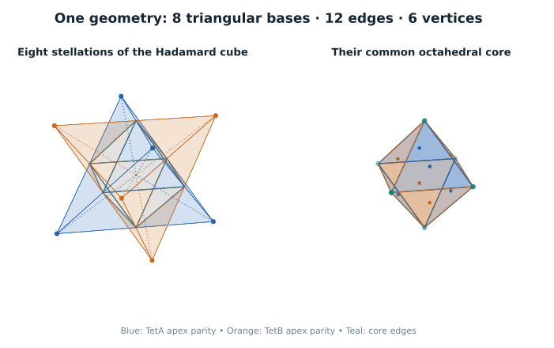

The count of six octahedral **vertices** is not the count of vortices. Three core axes, with two orientations each, describe possible directions of collective axial circulation in some solutions. There are always eight geometric stellation locations. The research begins at these eight faces, not with a chosen core axis.

### The Triforce is the surface subdivision of this same geometry

Each original tetrahedron has four triangular faces. Each is subdivided by its edge midpoints into three outer corner triangles and a medial (central) triangle. Both tetrahedra together supply 24 outer tiles and eight central tiles. The medial triangles are exactly the triangular faces of the shared octahedron.

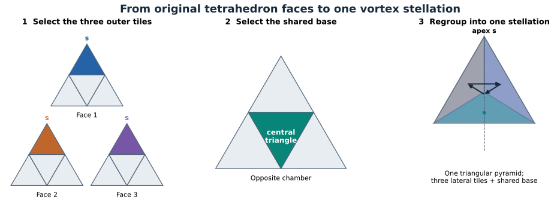

*The three differently coloured lateral tiles in the diagram come from three original faces meeting at the same apex. The base is the central triangle from the opposite tetrahedron. Colours distinguish tile provenance here, not TetA/TetB. The ring arrows connect actual lateral tile centroids; they illustrate the local circulation cycle, not a computed trajectory.*

An original Triforce face is **not** one complete stellation. It contributes its three outer tiles to three different stellations. Conversely, one stellation takes a single outer tile from each of three original faces. The fourth component, its base, is the opposite chamber's central triangle. This regrouping is what links local threefold windings to collective inner coupling.

| Geometry | Count | Role in the finite model |
|---|---:|---|
| Original tetrahedral faces | 8 | Eight Triforce subdivisions |
| Lateral tiles | 24 | Three per stellation; eight circulating rings |
| Central tiles | 8 | Shared octahedral interface |
| Centre O | 1 | Central coupling site |
| Total sites | 33 | Full Triforce Hamiltonian |
| Graph bonds | 104 | All retained in the explicit sustained solution |

The identification of the Hadamard cube with the local null cone is the GFD physical premise. The finite geometric correspondence above is exact; it does not by itself establish the physical discreteness of spacetime.

## 2. One tile network, two simultaneous readings

[T] In either chamber, label an outer tile \(X_{ij}\), where \(i\) names its apex and \(j\) names the original tetrahedral face by its opposite vertex. The diagonal is absent. The 12 entries are arranged as

$$X=\begin{pmatrix}0&X_{12}&X_{13}&X_{14}\\X_{21}&0&X_{23}&X_{24}\\X_{31}&X_{32}&0&X_{34}\\X_{41}&X_{42}&X_{43}&0\end{pmatrix}.$$

- Read a **row**: three tiles meeting at an apex, forming a local vortex ring.
- Read a **column**: three tiles belonging to an original Triforce face, coupling to its medial triangle.

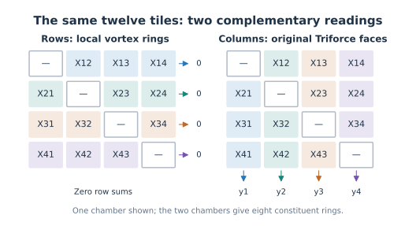

A pure local threefold winding has phase pattern \((1,\omega,\omega^2)\), with \(\omega=e^{2\pi i/3}\). Its row sum vanishes since \(1+\omega+\omega^2=0\). Its column contributions need not vanish. Thus a closed local winding can still excite the central triangles collectively.

Let \(R,Q\) be row and column sum maps, and \(P=I-R^TR/3\) the projector onto zero-row-sum patterns. The exact identity

$$QPQ^T=\frac83I_4-\frac23\mathbf1\mathbf1^T$$

shows that the column read has rank three on the local winding space. The uniform scalar is dark; the three nonconstant directions can couple into the central tiles. No independent core amplitude is imposed by this algebra.

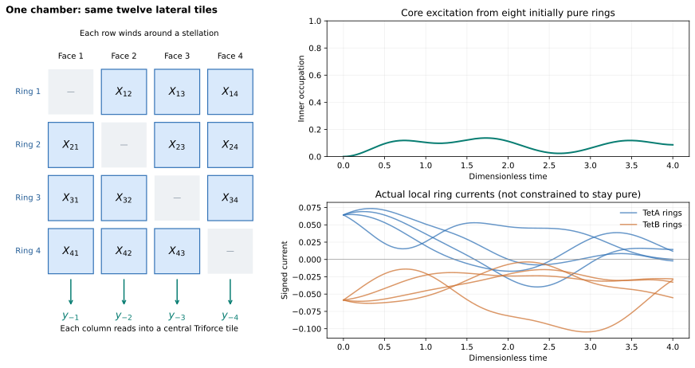

**The key idea:** the same Triforce tiles that form the individual vortices also transmit their collective phase information into the Field Origin.

## 3. Three distinct results — from possibility to sustained circulation

### A. All eight pure local windings can coexist, but the core can stay dark

[T] The face-first proof constructs stationary, symmetry-locked states with eight pure threefold local windings. A particular E-sector state has nonzero ring currents on all eight stellations, opposite outward senses between chambers, and a nonzero *registered* parity circulation. Its actual inner site amplitudes remain zero.

This is a useful counterexample: the existence of eight vortices does not alone force physical core excitation. The relative phases matter. A current assigned to the core by a registration map is not necessarily a current flowing on an actual inner bond.

### B. Eight local windings can generate actual core currents

[T] If the initial column read is nonzero, the Hamiltonian couples the eight outer rings to the central triangles. With inner amplitude initially zero and \(H_{io}\) the block of the Hamiltonian mapping outer amplitudes to inner amplitudes,

$$\|y(t)\|^2=t^2\|H_{io}\psi_0\|^2+O(t^3).$$

The face-first suite verifies both the exact initial growth coefficient and finite numerical examples with actual central shared-edge currents. No axis is imposed as an extra degree of freedom. This result alone does not prove that the eight rings remain circulating indefinitely.

### C. Eight circulating rings and the core can coexist indefinitely

[T, conditional] The sustained-flywheel theorem resolves that question for a particular conservative Hamiltonian, with all 104 bonds nonzero. It provides both an exact trajectory starting with an empty core and a separate stable stationary configuration with the core already occupied. The dynamical input is an open family of coordinated, circulating ring patterns, generally mixtures of the two local C3 helicities, not eight simultaneous pure single-helicity eigenvectors.

## 4. The sustained-flywheel theorem, in plain language and equations

Write the four TetA corners as \(s_i\), and the TetB corners as \(-s_i\). Choose a complex spatial phase coordinate \(z\) of unit norm and set \(q_i=s_i\cdot z\), so \(\sum_iq_i=0\). This is a convenient coordinate read of the outer tiles, not an additional oscillator. In the inversion-even sector, the amplitudes on the existing sites can be written

$$X_{ij}^{\pm}=\rho(uq_i+vq_j),\qquad y_i^{\pm}=\rho wq_i,\qquad \rho=\sqrt3/8,$$

with the centre O dark. Their row and column sums are \(\rho(3u-v)q_i\) and \(\rho(3v-u)q_j\). Start with \((u,v,w)=(1/3,1,0)\): local rows close, columns are nonzero, and the core is empty. The initial phases determine chirality \(\mathbf C=-i\bar z\times z\); the model does not create chirality out of nothing.

The six bond classes (ring, cross-chamber transpose, base, original-face centre, central shared edge, centre link) have the witness weights \((-1,-1/2,-2,-1,-1,-1)\); outer and centre site energies are zero and central energies are \(-99/10\). These dimensionless choices were made for exact solvability, not derived from the physical GFD action. Direct bond summation gives the exact invariant restriction

$$i\frac{d}{dt}\begin{pmatrix}u\\v\\w\end{pmatrix}=\begin{pmatrix}-2&1/2&-2\\-1/2&1&-1\\-5&-1&-89/10\end{pmatrix}\begin{pmatrix}u\\v\\w\end{pmatrix}.$$

This matrix is self-adjoint in the positive induced metric \(G=\left(\begin{smallmatrix}3&-1&0\\-1&3&0\\0&0&1\end{smallmatrix}\right)\); the original 33-site Hamiltonian is real symmetric. Hence total occupation and energy are conserved. At the starting instant \(i\dot w=-8/3\): the outer state immediately excites the inner triangles.

### The eight outer rings persist

For the given model, the outward-oriented mean current around the ring with normal \(s\) is

$$j_s(t)=\frac{|v(t)|^2}{16}\,s\cdot\mathbf C,\qquad |v(t)|\ge\frac{73}{77}.$$

Every one of the eight rings therefore retains its signed mean circulation if \(s\cdot\mathbf C\ne0\) for every face. The detailed proof gives a stronger sufficient inequality, \(\min_s|s\cdot\mathbf C|>0.734465\ldots\), ensuring that **each of the 24 actual ring bonds** retains its direction for all time. This holds on an open set of input orientations, not only at a coordinate axis.

### The core is a generated circulating current

The 12 central-to-central bonds, with their actual graph currents (no outer-current projection included), form a conserved circulation on the central tile adjacency graph. The angular current moment is

$$\boldsymbol{\mathcal L}_{\rm inner}(t)=-\frac{|w(t)|^2}{6}\mathbf C.$$

The three exact eigenfrequencies are \(11/10,-11/2-\sqrt{22},-11/2+\sqrt{22}\). For the specified initial state, the exact spectral coefficients and irrational gap ratio imply \(w(t)\ne0\) for every finite \(t>0\). Therefore, in the stated open family, all eight outer rings and a nonzero inner circulation coexist for all positive time. The inner amplitude may approach zero arbitrarily closely by recurrence. There is no uniform positive lower bound on its magnitude, nor a dissipative attractor.

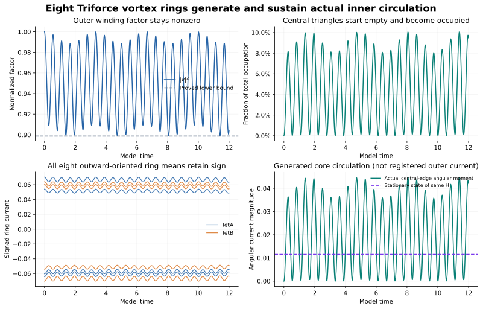

*Calculated trajectory of the explicit graph Hamiltonian, in dimensionless model units. The separate stationary solution is not an asymptotic endpoint of this unitary trajectory.*

### A stable stationary eight-ring/core configuration

The same Hamiltonian admits the eigenvector \((u,v,w)=(1/3,1,-4/15)\), after normalization. Its inner occupation is exactly \(2/77\); all eight outer rings and the inner angular current coexist indefinitely. The stationary wave has exact linear orbital stability because unitarity preserves the distance from its trajectory:

$$\|\psi(t)-e^{-i\lambda_0t}\psi_*\|=\|\psi(0)-\psi_*\|.$$

Strict nonzero-current margins then imply that sufficiently small perturbations of **any of the 33 complex amplitudes** retain the eight directed rings and nonzero inner moment. This is not a theorem of nonlinear stability for the physical Field Origin.

**[Explore the exact generation and stationary solutions](sustained_explorer.html)** · [Read the full theorem and derivations](SUSTAINED_TRIFORCE_FLYWHEEL.md).

## 5. The supporting algebra: why the construction fits together

The earlier stages are not separate physical mechanisms. They establish the algebraic foundation and its limitations.

| Result | Meaning |
|---|---|
| \(LD=0,\ D^TD=3I-A_{\rm cube}\) | [T] The oriented boundary map from eight faces to 12 octahedral edges conserves current; its Gram operator is the Hadamard cube Laplacian. |
| \(\operatorname{im}D=\ker L\), rank seven | [T] All conserved core-edge currents have an eight-face ledger, unique up to a constant. There are two axial triplet sectors and one parity singlet. |
| \(w_Aw_B=w_{A\triangle B}\) | [T] Full eight-mode Walsh multiplication is associative. Discarding the constant and projecting each product back into the seven-mode space breaks associativity. |
| Hodge–Dirac operator | [T] Its squared blocks unify vertices, edges and faces; exact spectrum in the [core hardening proof](archive/stages-I-VI/CORE_HARDENING.md). It is a discrete geometric operator, not a derived relativistic wave equation. |
| Torsion and spin holonomy | [T] The circulation parity singlet has a unique symmetry-level map (up to scale) to torsion's sign representation. The full nonzero Hodge–Dirac sector is *not* the torsion representation. The spin transport Laplacian is distinct from the scalar Walsh Laplacian. |
| Nonlinear candidates | [T, conditional] Geometric quartic energies admit stable axial or face-oriented circular states depending on energy coefficients. A quadratic E harmonic receiver permits parity circulation, but its coupling is not physically derived. These are subsidiary stability and selection theorems, not a proof of nonlinear eight-ring/core coexistence. |
| Fine-to-coarse registration | [T] The exact 33-site-to-core chain map preserves divergence. Symmetry and flux constraints leave 16 degrees of freedom; Whitney integration with specified paths and a minimum-norm central rule selects the earlier map conditionally. Eliminated amplitudes can require a memory kernel. |

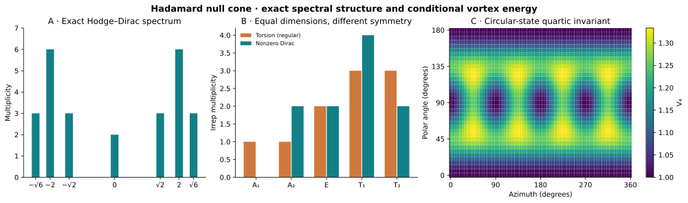

The key distinction is between the registered core-edge current of the six-vertex octahedron and the **actual central-triangle bond current** in the 33-site model. The latter is calculated directly in the sustained theorem. Their divergence-preserving relation does not make the two Hamiltonians dynamically identical.

## 6. Connection to GFD and Distributed Field Processing

[D / existing framework premises] Every Field Object settles and registers its own field, whether drained or drainless; ownership is single-valued even when closures overlap. Larger objects read registered boundary states rather than reopening smaller objects. The mountain-scale and closure-surface proofs establish results about this composition under stated premises. The new Triforce work supplies a microscopic finite-algebra candidate for phase-dependent coupling and conservative registration, not yet a derivation of the macroscopic settlement or stagnation-surface rule.

Use the terminology in [llms.txt](https://github.com/fielddynamics/research/blob/main/llms.txt):

| Symbol | Meaning |
|---|---|
| \(\mu(x)=x/(1+x)\), \(x=g_t/a_0\) | Constitutive law; selected in the existing proof under exchange, screening and acceleration-strength premises. |
| \(\sigma(x)=(x-1)/(x+1)\) | Continuous share difference, not the discrete structural state. |
| \(f(K,s)=1+sK+K^2\), \(K=4\) | Structural coupling polynomial, with values 21, 17, 13. |
| \(f(x)=(21x+13)/(x+1)\) | Capacity function. |
| \(F(y)\) | Kinetic functional. |
| \(g_s=g_t^2/(a_0+g_t)\) | Spherical field equation. |
| SST | The full four-term covariant action only. |

[E] Neither graph circulation nor the parity cycle establishes through-flow or a TetB drain. The constitutive law applies to a field with a drain, not a drainless object's own internal field. No new derivation of the constitutive law, Newton's constant, the SST or the spacetime continuum is claimed here. The graph coefficients are mathematical witness parameters, not new fitted galactic parameters.

## 7. What is now established, and the next decisive theorem

**Established:** the exact face/stellation correspondence; the Triforce row/column duality; eight pure stationary rings in a dark-core configuration; phase-dependent generation of inner occupation; an explicit all-bond Hamiltonian with persistent eight-ring and inner circulation; a separate stationary state stable under unrestricted small initial-amplitude perturbations.

**Open at Stage VII (see Stages VIII–IX below for subsequent conditional results):** physical selection of the Hamiltonian and relative phases; unrestricted nonlinear stability of all eight rings and their core together; a mechanism selecting a circulating state from more general initial conditions; derivation of through-flow and a drain marker; a connection between neighbouring null cones and physical compositional registration. In particular the explicit generation trajectory is not a proof of exact simultaneous pure single-helicity winding on all eight rings. The next strong result would derive a nonlinear interaction from independently justified premises, demonstrate coexistence and orbital stability in the full 33-site space, and determine whether the dynamics select the physical phase pattern without putting it in by hand.

## 8. Research archive and verification

The following files retain all nine validated stages of the research. Some early statements of open work were superseded by later stages; use the current entry points below for the latest status.

| Stage | Mathematical proof / research notes | Recorded checks |
|---|---|---:|
| I | [Technical foundation, Part I](archive/stages-I-VI/TECHNICAL_FOUNDATION.md#part-i--the-hadamard-null-cone-and-the-stellated-octahedral-vortex-flywheel) | 501 |
| II | [Technical foundation, Part II](archive/stages-I-VI/TECHNICAL_FOUNDATION.md#part-ii--conservative-current-registration-and-nonlinear-core-harmonics) | 483 |
| III | [Extended validation](archive/stages-I-VI/EXTENDED_VALIDATION.md) | 211 |
| IV | [Core hardening](archive/stages-I-VI/CORE_HARDENING.md) | 170 |
| V | [Face/core clarification](archive/stages-I-VI/FACE_CORE_CLARIFICATION.md) | 132 |
| VI | [Triforce flywheel](archive/stages-I-VI/TRIFORCE_FLYWHEEL.md) | 271 |
| VII | [Sustained Triforce flywheel](SUSTAINED_TRIFORCE_FLYWHEEL.md) | 809 |
| VIII | [Open directional throat](OPEN_THROAT.md) | 160 |
| IX | [Coupled directional Field Origins](COUPLED_FIELD_ORIGINS.md) | 115 |
| | **Cumulative recorded assertions** | **2,852** |

These are recorded passing assertions across stages, not independent theorems. All nine scripts passed in the Stage IX rerun; this illustrated edition does not rerun or increase that count. [Verification guide and logs](VERIFICATION.md) · [Lean draft audit](archive/stages-I-VI/LEAN_DRAFT.md). Lean has not been compiled; no [T+L] claim is made for these new results.

### Upstream dependencies

The existing GFD [proof index](https://github.com/fielddynamics/research/tree/main/proofs), [Hadamard frame](https://github.com/fielddynamics/research/tree/main/proofs/hadamard-cube-frame), [Walsh eigenmodes](https://github.com/fielddynamics/research/tree/main/proofs/walsh-eigenmodes-of-the-cube), [Triforce synthesis](https://github.com/fielddynamics/research/blob/main/research/faces/enterprise_triforce_synthesis.md), [vortex theorem](https://github.com/fielddynamics/research/tree/main/proofs/vortices-of-the-stellated-octahedron), [chiral holonomy](https://github.com/fielddynamics/research/tree/main/proofs/chiral-holonomy-closed-frame), [torsion representation](https://github.com/fielddynamics/research/tree/main/proofs/torsion-regular-representation), [mountain scale](https://github.com/fielddynamics/research/tree/main/proofs/sst-mountain-scale) and [closure surface](https://github.com/fielddynamics/research/tree/main/proofs/closure-surface) provide the framework context. The proof archive records the premises and caveats for each connection.

## Current research entry points

- [Stage VIII proof](OPEN_THROAT.md) and [verifier](verify_open_throat.py).
- [Stage VII closed proof](SUSTAINED_TRIFORCE_FLYWHEEL.md) and [verifier](verify_sustained_flywheel.py).
- [Historical synthesis and Stages I–VI](archive/stages-I-VI/README.md) (includes the historical Stage VII snapshot for reproducibility).
- [Verification guide](VERIFICATION.md).

## Stage IX — matched-face transport

[Coupled Field Origins proof](COUPLED_FIELD_ORIGINS.md) · [Two-cell explorer](coupled_origins_explorer.html) · [Verifier](verify_coupled_origins.py) · [Fresh verification logs](VERIFICATION.md).

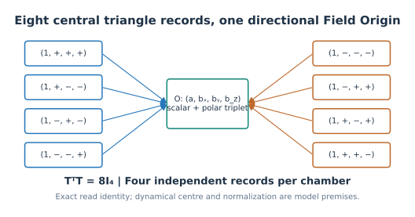

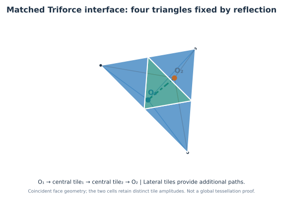

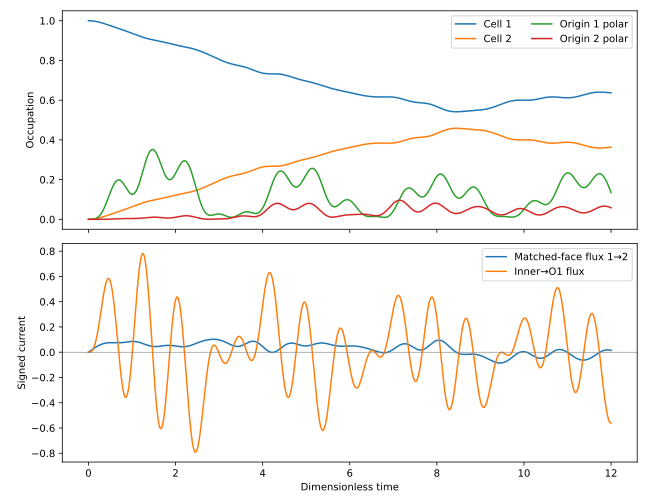

## Stage X — illustrated bound-field research specification [E]

[Read the bound-field capture and nuclear-paper connection](BOUND_FIELD_CAPTURE.md). These figures represent the next research direction, not a completed capture theorem.

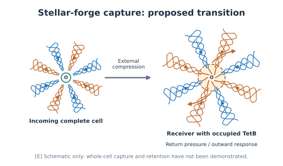

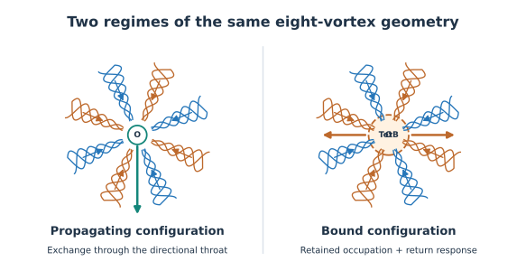

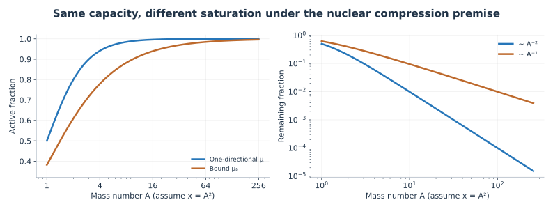

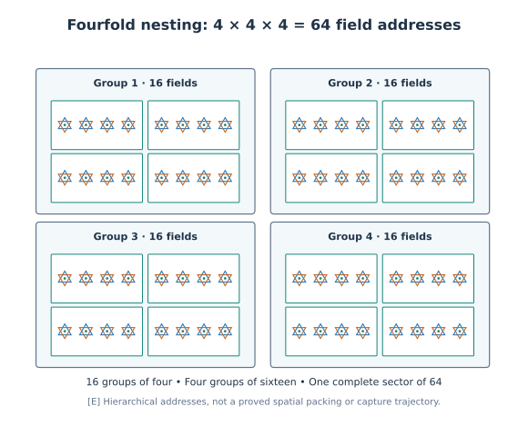

[Illustration index and regeneration instructions](VISUAL_INDEX.md).

## Hadamard–Flower of Life extension — geometric lattice model

[Exact proof and scope](HADAMARD_FLOWER_LATTICE.md) · [Interactive explorer](hadamard_flower_explorer.html) · [Verifier](verify_hadamard_flower.py).

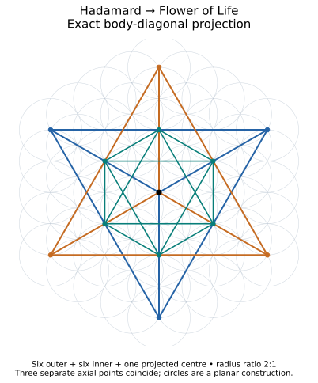

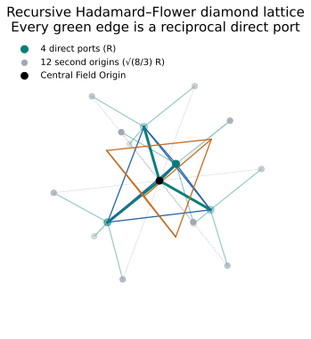

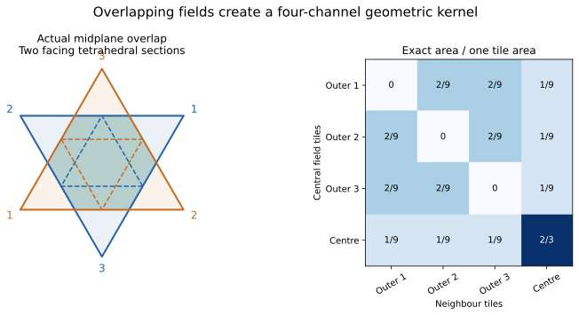

The corner-origin diamond lattice preserves four regular Hadamard ports per complete field. It has twelve second neighbours, not eight. The overlap cross-section supplies an exact rank-four area matrix, whose use as a Hamiltonian coupling is a separate model assumption. The 13 projected positions are not a count of physical neighbours. See the proof for the separate solid, sphere and Voronoi neighbour counts.
