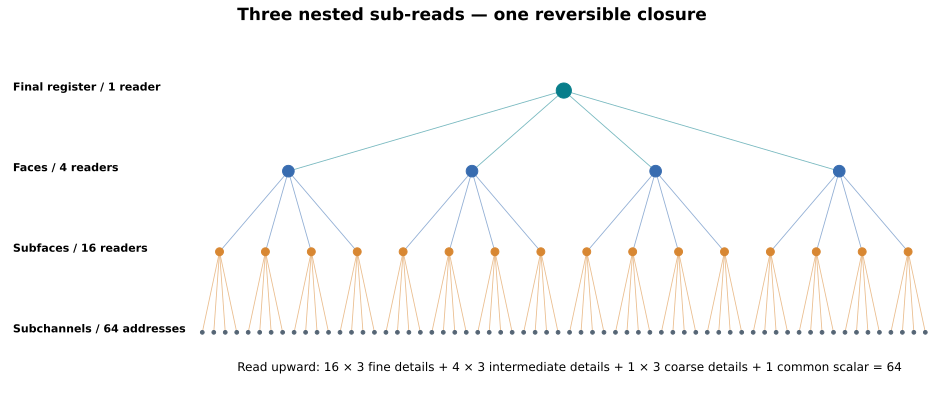
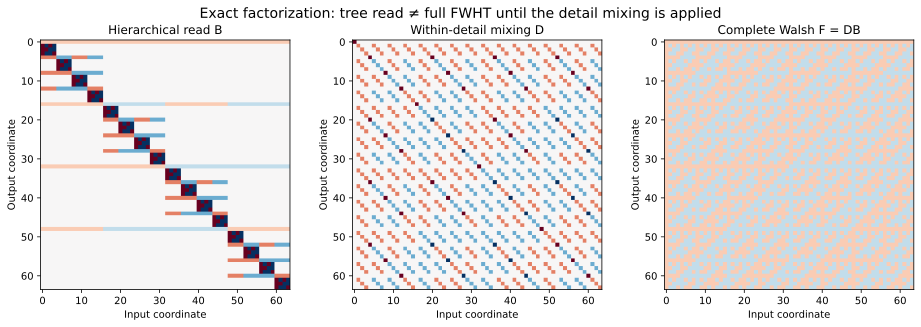

# Three sub-reads of one closure engine

*GFD Standard Field Model · November 2026*

**Status:** [T] exact finite-dimensional identities; [D] consequences of the specified candidate Hamiltonian and read operations; [E] autonomous implementation, physical grading, attenuation and gravitational registration. No new physical constants or fitted G. SST denotes only the full covariant action. One whole stellated octahedron per field.

## 1. Face, subface, subchannel

The proposed architecture reads four original faces, four Triforce tiles per face and four algebraic subchannel addresses per tile. The last index is a **candidate record index**, not a proved new physical subdivision of a triangle. One chamber's 16 tiles do not replace the dual-tetrad solid or its 36 complex coordinates. Addressing proceeds down the hierarchy; reversible aggregation proceeds upward.

Let the coherent address ledger be x[a,b,c], a,b,c in {0,1,2,3}. Use h=H4/2, the orthogonal four-point Walsh matrix. At each node retain its common mode and three differences. The first aggregation acts on c in all 16 subfaces, retaining 48 fine details. The second acts on b in the four common-mode branches, retaining 12 intermediate details. The third acts on a and retains 3 coarse details and the final scalar. Thus there are 21 four-way readers, 63 differences and one scalar. This is an exact reversible multiresolution transform B, not merely a count:

$$64=1+3+12+48=1+3(1+4+16).$$

The common scalar is the sum of all 64 records divided by 8. Every address can be reconstructed with B transpose. An ideal static snapshot or coherent reference to a single time is required; the pi walk cannot simply combine evolving records from unrelated times. The addressing direction is face → subface → subchannel; the mathematical return read is subchannel → subface → face. This does not identify three physical time intervals or a Compton clock.

## 2. Exact relationship with full FWHT [T]

Define B1=h on every last digit; B2=h on the b digit only where the last digit is zero; B3=h on the a digit only where both following digits are zero. B=B3 B2 B1 is orthogonal. Let D act as h tensor h on the first two digits at every nonzero last digit, and h on the first digit for nonzero middle digit with last zero. The exact relation, verified entry by entry, is

$$H_{64}/8=(h\otimes h\otimes h)=DB.$$

D only mixes detail coordinates within a scale; it is not an extra physical closure cycle. The tree alone requires 21 four-way transforms, whereas the full radix-four Walsh transform requires 16 transforms in each of three stages (48 total). Do not confuse the internal-reader count with the total number of FWHT arithmetic operations.

## 3. Threefold symmetry selects 21 invariant differences [T]

Pair the source and destination bits along each spatial coordinate as in [projective closure](PROJECTIVE_WALSH_G_BRIDGE.md). In the four-element digit alphabet encode the simultaneous XOR cycle by 0→0, 1→2→3→1. Let M act on all three digits and Q=(I+M+M²)/3. The full Walsh F obeys FM=M^T F and FQ=QF. In the tree basis the symmetry becomes BMB^T, also a permutation, preserving the four detail strata. The common coordinate is fixed. All three nonzero detail strata contain triples, with invariant dimensions 3/3=1, 12/3=4, 48/3=16. Thus the same 21 count is the exact dimension of the invariant **contrast** space after one common scalar has been separated.

The triples can cross local reader groups; one cannot identify each orbit with a single physical reader by counting alone. The flag used to name the middle 4-level stratum is a choice; a cyclic permutation of spatial coordinate factors preserves Q but not the middle-grade projector. This rules out deriving the chamber-sensitive middle grade from the abstract symmetry alone. Retain the zero/mean mixing of the projective FWHT; the original 21 projective nonzero-address coordinates are not closed under F without the zero address.

## 4. A native core operator ledger [T/D]

The [native Walsh study](NATIVE_WALSH_READ.md) reconstructs the eight complex central triangle amplitudes z from four coherent port histories of the existing H36. This extension reuses seven samples spaced by dimensionless 0.9, with spectral-norm core reconstruction residual 3.57e-15. Phase-neutral closure can form rho=zz†. For each axis the elementary four observables are (I,X,Z,Y), and the complete operator basis is their three tensor factors. Write

$$p_{abc}=\operatorname{Tr}[(P_a\otimes P_b\otimes P_c)\rho],\qquad \rho=\tfrac18\sum_{abc}p_{abc}P_a\otimes P_b\otimes P_c.$$

For one 2x2 dyadic block the four outputs are diag sum, offdiag sum, diag difference and i times the offdiag difference. After dividing by sqrt(2), this is a unitary coordinate conversion of the four complex entries, implemented algebraically by two two-channel Hadamard butterflies, permutation and phase. Repeating along each paired bit gives the full 64-coordinate Pauli read. This is a **different transform from the real address FWHT**, though both use four-way factorizations. Six fresh trials reconstruct the exact core Pauli ledger from the seven coherent histories of arbitrary 36-coordinate initial states. This is a postprocessed coherent read, not an autonomous measurement circuit. It requires known H and coherent sample access. A pure core density has only 14 normalized real degrees of freedom (15 with variable norm), so the 64 ledger entries are not independently adjustable; a general mixed Hermitian matrix has 64 real coordinates. Neither ledger has yet been identified with the physical affine connection.

## 5. What rotates? [T/D]

For one binary axis define U=(I+i(X+Y+Z))/2. U is unitary, U³=-I, and conjugation cycles X→Z→Y→X with no signs. Applying U3=U tensor U tensor U implements precisely M on the 64 Pauli labels, including all 21 nonzero triples. Its eigenphase multiplicities are 2,3,3; its commuting operator space therefore has dimension 2²+3²+3²=22. The orbit average of rho is a genuine positive, trace-preserving operation:

$$\mathcal T(\rho)=\tfrac13\sum_{k=0}^2 U_3^k\rho(U_3^k)^\dagger.$$

For pure rho this mixture has rank at most 3. Its Pauli ledger is Qp. This is not an assertion that gravity performs irreversible dephasing; an actual coherent group read must retain the other 42 coordinates if full information is needed.

A physical 120-degree rotation of the stellated cube around a body diagonal has two fixed corners and two three-cycles. Its conjugation on the 64 core operators has invariant dimension (64+2*2²)/3=24, **not 22**. The Triforce's visible threefold rotation alone is insufficient to generate the proposed Pauli orbit symmetry.

The inherited H36 commutes with geometrical inversion; on its core inversion is XXX. U3 sends XXX to ZZZ, so U3 does not commute with inversion. Any compression of native free evolution to the core still commutes with inversion. Hence it cannot equal U3 for arbitrary inputs, even up to global phase. This is an exact obstruction, not a failure of numerical optimization.

A controlled realization on the actual 12 cube bonds is possible: set K3=-sum_j(X_j+Y_j+Z_j), with j over the three axes. These generators commute across axes; a single dimensionless pulse of duration pi/(3 sqrt(3)) produces U3. X and Y use existing bonds (Y requires oriented complex hopping), Z requires opposite on-site phase potentials. Isolating the core and implementing these controls gives zero leakage in the constructed pulse. This is [D] a candidate controlled implementation, not native dynamics. The next physical task is deriving the phase-odd hopping and onsite terms from vortex circulation or a dynamical reference frame while conserving the full engine energy. A state-selected rotation could break inversion in a sector without breaking symmetry of the underlying theory, but no such solution has been proved.

## 6. Why 21 attenuation factors could arise [D/E]

A specific symmetry-preserving optical contraction can be constructed without assigning different fitted coefficients to the 21 levels. Preserve the common scalar and multiply every orthogonal detail amplitude by t=sqrt(alpha). In input coordinates, with normalized common vector e=(1,...,1)/8,

$$J_\alpha=t I+(1-t)ee^T.$$

This commutes with Q. On all 64 records its eigenvalues are one and 63 copies of t. On the 22-dimensional invariant sector they are one and 21 copies of t. Therefore the squared determinant is alpha^21 on the reduced sector, versus alpha^63 on the full sector. Ordinary normalized contrast transmission is just alpha. A different, independently attenuated three-stage serial path would give alpha^3; that is not the operation calculated here. The contraction has an exact lossless orthogonal dilation with complementary reflected modes; no probability vanishes in the combined model.

The original GFD coupling polynomial is then represented by signed traces of the three invariant contrast blocks (1,4,16): f=1+4s+16. This obtains 21,17,13 from the tree and projective symmetry together, **given the middle-grade choice**. Negative s would entail gain if interpreted as a passive optical exponent in that block, so the TetB trace must not be equated with passive per-channel attenuation. The physical selection of the determinant rather than ordinary transmission, the per-contrast alpha coupling, the middle-grade assignment and the 17/13 mean/start normalization all remain open. No alternative G is introduced. The inherited tree-level target remains

$$G=(17/13)\alpha^{21}\hbar c/m_e^2,$$

with the proposed upstream loop factor 1+alpha/(2 pi). The electron closure equations and boundary register are retained, not re-derived here. An invariant contrast determinant is a collective volume (exterior-power) read, not a generic force amplitude. The figure deliberately distinguishes these.

## 7. Pi addressing and next derivation

The original [pi walk](PI_WALK_FWHT.md) addresses 64 ordered pairs with modular addition, not XOR. A fixed relabeling can address the 64 Pauli records; an actual field snapshot must transport values, not merely visit indices. The pi schedule covers all records at the previously recorded 332 fractional digits and the 22 quotient classes at 156. Neither is shown to be a physical period, nor does the native H generate BBP. The three sub-reads unify address resolution and the mathematical operator ledger; deriving an autonomous nonlinear or state-dependent core rotation, closure scheduling and physical registration is the next step. The native read and collective contraction must be linked to the existing weak-field settlement and conserved boundary energy, not asserted to be the same observable.

## Verification

Run `OPENBLAS_NUM_THREADS=1 OMP_NUM_THREADS=1 python verify_three_subreads.py`. See [log](three_subreads_verification_output.txt). 91 fresh assertions, 5,417 earlier recorded assertions preserved but not rerun, 5,508 cumulative recorded (not independent theorems). All five figures are generated by the verifier in SVG and PNG. No remote repository changes, empirical tests or new physical constants.
