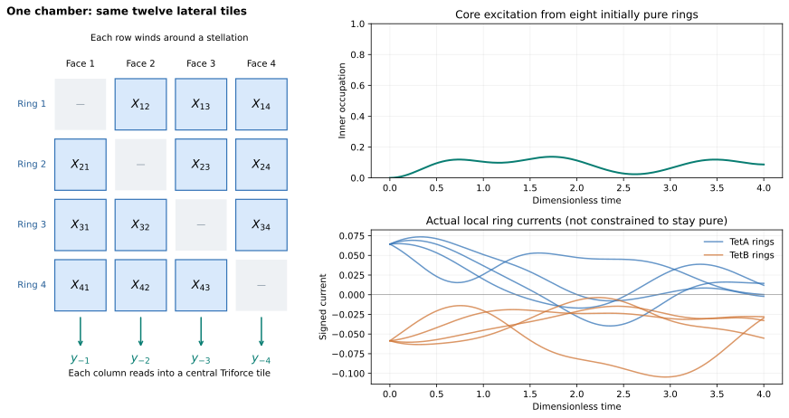

# The eight-vortex flywheel from the Triforce faces

*Field Dynamics Research · stage VI · [T] exact finite algebra and conditional graph dynamics; [E] physical selection and nonlinear stability remain open.*

The Hadamard null cone is the GFD field geometry. Its eight constituent vortices are its eight stellations, one on each triangular face of the common octahedron. No central axis is prescribed in this construction. We work with the actual 33-site Triforce graph of the existing vortex proof, not a collection of independent added oscillators.

Sources: [Triforce synthesis](https://github.com/fielddynamics/research/blob/main/research/faces/enterprise_triforce_synthesis.md), [Triforce vortex proof and correction](https://github.com/fielddynamics/research/blob/main/research/diamond-tetrad-lattice/triforce-vortex/PROOF.md), [consolidated vortex proof](https://github.com/fielddynamics/research/tree/main/proofs/vortices-of-the-stellated-octahedron), [Hadamard frame](https://github.com/fielddynamics/research/tree/main/proofs/hadamard-cube-frame), [Walsh eigenmodes](https://github.com/fielddynamics/research/tree/main/proofs/walsh-eigenmodes-of-the-cube), [framework terminology](https://github.com/fielddynamics/research/blob/main/llms.txt).

## 1. [T] Two complementary readings of the same 24 lateral tiles

Let `s,t` be distinct vertices of a single chamber, with coordinates in the parity class of the Hadamard cube. The tile `X_st` lies at apex s on the original tetrahedron face opposite t. It is a lateral face of the stellation at s. Its vertices are s and the midpoints of the edges joining s to the two vertices other than s,t. The central tile of the original face opposite t is the base of the opposite chamber's stellation at −t. The base of the stellation at s has the three vertices `(s+u)/2` for u ≠ s in the same chamber. It is itself a central Triforce tile of the opposite tetrahedron.

Each chamber's outer tiles form a 4×4 off-diagonal array: 12 tiles. A row contains the three lateral tiles of one stellation; a column contains the three outer tiles of an original tetrahedron's Triforce face. The fourth tile of that original face is its central tile. Across the two chambers there are 24 outer, eight central and one centre sites. This is a geometric indexing of tiles, not a claim that there are 24 independent physical coupling constants.

Define row and column sum maps R,Q on the 12 coordinates of a chamber. The row-sum-zero subspace is precisely the space of local threefold winding amplitudes (both senses), with orthogonal projector `P=I−RᵀR/3`. The exact Gram identity is

$$QPQ^T=\frac83 I_4-\frac23\mathbf1\mathbf1^T.$$

Indeed RRᵀ=QQᵀ=3I and QRᵀ=J−I. Consequently QP has three nonzero singular values, all √(8/3), and a five-dimensional kernel within the eight-dimensional row-winding subspace. Both chambers together give 16 local winding coordinates, six bright and ten instantaneously dark coordinates. The terms bright and dark refer here to immediate inner excitation, not necessarily to invariant dynamics. This rank concerns complex amplitudes, not a count of vortices.

## 2. [T] The actual graph gives the face-to-core excitation rule

Each outer tile X_st is coupled to exactly two central tiles in the published edge-sharing graph: the base at s, and the original face's central tile at −t. Let their coupling constants be h_cross and h_same respectively, uniform within the corresponding bond orbit. The direct contribution of the winding amplitudes of chamber A to central tiles is thus

$$i\dot y_s=h_{\rm cross}\sum_{t\ne s}X_{st}+\cdots,\qquad i\dot y_{-t}=h_{\rm same}\sum_{s\ne t}X_{st}+\cdots.$$

The omitted terms include the other chamber and already-present central amplitudes. On pure local winding the first sum vanishes. The second need not vanish. This is the exact bridge from the three spatial tiles of every constituent vortex to the gravitational central sub-channel of each original Triforce face. A simple independent-ring picture would miss the column coupling.

The code checks all 24 tile-to-inner adjacency relations, the exact rational Gram matrix and the actual weighted Hamiltonian derivative for twelve independent symmetry-preserving parameter sets. If the inner sites start empty, Schrödinger evolution gives

$$\|y(t)\|^2=t^2\|H_{\rm inner,outer}\psi_0\|^2+O(t^3).$$

The origin site remains dark in this linear evolution because the row-winding sector has no trivial representation component; the eight central tiles may become occupied. The reported current on their mutual edges is actual bond current, not just a projected quantity.

## 3. [T] All eight constituent rings winding at once, without choosing a central axis

On each ring choose its outward cyclic ordering and local Fourier modes `(1,ω,ω²)/√3` and its conjugate, ω=e^(2πi/3). The eight rings partition the 24 outer tiles, so these sixteen vectors are orthonormal. A real nearest-ring hopping h gives a nonzero signed ring current of magnitude |h|/√3 per unit ring occupation for a pure winding, using the current convention of the published corrected vortex theorem.

Take the first positive winding vector in TetA and transport it to the other three TetA rings by the four even sign flips (the Klein four subgroup). Sum and divide by two. Call this normalized vector e_A. Spatial inversion maps it to e_B, on the four TetB rings with opposite outward handedness. Inversion is a geometric relabeling, not assumed to be a symmetry of the Hamiltonian. The cyclic coordinate permutation acts on both vectors by the same nontrivial cube-root phase. They span one of the two conjugate character subspaces of the proper tetrahedral group (the E sector of the full tetrahedral group). The two columns and their conjugates exhaust the four-dimensional E isotypic subspace. Since the inner site representation has no E, the two complex columns remain in their subspace under every real Td-invariant Hamiltonian. On it the Hamiltonian reduces to a Hermitian 2×2 chamber matrix. Its eigenstates have all eight rings in pure local winding when both chamber coefficients and the within-ring hoppings are nonzero. The proper rotations equate the four ring strengths per chamber; inversion gives opposite outward winding conventions. Time reversal conjugates the entire state.

The physical registered core current of these stationary states is divergence-free and lies in the A2 parity-cycle line. Proof: the state transforms by a phase under proper rotations, so its bilinear current is invariant under them; the only proper-rotation-invariant line in the seven-dimensional cycle space is A2. Its coefficient need not be nonzero for arbitrary couplings. In 24 stationary states (two branches of twelve Hamiltonians), every ring and the parity registration were nonzero. Crucially **all inner amplitudes vanish in these states**. The nonzero registered parity circulation is a boundary accounting of the outer currents, not proof of occupation or actual currents between inner sites. Perfect phase locking of this particular symmetry type is dark to inner excitation.

## 4. [T] Core excitation from eight initially pure local vortices

Start with eight pure local windings of equal occupation, four in each outward sense as above, and independent relative phases. No core axis or core amplitude is imposed. In twelve tested phase/coupling examples all eight initial ring currents were nonzero. The weighted column sums excite the central tiles with the exact short-time coefficient above. The numerical coefficient ranged from 0.615857 to 1.029469 in arbitrary model units. At time 0.25 the central tiles carried nonzero actual shared-edge currents, and the fine/coarse continuity law held. The example time series is in `triforce_dynamics.csv`; the plotted principal/complementary/parity components of registered current include any instantaneous gradient part only through their orthogonal cycle projections. Their values are not asserted to be stationary; the individual local rings need not remain pure windings.

The two cases are complementary: the fully symmetry-locked E state realizes eight simultaneous stationary pure rings with a dark physical core; phase choices with a nonzero column read actually excite the core. The latter is not yet a proof of stable simultaneous winding and central circulation indefinitely. Symmetry allows the former state to remain dark exactly; do not assert that any eight vortices inevitably generate a central vortex. The published graph also contains 12 direct shared-edge outer-to-outer bonds between chambers; these are part of the model used here. A model in which cross-chamber coupling occurs exclusively through inner tiles would have to be tested separately.

## 5. [E] Next physical theorem

Derive a nonlinear interaction that preserves all eight local rings while exciting and stabilizing the collective core. A candidate must select the relative phases/handedness, conserve the appropriate charges, and remain stable to perturbations outside the local winding subspace. Circulation does not establish axial through-flow or a drain. Every Field Object closes in GFD; the drain determines its interior response, not whether it registers. The constitutive law is μ(x); SST denotes only the full covariant action. No derivation of that action, constitutive law, physical phase selection or continuum limit is claimed here.

## Reproduction

`python verify_triforce_flywheel.py` reruns 984 inherited checks and adds 271 checks (exact rational identities and finite numerical examples). The cumulative distinct assertion count across all stages is 1,768; not all earlier stages were rerun in this extension. `python generate_triforce_figure.py` regenerates the figure from the saved trajectory. All earlier documents and explorer are preserved; Lean remains uncompiled and no repository changes have been made.
