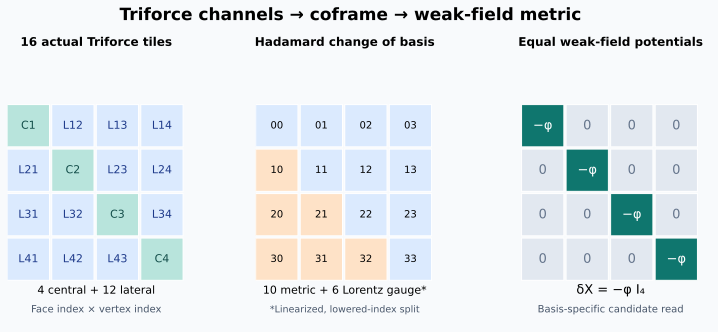

# The sixteen Triforce channels as a tetrad read

*GFD Standard Field Model · [T] exact algebra, [D] conditional realization, [E] physical identification · November 2026.*

This extends the [G optical closure](G_CLOSURE_DERIVATION.md), [unified Hamiltonian](UNIFIED_HADAMARD_FIELD_DYNAMICS.md) and upstream [Triforce synthesis](https://github.com/fielddynamics/research/blob/main/research/faces/enterprise_triforce_synthesis.md). It supplies a coordinate dictionary, not a derivation of Einstein's equations or a new normalization for G.

## 1. Actual triangles supply the ordered pair [T]

Let the four sign vectors $s_i$ be the alternating Hadamard corners. On each chamber, label the original face opposite $s_i$ by $i$. Its medial triangle is tile $(i,i)$, and the lateral triangle at $s_j$ is $(i,j)$, $j\ne i$. The central centroid is $-s_i/3$ and the lateral centroid is $(3s_j-s_i)/6$. The same construction with all signs reversed labels TetB. There are exactly 16 actual tiles in each chamber (32 in the full stellated octahedron); this does not reduce the full 36-complex-coordinate Hamiltonian to 16 real numbers. Let $X$ be a **candidate real signed read** of one chamber. The physical map from microscopic amplitudes to $X$ is not established.

The tetrahedral symmetry acts by simultaneous face and vertex permutation $X\mapsto PXP^T$. Put $U=[1;s_i]/2$ (columns) and $\eta=\operatorname{diag}(-1,1,1,1)$. Then $U^TU=I$, and $R=UPU^T=1\oplus R_3$ where $R_3$ is the ordinary tetrahedral action. This intertwines all 24 permutations exactly. The four columns of $U$ are Euclidean-orthogonal Hadamard directions, not normalized Lorentz-null vectors. The latter are proportional to columns of $N=\operatorname{diag}(1,1/\sqrt3,1/\sqrt3,1/\sqrt3)U$, which is not Euclidean-orthogonal.

## 2. Explicit coframe and metric [T/D]

Fix a Cartesian background and identify the two index bases there. Interpret the signed channel read as the **lowered** coframe matrix in the orthogonal Hadamard basis:

$$e=\eta UXU^T,\quad X=U^T\eta eU,\quad J=U^T\eta U=I-\tfrac12\mathbf1\mathbf1^T.$$

Flat space corresponds to $X=J$, not zero or the identity. In particular, raw nonnegative intensities cannot directly be $X$. A real signed contrast around a reference is one possible implementation, with an as-yet undetermined scale. The exact reconstructed metric is

$$g=e^T\eta e=U X^T J X U^T,$$

with Lorentz signature for nonsingular real $X$, and $\sqrt{-\det g}=|\det X|$. For $X=J+Y$, $e=I+\eta UYU^T$, and

$$g=\eta+U(Y+Y^T+Y^TJY)U^T.$$

The map is a bijection between 16 real channel coordinates and 16 real coframe components, restricted to nonsingular reads for a coframe. It does not imply that arbitrary channel data obey Einstein's equations. Under geometric permutations $e\mapsto ReR^T$, not independent left and right Lorentz/coordinate transformations. A finite local Lorentz gauge $e\mapsto\Lambda e$ can be represented on the abstract read by $X\mapsto U^T\eta\Lambda\eta U X$. This preserves $X^TJX$. The microscopic tile Hamiltonian has not been shown invariant under this continuous action. A preferred frame, if present, must be treated consistently with the upstream covariant action rather than assumed to be a gauge choice. TetB uses $U_B=\operatorname{diag}(1,-1,-1,-1)U$; its dictionary is parity-related. Two arbitrary chamber reads give two arbitrary coframes; a single physical metric still requires a dynamical matching/read rule.

## 3. Ten metric modes and six infinitesimal frame modes [T]

At the flat reference the metric perturbation is $h=2U\operatorname{sym}(Y)U^T$. The 10 symmetric channel perturbations affect the metric at linear order; the six antisymmetric ones form its kernel, the tangent to local Lorentz gauge. Finite gauge changes must be exponentiated (an additive antisymmetric perturbation is not an exact gauge transformation). This reproduces the usual tetrad counting; it does not derive the two propagating GR tensor polarizations.

Under $T_d\simeq S_4$, the 4-vector representation is $A_1\oplus T_2$, so $\operatorname{Sym}^2=2A_1\oplus E\oplus2T_2$ and $\Lambda^2=T_1\oplus T_2$. More concretely an antisymmetric $Y$ is a flow on the six unoriented edges of $K_4$. With $r=Y\mathbf1$, define

$$Y_{\rm grad}=(r\mathbf1^T-\mathbf1r^T)/4,\qquad Y_{\rm cyc}=Y-Y_{\rm grad}.$$

These are orthogonal, each dimension three; $Y_{\rm cyc}\mathbf1=0$. Under $U$, the gradient becomes the time-space block of a lowered infinitesimal Lorentz generator (boosts); the cycle becomes its antisymmetric spatial block (rotations). This is an explicit algebraic bridge to circulation, but not an identification of tile amplitudes with physical gauge variables or of three cycles with the eight constituent vortices.

## 4. A weak-field scalar read [D]

In a weak, static scalar metric in the chosen Cartesian/Newtonian gauge, write $g_{00}=-(1+2\phi)$, $g_{ij}=(1-2\psi)\delta_{ij}$, where $\phi=\Phi/c^2$, $\psi=\Psi/c^2$. Choose $e=\operatorname{diag}(1+\phi,1-\psi,1-\psi,1-\psi)$ to first order. The lowered perturbation is $-\operatorname{diag}(\phi,\psi,\psi,\psi)$, hence

$$Y=-\psi I-\frac{\phi-\psi}{4}\mathbf1\mathbf1^T.$$

For diagonal read $d$ and off-diagonal read $o$, $d=-(\phi+3\psi)/4$, $o=-(\phi-\psi)/4$; thus $\phi=-d-3o$ and $\psi=-d+o$. In ordinary weak GR with negligible anisotropic stress, $\phi=\psi$, so $Y=-\phi I$: the four central channels change equally, all twelve lateral contrasts vanish. A nonzero common lateral contrast in this restricted scalar ansatz corresponds to gravitational slip $\phi-\psi=-4o$. This is a basis- and gauge-dependent dictionary, not a new prediction: using the nonorthogonal null directions or another tetrad gauge changes the channel pattern. No dynamical proof of equal potentials or zero slip is supplied. The exact metric from $Y=-\phi I$ is $\operatorname{diag}(-(1+\phi)^2,(1-\phi)^2,(1-\phi)^2,(1-\phi)^2)$; only its first-order limit is identified with the usual weak scalar metric.

For four adjacent origins at $x+\ell n_k$ with $n_k=s_k/\sqrt3$, define $\mathcal D_a Y=3\sum_k n_{ka}(Y_k-Y_0)/(4\ell)$. This recovers affine gradients exactly. In the equal-potential read the slow-particle acceleration is $\mathbf g=-c^2\nabla\phi\simeq c^2\mathcal D d$. This is the geodesic weak-field read conditioned on the coframe map and the scalar regime, not a dynamical derivation of $\Phi$ from vortices.

## 5. The connection is a different 64-dimensional space [T/D]

The 16 coframe components are NOT identical to one connection block. The latter has 16 lower-index slots for each upper index. For a smooth $e$ and an independent metric-compatible spin connection $\omega_\mu$, the tetrad postulate gives

$$\Gamma_\mu=e^{-1}(\partial_\mu e+\omega_\mu e),\qquad \omega_\mu^T\eta+\eta\omega_\mu=0.$$

Here $(\Gamma_\mu)^\rho{}_\nu=\Gamma^\rho{}_{\mu\nu}$. On a link, $L_{i\leftarrow j}=e_i^{-1}\Lambda_{i\leftarrow j}e_j$ gives $L^Tg_iL=g_j$ exactly if $\Lambda^T\eta\Lambda=\eta$. Neither this condition nor the Hadamard geometry determines $\Lambda$. Setting it to identity everywhere produces a flat pure-gauge connection in the transported frame, not generic Levi-Civita curvature. A separate independent spin connection is essential for general torsion. Even a flat constant tetrad can have a nonzero metric-compatible torsionful connection, e.g. $\omega_1$ with $\omega^2{}_{3}=1$ and $\omega^3{}_{2}=-1$, all other components zero. Conversely the antisymmetric tetrad gauge sector need not produce torsion. Standard torsion-free GR fixes the Levi-Civita connection using the metric and its first derivatives. The lattice spatial differences recover three derivative directions; a temporal derivative and spin transport still need a physical law.

The connection lower-index swap has 10 symmetric and 6 antisymmetric slots per upper index, giving 40 and 24 over four upper indices. These counts are **not** 40 and 24 propagating degrees of freedom, nor are all 40 arbitrary under Levi-Civita compatibility. The two 10+6 splits (coframe perturbation vs connection slots) are distinct. Applying $1\oplus 2P_+$, $1\oplus I$, $1\oplus2P_-$ to a 16-dimensional slot space gives exact weighted traces 21,17,13. The new dictionary does not prove that these traces are physical stiffnesses, that the original optical read takes a 21-dimensional determinant, or that the coframe gauge modes are TetB torsion.

## 6. An optical obstruction and the next decisive tests [T/E]

On four independently addressed faces the full Flower overlap $W$ has block-diagonal rank 16; its central-mediated filtered part $W_c$ gives rank 4. Thus a single instantaneous filtered read cannot communicate all 16 independent coframe values. This is consistent with a scalar response but requires a reconstruction using additional channels, dynamical histories, constraints or derivatives for a general tensor metric. The four-face rank count is a statement about local linear channel blocks, not a claim that all four neighbouring faces give a complete physical relativistic connection. A pure change of basis cannot generate the required continuous local Lorentz gauge symmetry, diffeomorphism invariance, stress-energy coupling, torsion constraints or GR's action. The candidate route should test (1) the actual Hamiltonian read Jacobian and observability around a circulating background, (2) a covariant link transport rule and compatibility, (3) the continuum kinetic action and spin-2 polarizations, (4) universality of matter coupling, (5) the earlier G normalization and drained constitutive law. No free alternative G is introduced; SST is the complete covariant action only.

References: [standard tetrad and connection formalism](https://doi.org/10.1140/epjc/s10052-022-10823-x), [weak-field scalar potentials](https://pmc.ncbi.nlm.nih.gov/articles/PMC5897888/). The dictionary and tests are new candidate-model algebra, not results claimed by those references.

Reproduce: `OPENBLAS_NUM_THREADS=1 python verify_tetrad_read.py` ([282 checks](tetrad_read_verification_output.txt)); `python generate_tetrad_read_figure.py`. Historical checks preserved, not rerun. Back to [master README](README.md).

**Continuation:** [Dynamic tetrad settlement](DYNAMIC_TETRAD_SETTLEMENT.md) tests this construction against the unchanged microscopic Hamiltonian, including central-first excitation, filtered observability, static slip and the remaining relativistic constraints.
