# Unified Hadamard–Flower field dynamics

**Normalization convention (current):** use the existing GFD topology-derived bare G, conditional on its upstream premises. Any microscopic effective coefficient must match it; no independent G fit is introduced. See the [G normalization bridge](G_NORMALIZATION_BRIDGE.md).

> **Matter/charge extension:** [Eight-register vortex and charge research](MATTER_VORTEX_CHARGE.md) distinguishes retained matter from optical occupation, proves the bare chamber-charge conservation obstruction, and supplies conditional inward/outward response models. Full microscopic capture, charge and physical work coupling remain open.

> **New extension:** [Field Origin gravity read](FIELD_ORIGIN_GRAVITY_READ.md) derives a phase-neutral polar observable of the directional origin and its leading source-directed transfer; a separate static potential bridge is conditional.

> **Optical extension:** [Four-port optical resonator](OPTICAL_FOUR_PORT_RESONATOR.md) proves the four-bright/eight-dark coherent mode split and models the isolated central-mediated overlap branch. It preserves the full previous geometry and distinguishes dark modes from inactive individual neighbours; capture remains unproved.

*Field Dynamics Research · November 2026 · Illustrated technical synthesis and reproducible candidate model*

**One complete field, eight constituent vortices, one Field Origin, four reciprocal external ports.**

[T] denotes a geometric or algebraic theorem; [D] a consequence of explicitly stated model assumptions; [E] an exploratory physical identification; [O] an observation. The geometry, finite Hamiltonian and numerical checks below are distinct from a derivation of physical gravity. This synthesis extends the existing research, rather than renaming the constitutive law or replacing the covariant SST action.

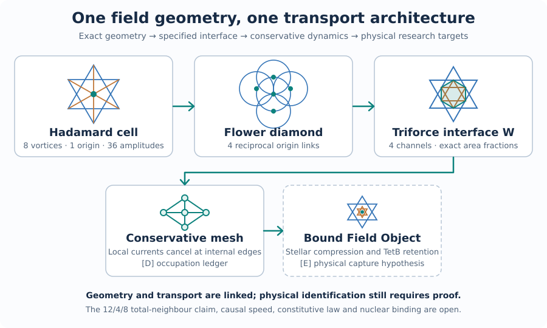

## 1. The single geometric object [T]

Define $S=\{(1,1,1),(1,-1,-1),(-1,1,-1),(-1,-1,1)\}$. TetA and TetB are the convex hulls of $S$ and $-S$; their union is the stellated octahedron inside the cube. Their intersection is the central octahedron with vertices $\pm e_i$. The centre O is the shared Field Origin. The eight triangular core faces correspond to eight stellations, each with three lateral tiles and one base. The original eight tetrahedron faces are subdivided into 32 Triforce tiles; regrouping yields eight disjoint sets of three lateral tiles and one base. The Hadamard record $n_s=(1,s_x,s_y,s_z)^T$ obeys $\sum_{s\in S}n_s n_s^T=4I_4$.

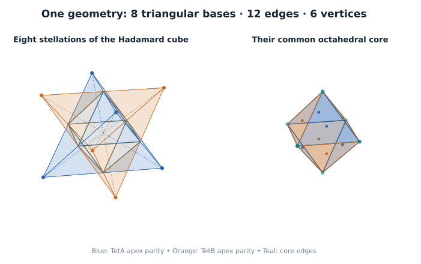

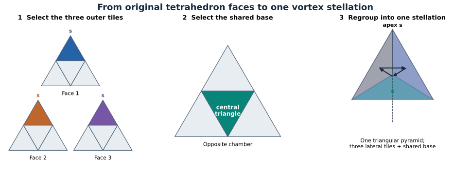

See [forced frame](https://github.com/fielddynamics/research/tree/main/proofs/forced-tetrahedral-frame), [Hadamard cube frame](https://github.com/fielddynamics/research/tree/main/proofs/hadamard-cube-frame), [original Triforce research](https://github.com/fielddynamics/research/blob/main/research/faces/enterprise_triforce_synthesis.md) and [corrected vortex theorem](https://github.com/fielddynamics/research/tree/main/research/diamond-tetrad-lattice/vortex-theorem). The source theorem distinguishes generic winding eigenstates from degenerate exceptions. Eight geometric rings do not alone guarantee collective occupation or circulation.

## 2. Flower projection and two distinct embeddings [T]

The projection $P=I-\mathbf1\mathbf1^T/3$ produces 13 distinct planar points from the eight cube corners, six core vertices and O. The outer projected hexagon is twice the inner radius. The reference Flower drawing is the triangular planar circle construction; it is not a literal projection of equal three-dimensional spherical boundaries. The three points O and $\pm(1,1,1)$ coincide in the projection, not in space.

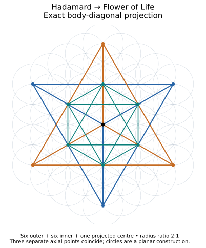

The original [Pixel Lattice research](https://github.com/fielddynamics/research/tree/main/research/diamond-tetrad-lattice) describes a cubic tiling with one whole pixel per cube; the diamond nets alternate cube centres and shared corner junctions. With cube side 2, all cube centres are $2\mathbb Z^3$. Its TetA legs reach odd-coordinate junctions $p+s_i$. The even centres split into two cosets of $L=\{p\in(2\mathbb Z)^3:\sum p_i=0\pmod4\}$, giving two diamond components of TetA legs; the TetB leg nets provide two more. A corner junction is not automatically a whole field in that construction.

The new **overlapping-origin model** places a whole field at each site of a single diamond net $L\cup(s_1+L)$. The B-sublattice's active star is $-S$, but each node still has both TetA and TetB. The four bond lengths equal the sphere envelope radius $R=\sqrt3$, so an origin is a corner of its neighbour's cube. Primitive translations $s_1-s_j$ ($j=2,3,4$) generate $L$ and make the active graph connected. The two constructions are isomorphic on a chosen diamond component as graphs, but **not the same physical placement or density**: in the overlapping model junctions are promoted to full Field Origins and the other cube-centre coset is absent. One cannot retain every original cube centre, declare every corner an additional whole field, and still claim one per non-overlapping cube or the same four-port network. This is a proposed alternative microscopic embedding, not a silent replacement of the repository's cubic tiling.

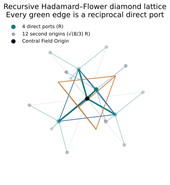

Neighbour counts must be named:

| Relation | Count per origin | Meaning |
|---|---:|---|
| Direct links | 4 | Exact tetrahedral active star |
| Second shell | 12 | Two-step displacements $s_i-s_j$, $i\ne j$; two vertex contacts per solid pair |
| Third shell | 12 | Spherical-envelope overlap only |
| Total other overlapping spherical envelopes | 28 | All three shells |
| Ports of opposite active parity | 4 | Internal stellations without direct links at this node |

Four exact tetrahedral contacts among twelve rigid equal tangent spheres are impossible by the [corner-first bound](CORNER_FIRST_PACKING.md). The FCC [four-of-twelve construction](FOUR_PORT_PACKING.md) is retained as a different model with nonregular contact stars. Neither the 13-point projection nor the 12 second-neighbour directions establishes twelve *total* neighbours with four active and eight inactive. There are eight internal vortices, not eight independently established inactive neighbours. Choosing eight of the twelve equivalent second-shell directions requires an additional symmetry-breaking rule. No such rule is imposed here.

## 3. From eight local vortices to the directional Field Origin [T/D]

The existing 33-position graph has 24 lateral, eight base tiles and O, with 104 original bonds. Stage IX extends O to four complex amplitudes $c=(a,\mathbf b)$; all 33 positions remain, and the resulting 36-coordinate Hamiltonian $H$ has the eight original scalar couplings plus 24 directional couplings. Its chosen centre-to-base row is $-n_s^T$, with each noncentre original bond assigned dimensionless hopping -1. These are model choices. They preserve the full tetrahedral symmetry and inversion when chamber parameters are equal. For a row-closed outer state, a different column read need not vanish. In the actual Triforce indexing $X_{ij}$, $R$ sums rows, $Q$ sums columns, and the zero-row projector $P_R$ obeys $QP_R Q^T=(8/3)I-(2/3)\mathbf1\mathbf1^T$. Hence collective polar excitation is possible even when local row sums vanish.

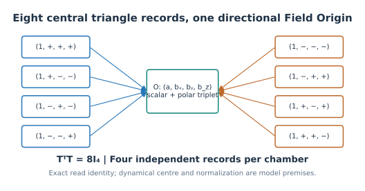

The raw odd-parity outer basis $B$ of Stage IX satisfies $B^TB=192I_3$, $(HB)_O=0$, $(H^2B)_O=(0,-64I_3)^T$. This yields directional occupation $16t^4/3+O(t^5)$ for the corresponding unit initial state in an isolated cell. Other stationary states have a dark core. See [sustained flywheel](SUSTAINED_TRIFORCE_FLYWHEEL.md), [open throat](OPEN_THROAT.md) and [directional origins](COUPLED_FIELD_ORIGINS.md) for the different regimes; a driven outlet is not a conservative lattice.

## 4. Exact overlap geometry becomes a full-cell interface [T/D]

For the bond $0\to s=(1,1,1)$, the midplane is $s\cdot x=3/2$. Facing stellation sections are equilateral triangles related by inversion about the midpoint. Their hexagonal overlap has area $2/3$ of either section. Subdivide both sections into equal Triforce tiles. Exact rational clipping gives the area matrix (each entry divided by one tile's area)

$$W=\frac19\begin{pmatrix}0&2&2&1\\2&0&2&1\\2&2&0&1\\1&1&1&6\end{pmatrix}.$$

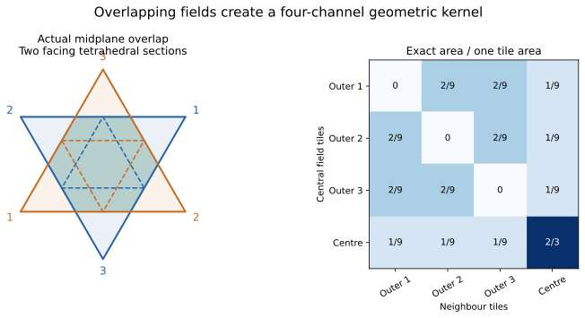

**New bridge.** A section's three outer corners correspond to the three base vertices of the stellation by homothety about its apex. For apex $s_i$ label each outer section tile by the *opposite lateral face* of that stellation; its base vertex is $(s_i+s_j)/2$, $j\ne i$. Label the central section tile by the stellation's actual base at $s_i/3$. This opposite-face identification is a specified, symmetry-equivariant routing, not a derivation of the amplitude on a cross-section from the surface wave equation. Inversion identifies corresponding labels on the neighbouring apex $-s_i$. Let $F_s$ be the resulting $36\times4$ coordinate injection.

The eight $F_s$ partition all 32 tile coordinates exactly, each is isometric, and their ranges are orthogonal. Four active ports use sixteen distinct tile coordinates. The verification checks covariance under all 24 tetrahedral transformations. This is the first explicit embedding of the Flower overlap kernel into the same 36-coordinate model as the eight-vortex flywheel.

For neighbour j of i at displacement s, set

$$H_{ji}=-\kappa F_{-s}WF_s^T,\quad H_{ij}=H_{ji}^\dagger.$$

Here $\kappa=1$ is only a dimensionless simulation normalization. No mass, acceleration or physical time units are calibrated. Stage IX's reflection-matched original triangular face and the Flower overlap midplane are distinct geometries: do not substitute W into the former while claiming the faces coincide.

The spectrum of W is $7/9,1/3,-2/9,-2/9$. On the two-dimensional zero-sum outer subspace, W acts as $-2I/9$ with no direct central component. The remaining symmetric sector, in normalized outer-mean and centre basis, is $\frac19\begin{pmatrix}4&\sqrt3\\\sqrt3&6\end{pmatrix}$. Thus the local winding modes can be communicated without directly activating the central section tile; both common and difference responses survive. Negative eigenvalues are signed amplitudes, not negative geometric areas. The central tile's total overlap is 1, but its central-to-central overlap is $2/3$; the other $1/3$ goes to outer tiles.

## 5. Exact origin-to-origin and peripheral transmission [D]

With the two facing ports embedded above, the neighbour-to-source O block of the first and second powers of the pair Hamiltonian vanishes. The cubic power is

$$ (\mathcal H^3)_{O_jO_i}=-\frac{2\kappa}{3}n_{-s}n_s^T.$$

Thus for initial state supported at the first origin,

$$c_j(t)=-\frac{i\kappa}{9}t^3 n_{-s}n_s^T c_i(0)+O(t^4).$$

This is a rank-one leading read of the scalar/polar origin across a single bond. All four active directions resolve the full origin record. It proves the existence of an actual O-to-O path through both base tiles, with overlap factor $2/3$. It does **not** prove that every communicated excitation goes through O: the outer-to-outer block is nonzero, and local winding information can reach the neighbour at first order even while the centre is dark. This is consistent with the earlier distinction between spatial Triforce infrastructure and central gravitational coupling, but the physical interpretation of the two amplitudes is not derived.

## 6. Conservative network dynamics [D]

For complete field amplitudes $\psi_i\in\mathbb C^{36}$ on the diamond graph,

$$ i\dot\psi_i=H\psi_i+\sum_{j\sim i}H_{ij}\psi_j.$$

Let $N_i=\psi_i^\dagger\psi_i$ and $J_{i\to j}=2\operatorname{Im}(\psi_j^\dagger H_{ji}\psi_i)$. Hermiticity gives $J_{i\to j}=-J_{j\to i}$ and $\dot N_i=-\sum_{j\sim i}J_{i\to j}$. Therefore for any collection of fields U,

$$\frac{d}{dt}\sum_{i\in U}N_i=-\sum_{i\in U,\,j\notin U}J_{i\to j}.$$

Internal edges cancel once and only once. For the closed lattice total occupation and time-independent Hamiltonian energy are conserved. This is an exact network account, not a proof that $N_i$ equals physical mass. The Bloch symbol on a two-site primitive cell is 72-dimensional; choosing $q_i=0,-e_1,-e_2,-e_3$ in primitive-cell coordinates gives $C(k)=\sum_i e^{-ik\cdot q_i}F_{-s_i}WF_{s_i}^T$ and

$$H(k)=\begin{pmatrix}H&-\kappa C(k)^\dagger\\-\kappa C(k)&H\end{pmatrix}.$$

This provides a route to the dispersion relation, not a proof of Lorentz invariance or propagation at c. Continuous-time finite-range Hamiltonian propagation can have nonzero tails at arbitrarily small positive time; a strict light cone needs a further causal evolution law or continuum-limit argument.

### Fresh calculation: 54 complete fields, 1,944 complex amplitudes

A periodic 3×3×3 primitive-cell network contains 54 complete fields and 108 reciprocal links. Start the source in the Stage IX normalized odd-parity eight-ring state with all 24 original ring bond currents nonzero and all base tiles and origin amplitudes empty. No pumps or sinks. Across 401 time samples from 0 to 8:

| Quantity | Computed result |
|---|---:|
| Peak total first-neighbour occupation | 0.31786081 |
| Peak occupation beyond first shell | 0.05097974 |
| Peak source directional O occupation | 0.36053628 |
| Peak total first-neighbour directional O occupation | 0.08984795 |
| Samples with all 24 source ring signs retained, inward O current, outward net flux and neighbouring polar O occupation | 167 |
| Maximum total occupation error | 4.44e-15 |
| Maximum energy error | 2.20e-14 |
| Maximum per-cell continuity error | 3.61e-16 |

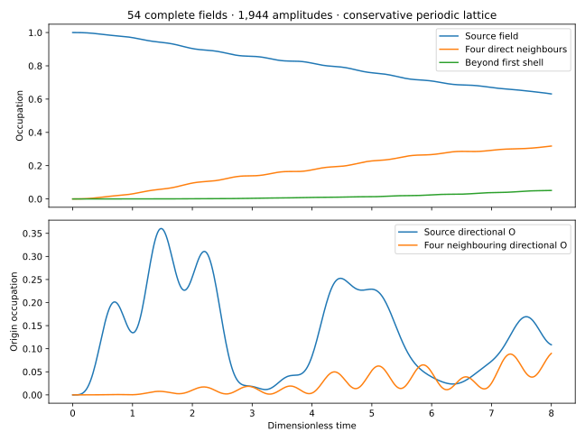

Peaks occur at potentially different times and are not additive. The torus is a finite numerical witness, not an infinite-lattice steady state. The closed model cannot sustain permanent one-way flux across a finite cut. The earlier full neutral axial back-reaction result is retained for its matched two-cell geometry; it has not been integrated for this new 54-cell overlap network. The [data](unified_flower_dynamics.csv), [verifier](verify_unified_flower.py) and [output](unified_flower_verification_output.txt) reproduce the witness. The verifier reuses the preserved Stage IX geometry/H definitions without executing its historical test body.

## 7. Connection to Distributed Field Processing and closure [D/E]

The [current-closure proof](archive/stages-I-VI/README.md) provides a chain map from detailed Triforce bonds to the registered octahedral current. The new intercell conservation law is complementary: a region's boundary ledger can be composed from smaller ledgers without recounting its internal edges. In the GFD terminology of [llms.txt](https://github.com/fielddynamics/research/blob/main/llms.txt), overlapping closure fields may read each other, but ownership is single-valued; every field object at every scale closes, and larger registrations do not reopen smaller accounts. We have proved cancellation for model occupation flux, not derived the physical snapshot/settlement/registration map, Jacobi boundaries or ownership dynamics. Keep ownership records separate from overlapping amplitudes and count each bound field once.

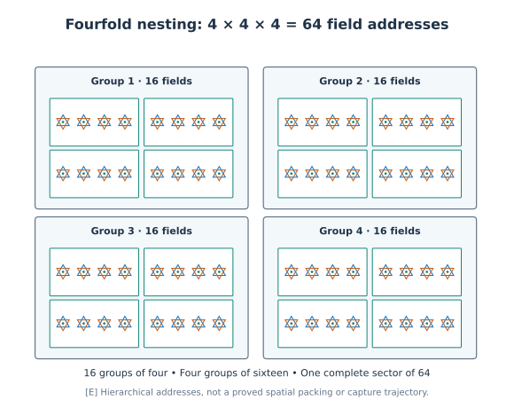

Scale universality is compositional, not geometric self-similarity. Every level uses local accounting, not necessarily the same physical radius, microscopic lattice density or constitutive response. The drain determines the interior law, never whether a Field Object closes. Drainless interbody fields use bare G and leading-order GR in GFD; each body's enclosed TetB is already counted in measured GM. The galaxy is bound and drained, not unbound; its exterior response is the one-directional law. None of these physical statements is derived from the finite lattice model.

## 8. Nuclear binding and the stellar forge [E]

The [bound capture specification](BOUND_FIELD_CAPTURE.md) builds on [Paper VII](https://github.com/fielddynamics/research/tree/main/papers/07-dual-tetrad-topology-field-origin), [Paper XI](https://github.com/fielddynamics/research/tree/main/papers/11-nuclear-shells-tetrahedral-packing), [Paper XIII](https://github.com/fielddynamics/research/tree/main/papers/13-nuclear-binding-bidirectional-sst), [bound-gravity packing](https://github.com/fielddynamics/research/tree/main/research/bound-gravity-and-packing) and [Triforce nuclear intersection](https://github.com/fielddynamics/research/tree/main/research/nuclear-triforce). The proposal is stellar compression of an entire incoming field through the receiver's O into TetB, followed by expansion and a retained bidirectional vortex response. A small amplitude transferred along the Flower network is not that process. The new interface is an explicit transport candidate for approaching the origin; capture requires additional dynamical configuration/ownership degrees of freedom, nonlinearity and an accounted energy-release or retention mechanism. An invariant linear bound subspace cannot be populated from a state initially orthogonal to it in autonomous Hermitian evolution.

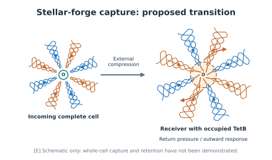

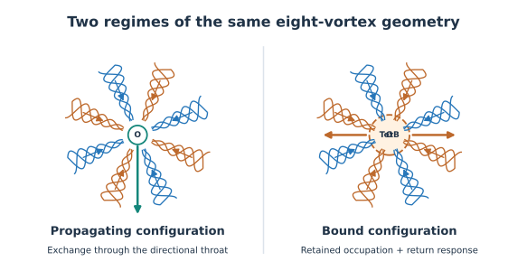

The one-directional constitutive law $x(1-\mu)=\mu$ and nuclear bound law $x(1-\mu_b)^2=\mu_b$ remain separate from the full four-term covariant SST action. Under a *postulated* two-factor screening and symmetric relaxation, equality of forward/return responses is dynamically stable. The overlap W alone does not imply that nonlinear screening product. Paper XI's electron-mass energy scale and Paper XIII's Zn-64-calibrated sector reflections are distinct. Neither the physical compression mapping $x=A^2$, gate exclusion, nor nuclear binding energies follow from the lattice calculation. The geometric origin is not automatically the equal-share point: those points are x=1 and x=2 in the two laws, respectively.

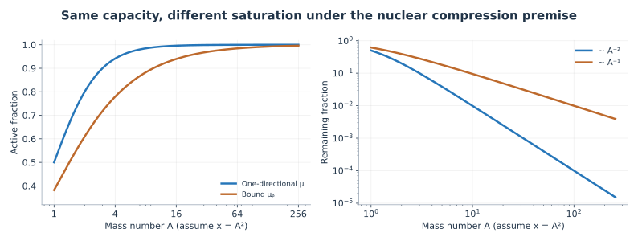

## 9. What is unified, and what remains

| Link | Status |
|---|---|
| Hadamard → dual tetrahedra → eight Triforce rings | [T] exact geometry |
| Body-diagonal projection → Flower thirteen-point pattern | [T] exact projection |
| Overlapping corner origins → four-connected diamond | [T] exact given alternating active parity |
| Triforce overlap → W → 36-coordinate interaction | [T] area/routing algebra; [D] Hamiltonian ansatz |
| Eight-ring excitation → directional origins → multi-field transport | [D] analytical and numerical witness |
| Boundary accounting under composition | [T] cancellation for reciprocal currents |
| Physical lattice selection and 12-total/4-active/8-inactive neighbours | [E] unresolved; rigid equal spheres excluded |
| Physical null-cone speed, SST limit, $\mu$, $a_0$ | [E] not derived |
| Whole-field capture, retention, nuclear bound law and energies | [E] not demonstrated |

The next technical priorities are deriving the section-to-surface interface from actual field dynamics rather than an equivariant routing, extending nonlinear back-reaction to the overlapping network, deriving active parity selection, and building a compression/retention model that tracks whole-field ownership. These are tests of one architecture, not independent geometric analogies.

## Reproduce

Run `OPENBLAS_NUM_THREADS=1 OMP_NUM_THREADS=1 python verify_unified_flower.py`. It passed 316 assertions; previous 3,557 recorded assertions are retained, not rerun, for a cumulative 3,873 recorded checks. These are not independent physical theorems. The existing [Flower explorer](hadamard_flower_explorer.html), [vortex explorer](sustained_explorer.html) and [two-cell explorer](coupled_origins_explorer.html) remain available; only the latter uses the earlier reflection-matched interface. No Lean compilation or repository update was performed in this edition.

**Follow-up:** [Spectral gravity read](SPECTRAL_GRAVITY_READ.md) connects the same optical interface Hamiltonian to a conditional long-wavelength static response.

**Continuation:** [Dynamic tetrad settlement](DYNAMIC_TETRAD_SETTLEMENT.md) tests this construction against the unchanged microscopic Hamiltonian, including central-first excitation, filtered observability, static slip and the remaining relativistic constraints.

## Three-subread continuation

See [Three sub-reads of one closure engine](THREE_SUBREAD_CLOSURE.md) for the reversible tree, actual native core Pauli ledger, projective invariant contrast count and controlled-rotation obstruction. This continuation does not derive physical attenuation or change the prior model.

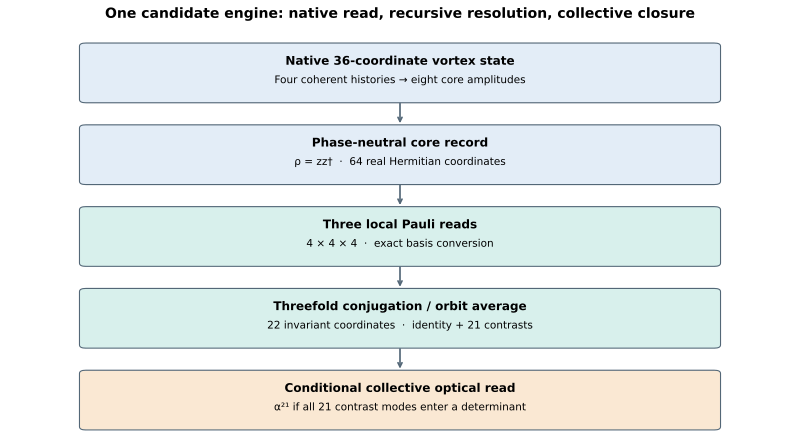
