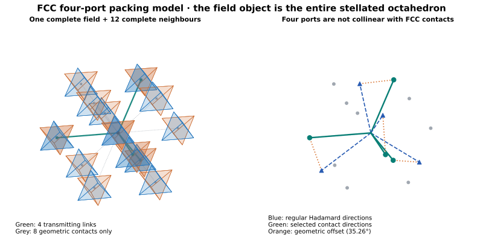

# Visual index — static figures and interactive companions

All figures are packaged with relative Markdown links. The recent chat illustrations are recreated as SVGs so that the Markdown renders without JavaScript on GitHub. The original static figures and interactive HTML explorers are retained. Conceptual arrows are not simulated trajectories. The physical binding proposal remains exploratory.

| Figure | Embedded in | Status |
|---|---|---|
| [13 Stellar-forge capture](figures/13_stellar_forge_capture.svg) | [Bound Field Capture](BOUND_FIELD_CAPTURE.md), [README](README.md) | Conceptual research hypothesis |
| [14 Propagating vs bound](figures/14_propagating_vs_bound.svg) | Bound Field Capture, README | Conceptual regimes |
| [15 Bound-law comparison](figures/15_bound_law_comparison.svg) | Bound Field Capture, README | Exact functions, conditional on x=A² |
| [16 Recursive nesting](figures/16_recursive_nesting.svg) | Bound Field Capture, README | Proposed hierarchy, not verified packing |
| [17 Matched Triforce interface](figures/17_matched_triforce_interface.svg) | [Coupled Field Origins](COUPLED_FIELD_ORIGINS.md), README | Exact local geometric match, conditional dynamics |
| [18 Directional read](figures/18_directional_origin_read.svg) | Coupled Field Origins, README | Exact sign records and conditional centre model |
| [19 Chamber flux comparison](figures/19_chamber_flux_comparison.svg) | [Open Throat](OPEN_THROAT.md) | Previous model results; asymmetric assignment is hypothetical |
| [20 Axial receiver](figures/20_axial_receiver.svg) | Open Throat | Exact special-case solution with illustrative coefficients |
| [21 Row/column read](figures/21_row_column_read.svg) | README | Exact tile-index duality |

The existing 00–12 figures remain in the synthesis and the proof archive, including the original Triforce regrouping, geometry, cycle sectors, registration, harmonic conversion, current dynamics and two-cell calculations. The [geometry explorer](explorer.html), [sustained dynamics explorer](sustained_explorer.html) and [two-cell explorer](coupled_origins_explorer.html) remain standalone.

Regenerate figures 13–21 using `python generate_bound_visuals.py` (NumPy and Matplotlib). This is an editorial/visual revision, not a new numerical validation of the capture mechanism. No new mathematical test count is claimed.

## Whole-field packing

[Proof and model](FOUR_PORT_PACKING.md) · [Interactive explorer](four_port_packing_explorer.html) · regenerate with `python generate_four_port_visual.py`.

## Corner-first packing

[Figure 23](figures/23_corner_first_packing.svg): eight attaining contacts and four rigorous bounding caps. Regenerate with `python generate_corner_first_figure.py`.

### Hadamard–Flower geometry

| Figure | Description |
|---|---|
| [24](figures/24_hadamard_flower.svg) | Exact body-diagonal projection, two hexagons and Flower guide |
| [25](figures/25_flower_triforce_overlap.svg) | Actual midplane cross-sections and rational four-channel kernel |
| [26](figures/26_flower_diamond_network.svg) | Four direct and twelve second origins |

Regenerate using `python generate_hadamard_flower_figures.py`. [Rotatable explorer](hadamard_flower_explorer.html).

## Unified synthesis

| Figure | Purpose | Generation |
|---|---|---|
| [27](figures/27_unified_field_architecture.svg) | Geometry, interface, network and proposed binding architecture | Standalone vector schematic |
| [28](figures/28_unified_flower_dynamics.svg) | Computed 54-field transport and directional origin occupation | `python verify_unified_flower.py` |

Both embedded in [the unified synthesis](UNIFIED_HADAMARD_FIELD_DYNAMICS.md) and README.

## Optical resonator

| Figure | Purpose |
|---|---|
| [29](figures/29_optical_projectors.svg) | Four bright and eight dark coherent modes |
| [30](figures/30_optical_scattering.svg) | Calculated scattering response of full and filtered models |
| [31](figures/31_optical_network.svg) | 16-field whole-cell dynamics with full and central branches |

All three generated by `python verify_optical_ports.py` and embedded in [the optical proof](OPTICAL_FOUR_PORT_RESONATOR.md) and README.

## Field Origin gravity read

[Figure 32](figures/32_field_read_bridge.svg): early-time transfer coefficient, static acoustic isotropy and 128-node nonlinear solve. Embedded in [field read](FIELD_ORIGIN_GRAVITY_READ.md) and README. Regenerate with `python verify_field_read.py`.

## Spectral gravity read

[Figure 33](figures/33_spectral_read.svg): microscopic band-edge curvature, scalar susceptibility and polar read. Regenerate with `python verify_spectral_read.py`; embedded in [spectral research](SPECTRAL_GRAVITY_READ.md) and README.

## Matter vortex and charge

[Figure 34](figures/34_matter_charge.svg): nonlinear excess-mode wells, dressed exchange charge conservation and periodic static interaction kernel. [Figure 35](figures/35_matter_response_rings.svg): signed response and neutral TetA ring currents at the three equilibria. Both regenerated by `python verify_matter_charge.py` and embedded in [the new research note](MATTER_VORTEX_CHARGE.md) and master README.

## Collective optical closure

[36 — Optical closure normalization](figures/36_g_closure_bridge.svg), embedded in [the proof note](G_CLOSURE_DERIVATION.md). Conditional architecture schematic.

## Triforce tetrad and dynamics

[Figure 37](figures/37_triforce_tetrad_read.svg): coframe dictionary and equal-potential channel representation. [Figure 38](figures/38_dynamic_tetrad.svg): central-first response, raw static intensity read and coherent optical history rank. Embedded in [dynamic tetrad settlement](DYNAMIC_TETRAD_SETTLEMENT.md) and README; regenerate with `python verify_dynamic_tetrad.py`.

## Electron closure

[Figure 39](figures/39_electron_closure.svg): two energy records, idempotent radial cost, lossless matching, joint mass/G sensitivity. Regenerate with `python verify_electron_closure.py`; embedded in [closure note](ELECTRON_CLOSURE_SETTLEMENT.md) and README.

## π-addressed spectral read

[Figure 41](figures/41_pi_fwht_ledger.svg): first-visit index, count spectrum and sparse digit decoder. Embedded in [π/FWHT note](PI_WALK_FWHT.md); regenerate with `python verify_pi_fwht.py`.

## Native core Walsh read

[Figure 42](figures/42_native_walsh_read.svg): native observability, spectral poles, sample conditioning; embedded in [research note](NATIVE_WALSH_READ.md). Regenerate with `python verify_native_walsh.py`.

## Projective Walsh–G bridge

[Figure 43](figures/43_projective_walsh.svg): address orbit map, reduced Walsh matrix, pi coverage. Embedded in [research note](PROJECTIVE_WALSH_G_BRIDGE.md) and README.

## Closure engine internals

[Figure 40](figures/40_closure_engine.svg): boundary energy registration, exact solid-angle flux and vortex exchange. Embedded in [engine note](CLOSURE_ENGINE_INTERNALS.md) and README.

## Three nested sub-reads

All five figures are embedded in [the new note](THREE_SUBREAD_CLOSURE.md) and README. Regenerate using `python verify_three_subreads.py`.

| Figure | Description |
|---|---|
| [44](figures/44_three_subread_tree.svg) | Face/subface/subchannel tree, 21 readers and 64 leaves |
| [45](figures/45_three_subread_factorization.svg) | Exact tree/detail/full-FWHT matrices |
| [46](figures/46_pauli_cycle_obstruction.svg) | Pauli cycle versus rigid spatial rotation |
| [47](figures/47_three_subread_attenuation.svg) | Raw and invariant contrasts; conditional transmission versus determinant |
| [48](figures/48_native_recursive_read.svg) | Native coherent history → Pauli read → collective closure |
