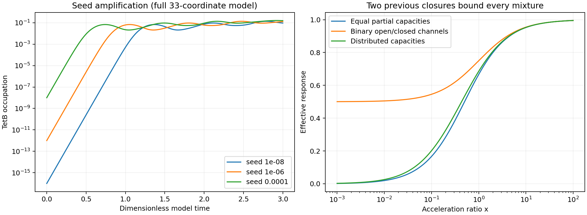

# Time-face aperture and seeded TetB recruitment

*Field Dynamics Research · November 2026 · cumulative vertex research, not Proof 26.*

**Result:** 45 exact + 263 numerical = 308 fresh assertions. The native constitutive vertex admits both a stable balanced operating point (previous conditional result) and a spectrally unstable empty-partner winding state. This is seed amplification, not creation from nothing or irreversible capture. The two earlier partial-drain closures are the sharp bounds of a common distributed-capacity model. The existing full-rank kernel alone cannot select a genuinely closed drain with a nonempty TetB.

## 1. Preserve the engine; test its missing state

Use the same 33 coordinates, two 16-coordinate chambers and the scalar O. The local block H₀ retains same-chamber ring and base edges and O links. The registered cross block V has off-diagonal C and Cᵀ; no physical spatial edge is asserted. In the collective zero-sum spatial phase q, O is dark. The one-chamber read is E_q:(u,v,w) ↦ (u q_i+v q_j, w q_i)/2 with q_i=s_i·z, ||z||=1. Its metric is G=[[3,−1,0],[−1,3,0],[0,0,1]]. The established local and cross operators are

```
M=[[-2,1,-2],[0,1,0],[-6,2,-99/10]]
K=[[0,-1/2,0],[-1/2,0,-1],[1,-3,1]].
```

Both are G-self-adjoint. On the collective sector the dynamics is i Ȧ=M A+g(u)K B, i Ḃ=M B+g(u)K A with u=Re(A†G K B). Here A,B are coefficient triplets; the actual arrays are E_q A,E_q B. No new degree of freedom. The gain from CONSTITUTIVE_VERTEX.md is g(u)=(1+t)u/(t c+|u|), c=59/308, t>0 (t is a dimensionless scale ratio, not model time). Its derivative at zero is h=(1+t)/(tc). Use dimensionless model time throughout.

The A-only background is A=e^(−i time) a, B=0, where a=(1/3,1,0)ᵀ/√(8/3), M a=a and a†G a=1. This is exactly the original row-closed winding pattern in one chamber; it is not the balanced eight-ring state. For z=(1,i,0)/√2, the four A ring means are nonzero. B and O remain identically zero: g(0)=0, O reads only the sum of the central components, and uniqueness of the finite-dimensional ODE applies. This invariance concerns the stated dark-O sector, not an arbitrary A state with a bright central scalar. The phase-space boundary is not spontaneous capture. An arbitrarily small pre-existing B perturbation is a different question.

## 2. Exact seed instability

In the frame rotating at frequency 1, set B=x+i y with real x,y in the coefficient basis. To first order about B=0, the A perturbations do not feed back into the B equation (the coupling into A is quadratic in B). Let D=M−I, f=K a, S=f fᵀ G. Then

```
ẋ=D y,
ẏ=−(D+h S)x,
ẍ=−D(D+h S)x.
```

This is a real-linear (anomalous) amplitude equation. It is not the Hermitian Schrödinger equation with a fixed hopping. The normalization of a fixes the factor in h; no free extra seed coupling is introduced. With P=a aᵀG, Q=I−P, D annihilates P and is negative definite on Q: its nonzero eigenvalues are the roots of the translated quadratic 10λ²+119λ+78 of M, shifted down by 1. Equivalently their sum is negative and product positive. The f component along a is −a/6. Its Q norm² is 26/9. For nonzero-growth modes x lies in Q, since P ẋ=0. On that space −D is positive definite. The sign of D+h QSQ is governed by the rank-one update:

$$\mathcal S=-f^T GQ(D+P)^{-1}Q f=\frac{458}{1863},\qquad h_{\rm seed}=\frac{1}{\mathcal S}=\frac{1863}{458}.$$

Indeed conjugating the restricted D+h QSQ by (−D)^(-1/2) gives −I plus a positive rank-one matrix of nonzero eigenvalue h S_cal. Since D is negative definite there, the squared-frequency operator D(D+h S) is similar on Q to a real symmetric operator with one negative eigenvalue exactly for h>h_seed. A negative squared frequency means exponential growth; at equality a zero eigenvalue occurs. This does not classify all full-space perturbations at or below threshold (zero/neutral directions may shear). The full characteristic polynomial of D(D+h S) is

$$\frac{\ell}{300}\left(300\ell^2+(10520h-45543)\ell+128547-31602h\right).$$

The constant term changes sign at h_seed, independently confirming the growing pair for h>h_seed.

For the existing constitutive family, h>(1/c)=308/59>1863/458. Thus **every positive scale ratio t** in this family admits the seed instability in this particular A-only state, including the prior balanced-orbit stability interval 0<t<222607/119913. At t=1, h=616/59 and the exact quadratic has roots approximately 3.08803 and −217.39780; growth exponent is √217.39780≈14.744416 in dimensionless inverse time. This is a seed-recruitment mechanism using the same law, not a second oscillator or proof that the stable balanced orbit attracts the seed. A precisely zero initial partner still cannot grow.

### Full-coordinate numerical test

Rebuild the 33-coordinate Hamiltonian and embed the expanding B eigenvector at initial norm ε, normalize A by √(1−ε²), integrate the *nonlinear* canonical complex equation (not the linear approximation), t-scale=1. DOP853, rtol=2e−11, atol=2e−13, sample 601 times on [0,3]. Results:

| Seed amplitude ε | Peak TetB occupation (sampled) |
|---:|---:|
| 0 | 0 |
| 10⁻⁸ | 0.13566648 |
| 10⁻⁶ | 0.13566796 |
| 10⁻⁴ | 0.16090532 |

All selected seeds match the predicted linear growth in the early small-amplitude regime (relative amplitude error <0.005), then enter nonlinear evolution. Norm and energy errors <2e−8; O remains dark. Peak fractions are sampled observations, not universal saturation values. Different phases/perturbation directions need not grow. The finite conservative model has bounded N_B, so the signed long-time mean transfer [N_B(T)−N_B(0)]/T tends to zero; no irreversible capture, steady drain, or physical timescale follows. The plotted central occupation is not axial angular current.

## 3. Aperture is a spectral read, not just inventory

A natural phase-neutral *candidate* for how much of B is exposed to the vertex is ||C B||², where B now denotes the full chamber array. This is the magnitude of the available cross response before multiplication by g; the actual driving amplitude is g C B. For B≠0 let w_j=||P_j B||²/||B||² with P_j the spectral projectors of C², and τ_j=λ_j(C²)/||C||₂². Within degenerate eigenspaces use their combined weight (the choice of basis does not matter). Then

$$\bar\tau=\sum_j w_j\tau_j=\frac{B^\dagger C^2B}{\|C\|_2^2\|B\|^2}\in[0,1].$$

This measures alignment/exposure, not the amount of retained matter. Multiplying by N_B/N gives an inventory-weighted read continuous at empty B (N>0), but is another candidate, not a derived gravitational aperture. The actual sixteen-channel matrix has determinant −3/4096, hence all its singular values are nonzero. For a nonzero B, the normalized exposure is strictly positive. For a common dark-to-base symmetric outer mode, ||CB||²/||B||²=1/4, while a uniform central array of the same norm gives 12. Even within a fixed q triplet, coefficient directions e₁,e₂,e₃ give 7/12,13/4,4 respectively. Thus same occupation, even fixed spatial phase, does not fix this aperture candidate. A nonempty B can also have zero signed transfer despite positive exposure (balanced stationary witness). These are algebraic constraints on a proposed inventory law, not statements about how retained vortices actually gravitate.

**Closure obstruction:** any quadratic aperture B†A B with A positive semidefinite vanishes exactly on ker A. The native C² is positive definite. It therefore cannot itself supply the net-field rule's exactly closed drain for an occupied TetB. A rank-restricted boundary read, a state-dependent selection, or a different effective kernel is needed. The previously studied shared-junction condition dk=a² makes the cross block rank 12; the verifier constructs its four null directions at d=−1/2,a=−1,k=−2. This is a mathematical example of a dark subspace, not evidence that the physical time face dynamically chooses those weights, nor that a null vector is an inhabited stable vortex. No change to the native witness is made.

## 4. Unification of the two drain closures

The last note derived a reduced-capacity response μ_cap=x/(x+τ) and an active-channel response μ_channels=1−τ/(1+x). They are not competing arbitrary formulas. Suppose the registered field response is an average of parallel, work-conjugate channel responses, each with accessible normalized capacity τ_j∈[0,1] and normalized weights w_j≥0, Σw_j=1. **Additivity of the eliminated channel energies is the new conditional premise.** With x>0 and fixed capacities/weights for a variation of the drive, the common channel law is the previous reduced-capacity settlement dual τ_j² L(x/τ_j), defined as zero at τ_j=0 by its limit. Each responds with μ_j=x/(x+τ_j). The effective μ̄=Σw_j μ_j follows by differentiation of the sum; no new per-channel functional shape. The weights can be geometric, or the spectral weights above if justified. If they themselves vary with p, the derivative has extra terms; the formulas here are fixed-boundary response, not a full back-reacting action.

Write m=Σw_j τ_j. Since φ(v)=x/(x+v) is strictly convex in v, Jensen's inequality and the endpoint chord give the sharp bounds

$$\boxed{\frac{x}{x+m}\le \bar\mu(x)\le 1-\frac{m}{1+x}.}$$

For 0<m<1 the lower equality holds exactly when every positive-weight capacity equals m; the upper equality holds exactly when every positive-weight capacity is 0 or 1. The upper endpoint has weight m on open channels. Both are attainable, so no universal narrower bounds follow from the mean alone. The exact two remainders are

$$\bar\mu-\frac{x}{x+m}=\frac{x}{(x+m)^2}\sum_j\frac{w_j(\tau_j-m)^2}{x+\tau_j},$$

$$1-\frac{m}{1+x}-\bar\mu=\sum_j\frac{w_j\tau_j(1-\tau_j)}{(1+x)(x+\tau_j)}.$$

The difference between the endpoints is m(1−m)/[(1+x)(x+m)]. At large x, μ̄=1−m/x+E[τ²]/x²+O(x⁻³). Thus the mean determines the leading correction, while the next term resolves variance; a single effective capacity law at all x requires zero variance. At x→0+, μ̄ tends to the total weight at τ=0. At full closure all positive-weight channels have zero capacity; at full opening all have unit capacity. These statements hold for discrete measures and also probability measures by integration. They do not identify the physical acceleration p or derive the channel weights from the recursive antenna. Applying τ_j=C² eigenvalues normalized by its maximum is illustrative and fails generic exact closure when C is invertible. The mathematical payoff is a discriminating condition on any proposed time-face activation law.



## 5. What remains to derive

The new result supplies a route from pre-existing TetB seeds to substantial coherent exchange without adding an engine, and from a time-face capacity distribution to a constrained macroscopic response. The native kernel's lack of a zero mode shows precisely why exposure alone is insufficient. Next: derive a physically selected open/closed boundary projection from the actual recursive time-face/read–settle–register algebra; distinguish a bound inventory from an accessible drain; test seeded states with relative registration, axial core currents and boundary supply/return; connect the response to Cartan time-leg acceleration and derive its scale. A coherent conservative cell cannot implement irreversible net drainage without boundary flux or additional degrees of freedom. The scheme's disconnected determinant sectors are unchanged; the nonspatial physical interpretation and identification of retained matter with a vortex seed remain hypotheses. No physical capture, gravitational prediction or new proof number is claimed.

## Reproduce

`OPENBLAS_NUM_THREADS=1 OMP_NUM_THREADS=1 python verify_aperture.py > aperture_verification_output.txt` (NumPy, SciPy, SymPy, Matplotlib). All prior results preserved, not freshly rerun. Numerical checks include repeated sample cases; they are not independent theorems. See [offline interactive explorer](interactive/aperture.html). Sources: the cumulative CONSTITUTIVE_VERTEX.md, ORDERED_RESPONSE_AND_DRAIN.md, VERTEX_FACTORIZATION.md, the actual Stage VII operator as reconstructed in the prior verifier, and the inherited settlement and antenna sources listed in SOURCE_REGISTER.md. No live repo changes or new Lean certification.
