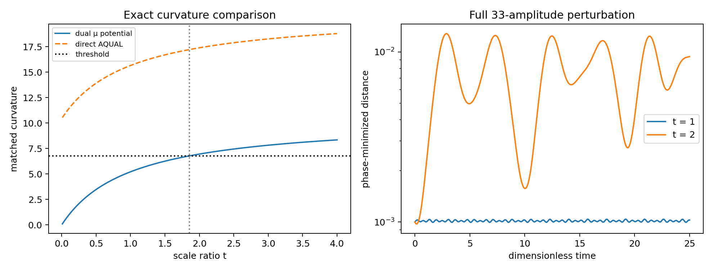

# Constitutive saturation of the registered Field Origin

[Interactive HTML companion](interactive/constitutive.html) — offline explorer of the existing results.

**Status:** [T] conditional finite Hamiltonian identities and nonlinear orbital stability theorem; [N] independent numerical tests; [F] identification of the overlap with the physical acceleration read remains open. This is the next stage of the same vertex research, not Proof 26. No new oscillator, storage ledger or spatial bond is introduced.

## 1. Recover the action already present in the settlement research

The [exchange-symmetry proof](../../../proofs/constitutive-law-exchange-symmetry/) selects μ(x)=x/(1+x) under its stated degree-one, endpoint and exchange premises. The [read–settle–register bridge](../../read-settle-register-bridge/READ_SETTLE_REGISTER_BRIDGE.md), §4, uses the finite-vacancy cost (in dimensionless magnitude variables)

$$W(b)=-b-\ln(1-b),\quad 0\le b<1.$$

Its derivative is the odds b/(1−b); its second derivative is 1/(1−b)². Thus maximizing xb−W(b) at fixed x≥0 gives uniquely b=μ(x), and the value is

$$L(x)=x-\ln(1+x),\qquad L'(x)=\mu(x),\quad L''(x)=(1+x)^{-2}.$$

The cost diverges at capacity, while the dual has a saturating slope. This is not a newly fitted polynomial. The same dual also appears in the existing [AQUAL energy](../../../proofs/aqual-energy-functional/): with y=x², F_AQUAL(y)=y−2L(√y). The correction and full energy are different objects; the sign in an actual gravitational action must follow from work conjugacy, not analogy. The bridge's premises about vacancy dynamics and work conjugacy are retained, not derived anew.

## 2. Use the existing vertex read, not a new degree of freedom

Let ψ=(A,B,O), V=[[0,C,0],[Cᵀ,0,0],[0,0,0]] and H₀ be the original Stage VII operator with the 48 direct cross-domain terms removed. C is the 16-address kernel established in the preceding research. Use the registered real overlap u=Re(A†CB)=ψ†Vψ/2. Define an overlap scale u₀>0 and t=u₀/χ*, where χ*=59/308 is the inherited normalized stationary read. The even constitutive potential is

$$F_t(u)=2(1+t)u_0 L(|u|/u_0)=2(1+t)[|u|-u_0\ln(1+|u|/u_0)].$$

Equivalently it is the stationary dual read of the same vacancy cost, maximizing 2(1+t)[u b−u₀ W(|b|)] for −1<b<1. The optimizing signed read is b=sgn(u)μ(|u|/u₀). The variable b is algebraically eliminated, not an independent dynamical coordinate. Define g_t(u)=F_t'(u)/2=(1+t)u/(u₀+|u|). The energy and exact complex Hamilton equation are

$$\mathcal H_t=\psi^\dagger H_0\psi+F_t(u),\qquad i\dot\psi=(H_0+g_t(u)V)\psi.$$

The interaction is genuinely nonlinear and quartic to leading order near the zero-amplitude state: F_t(u)=(1+t)u²/u₀+O(|u|³). It is C² even across u=0, not generally C³ there. The norm and autonomous Hamiltonian are conserved. The generator is Hermitian at every state, hence global existence on the bounded fixed-norm sphere. The scale and prefactor in this construction are chosen to preserve the existing witness, not determined by fundamental constants. In particular u is an overlap in model units; |u|/u₀ is NOT yet the gravitational x=g/a₀. At u=χ*, F_t'=2 for every t>0, so the original stationary mode and eigenfrequency survive exactly.

## 3. Sharp constitutive curvature condition

The previous note proved that the balanced fixed-z tangent changes inertia at h_c=290521/42815. Here the second derivative at the stationary overlap is

$$h(t)=\frac{2t}{\chi_*(1+t)}.$$

It is strictly increasing from 0 to 2/χ*. Consequently the sharp subcritical range is

$$0<t<\frac{h_c\chi_*}{2-h_c\chi_*}=\frac{222607}{119913}. $$

At t=1, χ*=u₀ and μ(1)=1/2, the slope matches the old interaction and h=308/59<h_c. This choice is a useful symmetric operating example, not a proof that t=1 is physically selected. At t=2 the candidate has a growing linear mode. The critical point is not decided by this strict inequality.

Do not directly use the whole AQUAL energy as the vertex potential: composing it with y=(u/u₀)² and matching the slope to 2 instead gives curvature 2(1+2t)/[χ*(1+t)]>2/χ*>h_c for every t>0. This is an exact counterexample to the idea that any constitutive energy automatically stabilizes this flywheel. The finite-capacity dual is the useful candidate here.

## 4. Nonlinear orbital stability in the full finite model [T]

This improves the earlier spectral result. Fix the normalized Stage VII stationary witness ψ* of frequency E*=11/10, with any one nonzero fixed collective orientation z. Let S be its three-complex-dimensional balanced collective subspace; in the notation of VERTEX_CURVATURE.md its embedding is E_z in both chambers, O=0. H₀ and V separately preserve S, as shown by the exact three-by-three matrices M_A and M_C (not only their sum). Hermiticity implies they also preserve S⊥, so the orthogonal projection Π_S commutes with both. For the nonlinear equation this remains true: even when g_t depends on the entire state,

$$\frac{d}{dt}\|(1-\Pi_S)\psi\|^2=0.$$

This does not mean that the complement has an autonomous Hamiltonian independent of the collective state; only that its norm cannot grow. Its phase evolution still depends on the same scalar coefficient.

### Strict energy maximum on the collective projective sphere

On the unit sphere in S modulo the common phase, take the tangent at ψ* in the complex orthogonal complement of ψ*. In the real multiplicity coordinates with metric G_m, the imaginary Hessian is a positive multiple of L=M_A+M_C−E*I restricted to x*⊥; the real Hessian is the same multiple of B_h=L+h f M_C x*x*ᵀG_m M_C restricted to that complement. Mixed Hessian is zero. The two eigenvalues of L on the complement are −33/5±√22, strictly negative. For h<h_c the rank-one criterion in the preceding note makes the real Hessian strictly negative as well. Thus ψ* modulo phase is a strict local maximum of the conserved Hamiltonian restricted to S, with a quadratic energy gap in local projective coordinates. A local maximum is as sufficient as a minimum for Lyapunov stability of an isolated energy extremum.

### Extend to arbitrary small perturbations of all 33 amplitudes

Write ψ=p+w with p∈S, w∈S⊥, initial norm one, and ε=||w||. Along the entire evolution ε is constant and ||p||=√(1−ε²). Both quadratic forms ψ†H₀ψ and ψ†Vψ split exactly, since the blocks commute with Π_S. Put p̂=p/√(1−ε²). On the norm sphere, bounded operator norms and bounded F_t' yield a constant K_t, independent of time, with

$$|\mathcal H_t(\psi)-\mathcal H_t(\hat p)|\le K_t\epsilon^2.$$

Indeed the H₀ difference is bounded by 2||H₀||ε², and the overlap difference by ||V||ε², followed by the Lipschitz bound on F_t. Conservation of total energy therefore bounds the variation of the restricted energy by 2K_tε² for every time. For any sufficiently small projective radius r, the boundary of its neighbourhood in S is compact and has a strictly positive energy deficit relative to the stationary orbit. Choose the full initial perturbation small enough that its restricted initial deficit plus 2K_tε² is less than this boundary gap. By continuity the normalized projection cannot reach the boundary. The full phase-minimized distance differs from that of p̂ by at most ε+|1−√(1−ε²)|. This proves orbital Lyapunov stability of the original stationary phase orbit for all time, for arbitrary sufficiently small normalized perturbations in the full 33-complex-amplitude model whenever 0<t<tcrit. The same argument extends to nearby norms by adding an O(|N−1|) bound; the unit-norm statement suffices here.

This is a conditional nonlinear stability theorem for the exact chosen operator and potential, not structural stability under changes to the Hamiltonian. It does not claim asymptotic attraction, stability of every original vortex state, or formation of a draining solution. The tests use the circular orientation z=(1,i,0)/√2 and the analytic argument uses the separate invariance shared by the fixed-z collective embeddings.

## 5. Transfer, root exchange and the drainless criterion

In the dark-O directional sector χ=A†CB, the vertex flux is Ṅ_A=2g_t(u) Imχ, Ṅ_B=−Ṅ_A. With O active include its local exchanges in the accounting. The total norm of all coordinates is conserved. At u=χ*, Imχ=0, the flux vanishes but g_t=1: locking does not remove the cross response. At a perfectly empty B with O dark and zero-sum directional A, u=0 and g_t=0, so B remains empty. A small phase-offset nonzero B can exchange occupation (verified). Spontaneous capture from an empty sector is not supplied by this potential.

More fundamentally, exchanging the chambers sends χ to its conjugate and leaves u invariant. The candidate saturation argument |u|/u₀ is also invariant. A chamber *share* must exchange with its complement, as μ(1/x)=1−μ(x). Therefore this invariant overlap-based μ cannot itself be the chamber fraction except at the equal-share point. It is a candidate **gain** of the registered interaction, not the physical exchange-odd partition. To recover the physical odds one needs an ordered driving read that inverts under exchange, and an independent derivation connecting that read to time-leg acceleration. Substituting N_A/N_B gives μ=N_A/(N_A+N_B) by definition, not a gravitational derivation.

The [net-field rule](../../../proofs/net-field-rule/) requires zero local TetB gravitational correction in the drainless regime, even if internal occupation and swirl persist. No-transfer locking is not that theorem: the vertex gain is nonzero there. Do not identify either zero flux or a nonzero circulating core with a static gravitational contribution. The next step is the response registration/variation with respect to the time-leg acceleration, using the existing settlement work term and a physically derived drive. Also required are the boundary conditions sustaining transfer in an open drain, the actual registered kernel from recursive time-face geometry, and a causal ordering. None is solved by choosing the equal-scale operating point.

## 6. Reproduce and scope

`OPENBLAS_NUM_THREADS=1 OMP_NUM_THREADS=1 python verify_mu_vertex.py > mu_verification_output.txt` produced **38 exact and 75 numerical assertions**. Exact checks include duality, action derivatives, reduced matrices, threshold, tangent inertia and the full invariant embedding at the tested circular orientation. Numerical checks include 66-real-coordinate Jacobian spectra, 12 entire-state integrations (251 time samples each), norm/energy/complement conservation, phase-orbit deviations, and seeded vs empty transfer. Assertion counts are not independent theorems. The CSV and plot are reproducible; finite time samples alone do not prove all-time stability, which is established conditionally in §4. Previous 3,096 named checks are retained, not rerun. No Lean certification, physical measurement, fitted physical scale or live repository mutation.
