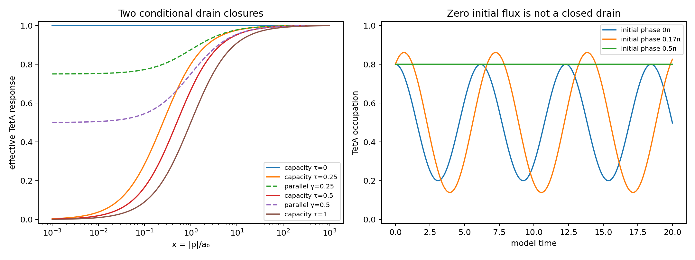

# Ordered time-face response: odds, coherent exchange and the drain boundary

*Continuation of the cumulative Field Origin vertex research · November 2026 · [T] exact conditional algebra; [E] proposed physical closure.*

The preceding constitutive vertex is stable near its published stationary witness, but its real overlap is exchange-even. Here we test the missing ordered response and ask whether closing a drain can remove the local gravitational correction without removing the flywheel. The new verifier reports **51 exact + 107 numerical = 158 checks**. This note is not a proof of physical subspace or a derivation of the drain boundary from geometry.

## 1. Root exchange is not acceleration inversion

The scheme defines σ=det(e)/sqrt(κ)=±1 at a fixed metric; P_A=(1+σ)/2, P_B=(1−σ)/2 are orthogonal sector idempotents. Constant spatial parity P=diag(1,−1,−1,−1) sends σ→−σ but preserves eᵀηe and the time coframe. With fixed observer and time orientation the Levi-Civita acceleration p=c²∇_u u is therefore unchanged. In particular its magnitude x=|p|/a₀ is unchanged. The constitutive involution x→1/x is **not** the pointwise parity action on that fixed-metric fibre (except x=1). It exchanges ordered constitutive configurations or reads, not necessarily identical spacetime states. The scheme supplies the discrete label; it does not supply x.

Given positive ordered reads R_A,R_B, their odds r=R_A/R_B and normalized contrast s=(R_A−R_B)/(R_A+R_B) satisfy s=(r−1)/(r+1), μ(r)=(1+s)/2. Swapping the reads sends r→1/r and s→−s. This algebra works for any positive reads, including norms, so cannot determine which read is gravitational. In particular substituting N_A/N_B gives the occupation fraction identically; it is not a derivation of acceleration. A balanced stationary flywheel is invariant under chamber exchange, so every exchange-odd scalar formed from it is zero. Without an ordered external read or a symmetry-breaking state it cannot distinguish arbitrary macroscopic accelerations. The discrete orientation σ must not be equated with the continuous contrast s.

## 2. Exact native ordered dynamics

In the 32 chamber coordinates, with O dark, write A,B for the two amplitude arrays, H_l for the same-chamber operator, C=Cᵀ for the registered cross kernel, χ=A†CB, u=Reχ, and g(u) for the constitutive gain. In the Hamiltonian convention iψ̇=∂H/∂ψ̄, the equations are

```
i Ȧ=H_l A+g(u) C B,   i Ḃ=H_l B+g(u) C A.
Ṅ_A=2g(u) Imχ,       Ṅ_B=−Ṅ_A,
χ̇=i A†[H_l,C] B+i g(u)(B†C²B−A†C²A).
```

These identities are for the dark-O subsystem (or instantaneous states O=0). If O is occupied, include the explicit local origin terms in both balances. The sign is positive into A. Total occupation is conserved. Under chamber exchange, χ→χ̄, so u and g are even while flux and population contrast are odd. Conjugation also reverses flux, not the even vertex gain. Zero instantaneous flux does not prove locking: its time derivative can be nonzero. Even if flux remains identically zero, the stationary constitutive witness has g=1, so a nonzero response is still possible. A drain indicator cannot in general be the instantaneous signed flux, nor does zero flux imply empty B.

### A native exact counterexample, not an additional oscillator

The same Stage VII operator has a two-dimensional common eigenspace of symmetric outer arrays with zero row and column sums and no central entries. For a normalized vector v there, H_l v=v and C v=−v/2. Take A=a v, B=b v and O=0. Then u=c Re(āb) with c=−1/2 is constant. Hence the full constitutive nonlinear system reduces **exactly on this invariant sector** to a constant-gain exchange with Ω=c g(u):

```
a(t)=exp(−it)[a(0)cos(Ωt)−i b(0)sin(Ωt)],
b(t)=exp(−it)[b(0)cos(Ωt)−i a(0)sin(Ωt)].
```

For real unequal a(0),b(0), u is nonzero and the initial flux vanishes, but Imχ̇=g c²(|b|²−|a|²) is nonzero. The 33-amplitude simulations match the exact formulas at 401 samples per initial phase. At relative phase π/2, u=0 and the overlap-gain interaction switches off in this sector. This example is not claimed to be the eight-ring/core stationary vortex: it is an exact native dark-to-base sector used to falsify the zero-flux criterion. A phase-locked stationary state requires invariance under the dynamics, not merely Imχ=0 at one moment.

### 18-dimensional ordered read obstruction

Fix the collective q in W_C, but allow distinct triplets of row, column and central coefficients for each chamber. This six-complex-coordinate sector is invariant: all sums vanish at O. The local and cross reduced operators are the same G-self-adjoint M_A and M_C from CONSTITUTIVE_VERTEX.md. In the chamber-parity basis H₀=diag(M_A,M_A), V=diag(M_C,−M_C). The occupation difference is proportional to the off-diagonal observable with upper block I₃. For any off-diagonal Hermitian observable (lower block is the metric adjoint of its upper block Z), Heisenberg commutators have upper blocks i[M_A,Z] and i{M_C,Z} respectively. Thus the real vector space of such upper blocks has dimension 18. The commutator [M_A,M_C] is nonzero.

Starting from I₃, successive applications of both real-linear maps span **all 18 real dimensions**. The verifier uses integer operators 10M_A and 2M_C, starting at real I₃ and recording the real/imaginary parts, and certifies 18 independent words by exact modular row elimination over F_1009. Since nonzero determinant modulo a prime implies nonzero integer determinant, this is a rational lower bound, equal to the ambient upper bound. The log lists the words; this is a certificate for the stated finite witness, not a sampling-based rank inference.

This excludes an invariant *linear observable closure* on just the population difference and one or two coherence records under both native generators. It is not a lower bound on independent dynamical state variables, nor a claim that the 18 observables of a pure state can be chosen independently, nor an impossibility theorem for all nonlinear reductions or particular trajectories. In the nonlinear model g depends on the full state; the commutator identity still holds instantaneously. In the balanced sector the difference is zero. The full coherent ordered read is essential unless an additional physical selection constrains the state.

## 3. The gravitational ordered response already exists in settlement

The existing read–settle–register bridge defines p=c²a (spatial relative to the time leg), q=a₀ μ(x) p/|p| at equilibrium, x=|p|/a₀. Here q is a *response acceleration*, not the microscopic four-leg phase q of the flywheel (call the latter q_phase), and not the fraction of matter in B. Its ratio to p is 1−μ(x). For x>0,

```
R_A=|p−q|, R_B=|q|,
R_A/R_B=x,  R_A/(R_A+R_B)=μ(x).
```

The two ordered responses therefore give the required odds exactly, with no new function. This is a restatement of the existing static equilibrium and **not** yet a microscopic derivation of p or q from the vortex amplitudes. It is the most direct target for linking the time-face read to the registered connection. Their exchange swaps the ratio, but a constant tetrad parity alone does not implement this operation. Static response q and occupation flux have different units and time-reversal behaviour.

The existing cost W(b)=−b−ln(1−b) is strictly convex on 0≤b<1; its Legendre dual L(x)=x−ln(1+x) satisfies L′=μ. AQUAL's dimensionless energy is x²−2L(x), whose gradient (with the conventional factor 1/2) returns the observed flux p−q. This work-conjugate relation gives a way to test a closed drain at the action level rather than by inspecting a circulating graph.

## 4. Two ways to close the same finite-capacity settlement law

The net-field proof imposes no local TetB correction for a drainless field. We now derive two candidate effective closures from the same cost, and separate the assumptions. Both use a fixed external boundary availability parameter in [0,1], not a new propagating mode, and retain the same open-state normalization a₀. Neither derives that parameter from the vortex or proves it is a physical drain. Work is p·q and the optimal response aligns with p. The formulas below are in the radial scalar representation; isotropic vector response follows from alignment. Take x>0 and define the exactly closed endpoint by q=0.

### A. Reduce the accessible capacity (series / rate interpretation)

Let c=τa₀, 0<τ≤1. Retain the original form of the cost with its acceleration scale replaced by the accessible capacity c:

$$W_τ(q)=c^2 W(|q|/c),\qquad |q|<c.$$

Maximizing p·q−W_τ gives q=τa₀ μ(x/τ) p/|p| and the dual c² L(x/τ). Consequently

$$\mu_{\rm cap}(x,τ)=1-|q|/|p|=\frac{x}{x+τ}.$$

An equivalent scalar detailed-balance reading uses the earlier vacancy law with ordered rates: ḃ=κ[x(1−b)−τ b], b*=x/(x+τ). With τ=1 this is the previously used rate law; τ=0 and x>0 make b*=1. Here b is the normalized response fraction, not the actual magnitude of q, and q=τ a₀ b. That interpretation of the rate in a partial drain is an additional model premise. Both rates vanish at x=τ=0, so the kinetic equilibrium is then nonunique; the closed gravitational branch is defined by q=0. The static q has a unique limit there. A dissipative rate description needs a reservoir or conservative completion, not supplied here.

### B. Reduce the participating channels (parallel / mixture interpretation)

Let γ∈(0,1] be the active fraction of equally driven channels. Assume those channels each implement the original cost, the rest contribute zero correction, and integrate/sum the energies. The effective cost is

$$W_γ(q)=γa_0^2 W(|q|/(γa_0)).$$

The optimum is q=γa₀ μ(x) p/|p| and dual γa₀²L(x), hence

$$\mu_{\rm par}(x,γ)=1-\frac{γ}{1+x}.$$

Both constructions are unique static minimizers within their stated cost assumptions and admit the original correction at full openness, no correction at closure, and nonnegative radial and tangential differential response for the stated parameter ranges. They are not identical at partial openness. For the same numerical availability t∈(0,1),

$$\mu_{\rm par}(x,t)-\mu_{\rm cap}(x,t)=\frac{t(1-t)}{(1+x)(x+t)}>0.$$

As x→0 at fixed t>0, capacity reduction retains the deep-field asymptotic μ≈x/t, whereas the parallel closure approaches 1−t. The latter is not a pure deep-MOND branch except when all channels participate. Their radial flux derivatives are x(x+2τ)/(x+τ)² and 1−γ/(1+x)², respectively. At large x the residual acceleration tends to τa₀ or γa₀. These distinct predictions are a test of the model premise, not alternative fits to galaxy data. At fixed τ or γ the energies are static effective functions; if openness is state-dependent, variation produces additional derivative terms and the preceding flywheel stability theorem cannot automatically be reused.



[Interactive ordered-response explorer](interactive/ordered.html) compares these two analytic models and shows the exact native exchange formula.

## 5. What might physically determine the drain availability?

The antenna interpretation provides a candidate boundary discriminator rather than a local signed current: a passive outward port has a positive semidefinite escape operator D in an effective open-system equation iψ̇=(H−iD)ψ. It produces loss d||ψ||²/dt=−2ψ†Dψ from that subsystem; closed boundary D=0 is distinct from an open but dark state ψ∈ker D. In a complete conservative field, the removed occupation must be accounted for in boundary input/output or other resolved domains; a closed finite model cannot sustain strictly positive net transfer indefinitely. This is the previously established open-throat distinction, not a new reservoir to insert into the isolated flywheel. A coherent local transfer between A and B is conservative and not itself this escape. The challenge is to derive the outward boundary read for the relevant field object from the time-face action and closure registration, including incoming/return paths.

If a proposed active-channel fraction is γ=Tr(Pρ)/Trρ for a positive record ρ and port projector P, then 0≤γ≤1. Rank(P)/16 follows only under uniform exposure ρ∝I, not generally. A rank-one projector can have exposure 1 on a bright state or 0 on a dark one; the native tests verify these examples. Thus a four-port or sixteen-address count cannot alone fix gravitational openness. If P is not selected by the boundary, inserting a rank fraction as a universal number is unjustified. Likewise no identification of γ or τ with the instantaneous vertex flux has been established. At detailed balance with positive ordered rates r,f, μ=r/(r+f), net flux is zero while gross exchange is 2rf/(r+f)>0 (in units of κ); rates and net exchange are distinct. This is a diagnostic analogy for finite-capacity response, not evidence of hidden stochastic physical events.

## 6. Next gate: connect one microscopic read to two macroscopic responses

- Derive the ordered *time-leg* drive from the actual registered antenna/Triforce state; p already has a covariant meaning, but its amplitude scale is not fixed by the graph. Use the earlier torsion registration ansatz as a comparison, not assume the axial core vortex equals this polar response.
- Derive the escape/return boundary and choose between capacity and parallel closures, or rule out both, with the actual shared-face read and the net-field criterion. Test at fixed p with coherent standing versus outgoing modes. Closing the boundary must remove the local static correction without requiring all internal circulation or bound matter to vanish.
- Compare the resulting static action and its variation with the existing SST/settlement proof, and derive the microscopic Hamiltonian or an effective reduction before asserting physical stability or the value of a₀. Do not simply identify x with N_A/N_B or |Reχ|/u₀.

## Reproduction and scope

`OPENBLAS_NUM_THREADS=1 OMP_NUM_THREADS=1 python verify_ordered_response.py > ordered_response_verification_output.txt` produces 51 exact and 107 numerical assertions, the plot, and the trajectory CSV. The finite simulations reproduce the exact native dark-channel exchange; the observable rank is certified algebraically. The new tests do not establish the physical boundary, unique choice of partial-drain closure, empirical fit, or new Lean theorem. Earlier 3,209 assertions are preserved, not rerun. Proofs 24 and 25 remain unchanged. No live repository write.
