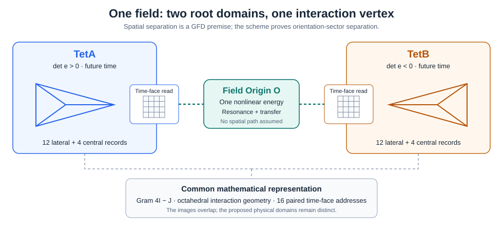
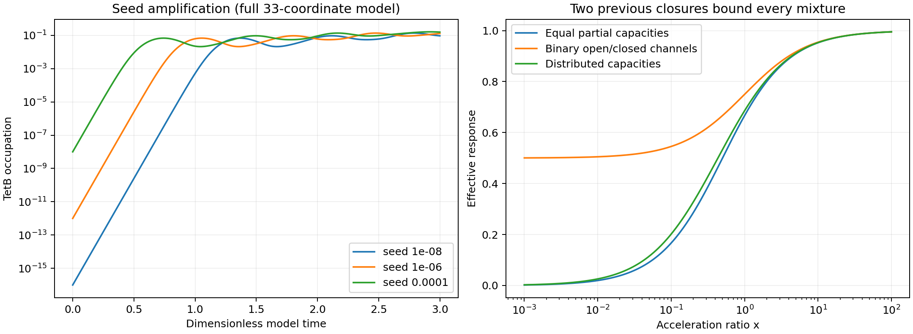
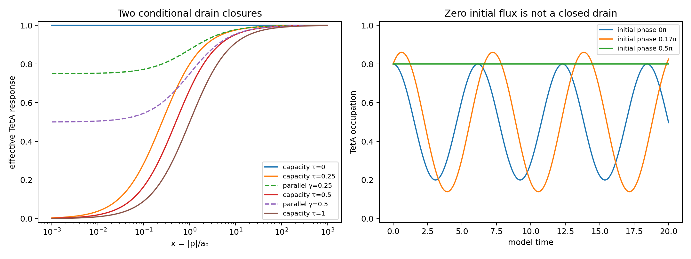
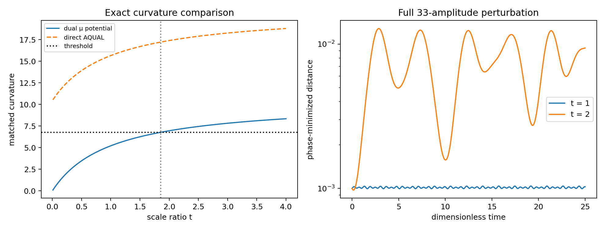
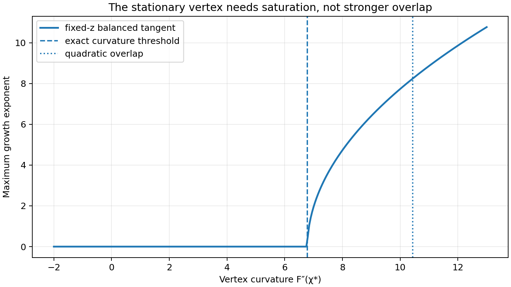
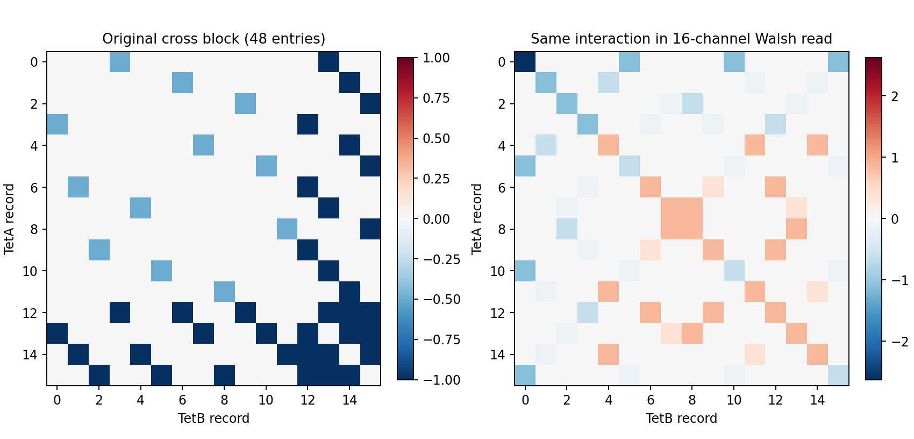
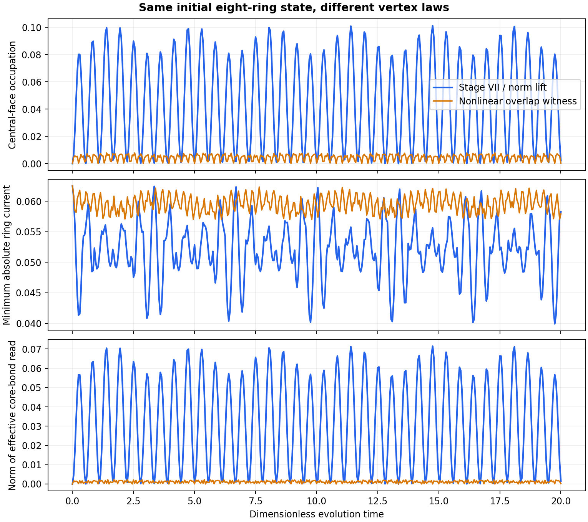

# The Field Origin as a nonlinear, nonspatial resonant vertex

*Active research · dual tetrad scheme, Sierpiński antenna, time-face read, eight-vortex flywheel · November 2026*

**Status.** Exact conditional algebra and numerical witnesses, not Proof 26. Repository base `a039b9194a4f5077a2fec405c4f61b28080f1447`. This continues the existing [Field Origin vertex opening note](../FIELD_ORIGIN_VERTEX.md) and [TetB subspace synthesis](../../../TETB_THE_SUBSPACE.md). No changes to Proofs 24 or 25, their Lean files, or the live repository.

The problem is not to discover a second engine. The GFD premise is that TetA and TetB are two physically distinct domains, with the same intrinsic tetrad geometry, coupled only through their time faces at one nonlinear Field Origin. The vertex must permit resonance **and** transfer without a spatial trajectory between chambers. It must account for the primary core vortex, the existing eight constituent vortices and settlement using one interaction law.



## Interactive HTML atlas (offline)

[Open the interactive explorer index](interactive/index.html). All six explorers are self-contained browser pages with embedded data, no external libraries or server required. Extract the archive and open `interactive/index.html`.

| Explorer | Interactive calculation or replay |
|---|---|
| [Root separation and recursive time face](interactive/geometry.html) | Relative frame rotation, cross-Gram, complete/gasket subdivision and scale |
| [Registered 16-channel kernel](interactive/kernel.html) | Adjustable d, a, k; native/Walsh matrices, rank, determinant and cross-grade mixing |
| [Collective flywheel](interactive/flywheel.html) | Play/scrub recorded Stage VII and nonlinear overlap trajectory samples |
| [Constitutive law and stability](interactive/constitutive.html) | μ and curvature, saturation and transfer illustrations, full-state perturbation playback, historical scans |
| [Ordered response and drain](interactive/ordered.html) | Compare static closures and native coherent exchange |
| [Aperture and seed recruitment](interactive/aperture.html) | Exact seed-instability threshold, capacity distribution bounds, full-state trajectory replay |

The explorers display the same conditional model results; they do not rerun the Python suites or establish new physical claims. The original figures and all recorded verification logs are retained.

## Latest continuation: time-face aperture and seeded recruitment

[Time-face aperture and seeded TetB recruitment](APERTURE_AND_SEED_RECRUITMENT.md) adds **308 new passing assertions (45 exact + 263 numerical); cumulative recorded total 3,675**. The previous 3,367 are preserved, not rerun.

- A-only row-winding state with dark O and B=0 is invariant, but a selected arbitrarily small B seed has an exact growing linear mode for h>1863/458. The same constitutive family is supercritical at the empty-partner state for every positive scale ratio; its earlier balanced stability interval remains unchanged. Full-coordinate runs illustrate substantial occupation transfer, not irreversible capture.
- The native C² spectral exposure differs at equal inventory and is strictly positive for every nonempty B. Exact drainless closure cannot be selected by this exposure alone. The previously studied rank-12 junction supplies a possible nullspace, not a derived physical switch.
- The two earlier partial-drain formulas are sharp lower/upper bounds for a mixture of reduced-capacity channels with fixed mean capacity. Their equality cases are uniform partial opening and binary opening. This links the boundary problem to the spectral distribution without assuming the physical selection law.



Reproduce: `OPENBLAS_NUM_THREADS=1 OMP_NUM_THREADS=1 python verify_aperture.py > aperture_verification_output.txt`. [Interactive explorer](interactive/aperture.html).

## Previous continuation: ordered response and drain closure

[Ordered time-face response](ORDERED_RESPONSE_AND_DRAIN.md) reconnects the vertex with the earlier settlement action. **158 new checks (51 exact + 107 numerical); cumulative recorded total 3,367**. Earlier checks preserved, not rerun.

- Pointwise spatial parity leaves the time leg and its acceleration unchanged; reciprocal constitutive odds exchange ordered responses, not merely determinant labels.
- The actual chamber population imbalance has full 18-dimensional real linear observable closure under the two native generators in the fixed-q six-complex-coordinate sector. Zero instantaneous flux does not prove locking: an exact native common eigenchannel yields coherent exchange from a zero-flux initial state.
- The existing static settlement acceleration gives the correct ordered odds, but its microscopic identification is open. Two distinct conditional boundary-availability closures of the same cost give exact drainless GR and recover the fully open law; partial openness distinguishes them. No new internal oscillator is needed, and no physical boundary selection is claimed.



Reproduce: `OPENBLAS_NUM_THREADS=1 OMP_NUM_THREADS=1 python verify_ordered_response.py > ordered_response_verification_output.txt`. [Interactive comparison](interactive/ordered.html).

## Previous continuation: the constitutive vertex and orbital stability

[Constitutive saturation of the registered Field Origin](CONSTITUTIVE_VERTEX.md) derives a nonlinear candidate from the earlier finite-capacity settlement cost, rather than inventing a new polynomial. The same research folder retains every preceding stage. The new verifier passed **38 exact + 75 numerical = 113 assertions**; the earlier 3,096 recorded assertions are preserved (not rerun).

- The existing dual L(x)=x−ln(1+x) has slope μ(x). Applied to the registered overlap it yields a saturating gain, with the matching slope and an exact curvature threshold: t < 222607/119913. The symmetric scale example t=1 is subcritical.
- **Conditional nonlinear orbital stability:** the separate local and vertex operators preserve the collective subspace; conserved complementary norm and a strict energy extremum give an all-time stability argument for arbitrary sufficiently small initial perturbations of the full 33-amplitude model. This is stronger than the prior linear criterion. It concerns this candidate only.
- Applying the full AQUAL energy directly fails the same curvature test. The overlap-based μ is an exchange-even gain, not the exchange-odd physical chamber share. Empty-partner capture and drainless gravitational registration remain open.



Reproduce: `OPENBLAS_NUM_THREADS=1 OMP_NUM_THREADS=1 python verify_mu_vertex.py > mu_verification_output.txt`. The numerical data are in `mu_vertex_trajectories.csv`.

## Continuation: registered spectrum and nonlinear curvature

**New results:** [Registered spectral vertex](REGISTERED_SPECTRAL_VERTEX.md) and [Vertex curvature](VERTEX_CURVATURE.md). The new verifier `verify_vertex_spectrum.py` passed **104 exact and 282 numerical assertions**; see `spectral_verification_output.txt`. The prior 2,710 checks are retained from the first package and were not rerun in this continuation.

- Relative registration is required for the directional cross read: under independent full S₄ relabellings with a fixed invariant kernel, only two uniform orbit records can couple. Parity supplies a candidate relative frame comparison, not a physical locking law.
- The inherited cross kernel splits into two uniform, five dark-to-base and nine triplet channels. Its exact characteristic polynomial is derived. A nonzero Stage VII kernel cannot preserve all three Walsh hierarchy grades separately. An independent scalar resonance at each depth is insufficient.
- Every quadratic-overlap coefficient split matching the published stationary state has an exact growing balanced tangent mode. The sharp curvature threshold for the fixed-z balanced perturbations is 290521/42815. The quadratic witness lies above it.
- An explicitly constructed saturating polynomial, quartic plus sextic in existing amplitudes, can match the **full** Stage VII linearization at the operating point with zero extra curvature. It has no exponential linear instability there, but this is not nonlinear orbital stability or a derived interaction law.



Run `OPENBLAS_NUM_THREADS=1 OMP_NUM_THREADS=1 python verify_vertex_spectrum.py > spectral_verification_output.txt` for the new results. No Lean build or live repository write was performed. Proofs 24 and 25 remain unchanged.

## Read this first: the main findings

| Finding | Status and significance |
|---|---|
| The tetrad scheme has a discrete orientation grading | Exact: a path of nondegenerate tetrads cannot change determinant sign. A vertex transfer of amplitudes need not be a path in this scheme. |
| The 48 Stage VII cross-chamber links are one matrix | Exact: a simple block factorization gives generic rank 16, special rank 12, 8, 4 or 0. The witness has rank 16. |
| One twice-refined time face has 16 ordered channels | Exact geometric count, conditional on Proof 23's midpoint lattice. It can encode the entire cross block by a symmetry-compatible address map. A single four-channel instantaneous read is insufficient. |
| A single quartic interaction can reproduce Stage VII exactly on a fixed-norm sphere | Constructive existence result, not a physical derivation: all relative phases and currents agree with Stage VII up to a common phase. |
| A genuinely nonlinear overlap vertex can activate the core | On the exact inversion-even collective subspace, one illustrative law gives nonzero central occupation at all 400 sampled positive times. Full-space numerical perturbations grow substantially; robust stability is not established. |
| No net transfer does not mean no TetB occupation or no TetB response | Exact distinction: the drainless gravitational branch still needs a derived response law. |

## Reading order

1. [Scheme and root algebra](SCHEME_AND_TIME_FACE.md): the two determinant sectors, their algebra, the common representation, and the status of the time-face selection.
2. [Antenna, hierarchy and resonance](ANTENNA_AND_SPECTRAL_READ.md): recover the Sierpiński work, reconcile the historical counts, and connect the frequency/read algebra to the vertex without confusing a physical antenna with a subspace.
3. [The 48-link factorization](VERTEX_FACTORIZATION.md): derive the full matrix, rank strata, the 16-channel read, the collective reduction, and the limited capacity of an unrefined face.
4. [Nonlinear dynamics and falsification](NONLINEAR_DYNAMICS.md): conservative exchange, pair transfer, empty chamber obstruction, quartic lift, actual flywheel tests and stability limitations.
5. [Source register and next gates](SOURCE_REGISTER.md): earlier proof chain, source commits, past-chat results, older candidate failures, and the work required before a formal proof.

## The mathematical connection in one equation

In each chamber label the twelve lateral tiles by ordered pairs X_ij, i ≠ j, and the four central faces by y_i. Let Q sum the columns, T transpose the off-diagonal array, and K = J−I. Then the full Stage VII interaction between the two sixteen-coordinate chambers is

$$C=\begin{pmatrix}dT&aQ^T\\aQ&kK\end{pmatrix}.$$

There is no need to draw 48 spatial bonds in a new model. The same matrix can act on two separately read time-face amplitude records. One vertex does not mean one scalar channel. The decomposition is precise: for d ≠ 0,

$$C=L\begin{pmatrix}dT&0\\0&(k-a^2/d)K\end{pmatrix}L^T,\qquad L=\begin{pmatrix}I&0\\(a/d)QT&I\end{pmatrix}.$$

This identifies both the generic full rank and the condition dk=a² that reduces the rank. See the factorization note for the full proof.



The next step is not to assert that a time face implements this matrix. It is to derive how its matched recursive resonance selects a coupling kernel and a vertex response. Our exact construction establishes mathematical compatibility, not physical necessity.

## What the simulation actually shows



The blue trajectory is the established linear Stage VII witness and the projectively identical quartic lift. The orange trajectory is a different nonlinear law acting on the **same** chamber amplitudes, with the 48 direct hopping terms absent from the local Hamiltonian. Both are conditional finite models. The plotted cross-read is a decomposition of the vertex-mediated exchange, not current through a physical tunnel. The nonlinear curve uses the invariant collective sector; a general-state perturbation test is recorded separately and is not stable in this example.

## Reproduce

```sh
python -m pip install numpy scipy sympy matplotlib
OPENBLAS_NUM_THREADS=1 OMP_NUM_THREADS=1 python verify_vertex.py > verification_output.txt
```

The verifier produces two figures and `trajectory.csv`. **122 exact + 2,588 numerical = 2,710 fresh assertions passed.** Numerical comparisons use the explicit tolerances in the code; many are repeated time samples, not independent theorems. `inherited-research/` preserves six earlier documents from our local research packages (not fresh reruns). See `SOURCE_REGISTER.md` for upstream sources. All new results are conditional on the stated finite model, not measurements or a new Lean certification.

## Before Proof 26

Derive the actual vertex read and nonlinear kernel from a time-face boundary/interaction action; distinguish the root-sign invariant from a continuous state share; derive the causal time ordering and physically meaningful conserved quantity; test full-space nonlinear stability and empty-TetB capture; derive the drainless net-field response rather than equate it to phase locking. A failure at any gate is a result, not a reason to alter Proofs 24 and 25.

## Later continuations

The continuations after the aperture study (clock closure and registration, hierarchical NET Field closure, atomic inverse reconstruction, the recursive Sierpiński generator, native generator normalization and the projective norm Walsh bridge) are in [`research/g_from_topology/updated-research/`](../../g_from_topology/updated-research/).
