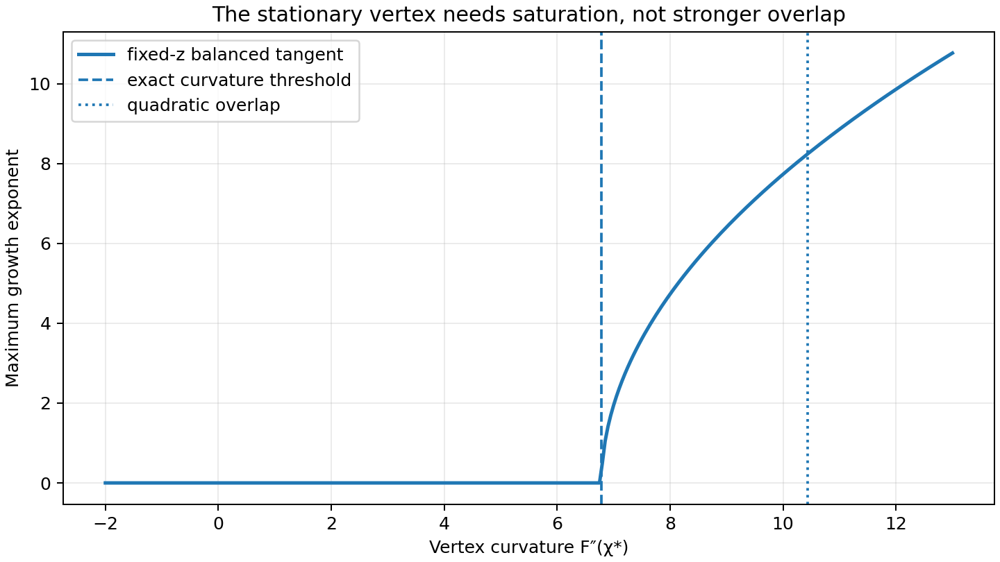

# The nonlinear vertex: exact instability and a curvature criterion

[Interactive HTML companion](interactive/constitutive.html) — offline explorer of the existing results.

**Status:** [T] exact conditional linearization and fixed-z balanced-sector spectral criterion; [N] full-space numerical Jacobian tests. The physical origin of the response function, nonlinear orbital stability, causal transport and gravitational normalization are open. This is a continuation of `NONLINEAR_DYNAMICS.md` and the Stage VII collective algebra.

## 1. Do not tune the resonance and transfer terms blindly

For χ=A†CB take H_O=λ|χ|²+κ Re(χ²), with real coefficients and θ=0 as in the previous study. Use i dot A=∂H/∂Ā. On A=B=p, χ real and the gradient is (λ+κ)χ Cp. On the balanced invariant sector the whole vertex depends only on β=λ+κ. The difference κ−λ changes the transverse chamber-odd response, not balanced dynamics. A varying split with fixed β cannot cure an instability within the balanced sector.

Take the existing Stage VII stationary branch, normalized with x*=(1/3,1,−4/15), q_i=s_i·z, ||z||=1, and chamber amplitudes p=ρ√(75/77) E_z x*, ρ=√3/8. The 16×3 embedding E_z maps x to the lateral/base amplitudes without the common factor. The single-chamber inner product is f G_m, f=225/1232, where G_m is the previously derived multiplicity metric. Both chambers have total occupation one. The original linear eigenfrequency is E*=11/10. The exact registered overlap at this state is

$$\chi_* = f x_*^T G_m M_C x_* = 59/308.$$

To keep this particular stationary state in the nonlinear model we must have βχ*=1, so β=308/59. This constraint is on the chosen model, not a physical coupling normalization.

## 2. Exact balanced tangent calculation

Let u=Reχ. Consider a more general vertex energy F(u) on the balanced submanifold; a full phase-sensitive extension may depend also on v=Imχ. Assume its stationary gradient matches the inherited coupling, F′(χ*)=2, and its mixed u,v derivative vanishes there (e.g. exchange-symmetric extension). Put h=F″(χ*). Work in the rotating frame, writing the fixed-z balanced multiplicity perturbation as ξ+iη. Define

$$L=M_A+M_C-E_* I,\qquad B_h=L+h f M_C x_*x_*^TG_m M_C.$$

Both are self-adjoint for G_m; Lx*=0. This follows by differentiating χ=f x†G_m M_C x, so δu=2f x*ᵀG_m M_C ξ and the gradient factor F′(u)/2 has variation h δu/2. The linearized equations are

$$\dot\xi=L\eta,\quad \dot\eta=-B_h\xi,\quad \ddot\xi=-LB_h\xi.$$

The exact characteristic polynomial of −LB_h (variable ℓ) is

$$\ell\left[\ell^2+\frac{1802900-257375h}{13750}\ell+\frac{6391462-941930h}{13750}\right].$$

For the quadratic overlap F(u)=βu², h=2/χ*=616/59≈10.44068. Its characteristic polynomial becomes

$$\ell(36875\ell^2-2371450\ell-9233301)/36875.$$

The constant term of the quadratic is negative, so exactly one of its roots is positive. That gives a real exponentially growing tangent mode, rate √ℓ₊≈8.245796 per dimensionless time. This is not an artefact of the numerical integrator, and it holds for every λ,κ split that preserves this stationary state. A full 33-complex-amplitude Jacobian scan (241 splits, κ/β from −3 to 3) corroborates the result. Changing the split can remove odd-sector exponential growth in the tested model (e.g. κ/β=1 or 2), but it never changes the even-sector growth. The conclusion is specific to this interaction family and stationary witness, not a no-go theorem for all nonlinear vertices or all vortex states.

## 3. A sharp curvature threshold

On the G_m-orthogonal complement of x*, L is negative definite: its two eigenvalues are −33/5±√22, both negative. Let Π be the G_m-orthogonal projection onto x*, b=(I−Π)M_C x*. The restricted B_h is L restricted to that complement plus a rank-one update h f b bᵀG_m. Therefore the exact threshold at which it ceases to be negative definite is

$$h_c=\left[f b^T G_m(-L+\Pi)^{-1}b\right]^{-1}=290521/42815\approx6.785496.$$

For h<h_c both non-gauge squared frequencies are strictly negative: on the complement −L is positive definite and −LB_h is similar to a symmetric matrix of the same inertia as B_h. At h=h_c an additional zero mode appears; Jordan behavior and nonlinear terms then matter. For h>h_c exactly one squared frequency is positive. The calculation is on the projective fixed-norm tangent of the balanced fixed-z sector; the x* direction and common phase are not extra modes. It is not a sufficient full-space orbital-stability condition.

The conclusion is that the proposed response needs enough saturation (smaller curvature at the operating point), not arbitrarily strong positive overlap feedback. A resonator's frequency matching alone cannot decide this; its nonlinear energy response must also be specified.

## 4. A constructive nonlinear counterexample to inevitable instability

A simple polynomial potential, chosen solely as an existence witness, is

$$F(u)=2u^2/\chi_* - 2u^3/(3\chi_*^2).$$

It has no bilinear field term, since u itself is bilinear in A,B and F′(0)=0. The potential is quartic plus sextic in the amplitudes. It satisfies F′(χ*)=2 and F″(χ*)=0. Extend it to the full space using u=Re(A†CB) with no dependence on Imχ. Its interaction gradient is [F′(u)/2] times the original cross action. At the stationary state this equals C and its first derivative with respect to either real overlap coordinate vanishes. Thus the entire linearization in the rotating frame is exactly −i(H_VII−E*I), a skew-adjoint operator on the full 33-complex-dimensional model. There is no exponentially growing tangent mode, no new oscillator and no direct inter-domain spatial hopping in the local energy. Twenty independent finite-difference Jacobian tests confirm the identity. It is a genuinely nonlinear law away from the operating point; unlike the norm lift it does not have identical projective dynamics throughout the norm sphere.

This example is **constructed**, not derived. χ* is a number inherited from the stationary witness, not a fundamental constant. F′(0)=0 also means it cannot seed an exactly empty partner through this overlap alone, and boundedness on the fixed finite norm sphere does not imply physical energy positivity or nonlinear orbital stability. A common-phase invariant norm-assisted single-overlap term can seed the partner but requires independent derivation and stability analysis. Do not elevate this polynomial to the GFD law; its role is to prove that the quadratic-overlap instability is not compulsory and to isolate the required local derivative conditions.

## 5. What locking and transfer actually mean

For a scalar illustrative restriction χ=ĀB, with total norm one, p=N_B and φ=arg B−arg A, a common-phase-invariant quartic vertex plus detuning reads

$$H=\Delta p+p(1-p)(\lambda+\kappa\cos2\phi)+\gamma\sqrt{p(1-p)}\cos\phi.$$

The last term is γN Reχ prior to fixing N=1. It is quartic and can seed an empty partner, unlike the squared-overlap law. The canonical equations (away from endpoints) are ṗ=∂H/∂φ, φ̇=−∂H/∂p. In unrestricted scalar coordinates the exchange rate is Ṅ_A=2κ Imχ²+γN Imχ and Ṅ_B=−Ṅ_A. At p=1/2, φ=0 and Δ=0, both rates vanish; the linearized angular-frequency squared is

$$(\gamma+2\kappa)(\gamma+\kappa+\lambda).$$

Its sign distinguishes an elliptic or hyperbolic fixed point (zero is inconclusive). Thus zero instantaneous transfer is not equivalent to a stable locked state. It is also not equivalent to zero TetB occupation or vanishing gravitational susceptibility. These elementary identities do not assume a drain switch or two separate mechanisms. An autonomous finite closed model can exchange occupation back and forth, but cannot sustain nonzero mean transfer indefinitely without an accounted environment/return network. The net-field rule still requires a derived gravitational response read in the drainless branch, and the shared time convention of this finite Hamiltonian is not derived from the scheme.

## 6. What must be derived next

Find the time-face action giving the actual registered kernel and nonlinear curvature. Independent criteria include: empty-partner activation where physically allowed; stability around the existing eight-ring/core configuration; conserved full-field accounting; phase-locking and detuning under the same law; and a response that vanishes in the drainless net-field regime. The gradient and Hessian are different mathematical data. Recovering a known linear matrix at one point does not fix nonlinear stability. No statement or formalization of Proofs 24 and 25 changes here.
