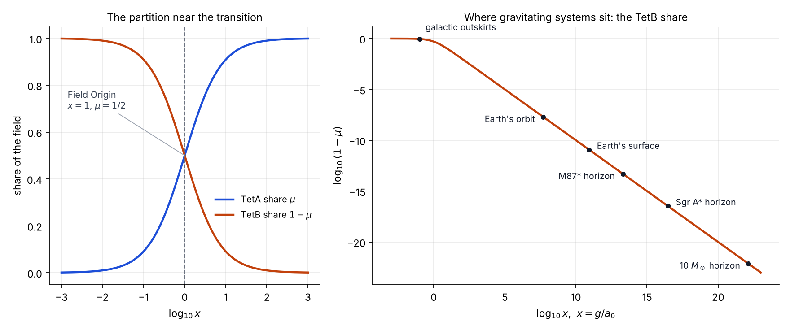

# The Universe Is Not a Goldfish

### On black holes, the persistence of information, and the other side of gravity

*Gravity Field Dynamics · Field Dynamics Research*

---

The universe has spent nearly fourteen billion years writing a story.

From an almost uniform beginning came galaxies, stars and the elements forged within them. From those elements came chemistry, living cells, consciousness, and eventually minds capable of asking how the story began.

Each chapter was written in the language of the one before it. Nothing emerged independently of what had already happened. The universe became not merely a collection of things, but a history of relationships between them.

Then, in 1975, Stephen Hawking discovered something extraordinary: black holes radiate. A year later, he argued that when a black hole disappears, the information that fell into it may disappear as well.

If so, nature possesses something far stranger than a mechanism of destruction. It possesses a mechanism of forgetting.

Imagine a universe with the memory of the proverbial goldfish. It circles its bowl, building and rebuilding a world whose history is forever slipping away. Real goldfish, incidentally, remember far more than folklore credits them with.

Perhaps the universe does too.

> **What if information was never lost? What if our description of gravity left out the geometry in which it could be retained?**

This is the question explored here through Gravity Field Dynamics (GFD), the geometry of the full affine connection, and the 24 torsion components absent from the torsion-free connection of general relativity.

---

## I. A book that loses its chapters

Information is more than inventory. It is arrangement, relationship and correlation.

| The architecture of a book | The architecture of nature |
| --- | --- |
| Letters | Elementary particles |
| Words | Atoms |
| Sentences | Molecules |
| Paragraphs | Organized material structures |
| Chapters | Organisms, planets and stars |
| The story | The history that connects them |

A sentence on page three hundred may owe its meaning to something written on page forty. The letters alone do not contain that meaning. It lives in their relationships, including relationships across great distances in the book.

Now imagine that chapters begin to disappear. They have not been torn out and scattered across the room. They have ceased to exist. What remains is not simply a shorter story. It is a story whose references have been severed.

Burn a book, by contrast, and its information is dispersed into smoke, ash, light and the surrounding environment. In an ideal closed quantum description, the original information remains encoded in the resulting state, however impossible its recovery might be in practice.

**Scrambling is not deletion.**

Hawking's semiclassical calculation gives outgoing radiation entangled with degrees of freedom behind the horizon. If those partners disappear at complete evaporation, without the correlations being recovered elsewhere, the radiation is left in a mixed state even though the complete initial state was pure.

For an initial density operator $\rho_{\mathrm{in}}$ and a unitary evolution $U$,

$$
\rho_{\mathrm{out}}=U\rho_{\mathrm{in}}U^\dagger,
\qquad
S(\rho_{\mathrm{out}})=S(\rho_{\mathrm{in}}).
$$

The entropy of a subsystem may change. The von Neumann entropy of the complete closed system does not.

This is the information paradox: can gravity erase what quantum mechanics requires it to preserve?

A universe with genuine information deletion would be a universe whose history is not fully recoverable from its final state. The concern about accumulated complexity is a motivation, not a theorem imposing a universal complexity ceiling.

## II. The other side of the page

The metric describes the geometry of spacetime. The affine connection describes how objects are transported through it.

In four dimensions its coefficients admit a simple algebraic partition:

$$
\underbrace{4^3}_{64}
=
\underbrace{4\times10}_{40}
+
\underbrace{4\times6}_{24}.
$$

Equivalently,

$$
\Gamma^\lambda{}_{\mu\nu}
=
\Gamma^\lambda{}_{(\mu\nu)}
+\tfrac12 T^\lambda{}_{\mu\nu}.
$$

The torsion-free condition sets $T^\lambda{}_{\mu\nu}=0$. With metric compatibility, the remaining connection is the Levi–Civita connection. This is a defining choice of general relativity, not an algebraic mistake.

GFD reopens that choice through the paired tetrad geometry developed in its [field-partition research](../../EINSTEIN_TETA_PARTITION.md). Its proposed interpretation associates the retained geometry with TetA and the restored torsion sector with TetB. In this construction, the latter carries distinctions that the metric alone does not resolve.

| | TetA | TetB |
| --- | --- | --- |
| Geometric partition | 40 symmetric connection coefficients | 24 torsion components |
| GFD constitutive fraction | $\mu(x)$ | $1-\mu(x)$ |
| Role in this investigation | Familiar gravitational response | Candidate information-bearing geometry |

A page has two sides. A reader permitted to see only one cannot determine what is written on the other.

The analogy is not that general relativity has no means of encoding information. Rather, GFD asks whether the geometry excluded by its torsion-free condition supplies an additional physical channel for preserving correlations.

The 24 is an algebraic component count, not a count of independent propagating quantum modes. Establishing the physical state space is part of the problem.

## III. The paradox within the paradox

The GFD constitutive law is

$$
\mu(x)=\frac{x}{1+x},\qquad
1-\mu(x)=\frac{1}{1+x},\qquad
x=\frac{g}{a_0}.
$$

If the torsion sector is a candidate for gravitational memory, one might expect it to dominate precisely where the information paradox arises. The calculation says otherwise.

At a Schwarzschild horizon, taking the surface gravity $\kappa=c^4/(4GM)$ as the acceleration scale in the constitutive law, the following values result:

| Black hole (mass scale) | $\kappa/a_0$ | TetB fraction |
| --- | ---: | ---: |
| Stellar, $10M_\odot$ | $1.3\times10^{22}$ | $8\times10^{-23}$ |
| Sagittarius A*, $4.3\times10^6M_\odot$ | $2.9\times10^{16}$ | $3\times10^{-17}$ |
| M87*, $6.5\times10^9M_\odot$ | $2.0\times10^{13}$ | $5\times10^{-14}$ |



*The strong-field limit suppresses the TetB acceleration fraction. It does not, by itself, determine the number of distinguishable states in that sector.*

That distinction is the heart of this investigation.

A book need not grow heavier when its letters are rearranged into a different story. The energy of a signal does not, by itself, specify the information encoded in it.

Likewise, a small constitutive fraction does not establish a small information capacity. Nor does it guarantee a large one. Capacity must be derived from the sector's physical states, their distinguishability and their dynamics.

**The proposed memory is in the configuration, not the fraction.**

The horizon calculation therefore supplies both an opportunity and a constraint: GFD approaches its familiar high-acceleration limit while leaving open the question of whether the restored geometry can carry information. It is not, on its own, a precision prediction for relativistic images, ringdowns or horizon smoothness.

## IV. What the full connection changes

The [companion mathematical note](singularities-information-and-holography.md) develops the Raychaudhuri equation for a metric-compatible connection with torsion. For the timelike autoparallel congruence and conventions used there,

$$
\frac{d\theta}{d\tau}=-\frac{\theta^2}{3}-\sigma_{ab}\sigma^{ab}
+\omega_{ab}\omega^{ab}-R_{ab}u^au^b
+T^d{}_{ab}u^b\nabla_du^a.
$$

The torsion term separates into three irreducible contributions:

| Sector | Components | Kinematic coupling |
| --- | ---: | --- |
| Vector | 4 | Expansion |
| Axial | 4 | Vorticity |
| Tensor | 16 | Shear and vorticity |

The same 24 components have an $8\times3$ organization in GFD's closed-frame construction: eight null directions and three rotation planes. The research connects this geometry to tetrahedral symmetry and chiral holonomy. These are structural clues, not yet a microscopic theory of black-hole states.

The calculation also identifies a hard limit. From the constitutive law,

$$
 g(1-\mu)=a_0\mu\leq a_0.
$$

If torsion amplitude is set solely by that acceleration, its scale is bounded by $a_0/c^2$. The resulting explicit torsion term is far too small to arrest strong-field collapse at the representative horizon scales above.

The possible alternative is a source that grows with the spin density of matter, as in Einstein–Cartan theory. Such coupling can produce a repulsive contribution quadratic in spin density in appropriate models. Deriving this source from the GFD action, and establishing its effect on collapse, remain open tasks.

## V. Three mathematical echoes

The same constitutive law produces three further identities, each pointing toward a familiar language of modern physics.

| Identity | Mathematical connection | What it does not yet establish |
| --- | --- | --- |
| $F(y)=y-2\sqrt y+2\ln(1+\sqrt y)$ | The logarithmic term is generated by integrating the TetB fraction and resembles the Shannon–Hartley capacity formula. | A physical communication channel or its capacity. |
| $d\mu/d\ln x=\mu(1-\mu)$ | A logistic flow between the two constitutive fixed points. | Quantum renormalizability or a quantum beta function. |
| $M_{\mathrm{extra}}=a_0r^2\mu/G$ | Area scaling of the Newtonian-equivalent mass residual in spherical symmetry. | The black-hole entropy area law or holography. |

These connections are worth investigating not because the same mathematical shapes guarantee the same physics, but because they provide precise places at which a deeper connection can be tested.

## VI. The test Hawking leaves us

For the proposed geometry to become a genuine resolution of the information paradox, three things must follow from the theory rather than be imposed upon it.

**1. The memory must be counted.** Identify the physical, distinguishable states of the restored sector and derive the Bekenstein–Hawking entropy, including its coefficient:

$$
\frac{S_{\mathrm{BH}}}{k_B}=\frac{A}{4\ell_P^2}.
$$

**2. The memory must be returned.** Derive a dynamical channel by which information about the infalling quantum state becomes encoded in the outgoing radiation, without simply postulating a transfer.

**3. The story must close.** Calculate the fine-grained entropy of the radiation over evaporation. For a pure initial state with complete unitary evaporation, it must rise and ultimately return to zero: the Page curve. Modern island and replica-wormhole results provide important benchmarks for this task.

A complete theory must also address the AMPS firewall argument. A small TetB acceleration fraction does not by itself resolve the entanglement constraints or establish a smooth horizon.

These are the tests that separate a candidate for gravitational memory from a theory of gravitational memory.

## VII. Research and verification

| Resource | Purpose |
| --- | --- |
| [Singularities, Information and Holography in GFD](singularities-information-and-holography.md) | Full derivations, assumptions, comparisons with established results and open problems. |
| [Verification script](verify_identities.py) | Constitutive identities, randomized torsion contractions and horizon-scale estimates; 16 checks. |
| [Regime map](regime_map.png) | Visualization of the TetA/TetB partition across gravitational scales. |
| [Tetrad partition](../../EINSTEIN_TETA_PARTITION.md) | The GFD geometric interpretation of the 40/24 partition. |
| [Tetrahedral torsion symmetry](../../papers/algebraic-papers-a-b-c/gfd_paper_b_torsion_S4.tex) | Representation-theoretic construction underlying the restored sector. |

From the repository root:

```bash
cd research/hawking
python verify_identities.py
```

Requires NumPy and SymPy. The companion note reports 16 passing checks. These checks support the algebraic identities and numerical estimates; they do not establish the proposed quantum information mechanism.

**Research status.** This is an investigation, not a claimed resolution of Hawking's paradox. The algebraic partition, the constitutive identities and the kinematic decomposition supply the foundation. The physical state count, spin-sourced dynamics, information-return channel and Page curve remain to be derived.

---

## Epilogue — The history of everything

Hawking taught us that a black hole is not simply the end of a star. It is a question about what nature is allowed to forget.

Perhaps the geometry that carries the answer is not something we must add to gravity, but something we must learn to read in the connection we already know.

A universe may burn its books. It may scatter their letters across the heavens. It may conceal their meaning beyond the reach of any observer.

But if quantum mechanics is right, nature never loses the story.

**The universe is not a goldfish.**

The work is to show why.

---

### Selected references

- Hawking, S. W. (1975). [Particle creation by black holes](https://doi.org/10.1007/BF02345020). *Communications in Mathematical Physics* 43, 199–220.
- Hawking, S. W. (1976). [Breakdown of predictability in gravitational collapse](https://doi.org/10.1103/PhysRevD.14.2460). *Physical Review D* 14, 2460.
- Bekenstein, J. D. (1973). [Black holes and entropy](https://doi.org/10.1103/PhysRevD.7.2333). *Physical Review D* 7, 2333.
- Page, D. N. (1993). [Information in black hole radiation](https://doi.org/10.1103/PhysRevLett.71.3743). *Physical Review Letters* 71, 3743.
- Almheiri, A., Marolf, D., Polchinski, J. and Sully, J. (2013). [Black holes: complementarity or firewalls?](https://arxiv.org/abs/1207.3123). *JHEP* 02, 062.
- Luz, P. and Vitagliano, V. (2017). [Raychaudhuri equation in spacetimes with torsion](https://arxiv.org/abs/1709.07261). *Physical Review D* 96, 024021.
- Popławski, N. J. (2012). [Nonsingular, big-bounce cosmology from spinor-torsion coupling](https://arxiv.org/abs/1111.4595). *Physical Review D* 85, 107502.
- Penington, G. (2020). [Entanglement wedge reconstruction and the information paradox](https://arxiv.org/abs/1905.08255). *JHEP* 09, 002.
- Almheiri, A. et al. (2020). [Replica wormholes and the entropy of Hawking radiation](https://arxiv.org/abs/1911.12333). *JHEP* 05, 013.

The complete bibliography and mathematical conventions are in the [companion note](singularities-information-and-holography.md).
