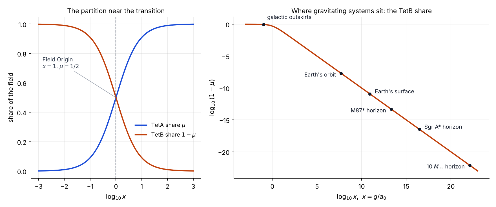

# The Universe Is Not a Goldfish

*Black holes, information and the 24 forgotten components of gravity · Gravity Field Dynamics (GFD) · Field Dynamics Research*

`black-holes` `information-paradox` `hawking-radiation` `raychaudhuri-equation` `torsion` `einstein-cartan` `holography`

---

Folklore says a goldfish remembers for three seconds. Every lap of the bowl is a new world, and nothing it has seen survives. (Real goldfish do better. Trained to press a lever for food at a set hour, they learn the schedule, and they keep what they learn for months.)

Now imagine a universe built like the goldfish of the folklore.

For thirteen billion years it has done expensive, improbable work. It has spent energy building structure out of uniformity: galaxies from gas, stars from galaxies, chemistry from starlight, cells, brains, books. Information has accumulated, layer upon layer of correlation and order. Then some of that structure falls into a black hole. Over an unimaginable span of time the black hole evaporates as Hawking radiation, which in the standard calculation is perfectly thermal and carries no imprint of what fell in (Hawking 1975). If that calculation is the whole story, the information is not hidden or scrambled. It is gone (Hawking 1976).

A universe like that spends energy only to forget. It would carry a firewall on information complexity, a limit on how much of what it builds can ever persist, because everything that falls through the wrong door is wiped. It would be a goldfish, circling its bowl, rebuilding what it cannot remember having built.

Quantum mechanics forbids this. Its evolution is unitary: information can be scrambled beyond practical recovery, but never destroyed. That is the black-hole information paradox, and fifty years later it remains one of the deepest tensions between gravity and quantum theory.

## A book that loses its chapters

The goldfish forgets in moments. The universe of the paradox forgets in a way that is stranger and, for anything built over time, more destructive. Think of information the way a language builds it:

| In a book | In the universe |
|---|---|
| characters | elementary particles |
| words | atoms |
| sentences | molecules |
| paragraphs | cells, minerals, weather |
| chapters | organisms, planets, stars |
| the story | the history that links them |

A book's meaning does not live in its letters. It lives in their arrangement, and above all in the relations between levels. A word means what it means because of the sentence around it. A sentence on page three hundred lands because of a chapter you read on page forty. The deeper a story goes, the more of it is carried by these long-range references: the callback, the foreshadowing, the character whose choice only makes sense in light of what happened two hundred pages earlier.

Now imagine reading that book and finding that, partway through, chapters have begun to disappear. They have not been torn out and left on the floor, where in principle you could gather them up. They have simply ceased to exist. What remains is not a shorter story but a broken one. Every later sentence that refers back to a vanished chapter now points at nothing. Names arrive without introduction. Consequences arrive without causes. The surviving text is still made of perfectly good words, yet read as a whole it has turned into noise.

That is the precise sense in which Hawking radiation looks thermal. The radiation that leaves a black hole is not random in itself. In the standard picture it is entangled with partners that fell inside, the way a sentence is bound to the chapter it refers back to. If the interior, and everything that fell into it, is erased when the black hole evaporates, the radiation is left full of references to chapters that no longer exist. Its correlations point at nothing, and a state that began as a coherent story ends as featureless heat. A pure state has become a mixed one. That is the violation of unitarity, told as a book.

**Losing chapters is not the same as scrambling them.** Shred a book, or burn it, and the information is not destroyed. It is dispersed into fragments, smoke, ash and light, and in principle, if hopelessly in practice, the text could be reconstructed. Physics permits scrambling; this is the sense in which burning a book preserves its information. It does not permit deletion. The paradox is whether a black hole is a shredder or a deleter.

**Why a deleting universe caps its own complexity.** In a universe that deletes, every story is provisional. Structure can be built, but any of it that crosses a horizon removes its chapters from the record, and everything downstream that depended on them loses its meaning. Complexity could never accumulate past the point where its material falls through. There would be a ceiling on how long and how deep a coherent story the universe could ever tell. That is the firewall on information complexity, and the goldfish in the bowl is its emblem.

**The answer, if there is one, will look like recovery.** A unitary black hole behaves like a reader handed the book one scrambled fragment at a time. For the first half of the black hole's life, the fragments in the radiation look like noise, because their partners are still inside. Past the halfway point (the Page time) they begin to fit together, and by the end the whole text has been returned. This rise and fall of the radiation's entropy is the Page curve. Recovering it is the test every proposed resolution has to pass.

### The other side of the page

GFD's proposal fits the book image closely. Every page has two sides. The tetrad equation has two roots, TetA and TetB, related by parity, and the metric cannot tell them apart: it reads only the front of each sheet. General relativity, by imposing the torsion-free condition, bound the book with the front sides alone. It kept the 40 components that the metric determines and discarded the 24 that carry the distinction between the roots.

On this reading, nothing in the book was ever deleted. The chapters that seem to vanish into a black hole are written on the backs of the pages, in the torsion sector, a part of the field that a front-side-only theory cannot read. Restore the 24 components, and the reader can turn the pages over.

## Where gravity keeps its memory

Gravity Field Dynamics offers a structural answer: general relativity forgot to keep the memory.

- **The forgotten components.** The gravitational connection, the mathematical object that tells a frame how to turn from point to point, has $4^3 = 64$ components. In 1915 general relativity imposed the condition that the connection be torsion-free. That keeps 40 components and discards the other 24.
- **What GFD says they are.** GFD identifies the discarded 24 with the second root of the tetrad equation, the TetB chamber of the stellated octahedron, and shows that the torsion-free condition is a projection, not a rewriting (Letter 3; [`EINSTEIN_TETA_PARTITION.md`](../../EINSTEIN_TETA_PARTITION.md)).
- **Why they could hold memory.** A theory that keeps only the torsion-free 40 has nowhere geometric to keep a record. Restore the 24, and the field gains a sector with rich structure of its own:
  - its components carry the full symmetry of the tetrahedron, every irreducible representation at full multiplicity (Paper B);
  - they organise into eight null directions, each with three rotation planes;
  - transport around them picks out a preferred axis.

That sector is the candidate for gravity's memory.

## What the note shows

The working note, [*Singularities, Information and Holography in GFD*](singularities-information-and-holography.md), takes the idea through four of the hardest problems in gravitational physics. It is deliberately honest about where the proposal stands.

**Black holes sit deep on the familiar side of the field.** The partition between the two chambers depends only on field strength. At the horizon of a black hole the field is $10^{13}$ to $10^{22}$ times the transition scale, so the second chamber's share is $10^{-14}$ to $10^{-23}$. GFD therefore agrees with general relativity at horizons to that precision, which is why it sits comfortably with the Event Horizon Telescope's images and with gravitational-wave ringdowns.



**The Raychaudhuri equation for the full connection.** The note derives the equation that governs gravitational focusing, the engine of the singularity theorems, for all 64 components. Each kind of torsion turns out to couple to one feature of the collapsing matter:

| Torsion part | Components | Couples to |
|---|---|---|
| Vector | 4 | expansion |
| Axial | 4 | vorticity, the one term that resists collapse |
| Tensor | 16 | shear and vorticity |

**Memory needs more than a share of the field.** A torsion sector whose strength simply follows its share of the acceleration is too weak to stop collapse, by fourteen to twenty-three orders of magnitude. The same arithmetic says that any record kept inside a black hole must live in the *configuration* of the restored sector, not in its share of the field. What would work is torsion sourced by the spin of matter. In Einstein–Cartan theory, spin–torsion coupling produces a repulsion that grows faster than gravity at extreme density and turns a singularity into a bounce (Popławski 2012). Deriving that source from the GFD action is now a precise target.

**Three more identities.**
- **The kinetic energy of the field.** Its logarithmic term comes entirely from the second chamber, and it has the form of Shannon's channel capacity, $\log(1 + S/N)$, with the field strength in the role of signal-to-noise.
- **A flow between two fixed points.** The constitutive law obeys $d\mu/d\ln x = \mu(1-\mu)$, the form of a renormalisation-group flow with fixed points at general relativity and at galactic dynamics.
- **An area law for the missing mass.** The mass conventionally attributed to dark matter is exactly $a_0 r^2 \mu / G$, proportional to the area of the sphere.

## The bar the idea has to clear

The folklore goldfish fails because it keeps nothing. A theory of gravitational memory fails if it cannot show three things, and the note sets them out as the programme's targets:

1. **A count.** Enough states in the restored sector, per unit area, to match the Bekenstein–Hawking entropy $S = A/4\ell_P^2$.
2. **A way out.** A channel by which the stored information returns in the radiation.
3. **The Page curve.** The entropy of the radiation must rise and then fall back to zero as the black hole evaporates (Page 1993). Recent semiclassical calculations recover this curve through "islands" (Penington 2020; Almheiri et al. 2020), and any rival account must do the same.

The word *firewall* has a technical meaning here too. In 2012 Almheiri, Marolf, Polchinski and Sully argued that preserving information might require a wall of high-energy quanta at the horizon, a firewall in the literal sense, at the cost of the smooth horizon that general relativity predicts. GFD's answer, if it holds, is gentler. The horizon stays smooth, because it sits deep in the familiar chamber. The memory is not a wall at the edge. It is the half of the gravitational field that general relativity set aside.

## Contents

| File | Contents |
|---|---|
| [`singularities-information-and-holography.md`](singularities-information-and-holography.md) | The working note: the black-hole regime, the Raychaudhuri equation for the full connection, information, renormalisation and holography, with the open problems and full references |
| [`verify_identities.py`](verify_identities.py) | Verification: the four GFD identities (symbolic), the full-connection Raychaudhuri decomposition (numerical, over random torsion fields), and the black-hole regime; 16 checks |
| [`regime_map.png`](regime_map.png) | The TetA/TetB partition, and where galaxies, the Earth and black-hole horizons sit on it |

```bash
cd research/hawking
python verify_identities.py      # 16/16 checks
```

## A note on scope

This is a working note, not a resolution. The identities are exact and verified. The Raychaudhuri result is derived, and it constrains the proposal as much as it supports it. The claim that the restored torsion sector is where gravity keeps its memory is a hypothesis with three stated tests. The universe may be no goldfish, but showing that, in the mathematics of the full connection, is the work this note begins.

---

**References**

- Almheiri, A., Marolf, D., Polchinski, J. and Sully, J. (2013). Black holes: complementarity or firewalls? *JHEP* 02, 062.
- Almheiri, A., Hartman, T., Maldacena, J., Shaghoulian, E. and Tajdini, A. (2020). Replica wormholes and the entropy of Hawking radiation. *JHEP* 05, 013.
- Hawking, S. W. (1975). Particle creation by black holes. *Commun. Math. Phys.* 43, 199.
- Hawking, S. W. (1976). Breakdown of predictability in gravitational collapse. *Phys. Rev. D* 14, 2460.
- Page, D. N. (1993). Information in black hole radiation. *Phys. Rev. Lett.* 71, 3743.
- Penington, G. (2020). Entanglement wedge reconstruction and the information paradox. *JHEP* 09, 002.
- Popławski, N. J. (2012). Nonsingular, big-bounce cosmology from spinor-torsion coupling. *Phys. Rev. D* 85, 107502.
- On goldfish memory: [BBC Wildlife, "Do goldfish really only have a 3-second memory?"](https://www.discoverwildlife.com/animal-facts/fish/goldfish-memory)
