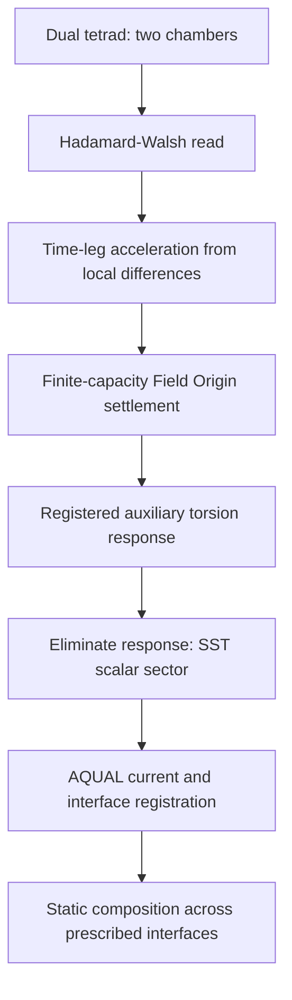

# From the Hadamard Read to the Gravitational Action

* A conditional torsion-response bridge for Gravity Field Dynamics (GFD) *

Research proposal · November 2026 · Companion to Field Closure and Recursive Registration

**Status.** New conditional mathematical construction, not an unconditional derivation of GFD from geometry. The local rate law is from Paper VII; the identification of the driving read with the acceleration of the time leg, the work coupling, and a response torsion ansatz are stated physical/model premises. The algebra, variational elimination and static junction below follow from them. No observational fit or new numerical parameter is used to select the static response. The 30 checks in `verify_bridge.py` are independent symbolic and numerical checks of this construction, not Lean theorems or tests of the physical premises.

## 1. What must be bridged

Letters 1–3 give, respectively, the two bounded tetrahedral regions under the spatial frame construction, the root-blindness of the metric and torsion-free metric connection, and the connection partition and effective constitutive law. The Hadamard proof identifies the balanced frame with a bordered Hadamard matrix; the Walsh proof characterizes the two chamber readouts. The pixel oscillator implements a saturating read and reconciliation, but inserts the saturation law in code. The G research identifies structural traces and a candidate gravitational normalization. None by itself specifies a physical dynamical map from a read of neighbouring cells to the gravitational action.

The two-connection note gets particularly close: it identifies the static time-leg acceleration with a torsion component, gives an auxiliary-field Legendre construction, and proposes a series throat law. Its open question is what determines the auxiliary cost and the odds. Here we supply a conditional local work/settlement model that determines the cost without starting from the desired SST functional, and identify a tensor realizing its registered response.

The chain is:



## 2. READ — Hadamard reconstruction and the local acceleration

Let the eight corner labels be $s=(s_1,s_2,s_3)\in\{-1,+1\}^3$, and $\chi_S(s)=\prod_{i\in S}s_i$. Define coefficients

$$\widehat f_S=\frac18\sum_s\chi_S(s)f_s,\qquad f_s=\sum_S\chi_S(s)\widehat f_S.$$

The identities follow from Walsh orthogonality. On TetA ($s_1s_2s_3=+1$), $\chi_S=\chi_{S^c}$; on TetB they have opposite signs. Each chamber has rank four, while the dual read has rank eight. This is lossless for the eight-value model, not proof that eight numbers exhaust a physical Field Object. The two chamber restrictions are genuinely complementary.

To make the read gravitational, choose a static time leg and $\Phi=c^2\ln N$ (lapse $N$). In a local spatial orthonormal chart choose eight samples $f_s=\Phi(X+\ell s)$, with positive sampling length $\ell$. These are a model of a local read, not a claim of a fundamental lattice spacing. Define

$$p_i^{(\ell)}=\frac{1}{8\ell}\sum_s s_i\Phi(X+\ell s).$$

For $\Phi(X+r)=\Phi_0+p\cdot r+r^THr/2$, this recovers $p$ exactly. In contrast the separate four-corner reads are

$$p^A=p+\ell(H_{23},H_{13},H_{12}),\qquad p^B=p-\ell(H_{23},H_{13},H_{12}).$$

Their average cancels the chiral mixed-tide leak. For smooth general potentials the dual read converges to the gradient with $O(\ell^2)$ error. The constant coefficient is not the exact central value of a quadratic potential: it includes $\ell^2\operatorname{tr}H/2$. The diagonal Hessian entries cannot individually be recovered from this single stencil. In a physical theory the complete boundary state, higher modes and correlations are not exhausted by these leading ports.

The covariant driving read is $p_\mu=c^2 a_\mu$, $a_\mu=u^\nu\nabla^\mathrm{LC}_\nu u_\mu$, where $u$ is the chosen unit timelike leg ($u^2=-1$). Static reduction gives $p_i=\partial_i\Phi$. For a teleparallel connection parallelizing $u$ (in particular an adapted tetrad with zero spin connection in that frame),

$$p_\mu=-c^2 u_\lambda u^\nu T_{\rm read}^{\lambda}{}_{\mu\nu}.$$

Indeed $a_\mu=u^\nu(\partial_\nu u_\mu-\partial_\mu u_\nu)$ and the exterior derivative of the parallel time coframe equals its contraction with teleparallel torsion. This specifies the read geometrically, including what assumptions are needed for the torsion identity. A consistently transformed parity-related tetrad and spin connection give the same coordinate torsion; the orientation-dependent dual changes sign. The static drive is not axial torsion.

The static stencil is not an instantaneous signal across a finite object. Retarded reads and hyperbolic propagation remain to be derived. The algebraic full-state read does not by itself establish causality or FSS across macroscopic domains.

## 3. SETTLE — a finite-capacity channel at the Field Origin

Paper VII's independent starting law is resolved/unresolved detailed balance, $\dot\varepsilon=\kappa[x(1-\varepsilon)-\varepsilon]$, $x=|p|/a_0$. We interpret the same scalar law as occupancy of the Field Origin's finite acceleration capacity. Introduce a spatial auxiliary vector $q$ with $0\le |q|<a_0$, and $b=|q|/a_0$. At equilibrium $q$ represents allocated TetB acceleration, not the TetB fraction. In particular $b=\mu$ at equilibrium whereas the TetB fraction of the total field is $1-\mu$.

**New model premise P1 (vector settlement).** In a local rest frame at fixed drive $p$, use the isotropic single-vacancy response

$$\dot q=\kappa\left[(1-|q|/a_0)p-q\right],\quad \kappa>0.$$

For an aligned nonnegative response this is precisely Paper VII's scalar rate law. The vector version is an extension, not forced by the Hadamard matrix. The closed ball is forward invariant; at the boundary the derivative is $-\kappa q$ and points strictly inward. At any fixed $p$ the unique equilibrium is

$$q_*(p)=\frac{a_0}{a_0+|p|}p.$$

The aligned scalar solution is $b(t)=b_*+(b(0)-b_*)e^{-\kappa(1+x)t}$ with $b_*=x/(1+x)$. The response is local in this model; there is no new static fit parameter. The rate $\kappa$ does not disappear from dynamical predictions. It must be determined independently before a physical timescale can be claimed.

## 4. Derive the energy cost from settlement, not from the SST

**New model premise P2 (work conjugacy).** The drive and response exchange work through $-p\cdot q$ in the static energy, with a local rotationally invariant cost $W(q)$, normalized by $W(0)=0$. Require the very same vacancy-dependent mobility to implement settlement as gradient descent:

$$\dot q=-\kappa(1-b)\nabla_q\big[W(q)-p\cdot q\big].$$

Matching P1 for every $p$ and $q$ fixes

$$\nabla_q W=\frac{q}{1-|q|/a_0}.$$

Integrate radially, using the normalization at zero:

$$\boxed{W(q)=a_0^2[-b-\ln(1-b)],\quad b=|q|/a_0.}$$

This is unique within P1 and P2. It is not selected by matching the desired gravitational functional. The logarithm arises because the cost of additional occupancy increases inversely with the remaining capacity. $W\to\infty$ as $|q|\to a_0$. Its tangential and radial Hessian eigenvalues are $1/(1-b)$ and $1/(1-b)^2$, respectively, both positive. The minimum for fixed $p$ is unique. Along settlement at fixed drive,

$$\frac{d}{dt}(W-p\cdot q)=-\kappa(1-b)|\nabla_q W-p|^2\le0.$$

This is a genuine least-energy settling result for the specified local response, not a proof that nature selects this mobility, nor that a whole Field Object settles by the same physical rule. A finite-rate dissipative evolution needs a physical reservoir or microscopic conservative completion; the static effective action by itself does not supply that completion.

## 5. REGISTER — an explicit torsion response

Represent the registered response by an independent auxiliary torsion (distinguish it from $T_{\rm read}$):

$$T_{\rm resp}^{\lambda}{}_{\mu\nu}=c^{-2}u^\lambda(u_\mu q_\nu-u_\nu q_\mu),\qquad u\cdot q=0.$$

It has the defining antisymmetry, vanishing totally antisymmetric/axial part and the desired readout

$$-c^2 u_\lambda u^\nu T_{\rm resp}^{\lambda}{}_{\mu\nu}=q_\mu.$$

For a metric this torsion determines a unique metric-compatible contorsion, so this is an explicit torsionful effective model, not merely a scalar relabelled torsion. It is a three-component time-space ansatz in the 24-dimensional torsion space. No claim is made that the other components are dynamically eliminated by the microscopic theory. The coordinate response itself is not root-odd under a joint parity transformation. Orientation, the axial rotating sector and the connection-level carrier of the chamber distinction should not be confused with the parity-even scalar susceptibility that enters static rotation curves.

## 6. Eliminate the response: the SST emerges exactly

The Newtonian field energy supplies $|p|^2/2$. The proposed joint static energy density (apart from the overall $1/(4\pi G)$ factor) is

$$\mathcal E(p,q)=\frac12|p|^2-p\cdot q+W(q).$$

At the stationary response, $q_*$ above, the envelope derivative is $\partial_p\mathcal E_{\rm eff}=p-q_*=\mu(x)p$. Direct substitution, not a reverse definition of $W$, gives

$$\boxed{\mathcal E_{\rm eff}(p)=\frac{a_0^2}{2}\big[x^2-2x+2\ln(1+x)\big]=\frac{a_0^2}{2}F(y),\quad y=x^2.}$$

Consequently, for $p=\nabla\Phi$ and matter energy $\rho\Phi$, variation gives

$$\nabla\cdot[\mu(|\nabla\Phi|/a_0)\nabla\Phi]=4\pi G\rho.$$

This is AQUAL without imposing alignment of the Newtonian source field with the total field. It is not a QUMOND algebraic prescription outside symmetry. The effective energy is strictly convex in $p$ (with a degenerate Hessian at $p=0$); radial tangent $x(x+2)/(1+x)^2$, transverse tangent $x/(1+x)$. The deep limit gives $\mathcal E\sim |p|^3/(3a_0)$. Spherical symmetry gives $g_s=g_t^2/(g_t+a_0)$ and $v^4\to GMa_0$ for an isolated mass.

A covariant auxiliary action for the gravitational sector, with coordinates $x^0=ct$, is

$$S_{\rm bridge}=\frac{c^3}{16\pi G}\int d^4x\sqrt{-g}\left[R+\frac4{c^4}(p\cdot q-W(q))\right]+S_m,$$

where $p=c^2a$, $q$ is spatial, and $u$ is the selected time leg (e.g. a hypersurface-normal field). Constraints on $u,q$ are understood. There are no derivatives of $q$ in the action. Its algebraic elimination yields the correction $-2a_0^2(F-y)/c^4$ inside the bracket. The $y$ subtraction is essential: the Einstein–Hilbert term already supplies the Newtonian quadratic energy. This recovers the preferred-foliation gravitational sector used in the SST time-leg proof, not the complete four-term GFD action. In particular, the electromagnetic term, full matter coupling, stability, and a covariant ownership rule are not derived here. An action using the scalar curvature of the response connection directly would require accounting for its contorsion terms; we use Levi-Civita $R$ explicitly.

## 7. From a drained child to a drainless parent

This is a separate, conditional static interface result. Prescribe a drained region $D$ where $q=q_*$, and a drainless exterior where $q=0$. This is an input, not a geometry-derived drain selector. Assume common continuous potential, no extra material sheet, and disjoint interior/exterior. The variational current is $J=p-q$ on either side. Variation of the shared trace at $\Sigma$ requires

$$[n\cdot J]=0.$$

More generally $[n\cdot J]=4\pi G\sigma_m$ for a material surface density $\sigma_m$, with bracket exterior minus interior and normal outward. Rewriting as Poisson gives $\Delta\Phi=4\pi G\rho+\nabla\cdot q$; hence the effective TetB surface contribution is $\sigma_{\rm ph}=[n\cdot q]/(4\pi G)$.

For a spherical drained galaxy of baryonic mass $M$ inside $R$ and a Newtonian parent, neglect host gradients and assume no material sheet. At the boundary $g_-=\tfrac12(z+\sqrt{z^2+4a_0z})$, $z=GM/R^2$, and $g_+=z=\mu(g_-/a_0)g_-$. The Newtonian-inferred mass just inside is $R^2g_-/G$; the conserved current mass is $M$. The phantom interface sheet is negative, $4\pi G\sigma_{\rm ph}=z-g_-$. Its integrated mass cancels the interior excess. The parent registers baryonic source flux $M$ in this specific model, not the apparent interior Newtonian mass. A drained parent would use its own constitutive current and shared trace, not this same exterior slope.

This gives a candidate junction condition from the same action and a falsifiable radial transition. It does not establish that a real galaxy has this interface, that its surface is spherical, or that this prescription explains cluster lensing. The actual nonlinear overlapping ownership problem remains open. For non-overlapping fixed domains, the minimized boundary response functional of each child can be composed by minimizing their sum over common compatible traces (as in Field Closure and Recursive Registration). A general physical registration must preserve response information, not just the monopole.

## 8. The 64-transition ledger and G's 21-level read

The Hadamard factorization $H_8=H_2\otimes H_4$ supplies an explicit *candidate* reindexing of a corner-pair operator. Write corners as $(p,i)$ and $(q,j)$, with binary chamber labels $p,q$ and four-valued frame labels $i,j$. Then an $8\times8$ array becomes four $4\times4$ blocks indexed by $(p,q)$. The partial swap $i\leftrightarrow j$ at fixed $(p,q)$ has trace 16 on the 64-dimensional vector space, so its two eigenspaces have dimensions 40 and 24. Ordinary matrix transpose has trace 8 and gives 36/28. Thus matching counts alone does not identify the connection: the physical theory must choose the partial swap, establish its transformation law and specify link transport. The proposed reindexing is a linear isomorphism, not a canonical Lorentz-equivariant identification of all connection components.

The G graded operator is a different representation, scalar + vector + rank-two tensor. Its full-completion trace is 21, and the Field Origin and opposite graded traces are 17 and 13. The convex mixture of the endpoint operators has trace $21\mu+13(1-\mu)=13+8\mu=17+4(2\mu-1)$. This relates settled share to the same polynomial but does not fix the physical attenuation law. The vector-block total inversion used in the null-rotation proof is not the spatial parity of Letter 1; identifying them without an intertwining construction would be incorrect.

The normalization $G=(17/13)\alpha^{21}\hbar c/m_e^2$ (and the proposed one-loop factor) can be inserted consistently as the common normalization of the static action. But geometry and the local rate law do not derive the factor of $\alpha$ per level, the trace-ratio selection, parallel-face read, or the loop term. The G research itself identifies those as open. This model distinguishes *the completed read's normalization* from *the local response share*. In particular it does not replace the exponent 21 by $13+8\mu(x)$, which would introduce an enormous variation of the bare $G$ and would not reproduce the static action.

## 9. What this closes and what it does not

| Result | Status |
|---|---|
| Eight-mode reconstruction, single-root aliases, dual-gradient cancellation | Exact finite algebra / quadratic stencil |
| 64-ledger partial-swap realization | Exact for the chosen reindexing; physical identification open |
| Local cost $W$ and unique stable fixed-drive settlement | Conditional on vector rate and work/mobility premises |
| Explicit auxiliary torsion and recovery of SST/AQUAL | Exact within the ansatz and chosen time leg |
| Fixed drained/drainless radial junction and mass accounting | Exact under prescribed interface and stated symmetry |
| Choice of drain, physical registration surface, dynamic ownership | Open |
| Full FSS, causality, Lorentz invariance, quantization, other torsion modes | Open |
| Numerical derivation of $G$ and $a_0$ from microscopic physical couplings | Open; not implied by this bridge |

**Next decisive step:** derive P1 and P2 from a conservative coupled-oscillator Hamiltonian (not a saturation function inserted into the update), show the projected local response emerges under controlled averaging, and derive a geometrically meaningful channel activation rule. These are more precise targets than simply asking why the two chambers couple. A model reproducing only a known static law is not yet independent evidence for GFD's microscopic interpretation.

## Sources in the GFD repository

All repository paths below refer to `https://github.com/fielddynamics/research/tree/main/`.

- [Letter 1](https://github.com/fielddynamics/research/tree/main/papers/letter-1-tetrad-frame-geometry), [Letter 2 v2](https://github.com/fielddynamics/research/tree/main/papers/letter-2-other-half-of-gravity-torsion/v2), [Letter 3 and supplements](https://github.com/fielddynamics/research/tree/main/papers/letter-3-field-closure-of-tetrad-frame).
- [Hadamard cube frame](https://github.com/fielddynamics/research/tree/main/proofs/hadamard-cube-frame), [Walsh eigenmodes](https://github.com/fielddynamics/research/tree/main/proofs/walsh-eigenmodes-of-the-cube), [G null rotation](https://github.com/fielddynamics/research/tree/main/proofs/g-null-rotation).
- [Universe is pixelated and oscillator source](https://github.com/fielddynamics/research/tree/main/research/universe-is-pixelated).
- [G from topology](https://github.com/fielddynamics/research/tree/main/research/g_from_topology), including *What Is Gravity?*, *Read Sweep*, *G as a Matrix Read*, *G from the Closure Climb*, and *Read and Rotation*.
- [Paper VII v7](https://github.com/fielddynamics/research/tree/main/papers/07-dual-tetrad-topology-field-origin/v7), constitutive law from detailed balance.
- [Two connections and the dual chamber](https://github.com/fielddynamics/research/tree/main/research/two-connection-dual-chamber), especially the auxiliary-field and throat-channel routes.
- [SST time leg](https://github.com/fielddynamics/research/tree/main/proofs/sst-covariant-time-leg), [quasi-static limit](https://github.com/fielddynamics/research/tree/main/proofs/sst-quasi-static-limit), [mountain scale](https://github.com/fielddynamics/research/tree/main/proofs/sst-mountain-scale), [closure surface](https://github.com/fielddynamics/research/tree/main/proofs/closure-surface).
- [Field Closure and Recursive Registration](https://github.com/fielddynamics/research/blob/main/FIELD_CLOSURE_AND_RECURSIVE_REGISTRATION.md).

## Reproduce

```bash
python -m pip install numpy sympy
python verify_bridge.py
```

The script checks finite Walsh identities, the dual gradient stencil, the 64-ledger swap, the cost and exact elimination, the torsion ansatz, the radial interface and sample settlement histories. It does not re-run the repository's Lean or SPARC suites.
