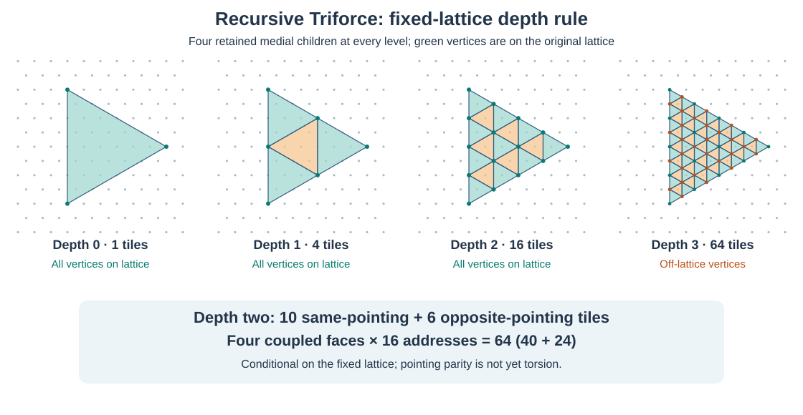
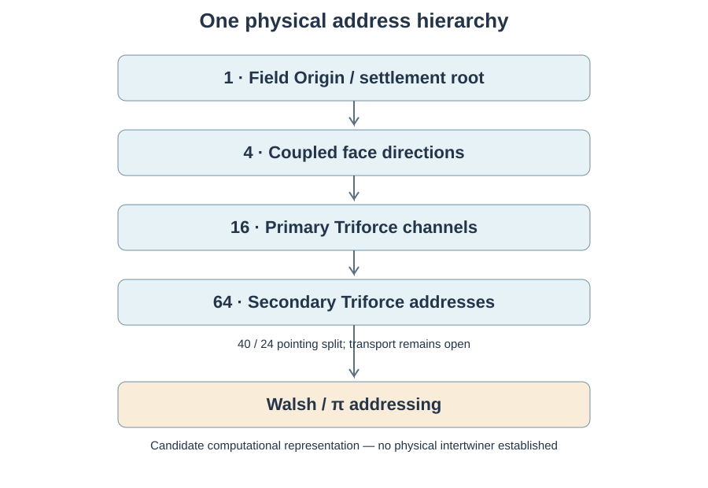

# Recursive Triforce geometry

Field Dynamics Research • 26 November 2026 • Based on `38285636e5ea0db2c68a8fe4424dabc107adc9cf`.

[T] Exact mathematical result; [D] conditional realization; [O] open physical identification. This note extends the existing Triforce, Flower, Walsh and vortex work without changing SST or existing proofs.

## Geometry and fixed-lattice depth

Four complementary face pairs give four coupled directions. Each triangular domain admits a full medial subdivision into four equal-area children, including the central triangle. Repeat once: four primary tiles and sixteen secondary tiles per face, 64 paired geometric addresses across four faces. The two chambers still have distinct geometric surfaces; pairing is an accounting convention, not a deletion of a chamber. For centered vertices v_j, child maps are F_0(x)=-x/2 and F_j(x)=(x+v_j)/2. Central inversion reverses pointing, not planar orientation (positive determinant). The retained-center construction is a full refinement, not a Sierpinski gasket.

The existing Flower projection uses P=I-11^T/3, p=P(e1)/2, q=P(e2)/2 and P(e3)/2=-p-q. The projected normal face has lattice coordinates (4,0),(0,4),(-4,-4), up to sign/permutation. Its edge components have joint gcd 4, so every vertex at dyadic depth n belongs to the fixed lattice iff 2^n divides 4. Maximum complete depth is two, giving 16 triangles and 15 vertices per face. By tetrahedral symmetry this applies in each face's own projection, not simultaneously in a single global projection. [O] Why the physical dynamics restrict vertices to this particular lattice pitch and occupy maximal depth. The existing circles are a planar construction, not measured vortices; a finer lattice or continuous refinement would evade the bound.

## Pointing parity, traces, and symmetry obstruction

At depth n the counts are (4^n +/- 2^n)/2, by the elementary three-positive/one-negative child rule. At depth two this gives 10/6 per face and 40/24 across four faces. Put J=diag(-1,1,1,1) and Q=J tensor J. Q is an involution of trace 4; 1+trace(I+sQ)=17+4s gives 21/17/13. These are weighted traces, not physical stiffness or independent propagating degrees of freedom.

The tensor swap tau has the same multiplicities, but under face stabilizer R (fixes center, permutes lateral labels), trace((R tensor R)Q)=trace(RJ)^2, while trace((R tensor R)tau)=trace(R^2). Identity, 3-cycle and lateral transposition yield (4,4),(1,1),(0,4). Thus there is no S3-equivariant identification. C3 eigenspace characters agree; a chiral state could remove the obstruction, but does not give a canonical or physical intertwiner. Chamber inversion pairs relative addresses, not necessarily their pointing signs. Pointing is not chirality or torsion.

## One physical hierarchy; other address representations require proof

The four-way tree has 21 internal readers, 63 contrast coordinates and one mean. A normalized four-point Haar/Walsh read is reversible. Physical C3 fixes one leaf and cycles the other 63 in triples, so invariant dimension 22. On ordered cube corner pairs it fixes four pairs and cycles the other 60, so invariant dimension 24. No equivariant address bijection exists. The projective XOR cycle is different and should remain exploratory as a computational representation, not a second physical ledger.

Q on the physical invariant sector has 14 positive and 8 negative coordinates: signed trace (16+2)/3=6. The normalized uniform mean has squared norms 40/64 and 24/64 in the two parity spaces. It is not a Q eigenvector. Its mean-zero compression has eigenvalues +1 (13), -1 (7), -1/4 (1): the orthogonal direction in the two-dimensional span of the even/odd mean parts exchanges their weights. Hence neither the 17/4 contrast grading nor the gravitational determinant follows from pointing parity. Distinguish the 21 internal readers, 21 invariant contrasts, and physical attenuation determinant.

## Refined optical overlap

In parent barycentric coordinates scaled by 12 the upstream inter-field midplane triangles are T=((0,0),(12,0),(0,12)) and B=((8,8),(-4,8),(8,-4)). Exact polygon clipping gives 13 nonzero entries and rank 4 at depth one; 49 nonzero entries and rank 13 at depth two. The common area remains 2/3 of the parent. This is not the internal TetA/TetB interface. Rank 13 is not proof of TetB coupling. Three corner tiles lack positive-area overlap at depth two.

## Actual refined radial solid-angle quadrature [T/D]

For a centered radial inverse-square field the physical angular fraction of a surface triangle with vertex vectors $a,b,c$ is $w=\Omega/(4\pi)$, where

$$\Omega=2\operatorname{atan2}\left(|\det(a,b,c)|,\ |a||b||c|+(a\cdot b)|c|+(b\cdot c)|a|+(c\cdot a)|b|\right).$$

This follows from the solid angle of the spherical triangle obtained by radial projection; the formula uses the exact rational vertex vectors of the medial refinement. The resulting normalized weights per representative face, with children listed center first, are:

| Primary tile | Central child | Lateral child 1 | Lateral child 2 | Lateral child 3 | Total |
|---|---:|---:|---:|---:|---:|
| Central | 0.043869914023 | 0.027043361992 | 0.027043361992 | 0.027043361992 | 1/8 |
| Lateral (each of three) | 0.010506209937 | 0.004117094737 | 0.013521680996 | 0.013521680996 | 1/24 |

For a lateral parent, lateral child 1 is the child at the original tetrahedral vertex. The other two are equivalent by reflection. Each face registers one quarter and all four sum to one. The original equal-child weights 1/32 and 1/96 are a simplified quadrature, not exact radial flux shares. The actual weights preserve the physical rotation, so normalized weighted prefix averaging still gives nested orthogonal projections in the weighted inner product and invariant detail ranks 1,4,16. This does not prove the attenuation or source operator; arbitrary angular fields require cell averages or an independently controlled quadrature. Do not add both enclosing chamber surfaces as separate source charges.

`python verify_refinement_weights.py` checks the rational 3D geometry and evaluates solid angles numerically (35 checks; [output](refinement_weights_output.txt)). In particular the rotation is tested directly on all 64 actual triangles, without assuming a simultaneous digit permutation.

## Next physical proof: nodal and refinement tests

The current H36 has first-level tile coordinates, not spatially resolved second-level amplitudes. It cannot alone derive finer physical boundaries. Recover a continuous face field from the existing action or independently derive a fine Hamiltonian. Test whether its nodal or flux-separation boundaries coincide with medial segments and whether the equations recur on each child with energy and flux matching. No artificial subdivision-specific weights. For a linear fine Hamiltonian H_f and normalized piecewise-constant prolongation E (E*E=I), exact autonomous coarse evolution for all coarse states holds iff (I-EE*)H_f E=0. Then H_c=E*H_f E. If leakage is nonzero, retain detail modes or derive a controlled effective response. For nonlinear evolution test tangency to the coarse image. Derive the lattice restriction, maximal-depth occupancy, chamber registration and source attenuation independently. A negative result is acceptable.

## Dynamical continuation

The [integrated vortex refinement research](../vortex-induced-triforce-refinement/) and [core Hodge decomposition](../vortex-induced-triforce-refinement/core-hodge/) test the physical bridge beyond Proof 23. The secondary mesh supports twelve circulation patterns invisible to the five-dimensional coarse cycle read, but does not select a fine Hamiltonian. A coarse cycle projection can be contaminated by fine gradients, and a global phase-invariant sign scalar cannot repair the connection dictionary at an axis-aligned circular ray. The physical edge metric, lattice selection, through-flow and connection dynamics remain open.

## Reproduction

Run `python verify_recursive_triforce.py` (Python standard library). The tests use exact rational geometry, integer/rational rank, symmetry and orbit counts. Not a vortex simulation, physical experiment, or Lean proof. Run `python verify_refinement_weights.py` for the additional refined radial weights and actual 3D rotation tests.

Sources (repository-relative links): [Enterprise Triforce](../faces/enterprise_triforce_synthesis.md), [Flower lattice](../hadamard-null-cone-vortex-flywheel/HADAMARD_FLOWER_LATTICE.md), [original projection](../hadamard-null-cone-vortex-flywheel/figures/24_hadamard_flower.svg), [Triforce tetrad read](../hadamard-null-cone-vortex-flywheel/TRIFORCE_TETRAD_READ.md), [three subreads](../hadamard-null-cone-vortex-flywheel/THREE_SUBREAD_CLOSURE.md), [projective Walsh](../hadamard-null-cone-vortex-flywheel/PROJECTIVE_WALSH_G_BRIDGE.md), [pi walk](../hadamard-null-cone-vortex-flywheel/PI_WALK_FWHT.md), [root exchange](../g_from_topology/read-and-rotation/ROOT_EXCHANGE_ON_THE_ADDRESS_TREE.md), [sustained flywheel](../hadamard-null-cone-vortex-flywheel/SUSTAINED_TRIFORCE_FLYWHEEL.md), [optical ports](../hadamard-null-cone-vortex-flywheel/OPTICAL_FOUR_PORT_RESONATOR.md).
