**Reading guide.** This illustrated edition retains all original mathematical derivations and figures, with the geometric interpretation corrected to the [recursive Triforce research](../recursive-triforce-geometry/). Ordered-pair and Pauli algebra are computational representations, not a second physical ledger. Generated HTML and historical output may reflect the earlier version; this Markdown is the current source.

[Open the numbered visual atlas](VISUAL_ATLAS.html) · [Original interactive companion](VISUAL_MATHEMATICAL_COMPANION.html)

# Part I — Three-subcycle settlement and stiffness

**Scope.** This companion reconstructs the nine visual diagrams from the chat and collects the associated mathematics in reading order. The diagrams are recreated graphics, not screenshots of the interface. The original two research notes, scripts, logs and supplied image are retained unchanged. Exact algebraic identities are distinguished from proposed physical mechanisms.

# 1. Geometric π and the initial three-cycle hypothesis

*Reference: the 2008 Barbury Castle π crop formation (photograph not reproduced here). The proposed three-circle interpretation is a GFD hypothesis, not evidence of a physical field mechanism.*

The decimal angular encoding uses increments of $2\pi/10$. For the ten digits of the rounded representation 3.141592654,

$$3+1+4+1+5+9+2+6+5+4=40,\qquad 40\frac{2\pi}{10}=8\pi.$$

This is four revolutions for that particular rounded representation, not a period of π. The three outer circles inspired the three-subcycle hypothesis. A separate exact mathematical connection is the eight-vertex Walsh transform:

$$8=2^3,\qquad (-1)^{a\cdot b}=e^{i\pi(a\cdot b)},\qquad \widehat f(a)=\frac{1}{\sqrt8}\sum_{b\in\{0,1\}^3}e^{i\pi(a\cdot b)}f(b).$$

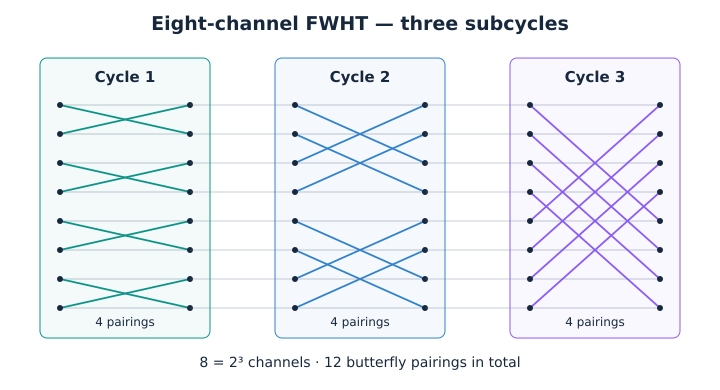

$$3\times4=12.$$

The twelve butterfly pairings correspond combinatorially to the three groups of four parallel edges of a cube. The dual tetrahedra occupy its eight vertices. A Walsh sign phase does not, by itself, derive a physical π digit-address schedule.

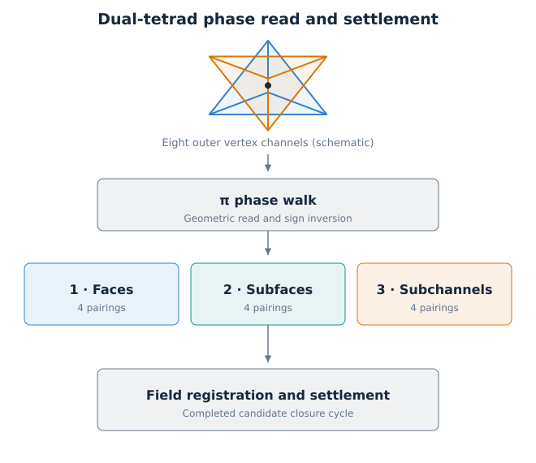

# 2. Recursive closure geometry and operator coordinates

The primary candidate geometric hierarchy is the [recursive Triforce geometry](../recursive-triforce-geometry/): four coupled face directions, four medial tiles per face and four medial children per tile. Eight core amplitudes also admit a 64-coordinate dyadic operator representation. These are distinct mathematical observables, not two physical ledgers. Spatial rotation fixes one recursive leaf versus four ordered corner pairs, so no rotation-equivariant bijection exists. The fixed Flower lattice allows a maximum of two complete dyadic subdivisions; physical lattice selection and subchannel dynamics remain open.

$$8^2=4^3=64,\qquad N=\frac{4^3-1}{4-1}=21,\qquad 64=1+3(21).$$

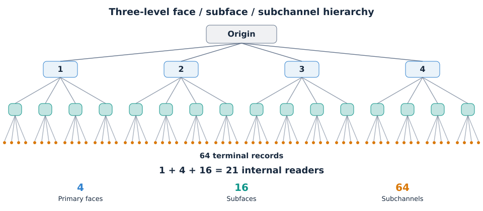

The normalized four-way Hadamard matrix and full relational FWHT are

$$h=\frac12\begin{pmatrix}1&1&1&1\\1&-1&1&-1\\1&1&-1&-1\\1&-1&-1&1\end{pmatrix},\qquad F=h\otimes h\otimes h.$$

The reversible hierarchical read separates one common mode and contrast strata of dimensions 3, 12, 48. This tree is distinct from the full FWHT, which also mixes details within each stratum. Under the simultaneous nonzero-digit cycle $M:1\mapsto2\mapsto3\mapsto1$ fixing zero,

$$Q=\frac{I+M+M^2}{3},\qquad \operatorname{rank}Q=22,\qquad 21=1+4+16.$$

The invariant contrast ranks are 1,4,16 for the stated digit cycle; the actual recursive geometric prefix projections have the same ranks by the fixed-leaf argument. The equal ranks do not identify the two rotations, the contrast operators or the physical sign grading.

# 3. Collective transmission and structural coupling

With a proposed elementary amplitude $t=\sqrt\alpha$, the top exterior-power read on the 21-dimensional contrast sector yields

$$|\det(tI_{21})|^2=\alpha^{21}=\alpha^{16}\alpha^4\alpha\approx1.33804868\times10^{-45}.$$

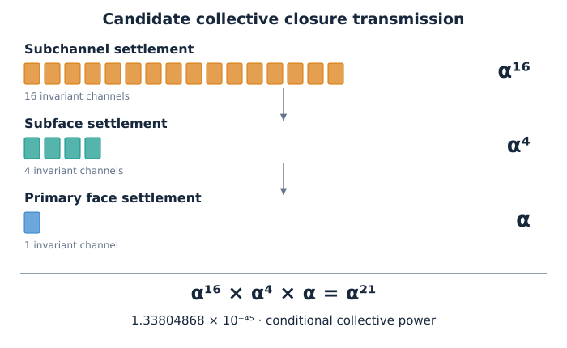

A serial network of independently routed reflected modes is an alternative mathematical realization. Each stage has a lossless dilation

$$S=\begin{pmatrix}t&\sqrt{1-t^2}\\\sqrt{1-t^2}&-t\end{pmatrix},\qquad S^TS=I.$$

An ordinary one-mode projection has intensity $\alpha$, not $\alpha^{21}$. Physical selection of the collective vertex and elementary attenuation remains open.

The inherited coupling polynomial with $K=4$ is

$$f(K,s)=1+sK+K^2,\qquad f(4,+1)=21,\quad f(4,0)=17,\quad f(4,-1)=13.$$

The tree-level GFD target is $\gamma_G=Gm_e^2/(\hbar c)=(17/13)\alpha^{21}$.

# 4. Boundary-weighted settlement

A centered regular tetrahedron has four faces of solid angle $\pi$. Each central primary tile subtends $\pi/2$ and each lateral primary tile $\pi/6$. The following equal-child weights are a simplified quadrature, **not the exact radial solid angles** of the second medial subdivision. The [recursive geometry](../recursive-triforce-geometry/) gives the actual unequal child weights. General weighted projection identities remain valid for any positive normalized rotation-invariant weights; the particular numerical Walsh weight pattern below belongs only to the simplified model.

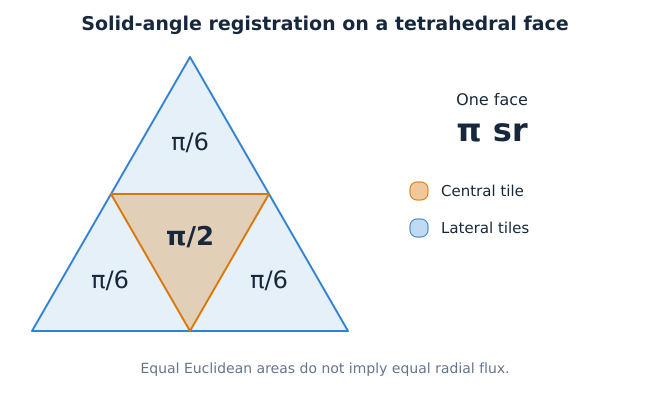

$$w_{abc}=\begin{cases}1/32&b=0,\\1/96&b\ne0.\end{cases}$$

Let $u=(1,\ldots,1)^T$, $w^Tu=1$, and $P=uw^T$. Then

$$P^2=P,\qquad J_\alpha=\sqrt\alpha I+(1-\sqrt\alpha)P.$$

$$J_\alpha u=u,\qquad w^TJ_\alpha=w^T,\qquad J_\alpha Q=QJ_\alpha.$$

In the quadrature metric $D_w=\operatorname{diag}(w)$, $D_wJ_\alpha=J_\alpha^TD_w$. Equivalently, with $v=\sqrt w$,

$$D_w^{1/2}J_\alpha D_w^{-1/2}=tI+(1-t)vv^T.$$

The invariant space contains one conserved scalar and twenty-one weighted-zero contrasts:

$$|\det(J_\alpha|_{\operatorname{im}Q})|^2=\alpha^{21}.$$

The FWHT of the weights has only four nonzero coordinates:

$$(Fw)_{000}=1/8,\qquad (Fw)_{010}=(Fw)_{020}=(Fw)_{030}=1/24.$$

The squared contrast norm is $1/192$ versus $1/64$ for the common mode. This connects the boundary read to an invariant intermediate direction but does not derive its physical signed coupling.

# 5. Scalar action and electron closure

For a dimensionless microscopic scalar $q$ with stiffness $\kappa$ and collective coupling amplitude $\lambda$,

$$S[q]=\int_\Omega\left[\frac\kappa2|\nabla q|^2-c^2\rho\lambda q\right]d^3x.$$

With $d=\lambda q=-\Phi/c^2$ at fixed universal parameters,

$$S[d]=\int_\Omega\left[\frac{\kappa}{2\lambda^2}|\nabla d|^2-c^2\rho d\right]d^3x.$$

Matching the inherited drainless weak-field functional

$$S[d]=\int_\Omega\left[\frac{c^4}{8\pi G}|\nabla d|^2-c^2\rho d\right]d^3x$$

gives

$$G=\frac{c^4\lambda^2}{4\pi\kappa},\qquad \kappa_G=\frac{13}{17}\frac{m_e^2c^3}{4\pi\hbar}\quad\text{if }\lambda^2=\alpha^{21}\text{ and the topology target holds}.$$

The boundary conjugate is the source registration, not an additional stored energy:

$$E_{\mathrm{reg}}=-\frac{c^4}{4\pi G}\oint\partial_n d\,dA=mc^2.$$

At the inherited saturation threshold $g_{\mathrm{sat}}=a_0/16$ the spherical capacity is

$$E_C=\frac{a_0c^2R^2}{16G}.$$

The three inherited closure equations are

$$mc^2=\frac{\alpha\hbar c}{R},\qquad a_0=\frac{16Gm}{R^2},\qquad Gm^2=\gamma_G\hbar c.$$

Their unique positive joint solution is

$$m=\frac{a_0\alpha^2\hbar}{16\gamma_Gc^3},\qquad R=\frac{16\gamma_Gc^2}{\alpha a_0},\qquad G=\frac{256\gamma_G^3c^7}{\alpha^4\hbar a_0^2}.$$

For the proposed, not derived, loop factor $\gamma_G=(17/13)\alpha^{21}(1+\alpha/(2\pi))$ and $a_0=1.225\times10^{-10}\,\mathrm{m/s^2}$:

| Quantity | Joint compatibility value | Reference deviation |
|---|---:|---:|
| Electron mass | $9.1091789125\times10^{-31}$ kg | −22.48 ppm |
| Gravitational constant | $6.6745191675\times10^{-11}$ SI | +32.84 ppm |
| Electromagnetic closure radius | 2.8180036761 fm | — |

The selected acceleration may itself depend on electron properties; this is not then an independent prediction. The radius is not a measured physical electron size.

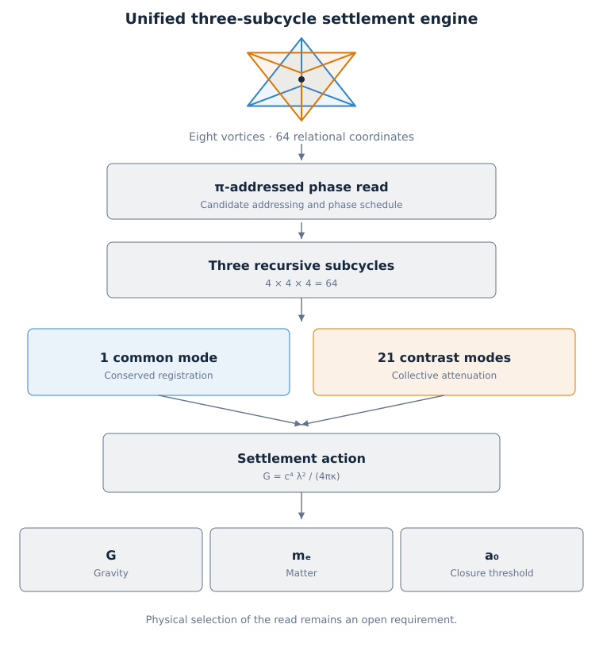

# 6. Microscopic Hamiltonian stiffness

The original 36-coordinate field and its two-site 72-coordinate Bloch operator have a simple lowest scalar band locally near zero momentum:

$$E(\mathbf k)=E_0+D|\mathbf k|^2+O(|\mathbf k|^4).$$

For normalized eigenvector $u$, reduced resolvent $R=(M(0)-E_0 I)^+$ and $M_j=iQ_j$,

$$D_j=\tfrac12u^TM_{jj}u+u^TQ_jRQ_ju.$$

| Interface | Calculated dimensionless curvature |
|---|---:|
| Full Triforce | 0.1242946733 |
| Central-mediated | 0.1050941805 |

Their ratio is approximately 1.1827, not 17/13. The primitive volume is $16a^3$ with microscopic energy unit $E_*$. For the unit-normalized scalar envelope,

$$S[q]=\int\frac{E_*D}{16a}|\nabla q|^2\,d^3x,\qquad \kappa_{\mathrm{micro}}=\frac{E_*D}{8a}.$$

The dimensionful scale is not fixed by the dimensionless Hamiltonian.

# 7. Face-pair exchange and the 13/17 ratio

On the sixteen ordered pairs $V=\mathbb R^4\otimes\mathbb R^4$ define $\tau(e_i\otimes e_j)=e_j\otimes e_i$. The three operators including an independent origin scalar are

$$C_A=1\oplus(I+\tau),\qquad C_O=1\oplus I,\qquad C_B=1\oplus(I-\tau).$$

$$\operatorname{Tr}\tau=4,\quad \operatorname{Tr}C_A=21,\quad \operatorname{Tr}C_O=17,\quad \operatorname{Tr}C_B=13.$$

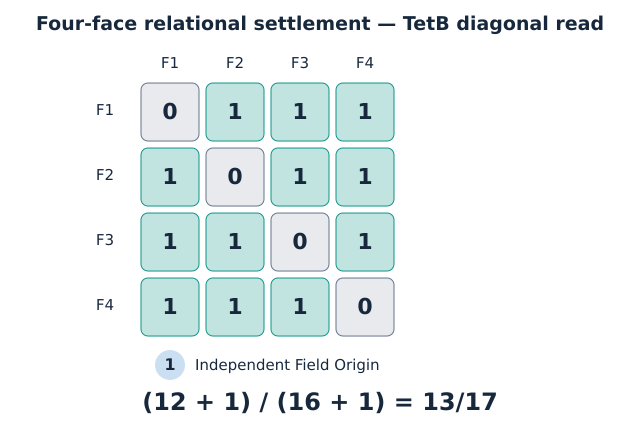

The twelve cross-pair diagonal contributions, four zero self-pair contributions and independent origin yield a balanced locked-read stiffness

$$\kappa_B=\frac{12+1}{16+1}\kappa_O=\frac{13}{17}\kappa_O.$$

This is a trace average, not the rank of $C_B$ (which is seven). The Walsh invariance follows from

$$\tau(h\otimes h)=(h\otimes h)\tau,$$

$$(h\otimes h)^T(I-\tau)(h\otimes h)=I-\tau.$$

For origin share $r$ and conditional self-pair share $p$,

$$\frac{\kappa_B}{\kappa_O}=r+(1-r)(1-p),\qquad r=1/17,\quad p=1/4\implies\frac{\kappa_B}{\kappa_O}=13/17.$$

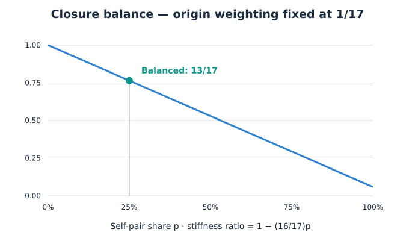

<label for="selfpair">Self-pair weighting (origin share fixed at 1/17): <strong id="pval">25%</strong></label>
<input id="selfpair" type="range" min="0" max="100" value="25" step="1" style="width:100%" oninput="updateBalance()">

Relative TetB stiffness: <strong id="stiffness">0.764706</strong> · Inverse stiffness ratio: <strong id="inverse">1.307692</strong>

<button onclick="document.getElementById('selfpair').value=25;updateBalance()">Restore balanced closure</button>

The π-walk must prove these occupation and dwell weights, not merely coverage. A deterministic equally weighted snapshot read is sufficient for the algebra but is not derived native motion.

# 8. Electromagnetic normalization and gravitational settlement

For the proposed common scalar kernel and elementary electrical transmission $T_E=\sqrt\alpha$, the electron pair interaction magnitude is

$$|U_E(r)|=\frac{m_e^2c^4\alpha}{4\pi\kappa_Er}=\frac{\alpha\hbar c}{r}.$$

Thus

$$\kappa_E=\frac{m_e^2c^3}{4\pi\hbar},\qquad \kappa_G=\frac{13}{17}\kappa_E.$$

Substitution into the gravitational matching identity gives

$$G=\frac{c^4\alpha^{21}}{4\pi\kappa_G}=\frac{17}{13}\alpha^{21}\frac{\hbar c}{m_e^2}.$$

This is conditional on the shared scalar-kernel source normalization and the collective read, not a derivation of Maxwell dynamics or electromagnetic force sign. With $\lambda_e=\hbar/(m_ec)$, equating the Hamiltonian stiffness to the electromagnetic reference requires

$$\frac{a}{\lambda_e}=\frac{\pi D}{2}\frac{E_*}{m_ec^2}.$$

If $E_*=m_ec^2$, the required lattice coordinate unit is $0.1952416162\lambda_e$ (full) or $0.1650815527\lambda_e$ (central). These are matching targets, not physical lengths independently predicted by the graph.

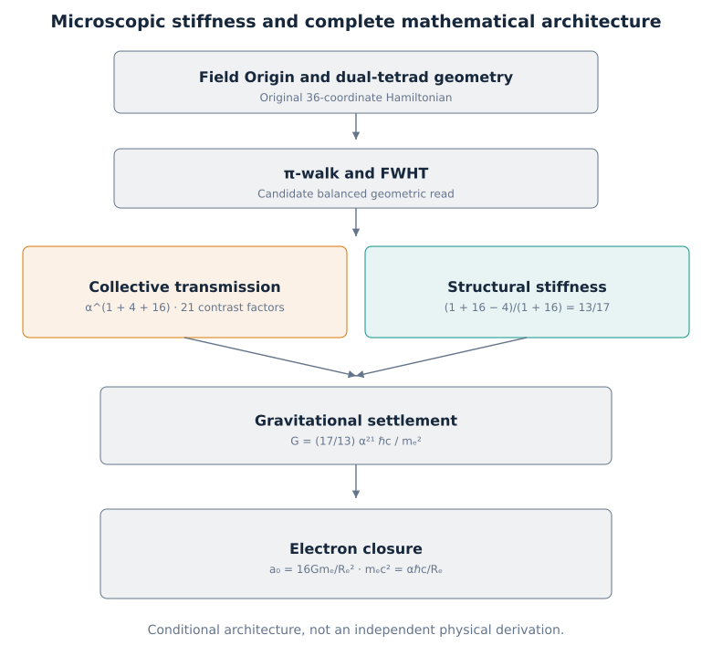

# 9. Research status and reproduction

The exact finite-dimensional identities, calculated graph curvature and conditional matching relations are supported by the included verifiers. The native autonomous π-walk, selection of the collective attenuation, origin of the physical energy/length scales, electromagnetic normalization premise and loop correction remain open. Conservative unitary dynamics do not supply attenuation without an additional channel or projection. No empirical validation or remote repository modification is claimed.

See `research/WEIGHTED_CLOSURE_SETTLEMENT.md`, `research/MICROSCOPIC_STIFFNESS_DERIVATION.md` and `verification/` for original notes and reproduction instructions. The visual reconstructions are available in both SVG and high-resolution PNG.

# Part II — Unified closure action

## Toward a unified field action

GFD Standard Field Model — research extension, November 2026. Companion to the preserved weighted closure and microscopic stiffness notes. **Exact:** finite-dimensional identities and response variational primitives. **Conditional:** chosen optical transmission, boundary sampling, static domain decomposition, and illustrative kinetic completion. **Open:** native H36 dynamics, physical charge, spin-2, full covariant SST, independent constants, and physical interpretation of the π formation. This is not a completed unified theory.

### 1. Three subcycles, one conserved registration

Let the primary candidate address space be the [recursive Triforce geometry](../recursive-triforce-geometry/): (a,b,c) in {0,1,2,3}³ for coupled face, primary tile and secondary medial tile. Let positive normalized weights w be invariant under the geometric C3 rotation. The earlier simplified equal-child quadrature assigns 1/32 for a central parent and 1/96 otherwise; actual radial solid-angle weights are unequal within each parent, given by the recursive geometry note. Let P_k be conditional averaging over prefixes of length k, so P_0=1wᵀ, P_3=I, and P_jP_k=P_min(j,k). With W=diag(w), WP_k=P_kᵀW. The detail projections D_k=P_k-P_(k-1) obey D_iD_j=δ_ij D_i and sum to I-P_0; raw ranks are 3,12,48. The physical rotation preserves prefixes and weights, so Q=(I+M+M²)/3 commutes with these projections, rank Q=22 and invariant detail ranks 1,4,16. This is a weighted geometric construction, not an identification with Pauli operators or connection components.

For t=√α define J_k=I+(t-1)D_k. Then

$$J_3J_2J_1=P_0+t(I-P_0),\qquad w^T J_k=w^T,\quad J_k\mathbf1=\mathbf1.$$

The invariant determinants have squared moduli α, α⁴, α¹⁶. Their product is α²¹. The three operators commute and can be applied in either order, so the algebra does not prove temporal ordering. On the common scalar the transmission is one; on each individual contrast it is t, not t²¹. Only a collective determinant/all-pass selection has the proposed gravitational suppression.

There is an explicit conservative realization for each stage. In weighted-orthonormal coordinates let A_k=W^(1/2)J_kW^(-1/2), B_k=√(1-t²) W^(1/2)D_kW^(-1/2). Then the block matrix [[A_k,B_k],[B_k,-A_k]] is orthogonal. It conserves norm on the joint system plus complementary registers. The complement must carry the missing amplitude; no microscopic physical energy law is derived from this norm identity. A logarithmic contraction generator on the retained channel is -(I-P_0) in dimensionless time, with duration -ln(t). It is not the native Hermitian H36 generator.

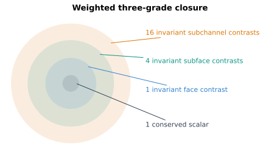

An illustrative balanced abstract face-pair schedule uses four repeats of each ordered pair and four independent origin reads with equal dwell weights. Its 68 entries give origin share 1/17 and pair-diagonal share 1/4, yielding 13/17 for the specified locked exchange read. This is a separate conditional normalization model, not a physical schedule of the recursive geometry: a spatial-rotation-equivariant bijection from corner pairs to the recursive addresses is impossible. Equal-area children have unequal solid angles, and structural traces are not flux weights. Derive the physical dwell/settlement law rather than identify a diagonal pair with a central tile by counting.

### 2. One odds variable, two constitutive responses

Define r=μ/(1-μ), μ=r/(1+r), x≥0. The existing drained law μ_d=x/(1+x) becomes x=r. The existing internal bound law x(1-μ_b)²=μ_b becomes x=r(1+r). Use discrete regime label b=0,1 (not an adjustable continuous parameter). Both are stationary minima of

$$C_b(r)-xr,\quad C_b(r)=\tfrac12r^2+\tfrac b3r^3,\quad x=r+br^2,\quad C_b''=1+2br>0.$$

At x=0 the minimizer is r=0. For b=1 use r=2x/(1+√(1+4x)). This is a common mathematical representation, not a microscopic derivation of the extra feedback or a proof that TetB selects it. The internal bound law is not the macroscopic drainless gravitational law.

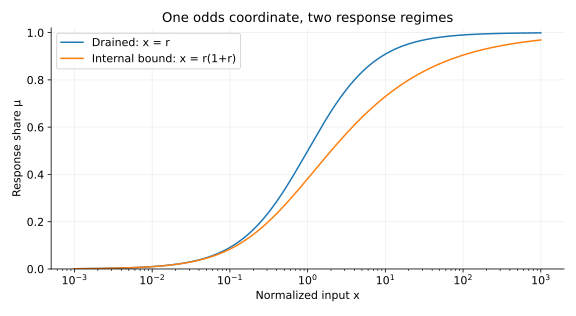

### 3. Common static generating action

Let y=x². Define V'_b(μ)=(r+br²)² and V_b(0)=0. Then

$$V_0=r-2\ln(1+r)+\mu,\quad V_1=r^3/3.$$

Their convex conjugate on 0≤μ<1 is

$$F_b(y)=\sup_{0\le\mu<1}[\mu y-V_b(\mu)],\qquad F_b'(y)=\mu_b(\sqrt y).$$

Explicit forms:

$$F_0=y-2\sqrt y+2\ln(1+\sqrt y),\quad F_1=r^4+2r^3/3,\quad r+r^2=\sqrt y.$$

The static mixed functional for drained gravity is ∫{a0²[μ |∇Φ|²/a0² - V_0(μ)]/(8πG)+ρΦ} dV; vary μ by maximization and Φ by minimization (appropriate boundary conditions). Eliminating μ gives the original AQUAL form. The flux is A(p)=μ(|p|/a0)p, p=∇Φ. Its transverse and radial Jacobian eigenvalues are μ and μ+x μ'; both positive for x>0. The gradient energy is strictly convex but degenerates quadratically at x=0; do not assert uniform ellipticity. At low x both laws have μ~x; at large x the complementary share behaves as 1/x (drained) and 1/√x (internal bound). F_1 is a response primitive, not a new macroscopic law. For drainless gravity use F(y)=y. The action is a static reduced functional, not the full four-term covariant SST.

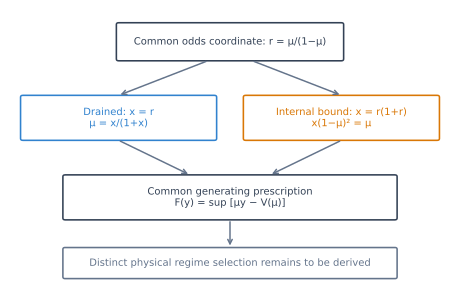

### 4. Recursive registration and exact charge composition

For a fixed region D with owned density ρ and admissible boundary trace f, define W_D[f]=inf_{Φ|∂D=f} E_D[Φ] using the appropriate static gravitational functional, with attained solutions or infima. Translation of Φ by a constant C leaves gradient energy unchanged, hence

$$W_D[f+C]=W_D[f]+C M_D,\quad M_D=\int_D\rho\,dV.$$

In the differentiable case D W_D[f](1)=M_D and D²W_D[f](1,h)=0. With n outward, first variation gives boundary flux δW_D=(1/4πG)∮ n·A(∇Φ) δf. This makes the total source charge independent of boundary trace, even when the angular response changes. The sign for d=-Φ/c² gives the rest-energy register as -∂W/∂d_b=M_D c². It is the prescribed static source charge; it is not a derivation of mass from vortex energy or an ADM mass theorem.

For fixed disjoint child interiors and residual parent region, minimise their sum over common interface traces g_i:

$$W_{parent}[f]=\inf_{\{g_i\}}\left[W_{residual}[f,\{g_i\}]+\sum_i W_{child,i}[g_i]\right].$$

The equality follows from decomposition/gluing of admissible potentials. Variation of g_i matches equal-and-opposite conormal flux. Internal interface terms cancel; the common-shift identity adds owned source charges. This is exact static distributed processing conditional on the partition, shared continuous trace, and additive local action. Nonlinear responses need the entire relevant boundary functional or a controlled approximation, not just total mass. Moving or overlapping closure ownership, causal dynamical response and gravitational binding contributions remain separate proof obligations.

### 5. Causality: a diagnostic obstruction and a possible constrained completion

For a naive Lorentz scalar kinetic function F(X), X=η^{μν}∂_μΦ ∂_νΦ/a0², on a static spacelike gradient background X=x²>0, the principal symbol is proportional to μ η^{μν}+2F''(X)∂^μΦ∂^νΦ/a0². Consequently the characteristic speed along the gradient is

$$v_\parallel^2/c^2=1+x\mu'(x)/\mu(x).$$

This equals 1+1/(1+x) for the drained law and 1+1/(1+2r) for the internal bound law. Both exceed one for finite x>0 and tend to 2 in the deep limit; transverse speed is c. This is a characteristic-cone result for that specific scalar completion, not a claim about the full SST. The scalar kinetic coefficient vanishes at x=0. A direct substitution of the Lorentz-invariant X is therefore not enough to secure the stipulated metric-c closure threshold.

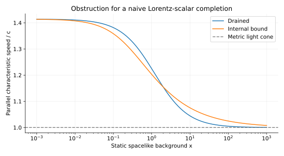

One illustrative static-background completion introduces a unit timelike field u, spatial projector h^{μν}=g^{μν}+u^μu^ν (signature -+++), y=h^{μν}∂_μΦ∂_νΦ/a0², and kinetic coefficient A(y)=μ(√y)+√y μ'(√y). Consider local scalar Lagrangian proportional to A(y)(u·∂Φ)²/a0² - F(y). Linearizing around u·∂Φ=0 with fixed u and metric gives v_parallel=c and v_transverse=c√(μ/A)≤c for x>0. This is the smallest time coefficient in this ansatz that makes the fastest scalar characteristic no wider than the metric cone on those backgrounds. It introduces a physical time-direction field, not derived from H36. At x=0 the kinetic term degenerates; evolving u, arbitrary backgrounds, metric constraints, positivity and tensor propagation require further work. No claim of general causal or relativistic completion.

### 6. Coupling and matter: what still must be unified

The previous conditional normalization follows from |T_G|²=α²¹, |T_E|²=α, the locked exchange stiffness ratio κ_G/κ_E=13/17, and a common reference pair-kernel magnitude. Then G=(17/13)α²¹ ℏc/m_e². Neither elementary α nor determinant source selection nor physical stiffness ratio has been obtained from native H36. The microscopic curvature remains D=0.1242946733 (full) or 0.1050941805 (central), yielding κ_micro=E_*D/(8a); the lattice energy and length scales require an independent dynamical equation. The electron joint compatibility relations in the preserved notes are unchanged. The proposed loop factor 1+α/(2π) is not derived. Reproducing a0 using the electron reference is not an independent prediction of m_e and G.

A true electromagnetic sector requires a local U(1) symmetry and Maxwell kinetic dynamics, not just the magnitude of an electrostatic pair kernel. For site amplitudes z_i and link U_ij, gauge-invariant hopping z_i†T_ij U_ij z_j is achieved by z_i→e^{iθ_i}z_i, U_ij→e^{iθ_i}U_ij e^{-iθ_j}; temporal connection is also required. The original H36 has a conserved global norm but its bare signed chamber occupation does not commute with H36. Hence this ordinary phase symmetry is not yet physical electric charge. A dressed conserved signed generator, compatible link dynamics, charge normalization and matter spin/statistics must be established. For gravity, universal coupling to stress-energy, local Lorentz covariance, nontrivial curvature transport and two propagating tensor modes must emerge; the scalar band pole E−E0∼Dk² alone does not supply them. A microscopic source variation should produce the boundary charge rather than assume ρ.

### 7. Unified architecture and decisive experiment

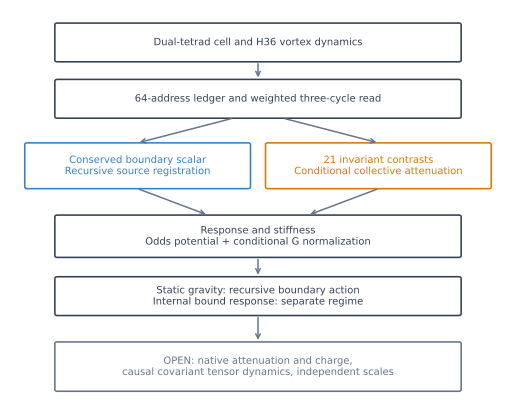

The central hypothesis is that the same field cell supports a lossless conservative internal engine, a coarse-grained registered boundary, a regime-dependent response potential, and recursive composition. The exact new results are the weighted three-stage factorization, two convex generating potentials and their explicit characteristic test. The physically unproved steps are native autonomous cycle/dwell selection, α and product source vertex, mass/charge and gauge normalization, causal tensor completion, and independent selection of the drained or internal bound feedback. The full SST action is not altered. The π crop image is inspiration, not evidence of the engine. 

The most discriminating next calculation is to construct a single radius-dependent, gauge-compatible Hamiltonian on the original cell plus link/complement degrees of freedom and compute its retarded response about a stable circulating state. It must demonstrate (a) the three grade projections and dwell balance, (b) a source vertex selecting α²¹ rather than ordinary α, (c) the predicted stiffness ratio without fitting, (d) a stable, universally coupled stress-energy source and signed conserved charge, (e) a causal long-wave tensor spectrum. If any lower-order symmetry-allowed source vertex survives, the collective exponent is not dynamically protected. A conservative H36 by itself cannot produce all of these results without additional dynamics; this is the target, not a completed proof.

### Reproduce

Run `OPENBLAS_NUM_THREADS=1 python verify_unified_closure.py` in this folder (NumPy, Matplotlib). The fresh verifier checks weighted projectors, invariant grade ranks, determinants, orthogonal dilations, response laws, Legendre forms and characteristic ratios (43 assertions). It does not rerun earlier verifiers, test astrophysical data, or modify GitHub. Diagrams are standalone SVG and PNG. Prior illustrated archive contents are preserved.

# Part III — Octal π sweep and gravity

## Octal π sweep, Walsh read and angular gravitational settlement

**GFD research extension — mathematical constructions and numerical checks; not a derivation of gravity from microscopic dynamics.**

This note builds on the existing [I Ching synthesis](https://github.com/fielddynamics/research/blob/main/research/exploratory/i-ching/BOOK_OF_CHANGES_AND_PI.md), [circular closure walk](https://github.com/fielddynamics/research/blob/main/research/exploratory/i-ching/notes/circular_closure_walk_synthesis.md), [BBP synthesis](https://github.com/fielddynamics/research/blob/main/research/bbp%20and%20pi%20field%20closure%20stepping/bbp_field_closure_synthesis.md), and [three-sweep algebra](https://github.com/fielddynamics/research/tree/main/research/3%20sweep%20understanding). The crop formation is inspiration, not empirical evidence for the field hypothesis.

### 1. Circular transfer function [exact conditional construction]

Let C shift the eight-dimensional slot basis cyclically, C|j>=|j+1 mod 8>. C^8=I. With the assumed BBP lap amplitude 1/16, an equal positive step factor is q=1/sqrt(2). Then

$$R(y)=(I-qyC)^{-1}=\frac{\sum_{j=0}^7(qy)^j C^j}{1-y^8/16}.$$

Use zero-based internal slot indices, with slot j representing denominator offset j+1, and w=(4,0,0,-2,-1,-1,0,0). Define the compensated read vector ell_j=w_j/q^j. Then

$$\ell^T R(y)e_0=\frac{4-2y^3-y^4-y^5}{1-y^8/16},\qquad \pi=\int_0^1\ell^T R(y)e_0\,dy.$$

The compensation is necessary: the unmodified BBP weights applied directly to the equally attenuated internal slots give a different function. The displayed circular address labels are denominator offsets modulo eight, not internal indices. The resolvent poles are y=sqrt(2) exp(i k pi/4); the numerator cancels four of them. This realizes the known BBP formula as an eight-slot linear feedback transfer function, not as the native 36-coordinate Hamiltonian. Both the read weights and amplitude factor are inputs. The factor 1/16 is a series amplitude weight, not the electromagnetic fine-structure transmission alpha.

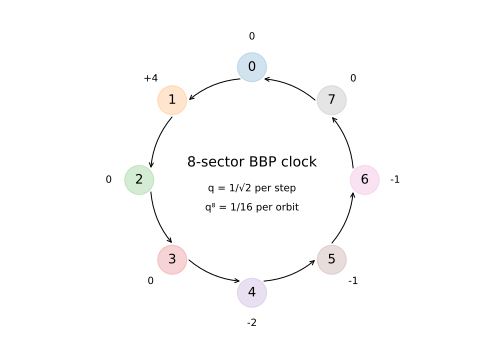

### 2. Circular addressing and binary phase operations

The octal step is a translation of Z/8, whereas the Walsh domain is (Z/2)^3. These groups are not isomorphic. Increment with input bits b2,b1,b0 obeys

$$b'_0=b_0\oplus1,\quad b'_1=b_1\oplus b_0,\quad b'_2=b_2\oplus(b_1b_0).$$

Apply Toffoli to bit 2 controlled by bits 0 and 1, then CNOT to bit 1 controlled by bit 0, then X to bit 0. Repeating implements C^d. With normalized Walsh W8, the off-diagonal Frobenius norm of W8 C W8^T is sqrt(5), so a circular increment is not a Walsh-diagonal translation. Neither carries nor a complete 2pi rigid rotation generate a Hadamard transform by themselves. A candidate phase generator of a normalized involution h is P_-=(I-h)/2, so exp(-i pi P_-)=h. Its microscopic generation remains open.

A circular address is also not a rigid rotation of the cube: a single 8-cycle is not a cube symmetry. The antipodal cube map is XOR 7, whereas a half-turn of the address circle adds 4 modulo 8. XOR 7 reverses the clock, JCJ=C^{-1}. Therefore these geometric and addressing actions require a dictionary, not an identification.

### 3. Exact settlement after address coverage

Initialize v=3 (leading octal digit), and for each fractional octal digit d set u=(v+d) mod 8. Increment N[v,u], then v=u. First complete coverage occurs at 332 transitions (333 digits including the integer digit). Counts range from 1 to 10. The first-coverage time is a finite sequence fact, not a physical period or proof of pi normality.

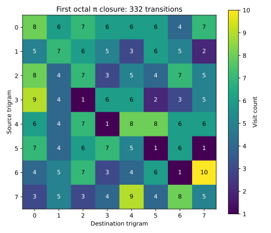

Given a static/coherently time-referenced record f_ab, assign each occurrence weight 1/(64 N_ab). Then the weighted sum is exactly (1/64) sum_ab f_ab. Equivalently, read every address at least once, register one value per address, and replace rather than add duplicate records. For target quadrature weights w_ab, use w_ab/N_ab instead. Neither rule creates a common-time snapshot for a changing system. It must be supplied by sample-and-hold, known transport or a derived coherent measurement.

Grouping antipodes gives face label min(a,7-a). The 4x4 matrix is [[23,23,20,25],[21,18,25,15],[21,21,18,20],[26,17,18,21]]. Its diagonal sum is 80. With independent origin weight 1/17 and raw visit weighting, the conditional TetB/Origin exchange stiffness is 1-(16/17)(80/332)=0.7732104890, not 13/17. Equal pair registration gives diagonal fraction 1/4 and restores 13/17 exactly under the exchange premise. Solid-angle boundary quadrature and equal-weight trace averaging represent distinct functionals; do not silently substitute one for the other.

### 4. Angular averaging and the first surviving multipole

For uniform weight on the eight unit cube vertices n=(±1,±1,±1)/sqrt(3), the first and third moments vanish and the second moment is I/3. But for a unit direction u,

$$\langle(n\cdot u)^4\rangle=\frac{3-2\sum_i u_i^4}{9}.$$

The sphere's corresponding moment is 1/5. Thus even an exactly balanced finite cube is not fully isotropic. For eight equal Newtonian point masses at radius a, the exterior multipole expansion (R>a) has no l=1,2,3 terms. The first possible anisotropic term is l=4:

$$\Phi(R,u)=-\frac{GM}{R}\left[1+\left(\frac aR\right)^4\frac7{36}(3-5\sum_i u_i^4)+O((a/R)^6)\right].$$

This is a toy source with ordinary Newtonian gravity already assumed; not a claim about actual electron substructure. It is a concrete angular diagnostic of the proposed sweep.

### 5. Three circular sweeps as projection operators

Define A_i f(n)=(1/(2pi)) integral_0^{2pi} f(R_i(-theta)n) dtheta for axis i=x,y,z. Each A_i is an orthogonal projection on L2(S2), using the normalized solid-angle measure. On the degree-l harmonic subspace the axisymmetric subspace is one-dimensional, spanned by the unit zonal harmonic z_{l,i}=sqrt(2l+1) P_l(n_i). By the spherical harmonic addition theorem, <z_{l,i},z_{l,j}>=P_l(e_i dot e_j). For perpendicular axes p_l=P_l(0). A complete averaged three-sweep operation T=A_z A_y A_x has the exact restriction

$$T_l=p_l^2 |z_{l,z}\rangle\langle z_{l,x}|,\qquad T_l^m=p_l^{3m-1}|z_{l,z}\rangle\langle z_{l,x}|\ (m\ge1).$$

Thus T_0=1, odd l are annihilated, and nonzero even l are contracted. The first-cycle norm is |p_l|^2, the nonzero eigenvalue is p_l^3. For l=2, p=-1/2, norm 1/4 and eigenvalue -1/8. For l=4, p=3/8, norm 9/64 and eigenvalue 27/512. Since |P_l(0)|<=1/2 for l>=1, on mean-zero L2 fields ||T^m||<=2^{-(3m-1)}. Consequently repeated three-sweep averages converge in L2 to the monopole, which is preserved exactly in every sweep. A single triple cycle is not an exact spherical average. For an exact one-pass angular average, use Haar rotation measure dphi sin(theta)dtheta dpsi/(8pi^2) in a ZYZ Euler parametrization, not three independent uniform Euler angles.

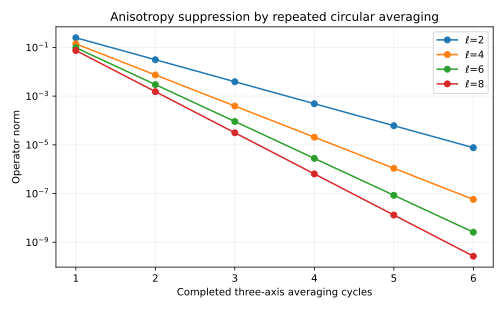

This theorem concerns *averaging* over full turns, not just end-point rotation. A physical model must derive angular transport, the averaging/reset operation, its conservation laws, and causal travel time. The three abstract axis vectors and the three visible circles do not establish such a process.

### 6. Flux and action

At each radius, angular averaging preserves the integral of a scalar radial flux density F_R(n). If the weak-field gravitational Gauss law is independently established, integral R^2 F_R dOmega=-4pi GM. Repeated averaging then drives F_R to the constant -GM/R^2 in L2. Gauss law itself requires a physical constitutive action and universal source coupling. A rotation cannot set G, derive a radial conservation law, or turn a scalar read into GR spin-2.

### 7. Distinguish physical and internal threefold symmetry

For literal 120-degree cube rotation, two corners are fixed; ordered pairs therefore have 24 invariant coordinates, whereas the recursive Triforce geometry has one fixed leaf and 22 invariant coordinates. The internal XOR/Pauli cycle also has 22, but is a different operation. The prior proposal of identifying the four axial pairs into two is an optional quotient imposed by hand, not a derived physical boundary condition, and cannot repair the missing equivariant bijection. Do not adopt it merely to force 22. Derive any physical map, dynamics and source functional independently.

### 8. Next proof target

First derive the independently specified recursive fine-field dynamics, geometric lattice restriction and energy-conserving settlement operator. Then test whether an explicit phase-transport or computational address map emerges, with no double counting and actual solid-angle weighting. A BBP generator, source determinant, elementary alpha and 13/17 stiffness normalization remain separate proof obligations; none may be selected merely to obtain the target numbers.

### Verification

`python verify_pi_sweep.py` requires numpy, scipy, mpmath and matplotlib. 70 checks passed in this run (numerical integral, finite matrices, coverage and spherical quadrature); the projection theorem is analytical, the checks are not 70 independent proofs. Three figures are supplied in SVG and PNG. No source repository modifications, empirical tests, or original H36 dynamics rerun in this extension.

# Part IV — I Ching encoding and circular sweep: visual reconstruction

The octal expansion, rather than the decimal representation of the supplied crop formation, is the field-address hypothesis. The established crop formation decoding is decimal; the research does not independently establish that the formation uses octal digits or an I Ching encoding. The diagrams below reproduce the mathematical concepts discussed in chat, not historical evidence of field dynamics.

## Trigrams and the dual tetrahedra

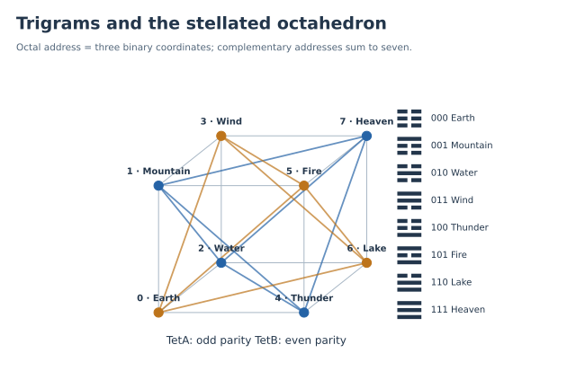

$$\pi_8=3.1103755242102643\ldots,\qquad v_{n+1}=(v_n+d_n)\bmod 8.$$

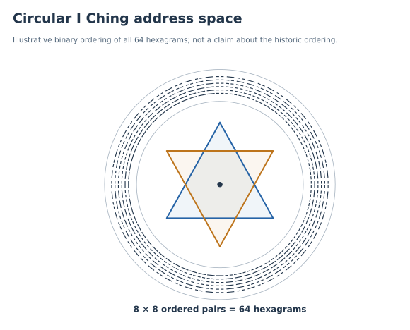

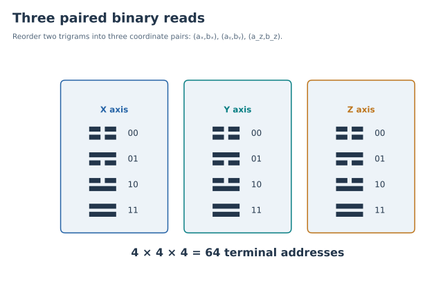

$$8^2=2^6=4^3=64.$$

## The three octal sector sweeps

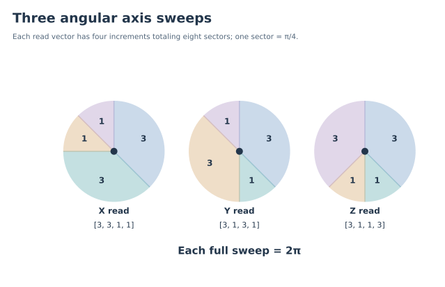

$$v_x=(3,3,1,1),\quad v_y=(3,1,3,1),\quad v_z=(3,1,1,3),\quad \sum_j v_{ij}\frac{\pi}{4}=2\pi.$$

## From the circular clock to binary operations

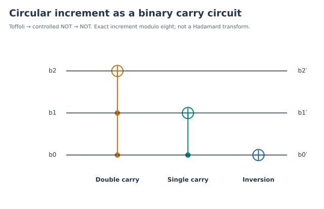

$$b'_0=b_0\oplus1,\quad b'_1=b_1\oplus b_0,\quad b'_2=b_2\oplus(b_1b_0).$$

This circuit applies gates in descending bit order and is not a Hadamard transformation. The separate normalized Hadamard phase identity is

$$P_-=(I-h)/2,\quad e^{-i\pi P_-}=h.$$

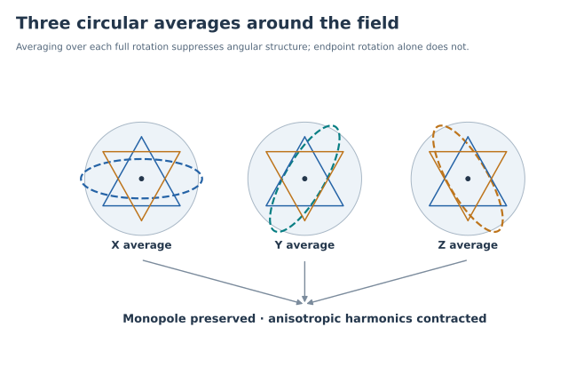

$$A_i f(\mathbf n)=\frac1{2\pi}\int_0^{2\pi} f(R_i(-\theta)\mathbf n)\,d\theta,\qquad \mathcal T=A_z A_y A_x.$$

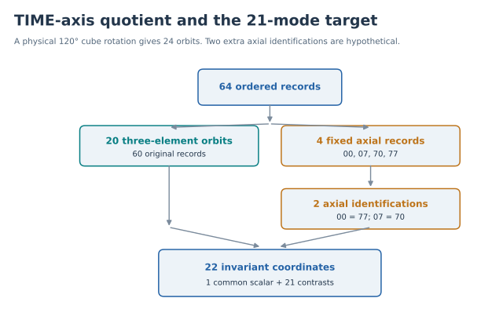

$$N_{\mathrm{orbits}}=(64+4+4)/3=24,\qquad 24-2-1=21.$$

The two extra axial identifications are proposed constraints, not a result of the spatial rotation alone.

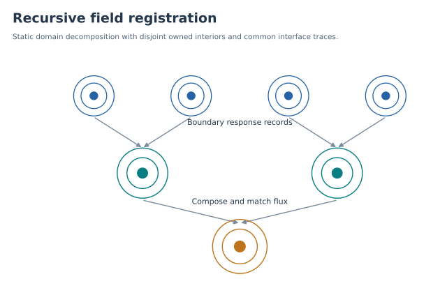

$$W_D[f+C]=W_D[f]+CM_D.$$

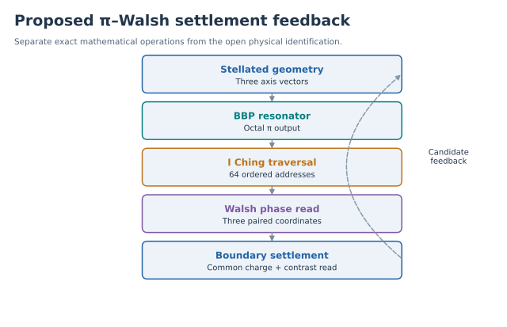

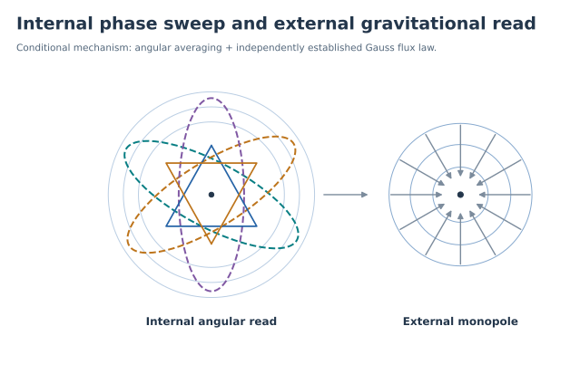

$$\oint_{S_R}\mathbf g\cdot d\mathbf A=-4\pi GM\quad\Longrightarrow\quad g_R=-GM/R^2\quad\text{(spherical response)}.$$

The flux law must be established independently of rotation. These graphics are candidate mechanisms, not a proof of their physical implementation.
