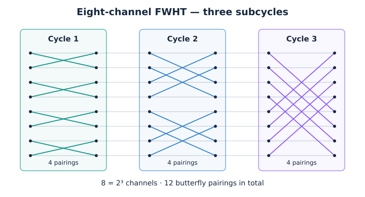
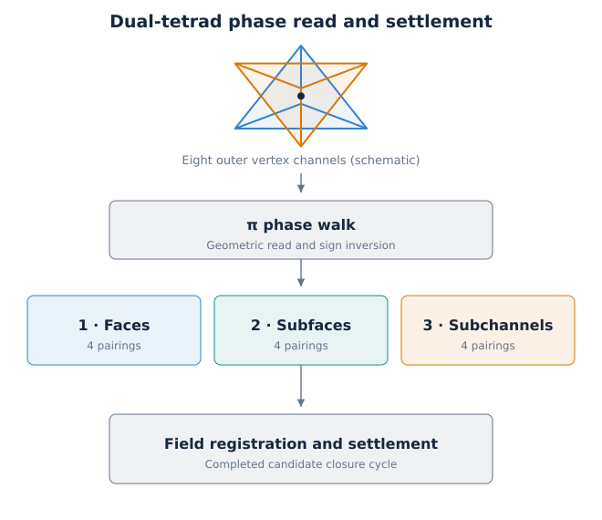
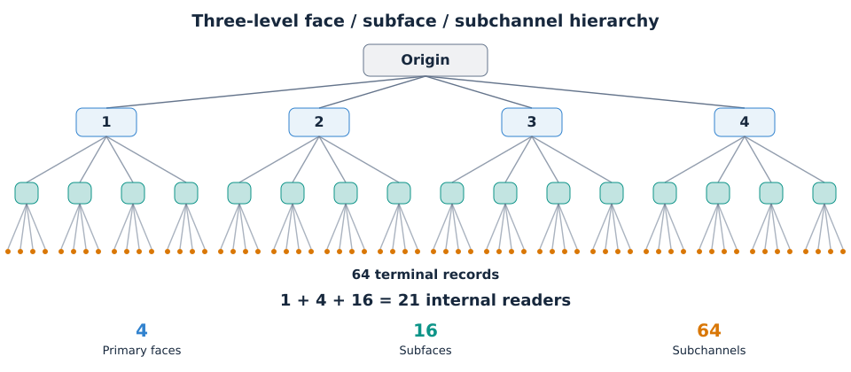
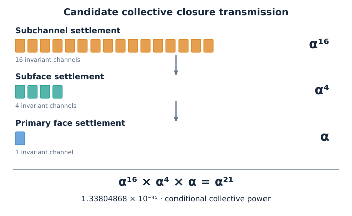
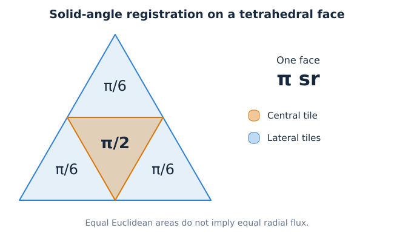
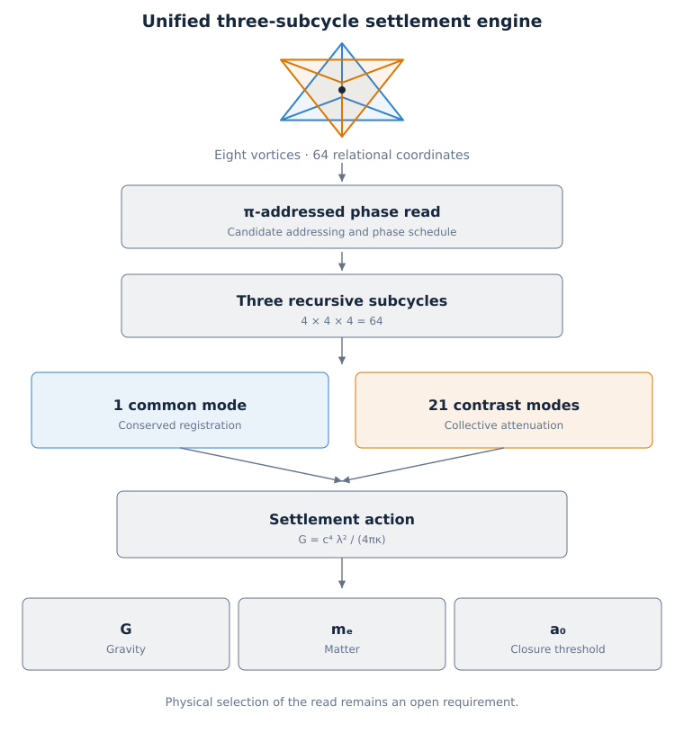
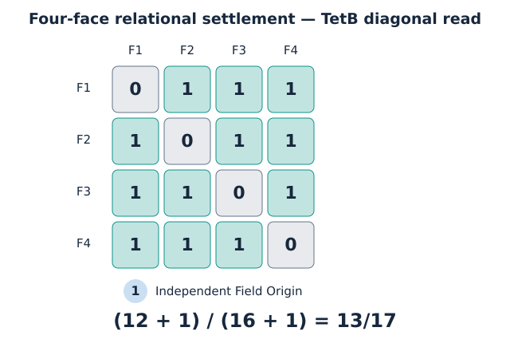
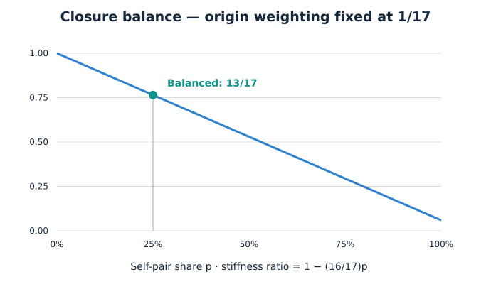
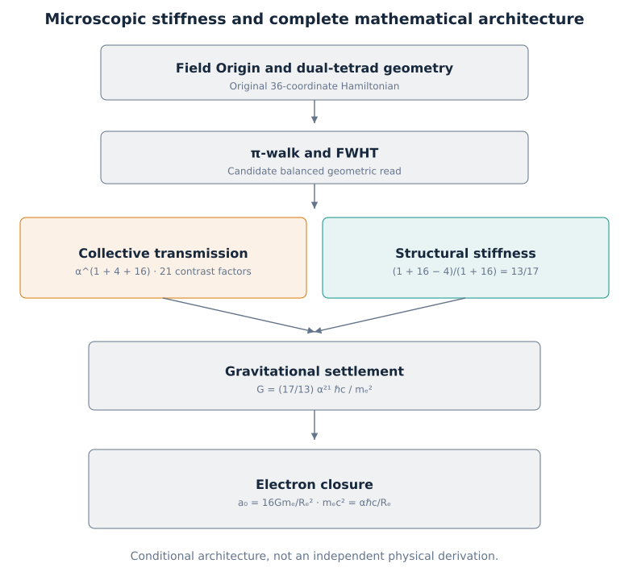

**Scope.** This companion reconstructs the nine visual diagrams from the chat and collects the associated mathematics in reading order. The diagrams are recreated graphics, not screenshots of the interface. The original two research notes, scripts, logs and supplied image are retained unchanged. Exact algebraic identities are distinguished from proposed physical mechanisms.

# 1. Geometric π and the initial three-cycle hypothesis

*Reference: the 2008 Barbury Castle π crop formation (photograph not reproduced here). The proposed three-circle interpretation is a GFD hypothesis, not evidence of a physical field mechanism.*

The decimal angular encoding uses increments of $2\pi/10$. For the ten digits of the rounded representation 3.141592654,

$$3+1+4+1+5+9+2+6+5+4=40,\qquad 40\frac{2\pi}{10}=8\pi.$$

This is four revolutions for that particular rounded representation, not a period of π. The three outer circles inspired the three-subcycle hypothesis. A separate exact mathematical connection is the eight-vertex Walsh transform:

$$8=2^3,\qquad (-1)^{a\cdot b}=e^{i\pi(a\cdot b)},\qquad \widehat f(a)=\frac{1}{\sqrt8}\sum_{b\in\{0,1\}^3}e^{i\pi(a\cdot b)}f(b).$$

$$3\times4=12.$$

The twelve butterfly pairings correspond combinatorially to the three groups of four parallel edges of a cube. The dual tetrahedra occupy its eight vertices. A Walsh sign phase does not, by itself, derive a physical π digit-address schedule.

# 2. Relational ledger and recursive closure

Eight vortex amplitudes admit a 64-coordinate dyadic operator ledger. A candidate three-level address structure is $L_{abc}$ with $a,b,c\in\{0,1,2,3\}$. A physical identification between the dyadic ledger and boundary records is still needed.

$$8^2=4^3=64,\qquad N=\frac{4^3-1}{4-1}=21,\qquad 64=1+3(21).$$

The normalized four-way Hadamard matrix and full relational FWHT are

$$h=\frac12\begin{pmatrix}1&1&1&1\\1&-1&1&-1\\1&1&-1&-1\\1&-1&-1&1\end{pmatrix},\qquad F=h\otimes h\otimes h.$$

The reversible hierarchical read separates one common mode and contrast strata of dimensions 3, 12, 48. This tree is distinct from the full FWHT, which also mixes details within each stratum. Under the simultaneous nonzero-digit cycle $M:1\mapsto2\mapsto3\mapsto1$ fixing zero,

$$Q=\frac{I+M+M^2}{3},\qquad \operatorname{rank}Q=22,\qquad 21=1+4+16.$$

The invariant contrast dimensions are $3/3,12/3,48/3$. The particular middle-grade assignment is a choice, not forced by spatial symmetry alone.

# 3. Collective transmission and structural coupling

With a proposed elementary amplitude $t=\sqrt\alpha$, the top exterior-power read on the 21-dimensional contrast sector yields

$$|\det(tI_{21})|^2=\alpha^{21}=\alpha^{16}\alpha^4\alpha\approx1.33804868\times10^{-45}.$$

A serial network of independently routed reflected modes is an alternative mathematical realization. Each stage has a lossless dilation

$$S=\begin{pmatrix}t&\sqrt{1-t^2}\\\sqrt{1-t^2}&-t\end{pmatrix},\qquad S^TS=I.$$

An ordinary one-mode projection has intensity $\alpha$, not $\alpha^{21}$. Physical selection of the collective vertex and elementary attenuation remains open.

The inherited coupling polynomial with $K=4$ is

$$f(K,s)=1+sK+K^2,\qquad f(4,+1)=21,\quad f(4,0)=17,\quad f(4,-1)=13.$$

The tree-level GFD target is $\gamma_G=Gm_e^2/(\hbar c)=(17/13)\alpha^{21}$.

# 4. Boundary-weighted settlement

A centered regular tetrahedron has four faces of solid angle $\pi$. The central Triforce tile subtends $\pi/2$, the three lateral tiles each $\pi/6$. For four assumed equally weighted subchannel addresses per tile,

$$w_{abc}=\begin{cases}1/32&b=0,\\1/96&b\ne0.\end{cases}$$

Let $u=(1,\ldots,1)^T$, $w^Tu=1$, and $P=uw^T$. Then

$$P^2=P,\qquad J_\alpha=\sqrt\alpha I+(1-\sqrt\alpha)P.$$

$$J_\alpha u=u,\qquad w^TJ_\alpha=w^T,\qquad J_\alpha Q=QJ_\alpha.$$

In the quadrature metric $D_w=\operatorname{diag}(w)$, $D_wJ_\alpha=J_\alpha^TD_w$. Equivalently, with $v=\sqrt w$,

$$D_w^{1/2}J_\alpha D_w^{-1/2}=tI+(1-t)vv^T.$$

The invariant space contains one conserved scalar and twenty-one weighted-zero contrasts:

$$|\det(J_\alpha|_{\operatorname{im}Q})|^2=\alpha^{21}.$$

The FWHT of the weights has only four nonzero coordinates:

$$(Fw)_{000}=1/8,\qquad (Fw)_{010}=(Fw)_{020}=(Fw)_{030}=1/24.$$

The squared contrast norm is $1/192$ versus $1/64$ for the common mode. This connects the boundary read to an invariant intermediate direction but does not derive its physical signed coupling.

# 5. Scalar action and electron closure

For a dimensionless microscopic scalar $q$ with stiffness $\kappa$ and collective coupling amplitude $\lambda$,

$$S[q]=\int_\Omega\left[\frac\kappa2|\nabla q|^2-c^2\rho\lambda q\right]d^3x.$$

With $d=\lambda q=-\Phi/c^2$ at fixed universal parameters,

$$S[d]=\int_\Omega\left[\frac{\kappa}{2\lambda^2}|\nabla d|^2-c^2\rho d\right]d^3x.$$

Matching the inherited drainless weak-field functional

$$S[d]=\int_\Omega\left[\frac{c^4}{8\pi G}|\nabla d|^2-c^2\rho d\right]d^3x$$

gives

$$G=\frac{c^4\lambda^2}{4\pi\kappa},\qquad \kappa_G=\frac{13}{17}\frac{m_e^2c^3}{4\pi\hbar}\quad\text{if }\lambda^2=\alpha^{21}\text{ and the topology target holds}.$$

The boundary conjugate is the source registration, not an additional stored energy:

$$E_{\mathrm{reg}}=-\frac{c^4}{4\pi G}\oint\partial_n d\,dA=mc^2.$$

At the inherited saturation threshold $g_{\mathrm{sat}}=a_0/16$ the spherical capacity is

$$E_C=\frac{a_0c^2R^2}{16G}.$$

The three inherited closure equations are

$$mc^2=\frac{\alpha\hbar c}{R},\qquad a_0=\frac{16Gm}{R^2},\qquad Gm^2=\gamma_G\hbar c.$$

Their unique positive joint solution is

$$m=\frac{a_0\alpha^2\hbar}{16\gamma_Gc^3},\qquad R=\frac{16\gamma_Gc^2}{\alpha a_0},\qquad G=\frac{256\gamma_G^3c^7}{\alpha^4\hbar a_0^2}.$$

For the proposed, not derived, loop factor $\gamma_G=(17/13)\alpha^{21}(1+\alpha/(2\pi))$ and $a_0=1.225\times10^{-10}\,\mathrm{m/s^2}$:

| Quantity | Joint compatibility value | Reference deviation |
|---|---:|---:|
| Electron mass | $9.1091789125\times10^{-31}$ kg | −22.48 ppm |
| Gravitational constant | $6.6745191675\times10^{-11}$ SI | +32.84 ppm |
| Electromagnetic closure radius | 2.8180036761 fm | — |

The selected acceleration may itself depend on electron properties; this is not then an independent prediction. The radius is not a measured physical electron size.

# 6. Microscopic Hamiltonian stiffness

The original 36-coordinate field and its two-site 72-coordinate Bloch operator have a simple lowest scalar band locally near zero momentum:

$$E(\mathbf k)=E_0+D|\mathbf k|^2+O(|\mathbf k|^4).$$

For normalized eigenvector $u$, reduced resolvent $R=(M(0)-E_0 I)^+$ and $M_j=iQ_j$,

$$D_j=\tfrac12u^TM_{jj}u+u^TQ_jRQ_ju.$$

| Interface | Calculated dimensionless curvature |
|---|---:|
| Full Triforce | 0.1242946733 |
| Central-mediated | 0.1050941805 |

Their ratio is approximately 1.1827, not 17/13. The primitive volume is $16a^3$ with microscopic energy unit $E_*$. For the unit-normalized scalar envelope,

$$S[q]=\int\frac{E_*D}{16a}|\nabla q|^2\,d^3x,\qquad \kappa_{\mathrm{micro}}=\frac{E_*D}{8a}.$$

The dimensionful scale is not fixed by the dimensionless Hamiltonian.

# 7. Face-pair exchange and the 13/17 ratio

On the sixteen ordered pairs $V=\mathbb R^4\otimes\mathbb R^4$ define $\tau(e_i\otimes e_j)=e_j\otimes e_i$. The three operators including an independent origin scalar are

$$C_A=1\oplus(I+\tau),\qquad C_O=1\oplus I,\qquad C_B=1\oplus(I-\tau).$$

$$\operatorname{Tr}\tau=4,\quad \operatorname{Tr}C_A=21,\quad \operatorname{Tr}C_O=17,\quad \operatorname{Tr}C_B=13.$$

The twelve cross-pair diagonal contributions, four zero self-pair contributions and independent origin yield a balanced locked-read stiffness

$$\kappa_B=\frac{12+1}{16+1}\kappa_O=\frac{13}{17}\kappa_O.$$

This is a trace average, not the rank of $C_B$ (which is seven). The Walsh invariance follows from

$$\tau(h\otimes h)=(h\otimes h)\tau,$$

$$(h\otimes h)^T(I-\tau)(h\otimes h)=I-\tau.$$

For origin share $r$ and conditional self-pair share $p$,

$$\frac{\kappa_B}{\kappa_O}=r+(1-r)(1-p),\qquad r=1/17,\quad p=1/4\implies\frac{\kappa_B}{\kappa_O}=13/17.$$

<label for="selfpair">Self-pair weighting (origin share fixed at 1/17): <strong id="pval">25%</strong></label>
<input id="selfpair" type="range" min="0" max="100" value="25" step="1" style="width:100%" oninput="updateBalance()">

Relative TetB stiffness: <strong id="stiffness">0.764706</strong> · Inverse stiffness ratio: <strong id="inverse">1.307692</strong>

<button onclick="document.getElementById('selfpair').value=25;updateBalance()">Restore balanced closure</button>

The π-walk must prove these occupation and dwell weights, not merely coverage. A deterministic equally weighted snapshot read is sufficient for the algebra but is not derived native motion.

# 8. Electromagnetic normalization and gravitational settlement

For the proposed common scalar kernel and elementary electrical transmission $T_E=\sqrt\alpha$, the electron pair interaction magnitude is

$$|U_E(r)|=\frac{m_e^2c^4\alpha}{4\pi\kappa_Er}=\frac{\alpha\hbar c}{r}.$$

Thus

$$\kappa_E=\frac{m_e^2c^3}{4\pi\hbar},\qquad \kappa_G=\frac{13}{17}\kappa_E.$$

Substitution into the gravitational matching identity gives

$$G=\frac{c^4\alpha^{21}}{4\pi\kappa_G}=\frac{17}{13}\alpha^{21}\frac{\hbar c}{m_e^2}.$$

This is conditional on the shared scalar-kernel source normalization and the collective read, not a derivation of Maxwell dynamics or electromagnetic force sign. With $\lambda_e=\hbar/(m_ec)$, equating the Hamiltonian stiffness to the electromagnetic reference requires

$$\frac{a}{\lambda_e}=\frac{\pi D}{2}\frac{E_*}{m_ec^2}.$$

If $E_*=m_ec^2$, the required lattice coordinate unit is $0.1952416162\lambda_e$ (full) or $0.1650815527\lambda_e$ (central). These are matching targets, not physical lengths independently predicted by the graph.

# 9. Research status and reproduction

The exact finite-dimensional identities, calculated graph curvature and conditional matching relations are supported by the included verifiers. The native autonomous π-walk, selection of the collective attenuation, origin of the physical energy/length scales, electromagnetic normalization premise and loop correction remain open. Conservative unitary dynamics do not supply attenuation without an additional channel or projection. No empirical validation or remote repository modification is claimed.

See `research/WEIGHTED_CLOSURE_SETTLEMENT.md`, `research/MICROSCOPIC_STIFFNESS_DERIVATION.md` and `verification/` for original notes and reproduction instructions. The visual reconstructions are available in both SVG and high-resolution PNG.
