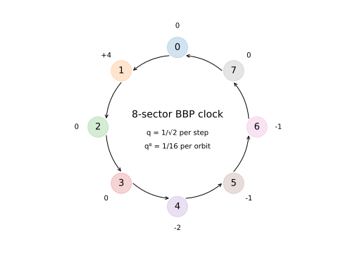
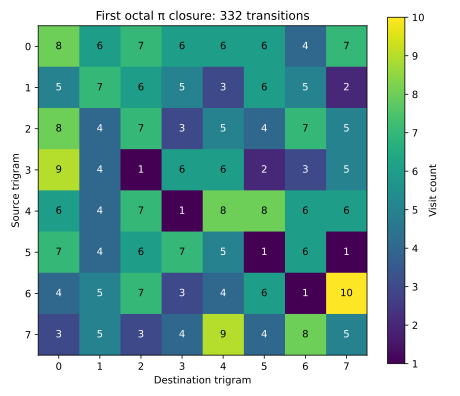
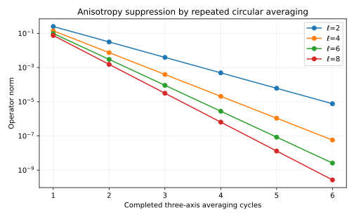

# Octal π sweep, Walsh read and angular gravitational settlement

**GFD research extension — mathematical constructions and numerical checks; not a derivation of gravity from microscopic dynamics.**

This note builds on the existing [I Ching synthesis](https://github.com/fielddynamics/research/blob/main/research/exploratory/i-ching/BOOK_OF_CHANGES_AND_PI.md), [circular closure walk](https://github.com/fielddynamics/research/blob/main/research/exploratory/i-ching/notes/circular_closure_walk_synthesis.md), [BBP synthesis](https://github.com/fielddynamics/research/blob/main/research/bbp%20and%20pi%20field%20closure%20stepping/bbp_field_closure_synthesis.md), and [three-sweep algebra](https://github.com/fielddynamics/research/tree/main/research/3%20sweep%20understanding). The crop formation is inspiration, not empirical evidence for the field hypothesis.

## 1. Circular transfer function [exact conditional construction]

Let C shift the eight-dimensional slot basis cyclically, C|j>=|j+1 mod 8>. C^8=I. With the assumed BBP lap amplitude 1/16, an equal positive step factor is q=1/sqrt(2). Then

$$R(y)=(I-qyC)^{-1}=\frac{\sum_{j=0}^7(qy)^j C^j}{1-y^8/16}.$$

Use zero-based internal slot indices, with slot j representing denominator offset j+1, and w=(4,0,0,-2,-1,-1,0,0). Define the compensated read vector ell_j=w_j/q^j. Then

$$\ell^T R(y)e_0=\frac{4-2y^3-y^4-y^5}{1-y^8/16},\qquad \pi=\int_0^1\ell^T R(y)e_0\,dy.$$

The compensation is necessary: the unmodified BBP weights applied directly to the equally attenuated internal slots give a different function. The displayed circular address labels are denominator offsets modulo eight, not internal indices. The resolvent poles are y=sqrt(2) exp(i k pi/4); the numerator cancels four of them. This realizes the known BBP formula as an eight-slot linear feedback transfer function, not as the native 36-coordinate Hamiltonian. Both the read weights and amplitude factor are inputs. The factor 1/16 is a series amplitude weight, not the electromagnetic fine-structure transmission alpha.

## 2. Circular addressing and binary phase operations

The octal step is a translation of Z/8, whereas the Walsh domain is (Z/2)^3. These groups are not isomorphic. Increment with input bits b2,b1,b0 obeys

$$b'_0=b_0\oplus1,\quad b'_1=b_1\oplus b_0,\quad b'_2=b_2\oplus(b_1b_0).$$

Apply Toffoli to bit 2 controlled by bits 0 and 1, then CNOT to bit 1 controlled by bit 0, then X to bit 0. Repeating implements C^d. With normalized Walsh W8, the off-diagonal Frobenius norm of W8 C W8^T is sqrt(5), so a circular increment is not a Walsh-diagonal translation. Neither carries nor a complete 2pi rigid rotation generate a Hadamard transform by themselves. A candidate phase generator of a normalized involution h is P_-=(I-h)/2, so exp(-i pi P_-)=h. Its microscopic generation remains open.

A circular address is also not a rigid rotation of the cube: a single 8-cycle is not a cube symmetry. The antipodal cube map is XOR 7, whereas a half-turn of the address circle adds 4 modulo 8. XOR 7 reverses the clock, JCJ=C^{-1}. Therefore these geometric and addressing actions require a dictionary, not an identification.

## 3. Exact settlement after address coverage

Initialize v=3 (leading octal digit), and for each fractional octal digit d set u=(v+d) mod 8. Increment N[v,u], then v=u. First complete coverage occurs at 332 transitions (333 digits including the integer digit). Counts range from 1 to 10. The first-coverage time is a finite sequence fact, not a physical period or proof of pi normality.

Given a static/coherently time-referenced record f_ab, assign each occurrence weight 1/(64 N_ab). Then the weighted sum is exactly (1/64) sum_ab f_ab. Equivalently, read every address at least once, register one value per address, and replace rather than add duplicate records. For target quadrature weights w_ab, use w_ab/N_ab instead. Neither rule creates a common-time snapshot for a changing system. It must be supplied by sample-and-hold, known transport or a derived coherent measurement.

Grouping antipodes gives face label min(a,7-a). The 4x4 matrix is [[23,23,20,25],[21,18,25,15],[21,21,18,20],[26,17,18,21]]. Its diagonal sum is 80. With independent origin weight 1/17 and raw visit weighting, the conditional TetB/Origin exchange stiffness is 1-(16/17)(80/332)=0.7732104890, not 13/17. Equal pair registration gives diagonal fraction 1/4 and restores 13/17 exactly under the exchange premise. Solid-angle boundary quadrature and equal-weight trace averaging represent distinct functionals; do not silently substitute one for the other.

## 4. Angular averaging and the first surviving multipole

For uniform weight on the eight unit cube vertices n=(±1,±1,±1)/sqrt(3), the first and third moments vanish and the second moment is I/3. But for a unit direction u,

$$\langle(n\cdot u)^4\rangle=\frac{3-2\sum_i u_i^4}{9}.$$

The sphere's corresponding moment is 1/5. Thus even an exactly balanced finite cube is not fully isotropic. For eight equal Newtonian point masses at radius a, the exterior multipole expansion (R>a) has no l=1,2,3 terms. The first possible anisotropic term is l=4:

$$\Phi(R,u)=-\frac{GM}{R}\left[1+\left(\frac aR\right)^4\frac7{36}(3-5\sum_i u_i^4)+O((a/R)^6)\right].$$

This is a toy source with ordinary Newtonian gravity already assumed; not a claim about actual electron substructure. It is a concrete angular diagnostic of the proposed sweep.

## 5. Three circular sweeps as projection operators

Define A_i f(n)=(1/(2pi)) integral_0^{2pi} f(R_i(-theta)n) dtheta for axis i=x,y,z. Each A_i is an orthogonal projection on L2(S2), using the normalized solid-angle measure. On the degree-l harmonic subspace the axisymmetric subspace is one-dimensional, spanned by the unit zonal harmonic z_{l,i}=sqrt(2l+1) P_l(n_i). By the spherical harmonic addition theorem, <z_{l,i},z_{l,j}>=P_l(e_i dot e_j). For perpendicular axes p_l=P_l(0). A complete averaged three-sweep operation T=A_z A_y A_x has the exact restriction

$$T_l=p_l^2 |z_{l,z}\rangle\langle z_{l,x}|,\qquad T_l^m=p_l^{3m-1}|z_{l,z}\rangle\langle z_{l,x}|\ (m\ge1).$$

Thus T_0=1, odd l are annihilated, and nonzero even l are contracted. The first-cycle norm is |p_l|^2, the nonzero eigenvalue is p_l^3. For l=2, p=-1/2, norm 1/4 and eigenvalue -1/8. For l=4, p=3/8, norm 9/64 and eigenvalue 27/512. Since |P_l(0)|<=1/2 for l>=1, on mean-zero L2 fields ||T^m||<=2^{-(3m-1)}. Consequently repeated three-sweep averages converge in L2 to the monopole, which is preserved exactly in every sweep. A single triple cycle is not an exact spherical average. For an exact one-pass angular average, use Haar rotation measure dphi sin(theta)dtheta dpsi/(8pi^2) in a ZYZ Euler parametrization, not three independent uniform Euler angles.

This theorem concerns *averaging* over full turns, not just end-point rotation. A physical model must derive angular transport, the averaging/reset operation, its conservation laws, and causal travel time. The three abstract axis vectors and the three visible circles do not establish such a process.

## 6. Flux and action

At each radius, angular averaging preserves the integral of a scalar radial flux density F_R(n). If the weak-field gravitational Gauss law is independently established, integral R^2 F_R dOmega=-4pi GM. Repeated averaging then drives F_R to the constant -GM/R^2 in L2. Gauss law itself requires a physical constitutive action and universal source coupling. A rotation cannot set G, derive a radial conservation law, or turn a scalar read into GR spin-2.

## 7. Distinguish physical and internal threefold symmetry

For literal 120-degree cube rotation, two corners are fixed; ordered pairs therefore have 24 invariant coordinates, whereas the [recursive Triforce geometry](../../recursive-triforce-geometry/) has one fixed leaf and 22 invariant coordinates. The internal XOR/Pauli cycle also has 22, but is a different operation. The prior proposal of identifying the four axial pairs into two is an optional quotient imposed by hand, not a derived physical boundary condition, and cannot repair the missing equivariant bijection. Do not adopt it merely to force 22. Derive any physical map, dynamics and source functional independently.

## 8. Next proof target

Derive the actual recursive face geometry and energy-conserving refinement/settlement dynamics first. Then test whether any native phase-transport or π-type addressing map realizes the physical records. No double counting, actual solid-angle quadrature, and external flux coupling are required. The proposed collective determinant, elementary alpha and 13/17 stiffness normalization remain independent proof obligations; a BBP-type read is not required by the existing algebra.

## Verification

`python verify_pi_sweep.py` requires numpy, scipy, mpmath and matplotlib. 70 checks passed in this run (numerical integral, finite matrices, coverage and spherical quadrature); the projection theorem is analytical, the checks are not 70 independent proofs. Three figures are supplied in SVG and PNG. No source repository modifications, empirical tests, or original H36 dynamics rerun in this extension.
