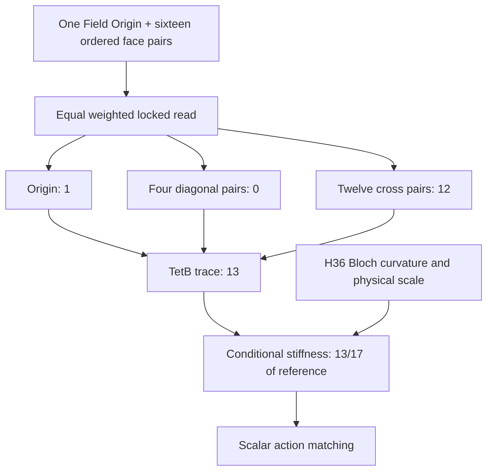

# Microscopic stiffness and balanced face-pair settlement

GFD Standard Field Model — companion to SPECTRAL_GRAVITY_READ.md, G_CLOSURE_DERIVATION.md and WEIGHTED_CLOSURE_SETTLEMENT.md.

**Status:** exact graph spectral calculation and conditional normalization; no independent derivation of G, alpha, or electron mass. The original Hamiltonian is unchanged. The balanced schedule below is a proposed physical read, not an observed native trajectory.

## 1. Continuum stiffness

Reconstruct Stage IX H36 with 128 nonzero undirected couplings, then use the existing two-site Bloch operator with actual tile maps and W or Wc. For the simple lowest band u, reduced resolvent R=(M(0)-E0)^+, and derivatives M_j=iQ_j, the dimensionless coefficient is D_j=u^T M_jj u/2 + u^T Q_j R Q_j u. The verifier reproduces D=0.12429467326666904 (full), 0.10509418047367802 (central). Both are isotropic locally. Neither ratio equals 17/13.

Primitive cell volume 16a^3 and energy scale E_* imply, for the normalized scalar envelope, kappa_micro=E_* D/(8a) in the convention S=integral kappa |grad q|^2/2. Rescaling H or physical a alters this value without changing its combinatorial geometry.

## 2. Balanced face-pair read

On C direct-sum (C^4 tensor C^4) define swap tau(e_i tensor e_j)=e_j tensor e_i. Let C_O=I17, C_A=1 direct-sum (I+tau), C_B=1 direct-sum (I-tau). These are positive semidefinite with traces 17,21,13. The symmetric/antisymmetric tensor dimensions are 10/6; C_B has rank 7. In the canonical pair basis the diagonal TetB weight is zero on four self-pairs and one on twelve cross-pairs. The independent origin contributes one.

A complete locked read that samples the scalar and each of the 16 ordered pairs once, with the same scalar-gradient amplitude and dwell weight, has mean stiffness kappa_B=(13/17) kappa_*. This also holds in any common orthogonal face basis because tau commutes with h tensor h, including the four-way Walsh operator. In particular no random mixing is required. This is an exact deterministic realization of the prior isotropic covariance assumption, not a derivation of the physical sampling schedule. Off-diagonal coherent swap terms are essential for general superpositions.

For a canonical-record schedule with origin share r and conditional self-pair share p, kappa_B/kappa_* = r+(1-r)(1-p). With r=1/17 and p=1/4 this is 13/17. Other schedules differ. A pi-address traversal must prove the relevant occupation and dwell weights, rather than merely coverage; if a snapshot is externally sampled and averaged once per distinct record, balance is a readout convention, not native dynamical weighting.

## 3. Electromagnetic reference and joint normalization

For a dimensionless field q coupled to a source m c^2 T, the pair energy magnitude is m^2 c^4 |T|^2/(4 pi kappa r). With elementary electrical T_E=sqrt(alpha) and electromagnetic pair magnitude alpha hbar c/r, kappa_E=m_e^2 c^3/(4 pi hbar). This is a conditional common scalar kernel normalization; it does not establish the electromagnetic force sign or Maxwell dynamics. Assign kappa_G=(13/17) kappa_E and T_G=alpha^(21/2). Then G=(17/13) alpha^21 hbar c/m_e^2. Loop factor not derived. This relation uses no measured G but assumes measured alpha, reference m_e, common source normalization, locked balanced read and collective vertex.

If the H36 scalar curvature is the reference stiffness, equating E_* D/(8a)=kappa_E gives a/lambda_e=(pi D/2)(E_*/m_ec^2). Here lambda_e=hbar/(m_ec). For E_*=m_ec^2 this requires 0.1952416162 (full) or 0.1650815527 (central). These are required values under a chosen scale, not independently determined geometry. If the band stiffness is already the gravitational one, the required length is instead larger by 17/13; do not apply the structural factor twice.

## 4. Obstruction to autonomous selection

Native core unitary conjugation preserves Hilbert-Schmidt norm and has determinant modulus one on the full operator space. Neither the FWHT nor such a unitary alone supplies a contrast attenuation alpha. Projection or coupling to additional modes is needed; physical selection of a 21-mode product vertex over a linear port remains unproved. Likewise an unlocked internal system can select directions of different stiffness, including zero; trace averaging is not forced by tetrahedral symmetry. A dimensionless Hamiltonian without a physical scale cannot determine a dimensionful stiffness uniquely. These are explicit proof obligations, not numerical discrepancies to fit away.

## Reproduction

`OPENBLAS_NUM_THREADS=1 python verify_microscopic_stiffness.py` (NumPy). Standalone reconstruction from the original Stage IX graph definition and checks of the Bloch curvature, swap traces, Walsh invariance and schedule weights. No earlier suite rerun, repository change, or empirical validation.
