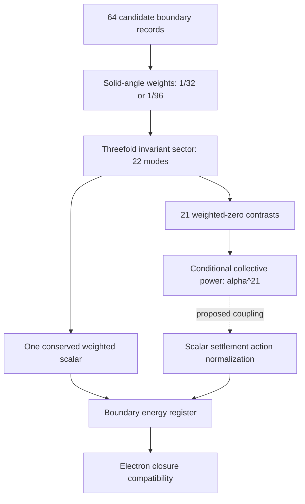

# Boundary-weighted three-subread settlement

GFD Standard Field Model · November 2026

**Status:** exact finite-dimensional identities conditional on the specified address geometry; proposed microscopic attenuation and scalar action matching; not an independent derivation of G or electron mass. Companion to `THREE_SUBREAD_CLOSURE.md`, `CLOSURE_ENGINE_INTERNALS.md`, and `ELECTRON_CLOSURE_SETTLEMENT.md`.

## 1. Flux-weighted register

For a radial inverse-square field centered on a regular tetrahedron, each primary face subtends π, its central Triforce tile π/2, and each lateral tile π/6. Thus the 16 tile shares of the total flux are 1/8 (central) and 1/24 (lateral). Equal division into four candidate subchannels per tile gives the 64 weights

$$w_{abc}=\begin{cases}1/32&b=0\\1/96&b\ne0.\end{cases}$$

The last split is an assumed address convention, not established physical subgeometry. Let $x$ denote scalar flux densities normalized to the tile solid-angle measure, not Pauli expectation values. Then $w^T x$ is the registered scalar. The threefold simultaneous nonzero-digit cycle $M$ preserves $w$ and $u=(1,\ldots,1)^T$. The projector $Q=(I+M+M^2)/3$ has rank 22.

With normalized four-point Hadamard $h$, $F=h^{\otimes3}$, the only nonzero components of $Fw$ are $(Fw)_{000}=1/8$ and $(Fw)_{0b0}=1/24$ for $b=1,2,3$. Thus the geometric boundary functional contains the uniform common coordinate and one invariant direction of the intermediate contrast block. Its squared Euclidean contrast norm is $1/192$, one third of its common squared norm $1/64$. This is an explicit link to the middle scale, not a derivation of its signed physical coupling.

## 2. A conserved weighted closure operator

The original unweighted contraction $tI+(1-t)uu^T/64$ preserves the raw sum, but generally not $w^T x$. To preserve the boundary register and a uniform density simultaneously, use

$$P=uw^T,\qquad J=tI+(1-t)P,\qquad t=\sqrt\alpha.$$

Since $w^Tu=1$, $P^2=P$. Hence $Ju=u$, $w^TJ=w^T$ and $JQ=QJ$. In the physical quadrature metric $D=\operatorname{diag}(w)$, $DJ=J^TD$. Equivalently $D^{1/2}JD^{-1/2}=tI+(1-t)vv^T$ with $v=\sqrt w$ of unit norm. The invariant sector splits into the common dimension and 21 dimensions of weighted-zero contrast. Consequently

$$|\det(J|_{\operatorname{im}Q})|^2=\alpha^{21}.$$

If Euclidean self-adjointness is required instead while keeping both $u$ and $w$ fixed, there must be at least two unit eigenvectors, leaving at most 20 attenuated invariant directions. The weighted metric resolves that obstruction. The operator is a candidate coarse-graining, not yet derived from H36. The 64-coordinate physical flux ledger and the Pauli ledger require an explicit physical dictionary; equal dimensionality does not identify them.

## 3. Collective versus individual transmission

A lossless two-port stage $S=\begin{pmatrix}t&\sqrt{1-t^2}\\\sqrt{1-t^2}&-t\end{pmatrix}$ can route its reflected output into a separate orthogonal channel. Cascading 21 such stages with no coherent feedback gives forward amplitude $t^{21}$ and power $\alpha^{21}$; the three block lengths are 16, 4, 1. Power conservation follows by the geometric series. This is an explicit realization of the determinant read, but selecting this serial channel, the per-stage $\alpha$, and the ratio $17/13$ remains a hypothesis. Parallel ordinary transmission does not yield this exponent.

## 4. Scalar action matching

For a scalar microscopic coordinate $q$ with action

$$S[q]=\int [\tfrac{\kappa}{2}|\nabla q|^2-c^2\rho\lambda q]d^3x,$$

identify the physical potential coordinate $d=\lambda q$. At fixed universal parameters the induced action is $\int[\kappa/(2\lambda^2)|\nabla d|^2-c^2\rho d]d^3x$. Matching the inherited drainless action requires $G=c^4\lambda^2/(4\pi\kappa)$. If the collective amplitude is $\lambda=\alpha^{21/2}$, the inherited tree-level topology formula requires $\kappa=(13/17)m_e^2c^3/(4\pi\hbar)$. This is a matching target, not an independent stiffness derivation. Including the proposed loop factor multiplies $\lambda^2$ by $1+\alpha/(2\pi)$.

The boundary conjugate of the on-shell physical action is $E_{reg}=-c^4/(4\pi G)\oint\partial_n d\,dA=mc^2$. At spherical capacity threshold $g_{sat}=a_0/16$ this becomes $E_C=a_0c^2R^2/(16G)$. Neither the threshold nor the dimensionful stiffness is derived by the weighted operator.

## 5. Electron compatibility

With the inherited premises $mc^2=\alpha\hbar c/R$, $a_0=16Gm/R^2$, $Gm^2=\gamma\hbar c$, one obtains

$$m=\frac{a_0\alpha^2\hbar}{16\gamma c^3},\quad R=\frac{16\gamma c^2}{\alpha a_0},\quad G=\frac{256\gamma^3c^7}{\alpha^4\hbar a_0^2}.$$

Using $a_0=1.225\times10^{-10}$ m/s², CODATA 2022 alpha, and the proposed loop-corrected gamma gives $m=9.1091789125\times10^{-31}$ kg, $R=2.8180036761$ fm, $G=6.6745191675\times10^{-11}$ SI. Reference deviations: -22.48 ppm in mass, +32.84 ppm in G. This illustration is not independent if the chosen acceleration was inferred from electron properties. The radius is an electromagnetic closure scale, not a measured electron size. No full covariant action or physical electron solution is established.

## Verification

Run `python verify_weighted_closure.py` (NumPy). Checks the quadrature weights, invariant rank, Hadamard support, projector, weighted reciprocity, conservation, determinant, and lossless serial transmission. No repository updates or earlier test-suite reruns were performed.
