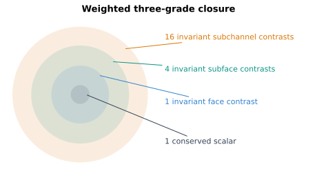
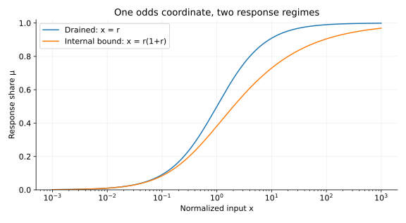
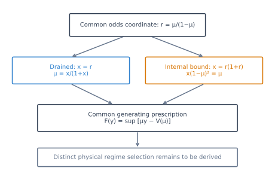
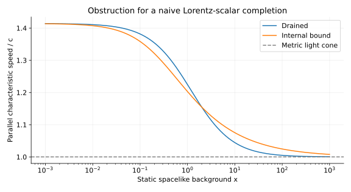
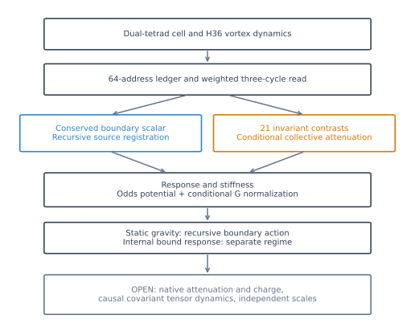

# Toward a unified field action

GFD Standard Field Model — research extension, November 2026. Companion to the preserved weighted closure and microscopic stiffness notes. **Exact:** finite-dimensional identities and response variational primitives. **Conditional:** chosen optical transmission, boundary sampling, static domain decomposition, and illustrative kinetic completion. **Open:** native H36 dynamics, physical charge, spin-2, full covariant SST, independent constants, and physical interpretation of the π formation. This is not a completed unified theory.

## 1. Three subcycles, one conserved registration

Let the address space be (a,b,c) in {0,1,2,3}³ with weights w=1/32 for b=0 and 1/96 otherwise, using equal candidate subchannel subdivision. Let P_k be conditional averaging over addresses sharing their first k digits, k=0,1,2,3. Thus P_0=1wᵀ, P_3=I, and P_jP_k=P_min(j,k). With W=diag(w), WP_k=P_kᵀW. The orthogonal detail projections D_k=P_k-P_(k-1) satisfy D_iD_j=δ_ij D_i and sum to I-P_0. Raw ranks are 3,12,48. For the simultaneous digit cycle 0→0, 1→2→3→1, the invariant projector Q=(I+M+M²)/3 commutes with all these projections; its rank is 22 and invariant detail ranks are 1,4,16. These are abstract read channels, not automatically Pauli or connection components.

For t=√α define J_k=I+(t-1)D_k. Then

$$J_3J_2J_1=P_0+t(I-P_0),\qquad w^T J_k=w^T,\quad J_k\mathbf1=\mathbf1.$$

The invariant determinants have squared moduli α, α⁴, α¹⁶. Their product is α²¹. The three operators commute and can be applied in either order, so the algebra does not prove temporal ordering. On the common scalar the transmission is one; on each individual contrast it is t, not t²¹. Only a collective determinant/all-pass selection has the proposed gravitational suppression.

There is an explicit conservative realization for each stage. In weighted-orthonormal coordinates let A_k=W^(1/2)J_kW^(-1/2), B_k=√(1-t²) W^(1/2)D_kW^(-1/2). Then the block matrix [[A_k,B_k],[B_k,-A_k]] is orthogonal. It conserves norm on the joint system plus complementary registers. The complement must carry the missing amplitude; no microscopic physical energy law is derived from this norm identity. A logarithmic contraction generator on the retained channel is -(I-P_0) in dimensionless time, with duration -ln(t). It is not the native Hermitian H36 generator.

A balanced reference face-pair schedule can be constructed by reading all 64 addresses once (four repeats of each ordered pair) and adding four independent origin reads with equal dwell weights. Then the 68 records give origin share 1/17 and pair-diagonal share 1/4, yielding 13/17 for the locked exchange read. A permutation generated by any deterministic address schedule preserves this count, but π-digit coverage is not a proof of the native dwell weights or a physical period. Do not conflate uniform structural read weights and physical solid-angle weights: a central tile carries half the boundary flux on its face; if the self-pair is identified with the central tile on every face, the weighted diagonal share is 1/2, not 1/4. A physical dictionary and distinct normalization must be established.

## 2. One odds variable, two constitutive responses

Define r=μ/(1-μ), μ=r/(1+r), x≥0. The existing drained law μ_d=x/(1+x) becomes x=r. The existing internal bound law x(1-μ_b)²=μ_b becomes x=r(1+r). Use discrete regime label b=0,1 (not an adjustable continuous parameter). Both are stationary minima of

$$C_b(r)-xr,\quad C_b(r)=\tfrac12r^2+\tfrac b3r^3,\quad x=r+br^2,\quad C_b''=1+2br>0.$$

At x=0 the minimizer is r=0. For b=1 use r=2x/(1+√(1+4x)). This is a common mathematical representation, not a microscopic derivation of the extra feedback or a proof that TetB selects it. The internal bound law is not the macroscopic drainless gravitational law.

## 3. Common static generating action

Let y=x². Define V'_b(μ)=(r+br²)² and V_b(0)=0. Then

$$V_0=r-2\ln(1+r)+\mu,\quad V_1=r^3/3.$$

Their convex conjugate on 0≤μ<1 is

$$F_b(y)=\sup_{0\le\mu<1}[\mu y-V_b(\mu)],\qquad F_b'(y)=\mu_b(\sqrt y).$$

Explicit forms:

$$F_0=y-2\sqrt y+2\ln(1+\sqrt y),\quad F_1=r^4+2r^3/3,\quad r+r^2=\sqrt y.$$

The static mixed functional for drained gravity is ∫{a0²[μ |∇Φ|²/a0² - V_0(μ)]/(8πG)+ρΦ} dV; vary μ by maximization and Φ by minimization (appropriate boundary conditions). Eliminating μ gives the original AQUAL form. The flux is A(p)=μ(|p|/a0)p, p=∇Φ. Its transverse and radial Jacobian eigenvalues are μ and μ+x μ'; both positive for x>0. The gradient energy is strictly convex but degenerates quadratically at x=0; do not assert uniform ellipticity. At low x both laws have μ~x; at large x the complementary share behaves as 1/x (drained) and 1/√x (internal bound). F_1 is a response primitive, not a new macroscopic law. For drainless gravity use F(y)=y. The action is a static reduced functional, not the full four-term covariant SST.

## 4. Recursive registration and exact charge composition

For a fixed region D with owned density ρ and admissible boundary trace f, define W_D[f]=inf_{Φ|∂D=f} E_D[Φ] using the appropriate static gravitational functional, with attained solutions or infima. Translation of Φ by a constant C leaves gradient energy unchanged, hence

$$W_D[f+C]=W_D[f]+C M_D,\quad M_D=\int_D\rho\,dV.$$

In the differentiable case D W_D[f](1)=M_D and D²W_D[f](1,h)=0. With n outward, first variation gives boundary flux δW_D=(1/4πG)∮ n·A(∇Φ) δf. This makes the total source charge independent of boundary trace, even when the angular response changes. The sign for d=-Φ/c² gives the rest-energy register as -∂W/∂d_b=M_D c². It is the prescribed static source charge; it is not a derivation of mass from vortex energy or an ADM mass theorem.

For fixed disjoint child interiors and residual parent region, minimise their sum over common interface traces g_i:

$$W_{parent}[f]=\inf_{\{g_i\}}\left[W_{residual}[f,\{g_i\}]+\sum_i W_{child,i}[g_i]\right].$$

The equality follows from decomposition/gluing of admissible potentials. Variation of g_i matches equal-and-opposite conormal flux. Internal interface terms cancel; the common-shift identity adds owned source charges. This is exact static distributed processing conditional on the partition, shared continuous trace, and additive local action. Nonlinear responses need the entire relevant boundary functional or a controlled approximation, not just total mass. Moving or overlapping closure ownership, causal dynamical response and gravitational binding contributions remain separate proof obligations.

## 5. Causality: a diagnostic obstruction and a possible constrained completion

For a naive Lorentz scalar kinetic function F(X), X=η^{μν}∂_μΦ ∂_νΦ/a0², on a static spacelike gradient background X=x²>0, the principal symbol is proportional to μ η^{μν}+2F''(X)∂^μΦ∂^νΦ/a0². Consequently the characteristic speed along the gradient is

$$v_\parallel^2/c^2=1+x\mu'(x)/\mu(x).$$

This equals 1+1/(1+x) for the drained law and 1+1/(1+2r) for the internal bound law. Both exceed one for finite x>0 and tend to 2 in the deep limit; transverse speed is c. This is a characteristic-cone result for that specific scalar completion, not a claim about the full SST. The scalar kinetic coefficient vanishes at x=0. A direct substitution of the Lorentz-invariant X is therefore not enough to secure the stipulated metric-c closure threshold.

One illustrative static-background completion introduces a unit timelike field u, spatial projector h^{μν}=g^{μν}+u^μu^ν (signature -+++), y=h^{μν}∂_μΦ∂_νΦ/a0², and kinetic coefficient A(y)=μ(√y)+√y μ'(√y). Consider local scalar Lagrangian proportional to A(y)(u·∂Φ)²/a0² - F(y). Linearizing around u·∂Φ=0 with fixed u and metric gives v_parallel=c and v_transverse=c√(μ/A)≤c for x>0. This is the smallest time coefficient in this ansatz that makes the fastest scalar characteristic no wider than the metric cone on those backgrounds. It introduces a physical time-direction field, not derived from H36. At x=0 the kinetic term degenerates; evolving u, arbitrary backgrounds, metric constraints, positivity and tensor propagation require further work. No claim of general causal or relativistic completion.

## 6. Coupling and matter: what still must be unified

The previous conditional normalization follows from |T_G|²=α²¹, |T_E|²=α, the locked exchange stiffness ratio κ_G/κ_E=13/17, and a common reference pair-kernel magnitude. Then G=(17/13)α²¹ ℏc/m_e². Neither elementary α nor determinant source selection nor physical stiffness ratio has been obtained from native H36. The microscopic curvature remains D=0.1242946733 (full) or 0.1050941805 (central), yielding κ_micro=E_*D/(8a); the lattice energy and length scales require an independent dynamical equation. The electron joint compatibility relations in the preserved notes are unchanged. The proposed loop factor 1+α/(2π) is not derived. Reproducing a0 using the electron reference is not an independent prediction of m_e and G.

A true electromagnetic sector requires a local U(1) symmetry and Maxwell kinetic dynamics, not just the magnitude of an electrostatic pair kernel. For site amplitudes z_i and link U_ij, gauge-invariant hopping z_i†T_ij U_ij z_j is achieved by z_i→e^{iθ_i}z_i, U_ij→e^{iθ_i}U_ij e^{-iθ_j}; temporal connection is also required. The original H36 has a conserved global norm but its bare signed chamber occupation does not commute with H36. Hence this ordinary phase symmetry is not yet physical electric charge. A dressed conserved signed generator, compatible link dynamics, charge normalization and matter spin/statistics must be established. For gravity, universal coupling to stress-energy, local Lorentz covariance, nontrivial curvature transport and two propagating tensor modes must emerge; the scalar band pole E−E0∼Dk² alone does not supply them. A microscopic source variation should produce the boundary charge rather than assume ρ.

## 7. Unified architecture and decisive experiment

The central hypothesis is that the same field cell supports a lossless conservative internal engine, a coarse-grained registered boundary, a regime-dependent response potential, and recursive composition. The exact new results are the weighted three-stage factorization, two convex generating potentials and their explicit characteristic test. The physically unproved steps are native autonomous cycle/dwell selection, α and product source vertex, mass/charge and gauge normalization, causal tensor completion, and independent selection of the drained or internal bound feedback. The full SST action is not altered. The π crop image is inspiration, not evidence of the engine. 

The most discriminating next calculation is to construct a single radius-dependent, gauge-compatible Hamiltonian on the original cell plus link/complement degrees of freedom and compute its retarded response about a stable circulating state. It must demonstrate (a) the three grade projections and dwell balance, (b) a source vertex selecting α²¹ rather than ordinary α, (c) the predicted stiffness ratio without fitting, (d) a stable, universally coupled stress-energy source and signed conserved charge, (e) a causal long-wave tensor spectrum. If any lower-order symmetry-allowed source vertex survives, the collective exponent is not dynamically protected. A conservative H36 by itself cannot produce all of these results without additional dynamics; this is the target, not a completed proof.

## Reproduce

Run `OPENBLAS_NUM_THREADS=1 python verify_unified_closure.py` in this folder (NumPy, Matplotlib). The fresh verifier checks weighted projectors, invariant grade ranks, determinants, orthogonal dilations, response laws, Legendre forms and characteristic ratios (43 assertions). It does not rerun earlier verifiers, test astrophysical data, or modify GitHub. Diagrams are standalone SVG and PNG. Prior illustrated archive contents are preserved.
