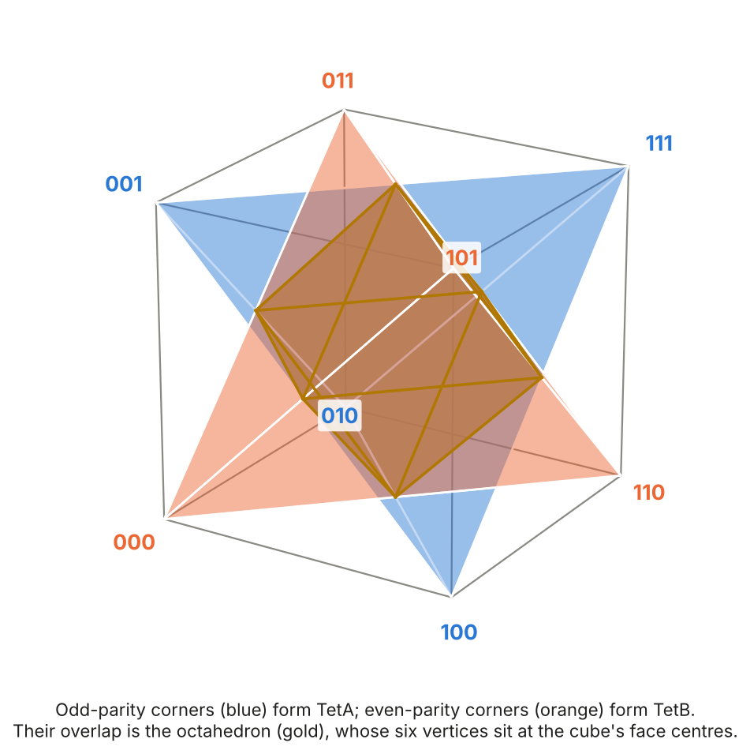
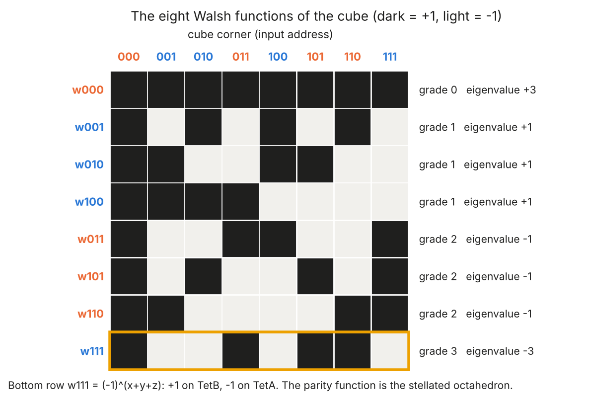
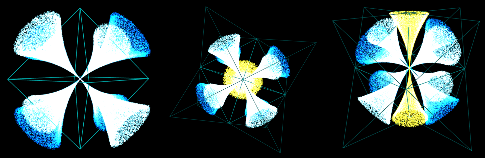

# The Universe Is Pixelated

*The cube, its Walsh spectrum, and the light cone · Gravity Field Dynamics (GFD) · Field Dynamics Research*

`walsh-hadamard-transform` `boolean-functions` `stellated-octahedron` `digital-physics` `discrete-spacetime` `tetrad` `light-cone` `gravitational-constant`

---

Every image on a screen is made of pixels. Each pixel is a small square that is either lit or not, and the picture exists only in their arrangement. Up close there are no curves at all, only steps. Step back and smooth curves appear.

Mathematics has two ways of building a signal out of simple pieces. Fourier analysis uses smooth waves, sines and cosines, and is the natural language of anything continuous. Walsh analysis uses square waves that take only the values +1 and −1, and is the natural language of anything built from on/off states. Fourier is the language of a violin string. Walsh is the language of a screen.

This folder asks which of the two belongs to the local structure of spacetime. In GFD, that structure is the stellated octahedron sitting inside a cube. The cube is a binary object: its eight corners are the eight three-bit addresses, 000 to 111. Its natural harmonics are therefore Walsh functions, not sine waves. The question is what that means.



## A shape with a long history

The stellated octahedron has fascinated geometers for more than five centuries.

- **The Renaissance.** Luca Pacioli included it in *De Divina Proportione* (1509), illustrated by Leonardo da Vinci, where Leonardo drew it twice, solid and hollow, as the *Octocedron Elevatus*, the "elevated octahedron." Pacioli described it as 24 equal triangles enclosing an inner octahedron "visible only to the imagination." Wenzel Jamnitzer engraved it again in *Perspectiva Corporum Regularium* (1568). It had already appeared in stone three centuries earlier, carved into the Sahib Ata caravanserai in Anatolia.
- **Kepler.** Johannes Kepler gave it the name *stella octangula*, the eight-pointed star. He discussed it in his essay on the snowflake, *De Nive Sexangula* (1611), and again in *Harmonices Mundi* (1619), where he set out stellation: extending the faces of a polyhedron until they meet again. The stella octangula is what you get by stellating the octahedron, and it is the octahedron's only stellation. Kepler had spent his career looking for the geometry beneath the cosmos. In *Mysterium Cosmographicum* (1596) he nested the Platonic solids between the orbits of the planets, and in the snowflake essay he asked why every snowflake has six points, and how spheres pack together.

Part of the appeal was Platonic. In the *Timaeus*, Plato assigned his solids to the elements: the tetrahedron to fire, the octahedron to air, the cube to earth. The stellated octahedron holds all three at once. Two tetrahedra interpenetrate, an octahedron sits at their heart where they overlap, and the cube encloses them, its eight corners exactly the eight points of the star. For anyone who believed the world was built from geometry, this was a single figure in which several of the elements locked together.

It is also the simplest of the five regular polyhedral compounds, and the only one made of just two solids: two copies of the most basic polyhedron, related by a reflection through the centre. Letter 1 shows that this is precisely the shape the tetrad of general relativity draws in space.

## The cube is a binary computer

Give each axis of the cube one bit: 0 for one side, 1 for the other. Each corner then has a three-bit address, from 000 to 111. Figure 1 colours them by parity, the number of 1s in the address:

- the four corners with an odd number of 1s (001, 010, 100, 111) form one regular tetrahedron, **TetA**;
- the four with an even number (000, 011, 101, 110) form the other, **TetB**.

**How the Walsh values are produced.** A Walsh function is labelled by an address $a$, just like a corner. Its value at corner $x$ is

$$w_a(x) = (-1)^{\,\mathrm{popcount}(a \,\mathrm{AND}\, x)} .$$

Take the bits that $a$ and $x$ share, count them, and return +1 if the count is even and −1 if it is odd. For example, $w_{011}$ at corner $110$: the shared bit is the middle one, a count of 1, so the value is −1.

Doing this for all eight labels and all eight corners gives an $8 \times 8$ table of ±1 entries, the **Walsh–Hadamard matrix**. It is built from the $2 \times 2$ block $\begin{smallmatrix}1&1\\1&-1\end{smallmatrix}$ by repeated tensor products, $H_8 = H_2 \otimes H_2 \otimes H_2$, one factor per axis (Sylvester 1867). Its rows are mutually orthogonal, and they are the eight harmonics of the cube.



**How many operations?** The cube is often said to give $2^8$ operations. The count is right, but the inputs are three, not eight. The cube has **3 inputs**, one bit per axis. Those 3 bits give $2^3 = 8$ corners, which are the 8 rows of a truth table. A Boolean operation assigns an output bit to each corner, so there are

$$2^{2^3} = 2^8 = 256$$

distinct operations on the cube. These are all the three-input logic gates there are. (With 8 independent inputs there would be $2^{256}$.) Each of the 256 has a Walsh spectrum of 8 integers, and every spectrum has the same total power: the squares of its 8 values sum to 64 (Parseval's theorem). Sixteen of the 256 are the Walsh functions themselves and their negatives. Every other operation is a mixture of them.

**The cube is the universal Boolean operator for three bits.** This is not a GFD idea. It is standard mathematics and computer science:

- **Every three-input Boolean function is a colouring of the cube.** The domain of an $n$-input Boolean function is, by definition, the set of $n$-bit strings, the vertices of the $n$-dimensional cube $\{0,1\}^n$. The field that studies these functions calls this space the *Boolean cube* (O'Donnell 2014). For $n = 3$, it is the ordinary cube.
- **Every Boolean function has exactly one Walsh expansion.** Any function on the Boolean cube can be written uniquely as a combination of the Walsh functions, its Fourier–Walsh expansion (O'Donnell 2014, Theorem 1.1). The eight rows of $H_8$ are a complete basis for all 256 operations.
- **Universal gates live on the cube.** The 256 include NAND and NOR, each of which can build every Boolean function. Every reversible three-bit gate is a permutation of the cube's 8 corners, so there are $8! = 40{,}320$ of them. One of these, the Toffoli gate, which swaps the corners 110 and 111 and fixes the rest, is universal for reversible computation (Toffoli 1980). Together with the Hadamard gate, $H_2$ itself, it is also universal for quantum computation (Shi 2003; Aharonov 2003).

So the cube's eight corners, read through the Walsh–Hadamard matrix, already contain every operation that three bits can perform, classical, reversible or quantum. What GFD adds is the claim that this cube is also the local frame of spacetime.

## The stellated octahedron is in the spectrum

Three exact facts tie the shape in Figure 1 to the matrix in Figure 2.

**1. The last Walsh function draws the star.** The highest harmonic, $w_{111}(x) = (-1)^{x_1 + x_2 + x_3}$, is the parity function. It is +1 on every corner of TetB and −1 on every corner of TetA. The split of the cube into two tetrahedra is not an extra construction. It is one row of the Walsh–Hadamard matrix.

**2. The cube's own vibrations split the same way.** Treat the cube's twelve edges as a network and ask for its natural modes, the eigenvectors of the graph. They are exactly the eight Walsh functions, with eigenvalues $3 - 2 \times \text{grade}$, where the grade is the number of 1s in the label: $+3, +1, -1, -3$, with multiplicities $1, 3, 3, 1$.

The cube graph is bipartite: every edge joins a TetA corner to a TetB corner, and no edge stays inside one tetrahedron. Multiplying any mode by the parity function $w_{111}$ turns eigenvalue $\lambda$ into $-\lambda$. Because the cube's frequency labels are themselves cube corners, the frequencies sort into the same two tetrahedra: the even-grade labels (eigenvalues $+3$ and $-1$) are the TetB addresses, and the odd-grade labels (eigenvalues $+1$ and $-3$) are the TetA addresses. The stellated octahedron appears on both sides of the transform.

**3. A tetrahedron transforms into the diagonal.** TetB is a subgroup of the cube under XOR, and TetA is its other half (its coset). The Walsh transform of TetA's indicator has only two nonzero values, at $w_{000}$ and $w_{111}$. Conversely, the transform of the body diagonal $\{000, 111\}$ is nonzero only on the four TetB addresses.

In frequency space, then, a tetrahedron becomes the line from 000 to 111, and that line becomes a tetrahedron. In Paper IX this diagonal is special: it passes through the Field Origin and joins the two **time faces**, TetA's face opposite 111 and TetB's opposite 000. The spectral dual of the stellated octahedron is the axis that carries time.

**And the tetrad is a Hadamard matrix.** Take the $4 \times 4$ Hadamard matrix and drop its first column of 1s. The four rows that remain are

$$(1,1,1),\quad (1,-1,-1),\quad (-1,1,-1),\quad (-1,-1,1),$$

which are exactly the four tetrad directions $v_1, \dots, v_4$ of Letter 1. They sum to zero, the closure condition, and meet at the tetrahedral angle, $\cos\theta = -1/3$. This is a general rule: an $n$-dimensional cube contains a regular simplex among its corners if and only if a Hadamard matrix of order $n + 1$ exists. Deleting a column of the Hadamard matrix gives the simplex, and adding a constant column to the simplex gives back the matrix. In three dimensions that order is 4. The tetrad of general relativity, written in ±1 form, is a Hadamard matrix.

## The octahedron and the light cone

Letter 1's supplement starts from the light cone. In a frame with signature $(-,+,+,+)$, every light ray through a point corresponds to a direction on a sphere, the celestial sphere $S^2$. The tetrad's four directions are four such directions, chosen so that none is preferred. They are null directions: directions of light.

Now look at the gold octahedron at the centre of Figure 1. It is the region where $|v_i| \le 1$ for all four directions at once, the overlap of TetA and TetB. Its eight faces point to the eight corners of the cube, which are exactly the eight directions $\pm v_1, \dots, \pm v_4$ of the two tetrads. **The octahedron is the solid bounded by the eight null directions.** It is the sphere of light rays, made discrete: eight facets instead of a smooth sphere, one facet for each null direction the frame contains.

GFD's photonic notes take the next step. They propose that **the photon is the stellated octahedron itself**: the whole figure, both chambers, TetA and TetB, coupled through the Field Origin, with the octahedral core where they overlap. The eight null directions that bound the core are the eight points of the star, so the photon's geometry is the geometry of its own directions of travel. On this reading light is the pixel of spacetime, and gravity is many such pixels organised into a lattice (see [`photonic/`](../photonic/the-pixel-and-the-lattice.md)). The visualisations below were made in that spirit. Eight cones converge on the centre, one along each of the eight null directions, through the faces of the octahedron. The ten-cone version adds a pair along a single axis.



*Left: the convergent octahedral vortex, eight cones meeting at the Field Origin inside the octahedron. Centre and right: the ten-cone variant inside the stellated octahedron, seen from two angles.*

## A photonic matrix of light

Put the pieces together and GFD's picture of reality is a **photonic matrix of light**.

Space is a grid of pixelated cubes. Each cube holds a stellated octahedron, and each stellated octahedron is a photon: two tetrahedral chambers coupled through the Field Origin, with its eight points along the eight null directions. Reality, on this reading, is a grid of stellated octahedrons, a lattice of photons, and everything else is built from how that grid is organised:

- **Empty space** is the grid in its unbound state, the photons coupled one way to their surroundings.
- **Gravity** is the organisation of the grid around a source, the share of the field carried by each chamber varying with field strength according to the constitutive law.
- **Matter** is the grid locally bound: fields driven through the Field Origin and held there (see [`bound-gravity-and-packing/`](../bound-gravity-and-packing/)).

One geometric fact makes the grid possible. Of the five Platonic solids, the cube is the only one that fills space face to face, with no gaps and no overlaps. A grid of cubes, each holding its stellated octahedron, therefore fills space completely.

## A computer in the shape of the null cone

The sections above establish two things. As mathematics, the cube's eight corners carry every three-input operation and its Walsh–Hadamard matrix decomposes all of them. Through Letter 1, those eight corners are also the eight null directions of the two tetrads. Put together, they say that the null cone of the GFD frame is shaped like a universal Boolean operator.

That was first found the other way round, by building one. The **octahedral resonance node** ([`OctahedralResonance.cs`](OctahedralResonance.cs), with a line-for-line Python port in [`octahedral_node.py`](octahedral_node.py)) is a coupled oscillator laid out on the eight corners of the stellated octahedron:

- **64 parameters**, $24 + 16 + 24$: amplitude, frequency and phase for each corner in TetA (24) and in TetB (24), and 16 shared couplings at the vertex where the two chambers meet. The count is $K^3$, the size of the full connection in Letter 3.
- **Three passes per oscillation.** A *forward* pass through TetA and the shared vertex, a *backward* pass through TetB that receives the forward result, and a *reconciliation* in which the two are averaged and the shared couplings learn from their agreement.
- **The coupling is geometric.** Two corners interact in proportion to the overlap of their sign patterns, the same ±1 structure that defines the Walsh functions.
- **The output is read as a spectrum.** The reconciled state is decomposed with the cube's $8 \times 8$ Walsh–Hadamard matrix.

**The three passes climb the Walsh grades.** Inject three inputs $(+1, -1, +1)$ and follow the spectrum through one oscillation:

| Stage | Walsh grades present | What appears |
|---|---|---|
| Input, projected onto the 8 corners | 1 | the three inputs themselves |
| After the forward pass (TetA) | 0, 1, 2 | the constant and the three pairwise products |
| After the backward pass (TetB) | 0, 1, 2, 3 | the three-way product, the parity term |

One oscillation fills the whole spectrum of the cube. The forward pass generates the even grades, and only the backward pass, through TetB, generates the odd grade-3 term. Every Boolean function of the inputs can then be read from the spectrum. In the language of Letters 2 and 3, the chamber that general relativity discards is the one that completes the computation.

**What the node computes** (Python port, all results reproducible):

| Task | Readout | Result |
|---|---|---|
| Analyser: any truth table on the 8 corners, decomposed and rebuilt | Walsh coefficients | 256 of 256 three-input functions exact |
| XOR | grade-2 coefficient $xy$ | 4/4 |
| Three-bit parity | grade-3 coefficient $xyz$ | 8/8 |
| All 16 two-input gates, including NAND and NOR | dot product with the gate's Walsh coefficients | 64/64 |
| Full adder | sum from grade 3, carry from grade 1 | 8/8 and 8/8 |
| XOR through a lattice of nodes (2×2, 3×2, 4×2, 4×4) | grade-2 coefficient at the output edge | 4/4 each |

**A standing wave has to be read as one.** The node's chambers are oscillators, so its state at any instant is the input-driven signal riding on a carrier wave. Two things decide whether the computation survives over many oscillations:

- **The readout.** A snapshot samples the carrier at an arbitrary phase. Averaging the Walsh coefficients over one full period ($2\pi / (\omega\,\Delta t) \approx 63$ ticks) cancels the carrier and leaves the standing signal.
- **The closure rule.** In the original code, each chamber relaxes its amplitude toward $\sqrt{\text{mean energy}}$. Because the energy grows with the amplitude, the rule feeds back on itself: amplitudes and outward couplings climb to their clamp of 5.0, and the mixed signals clip on about 800 of 1,000 cycles, which destroys the information. Saturating the same rule with the constitutive law, so the target is $r/(1+r)$ with $r = \sqrt{\text{mean energy}}$, and holding the outward coupling at its unit fixed point, removes the runaway. The amplitude then settles at about 0.62, a true standing wave.

| Cycles | Original rule, snapshot | Original rule, period average | Bounded closure, period average |
|---|---|---|---|
| 10 | parity 4/8 | parity 7/8 | parity 8/8, XOR 4/4 |
| 100 | parity 4/8 | parity 4/8 | parity 8/8, XOR 4/4 |
| 1,000 | parity 4/8 | parity 3/8 | parity 8/8, XOR 4/4 |

With the closure bounded and the wave read over a period, the node holds parity, XOR and the full adder exactly for at least 1,000 oscillations, with no clipping. The standing-wave picture holds; the earlier breakdown came from the self-training rule and the snapshot readout. The node itself computes XOR exactly in every configuration tested. One engineering question remains open, and it concerns transport, not computation: when the inputs are injected at one edge of a lattice more than four nodes wide and read at the far edge, the signal has faded too much by the time it arrives to be read reliably. Carrying a result across many nodes is still to be solved.

**Why both chambers are needed.** Paper C, [*The Hadamard Sign Kernel of the Tetrahedral Frame*](../../papers/algebraic-papers-a-b-c/gfd_paper_c_hadamard_tetrad.tex), gives the algebraic reason. On one tetrahedron alone ($xyz = +1$), the eight Walsh characters collapse in pairs, $1 \sim xyz$, $x \sim yz$, $y \sim xz$, $z \sim xy$, leaving four modes whose evaluation matrix is $H_4$, the tetrad's sign kernel. A single chamber therefore cannot tell the parity term from the constant. The factorisation $H_8 = H_2 \otimes H_4$ separates the two jobs: $H_2$ carries the TetA/TetB grading and $H_4$ carries the frame within each chamber. Parity, the grade-3 term, needs the $H_2$ factor, meaning both chambers. The node shows the same thing dynamically: the grade-3 term appears only in the backward pass.

**The engineering line that followed.** Feeding a full truth table across the eight corners gives the Walsh coefficients directly, with no nonlinearity at all. The stored coefficients, a *bridge*, then evaluate the function at any input with a single dot product. That is the basis of [`spectral/spectral_kernel.py`](../spectral/spectral_kernel.py), which collapses the node's three passes into one Walsh–Hadamard operation.

**What this shows, and what it claims.** That a coupled oscillator on the eight corners of the cube produces the full Walsh spectrum and computes with it is demonstrated by the code. That those corners are the null directions of the tetrad frame is Letter 1. GFD's claim, stated as a claim, is the conjunction: the null cone of every event, the stellated octahedron, is a universal computer, and a grid of them, a photonic matrix of light, is a computing medium.

## Why "pixelated"

The choice between Fourier and Walsh is not a matter of taste. It is set by symmetry.

Sine waves are the natural harmonics of continuous symmetry: a line, a circle, a string that can be shifted by any amount. Walsh functions are the natural harmonics of binary symmetry: a space of switches that can be flipped (Walsh 1923). Engineers learned this in practice. The Hadamard transform was among the first transforms used to compress digital images (Pratt, Kane and Andrews 1969). Single-pixel cameras, which record a whole scene with one light detector, commonly illuminate it with a sequence of Hadamard patterns and rebuild the image from the responses (Sun et al. 2017; Edgar, Gibson and Padgett 2019).

The argument of this folder follows from that:

1. **The local frame is a cube with binary corners.** The tetrad's directions are the corners of a cube (Letter 1), labelled by three bits (Paper IX).
2. **The harmonics of a binary cube are Walsh functions.** This is a theorem: the Walsh functions are the characters of the group of three-bit strings.
3. **The stellated octahedron is built into that spectrum.** It is the parity harmonic, it is the bipartition of the cube's modes, and its transform is the time axis.
4. **The stellated octahedron is built from the eight null directions.** Its eight points lie along them, and its octahedral core is bounded by them. On GFD's reading, the stellated octahedron is the photon.
5. **So, at the scale of the frame, the field is spectrally pixelated.** Its natural basis is a set of on/off patterns, not smooth waves.
6. **Reality is a photonic matrix of light.** Cubes fill space, each holding a stellated octahedron, a photon; the universe is a grid of them.

Smoothness does not disappear. It emerges at scale, the way a curve emerges from pixels when you step back. The [field closure](../field-closure/) work gives an example inside GFD: reading the tetrahedron's face normals, which are ±1 vectors on the cube, through the three axes assembles a series term for term identical to the Bailey–Borwein–Plouffe formula for π. The circle is recovered from switches.

The idea of a discrete universe has a long lineage in physics: Konrad Zuse's *Rechnender Raum* ("Calculating Space," 1969), John Wheeler's "it from bit" (1990), and the discrete spectra of area and volume in loop quantum gravity (Rovelli and Smolin 1995). GFD's version is specific. The pixel is not a point but a frame: the cube, its two tetrahedra, and the eight null directions between them.

## Letters 1, 2 and 3, read on the cube

The three tetrad letters were written in the language of differential geometry. Each of their central results has an exact counterpart on the Boolean cube.

### Letter 1: boundedness is a Boolean function

Letter 1 takes the tetrad's four planes and chooses a side of each, $2^4 = 16$ choices in all. Those 16 sign patterns are the corners of a four-dimensional cube. Boundedness is then a Boolean function on that cube: a region closes if and only if all four signs are the same. Its truth set is the antipodal pair $\{0000, 1111\}$, which are the two closed regions, TetA and TetB. The other fourteen leak to infinity.

The Walsh spectrum of that pair is the set of the eight even-weight patterns, exactly as, one dimension down, the body diagonal of the cube transforms into a tetrahedron. Letter 1's closure condition, "all four normals sum to zero, so only two regions close," is in Walsh terms the duality between the two-word repetition code and the even-weight code. These are standard objects in coding theory.

### Letter 2: root-blindness is even-grade content

Letter 2 rests on one rule. Under spatial parity, which exchanges TetA and TetB, a tensor of rank $r$ picks up a sign $(-1)^r$. The metric (rank 2) is unchanged, the frame (rank 1) flips, and so a torsion-free connection, built only from the metric, cannot tell the two chambers apart.

On the cube, parity is central inversion through the Field Origin, $x \mapsto x \oplus 111$, which sends every TetA corner to a TetB corner. Each Walsh function is an eigenfunction of this map, with eigenvalue $(-1)^{\text{grade}}$:

$$w_a(x \oplus 111) = (-1)^{\,\mathrm{popcount}(a)}\, w_a(x) .$$

Even-grade harmonics are unchanged and odd-grade harmonics flip, which is Letter 2's selection rule $(-1)^r$, with grade in place of rank. Its lemma has an exact counterpart. An operation on the cube cannot distinguish TetA from TetB if and only if its Walsh spectrum contains only even-grade harmonics. Only 16 of the 256 operations are blind in this way. All the others carry odd-grade content, and the odd-grade content is what tells the chambers apart, the role Letter 2 assigns to torsion.

The coupling polynomial follows the same pattern. In $f(K,s) = 1 + sK + K^2$, the state parameter $s$ multiplies only the odd term, because only the odd term changes sign between the chambers.

### Letter 3: the connection has the size of the cube's transitions

Letter 3 counts the connection: $K^3 = 64$ components, of which the torsion-free condition keeps 40 and removes 24. Per face, $16 = 10 + 6$, the symmetric and antisymmetric parts of a $4 \times 4$ matrix, which are the coupling polynomial at its two opposite states, $(f(K,\pm 1) - 1)/2$.

Three counts meet here:

- **The 16 per face** is the size of $H_{16} = H_4 \otimes H_4$, the Walsh basis of a $4 \times 4$ array. It is also Letter 1's 16 boundary channels and the 16 sign patterns of the four planes.
- **The 64 components** equal the $8 \times 8 = 64$ ordered pairs of cube corners, the transitions that the [closure walk](../field-closure/) must visit to close, and the size of $H_{64} = H_8 \otimes H_8$. The equality $K^3 = (2^D)^2$ holds only at $D = 3$.
- **The split 10 + 6** is again a $\mathbb{Z}_2$ parity, this time the exchange of the two lower indices, with the even part kept and the odd part removed. General relativity keeps the half of each face that is even under one swap and discards the half that is odd. Letter 2 shows that the discarded half is the half that carries TetB.

### Gravity's constant on the same blocks

The derivation of $G$ in [`g_from_topology/`](../g_from_topology/g_matrix_synthesis.md) works on a 21-dimensional space with blocks of size 1, 4 and 16, the scalar, vector and tensor parts of the tetrad equation. Those are exactly the sizes of the Sylvester–Hadamard matrices $H_1$, $H_4$ and $H_{16}$. The vector block is spanned by the rows of $H_4$, which are the tetrad of the previous section, and the tensor block by $H_4 \otimes H_4$, the 16 channels of Letters 1 and 3. The state parameter $s$ acts on the odd block alone, as Letter 2 requires. In this basis, $G$'s graded operator is a stack of Walsh–Hadamard blocks.

## G as an operator read

The same habit of thought, build a structured operator and then read it, appears in GFD's derivation of Newton's constant ([`g_from_topology/`](../g_from_topology/g_matrix_synthesis.md)).

**In the spectral kernel** ([`spectral/`](../spectral/spectral_kernel.py)), any Boolean gate is computed in one step. Build the Hadamard matrix $H$ from popcount parity, multiply the gate's coefficient vector by $H$, and read the sign of the result. The operator is fixed by the cube; the gate is a reading of it.

**For G**, GFD builds a graded operator on the $1 + 4 + 16 = 21$ dimensional space of the tetrad equation's scalar, vector and tensor parts:

$$I_s = P_0 + s\,P_1 + P_2, \qquad \mathrm{Tr}(I_s) = 1 + sK + K^2 = f(K,s) \in \{21, 17, 13\} .$$

It then reads it with two standard linear-algebra operations. The trace gives the ratio $17/13$. The determinant identity $\det(\alpha^{I}) = \alpha^{\mathrm{Tr}\,I}$ gives the attenuation $\alpha^{21}$, one factor of the fine-structure constant per coupling level. Together:

$$G = \frac{\mathrm{Tr}(I_0)}{\mathrm{Tr}(I_{-1})}\;\det\!\big(\alpha^{I_{+1}}\big)\;\frac{\hbar c}{m_e^2} = \frac{17}{13}\,\alpha^{21}\,\frac{\hbar c}{m_e^2}.$$

That is $6.6665 \times 10^{-11}$ at tree level, and $6.6742 \times 10^{-11}$ with the one-loop Schwinger factor $1 + \alpha/2\pi$, against the measured $6.6743 \times 10^{-11}$.

The two constructions are built the same way. The Hadamard matrix is a tensor power of one small block, $H_2^{\otimes 3}$. GFD's graded space is a sum of tensor powers of the four-dimensional frame, $V^{\otimes 0} \oplus V^{\otimes 1} \oplus V^{\otimes 2}$. The gradings differ: the cube's Walsh functions grade as $1, 3, 3, 1$ by bit count, while the tetrad's ranks grade as $1, 4, 16$. In both cases, though, the physics is a reading of a ±1-structured operator assembled from the geometry of the frame.

## What is established, and what is proposed

| Statement | Status |
|---|---|
| The Walsh functions are the harmonics of the binary cube; there are 256 three-input operations, each with an 8-value spectrum of total power 64 | Established mathematics |
| The parity harmonic splits the cube into the two tetrahedra; the cube's modes split the same way; a tetrahedron and the body diagonal are Walsh duals | Established mathematics |
| The tetrad directions are Hadamard rows, and the octahedron is bounded by the eight directions of the two tetrads | Established mathematics |
| The tetrad directions are null directions, and the cube is the local frame of spacetime | Derived in Letter 1 and Paper IX |
| $G = (17/13)\,\alpha^{21}\,\hbar c/m_e^2$ as a trace-and-determinant read | GFD derivation, matching measurement to 0.001% at one loop |
| The cube is the only Platonic solid that fills space face to face | Established mathematics |
| The Boolean cube carries every three-input operation; NAND, NOR, Toffoli (reversible) and Toffoli with Hadamard (quantum) are universal | Established mathematics and computer science |
| Letter 1's boundedness, Letter 2's parity rule and root-blindness, and Letter 3's counts have exact Walsh counterparts on the cube | Established mathematics, applied to the letters' results |
| A coupled oscillator on the 8 corners of the cube produces the full Walsh spectrum in one oscillation and computes XOR, parity, all 16 two-input gates and a full adder; with its closure bounded by $\mu(x)$ and read over one period, the standing wave holds parity and XOR for at least 1,000 oscillations | Demonstrated by the octahedral node |
| The stellated octahedron is the photon and the null cone of every event is a universal computer; reality is a photonic matrix of light, a grid of pixelated cubes each holding a stellated octahedron; spacetime is spectrally pixelated at the scale of the frame | GFD proposal |

Every statement marked as established mathematics, and the value of G, is checked by [`verify_pixelated.py`](verify_pixelated.py).

**The open question that matters most.** Any discrete picture of spacetime has to respect Lorentz invariance, which has been tested to extraordinary precision. Fermi observations of the gamma-ray burst GRB 090510 place any linear energy-dependent delay in the arrival of photons beyond 7.6 times the Planck energy (Vasileiou et al. 2013). A fixed grid of points laid over space would be expected to fail that test. GFD's grid is meant differently: each cube is the local frame at an event, built from null directions and defined in that event's own Lorentz frame, not a lattice laid over a background. Showing that its Walsh-type structure leaves the propagation of light unchanged at observable energies is the test this proposal has to pass.

## Contents

| File | Contents |
|---|---|
| [`README.md`](README.md) | This overview |
| [`verify_pixelated.py`](verify_pixelated.py) | 52 checks: the Walsh–Hadamard matrix, the stellated octahedron in the spectrum, Hadamard rows as the tetrad, the octahedron's null faces, the 256 operations and universal gates, Letters 1–3 on the cube, the octahedral node, G, and the cube as the only space-filling Platonic solid |
| [`octahedral_node.py`](octahedral_node.py) | Python port of the octahedral resonance node and lattice, with the original test suite, an analyser test, and the standing-wave test (closure bounded by $\mu(x)$, readout averaged over one period) |
| [`OctahedralResonance.cs`](OctahedralResonance.cs) | The original C# node and lattice (Stephen Nelson) |
| [`make_figures.py`](make_figures.py) | Generates the cube and spectrum figures |
| [`stellated_octahedron_in_cube.png`](stellated_octahedron_in_cube.png) | Figure 1: the stellated octahedron in the cube, with binary addresses |
| [`cube_walsh_spectrum.png`](cube_walsh_spectrum.png) | Figure 2: the eight Walsh functions of the cube |
| [`convergent_vortex.png`](convergent_vortex.png) | Figure 3: convergent vortex visualisations |

```bash
pip install numpy scipy matplotlib
python verify_pixelated.py     # 52 passed, 0 failed
python octahedral_node.py      # the node's full test suite
python make_figures.py         # regenerates Figures 1 and 2
```

## Related work

- **Letter 1**, [*The Coordinate-Space Geometry of the Tetrad Frame*](../../papers/letter-1-tetrad-frame-geometry/): the tetrad's four planes and the two bounded tetrahedra; the supplement derives the frame from the light cone.
- **Letter 2**, [*The Other Half of Gravity*](../../papers/letter-2-other-half-of-gravity-torsion/): the parity rule, root-blindness and torsion as the carrier of TetB.
- **Paper C**, [*The Hadamard Sign Kernel of the Tetrahedral Frame*](../../papers/algebraic-papers-a-b-c/gfd_paper_c_hadamard_tetrad.tex): $H_4$ as the parity-restricted Walsh kernel, the tetrad's sign skeleton and the axes of the stellated octahedron; $H_8 = H_2 \otimes H_4$.
- **Letter 3**, [*Field Closure of the Tetrad Frame*](../../papers/letter-3-field-closure-of-tetrad-frame/): the 40/24 split as the coupling polynomial at its opposite states.
- **Paper IX**, [*Complete Field Closure from Stellated Octahedron Topology*](../exploratory/i-ching/Nelson_2026_GFD_Complete_Field_Closure_from_Stellated_Octahedron_Topology.pdf): binary addresses, the parity partition and the time faces.
- [`g_from_topology/`](../g_from_topology/): G as a matrix read.
- [`spectral/`](../spectral/) and [`quantum compute/`](../quantum%20compute/): the Walsh–Hadamard kernel and the oscillator work built on it.
- [`photonic/`](../photonic/): the photon as the stellated octahedron, the pixel of spacetime.
- [`field-closure/`](../field-closure/): the closure walk, and π from binary steps.

---

*A screen shows smooth images built from square pixels. The proposal here is that spacetime may do the same, and that the pixel has been hiding in plain sight inside the tetrad for a century.*

---

## References

- Aharonov, D. (2003). A simple proof that Toffoli and Hadamard are quantum universal. arXiv:quant-ph/0301040.
- Edgar, M. P., Gibson, G. M. and Padgett, M. J. (2019). Principles and prospects for single-pixel imaging. *Nature Photonics* 13, 13.
- Jamnitzer, W. (1568). *Perspectiva Corporum Regularium*. Nuremberg.
- Kepler, J. (1596). *Mysterium Cosmographicum*. Tübingen.
- Kepler, J. (1611). *Strena seu de Nive Sexangula*. Frankfurt.
- Kepler, J. (1619). *Harmonices Mundi*. Linz.
- O'Donnell, R. (2014). *Analysis of Boolean Functions*. Cambridge University Press.
- Hadamard matrices and simplices in hypercubes: [Complex Projective 4-Space, "Subsumptions of regular polytopes"](https://cp4space.hatsya.com/2020/10/01/subsumptions-of-regular-polytopes) (2020).
- Pacioli, L. (1509). *De Divina Proportione*, illustrated by Leonardo da Vinci. Venice.
- Pratt, W. K., Kane, J. and Andrews, H. C. (1969). Hadamard transform image coding. *Proc. IEEE* 57, 58.
- Rovelli, C. and Smolin, L. (1995). Discreteness of area and volume in quantum gravity. *Nucl. Phys. B* 442, 593.
- Shi, Y. (2003). Both Toffoli and controlled-NOT need little help to do universal quantum computing. *Quantum Inf. Comput.* 3, 84.
- Sun, M.-J., Meng, L.-T., Edgar, M. P., Padgett, M. J. and Radwell, N. (2017). A Russian Dolls ordering of the Hadamard basis for compressive single-pixel imaging. *Sci. Rep.* 7, 3464.
- Sylvester, J. J. (1867). Thoughts on inverse orthogonal matrices, simultaneous sign-successions, and tessellated pavements in two or more colours. *Phil. Mag.* 34, 461.
- Toffoli, T. (1980). Reversible computing. In *Automata, Languages and Programming*, Lecture Notes in Computer Science 85, 632. Springer.
- Vasileiou, V. et al. (2013). Constraints on Lorentz invariance violation from Fermi-LAT observations of gamma-ray bursts. *Phys. Rev. D* 87, 122001.
- Walsh, J. L. (1923). A closed set of normal orthogonal functions. *Amer. J. Math.* 45, 5.
- Wheeler, J. A. (1990). Information, physics, quantum: the search for links. In W. Zurek (ed.), *Complexity, Entropy, and the Physics of Information*. Addison-Wesley.
- Zuse, K. (1969). *Rechnender Raum*. Vieweg.
- History of the stellated octahedron: [Wikipedia, "Stellated octahedron"](https://en.wikipedia.org/wiki/Stellated_octahedron); [MathWorld, "Stella Octangula"](https://mathworld.wolfram.com/StellaOctangula.html); [Matemáticas Visuales, "Stella octangula (adapted from Leonardo da Vinci)"](https://www.matematicasvisuales.com/english/html/history/leonardo/stellatedoctahedron.html).
