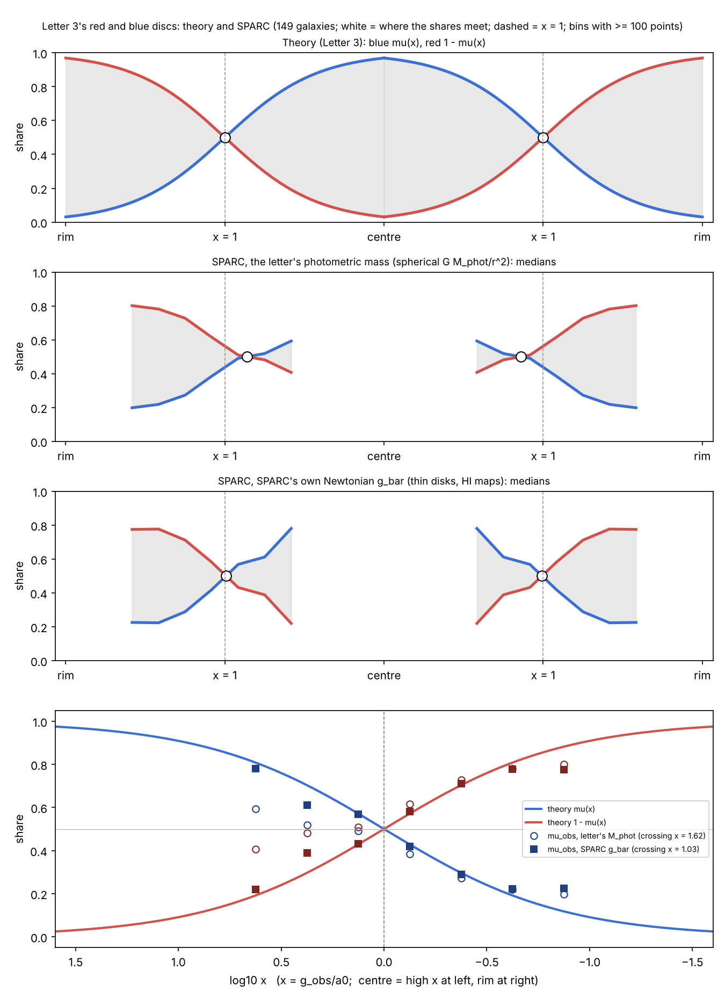

# TetA and TetB as One Vortex

*Field Dynamics Research, research folder, 2026-11-13 to 2026-11-14. Status: research, not a paper. Reviewed referee-style: [`referee_review.md`](referee_review.md).*

`vortex` `hourglass` `throat` `Field-Origin` `spatial-parity` `roll-ratio` `constitutive-law` `SPARC` `decoding-mass` `TetA` `TetB`

---

In GFD, TetA and TetB together form a vortex: spiral → throat → spiral, like water through a drain. The throat is the Field Origin. TetB lies beyond it and cannot be seen from our 3+1 spacetime; it is read from its share of the field, $1 - \mu(x)$. This folder puts that picture into exact mathematics and tests what can be tested of it against 175 SPARC galaxies.

## What this adds to GFD

1. **Exact mathematics for the vortex.** The [hourglass lemma](LEMMA.md) proves what parity does to any spiral → throat → spiral flow:
   - it keeps the swirl;
   - it reverses the through-flow, so the two spirals swap which one feeds the throat;
   - it flips the handedness, which needs both swirl and through-flow.

   The swirl-rate difference across the throat is the part of the vortex parity does not produce.
2. **One premise ties four existing results together.** The [roll-ratio theorem](ROLL_RATIO.md) assumes that the chambers roll without slipping at the Field Origin, with radii equal to their shares. Then:
   - the roulette's roll ratio is the rate ratio $x$;
   - Letter 2's exchange of the chambers is the vortex's parity;
   - Letter 3's ring $x = 1$ is where the two chambers turn at one rate;
   - the chiral-holonomy twist $(x-1)/(x+1)$ is the rate difference.
3. **Letter 3's red and blue discs hold on real galaxies.** The measured TetA and TetB shares meet at the ring, $x = 1.00$–1.07, and follow $\mu(x)$ across it, mirroring each other there as exchange symmetry requires (figure below).
4. **The decoding-mass letter is verified and corrected before review.** Its decode reproduces exactly, including every published value. CamB's mass model, which had been read from the wrong table columns, is fixed. Three further issues in its photometric pipeline are recorded for its next revision.
5. **Drive, brake and quiet, made precise.** **Drive and brake** always refer to the interior TetB (the framework's definition, Stephen Nelson, 2026-11-14). They are seen as measured observations above or below what the photometric mass predicts: a **drive** is $M_{\rm dec} > M_{\rm phot}$, a **brake** is $M_{\rm dec} < M_{\rm phot}$, and a **quiet** interior is $M_{\rm dec} = M_{\rm phot}$. The decode already contains $\mu(x)$. So the letter's quiet interior ($M_{\rm dec} = M_{\rm phot}$) means the chambers roll at $\mu(x)$ without slip, and an active interior, a drive or a brake, means slip: TetB departing from the rate the no-slip partition gives it.

## What is not established

- **That the vortex *is* the tetrad's structure.** The lemma is exact kinematics. Identifying its spirals with TetA and TetB, and its throat with the Field Origin, is the framework's reading. The no-slip premise and the link between helicity and axial torsion are not derived. The transport theorem (below) is the step that would derive them.
- **Drive and brake against the ring.** Under the letter's photometric method, galaxies with more mass inside the ring sit further above their baryons. With SPARC's own Newtonian accelerations, most of that signal goes. It comes mainly from the method's spherical approximation and model gas disks.
- **Uniqueness.** Any law that fits the radial acceleration relation puts the crossing of the shares near $x = 1$. The ring result is consistent with GFD; it does not single GFD out.

## The results in brief

### 1. The hourglass lemma ([`LEMMA.md`](LEMMA.md), 21 exact checks)

For any axisymmetric flow, parity $(\Pi v)(\mathbf x) = -v(-\mathbf x)$ sends $(v_r, v_\varphi, v_z)(r,z) \mapsto (v_r, v_\varphi, -v_z)(r,-z)$:
- **swirl:** kept;
- **through-flow:** reversed;
- **vorticity:** kept, $\boldsymbol\omega(-\mathbf x)$;
- **helicity:** flips, $h \to -h$. It is exactly the cross term between swirl and through-flow, so a pure swirl or a pure through-flow has none;
- **the swirl's mean rate:** kept. Its half-difference across the throat flips, so the equal-rate vortex (one rate on both sides) is the only one parity leaves unchanged.

### 2. The roll-ratio theorem ([`ROLL_RATIO.md`](ROLL_RATIO.md), 18 exact checks)

Grant no slip and radii $\mu$ and $1 - \mu$. Then:
- **rate ratio:** $\omega_B/\omega_A = \mu/(1-\mu) = x$;
- **exchange is parity:** swapping the chambers keeps the mean rate, flips the half-difference, and sends $x \to 1/x$;
- **one rate at the ring:** the rates are equal only at $x = 1$;
- **shear:** $\delta/\bar\omega = 1 - 2\mu$, changing at $-2\mu(1-\mu)$ per unit $\ln x$, fastest at the ring;
- **chiral-holonomy twist:** $\sigma = 2\mu - 1$.

### 3. Letter 3's discs, measured ([`measured_partition.py`](measured_partition.py))



The measured TetA share is $\mu_{\rm obs} = g_{\rm bar}/g_{\rm obs}$ at every radius of the 149 quality-cut galaxies. With SPARC's own Newtonian $g_{\rm bar}$ (thin disks, measured HI maps):

| | Result |
|---|---|
| Where the shares meet | $x = 1.03$ (95%: 0.88–1.24); 1.00–1.07 under every weighting, binning and smoothing variant |
| Gap between the discs, $\lvert 2\mu_{\rm obs} - 1\rvert$ | equals the theory at $\log_{10}x = \pm0.12$ (0.16 and 0.14 against 0.14); the two sides equal each other at ±0.62 (0.55 and 0.56, against 0.62) |
| Slip, $\log_{10}(\Omega_{\rm obs}/x)$ | under 0.03 dex for $-0.5 < \log_{10}x < +0.25$; grows outside that range |
| Far from the ring | the measured shares saturate less than $\mu(x)$, on both sides |

With the letter's spherical $GM_{\rm phot}/r^2$, the inner side flattens and the crossing moves to $x \approx 1.6$–1.8. That is the cost of the letter's declared spherical limit on disk galaxies.

### 4. Drive and brake from decoded mass ([`decode_audit/`](decode_audit/))

The decoding-mass letter's own pipeline was run on every SPARC galaxy, comparing the full $M_{\rm dec}(r)$ and $M_{\rm phot}(r)$ profiles. The new metric is the area above and below, with criteria committed before measurement. In the quality cut:
- **classes:** 51% quiet, 19% drive, 30% brake;
- **ring test (H3):** passes, $\rho = +0.47$;
- **with SPARC's own $g_{\rm bar}$:** $\rho = +0.16$, and not significant in star-dominated galaxies.

So the drive/brake pattern against the ring is **not established**. A measure of the drain itself is needed. The full audit, its checks against the letter's validations, and the atlas of every galaxy's profile are in [`decode_audit/README.md`](decode_audit/README.md).

### 5. Corrections and findings for the decoding-mass letter

- **CamB, corrected in the letter.** Its gas mass ($6.251\times10^8 = 1.33 \times R_{\rm disk}$) and gas scale length ($26.48 = {\rm SB}_{\rm disk}/2.5$) had been read from neighbouring columns of SPARC table 1, and its disk scale length (1.0 kpc) was a parser default. It now uses the catalogue values. Figure 2 is regenerated, and the letter's validations pass.
- **Recorded for the next revision:**
  - the catalogue counts bulge light twice (stars overstated by a median 19% in bulge galaxies);
  - every gas disk gets a scale length of $R_{\rm HI}/3$;
  - the sign wording of $\Delta M_{\rm eff}$ is ambiguous.

  Details are in [`referee_review.md`](referee_review.md), findings F1–F5.

## Next

1. **Transport theorem.** Carry a tetrad along a streamline from TetA through the Field Origin into TetB. Show that it arrives with a torsion difference (Gram-matrix proof, Proposition 2(b)), and compare its axial torsion with the lemma's helicity. This is the step that would make the vortex a consequence of the tetrad equation rather than a reading of it.
2. **Derive no slip** from the Field Origin as the point where both tetrads are evaluated together.
3. **Measure drive and brake from the interior.** A galaxy-level measure of TetB's effect, from the drain, not from how much of the disk lies inside the ring.
4. **Reduce the photometric systematics** that make the shares saturate less far from the ring: colour-based stellar M/L, asymmetric-drift corrections and HI surface-density profiles. Then test whether the departures are physical.

## Related

- [Gram matrix of the tetrad equation](../../proofs/gram-matrix-tetrad-equation/): the two roots differ only in orientation; torsion is the only place a metric connection can tell them apart.
- [Exchange symmetry](../../proofs/constitutive-law-exchange-symmetry/): $\mu(x) = x/(x+1)$.
- [Chiral holonomy](../../proofs/chiral-holonomy-closed-frame/): the twist $\sigma = (x-1)/(x+1)$.
- [Two connections and the dual chamber](../two-connection-dual-chamber/): axial torsion zero when static and opposite on the two roots; TetA $\mu g$ plus TetB $(1-\mu)g$.
- [Decoding-mass letter](../../papers/letter-decoding-mass-from-rotation-curves/) and [Letter 3](../../papers/letter-3-field-closure-of-tetrad-frame/) (the red and blue discs).

## Files

| File | Contents |
|---|---|
| [`LEMMA.md`](LEMMA.md), [`verify_hourglass_lemma.py`](verify_hourglass_lemma.py) | The hourglass lemma (21 checks) |
| [`ROLL_RATIO.md`](ROLL_RATIO.md), [`verify_roll_ratio.py`](verify_roll_ratio.py) | The roll-ratio theorem (18 checks) and the measured discs |
| [`measured_partition.py`](measured_partition.py), [`measured_partition.png`](measured_partition.png), [`measured_partition_output.txt`](measured_partition_output.txt) | Letter 3's discs from SPARC |
| [`decode_audit/`](decode_audit/) | The decoding-mass letter's pipeline on every SPARC galaxy: criteria, audit, diagnostics, atlas |
| [`referee_review.md`](referee_review.md), [`referee_checks.py`](referee_checks.py), [`referee_checks_output.txt`](referee_checks_output.txt) | Referee-style review of this folder and of the letter's pipeline |
| [`archive/`](archive/) | The full chronological record ([`HISTORY.md`](archive/HISTORY.md)), including the superseded tests H1, H2 and H2′ and the scripts that ran them |

## Reproduce

```bash
python verify_hourglass_lemma.py                                   # 21/21
python verify_roll_ratio.py                                        # 18/18
python decode_audit/decode_audit_paper_mphot.py GRAVIS_DIR         # the letter's pipeline on SPARC
python decode_audit/posthoc_checks.py decode_audit/results_paper_mphot
python decode_audit/diagnostic_d1.py ROTMOD_DIR                    # SPARC's own g_bar
python measured_partition.py decode_audit/results_paper_mphot measured_partition.png ROTMOD_DIR
python referee_checks.py ROTMOD_DIR GRAVIS_DIR                     # robustness
```

`GRAVIS_DIR` is a checkout of [fielddynamics/gravis](https://github.com/fielddynamics/gravis), commit `c19da3a`. `ROTMOD_DIR` holds SPARC's `*_rotmod.dat` mass models (Lelli, McGaugh & Schombert 2016); the source and its validation are in [`decode_audit/README.md`](decode_audit/README.md).
