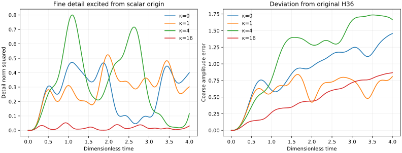

# Vortex-induced Triforce refinement: the orientation carrier and the coarse-dynamics obstruction

*Gravity Field Dynamics · Field Dynamics Research · November 2026 · Research toward the next standalone proof*

**Status.** [T] Exact finite algebra on the stated graph and representation spaces. [D] Results conditional on the independently specified fine-graph model. [N] Numerical diagnostics. [O] Physical derivation open. The new script passes 330 assertions, some exact and others numerical (the latter use stated tolerances). No new physical constant, fitted gravitational normalization, or modification to SST is introduced. This is not a proof of physical torsion or a new Lean package.

The starting point is the repository commit `c5647f66505246a0169b1008bdadc0a4edbdfe45`, which reports the successful Lean build and axiom audit for [Proof 23](../../proofs/recursive-triforce-closure/). Its mathematical dictionary is already explicit, so the next task is to understand how orientation data could arise from the field itself, and whether the dynamics can support the secondary geometry. These two questions are related, but neither can be answered merely by comparing counts.


> **Integrated continuation:** The [eight-vortex/core flywheel study](core-flywheel/README.md) extends the orientation read to the existing sustained collective state, not only the separate core-dark helicity state. The [refined core Hodge study](core-hodge/README.md) proves a 5+12 visible/hidden cycle split, a rank-five aggregate-projection obstruction, and the axis-aligned no-go for every phase-invariant sign scalar. These results refine the open research direction below; the local fine model remains conditional.

## 1. Start with the unchanged native Hamiltonian

We reconstruct the Stage IX 36-coordinate real symmetric Hamiltonian from the pre-check construction in [`verify_coupled_origins.py`](../hadamard-null-cone-vortex-flywheel/verify_coupled_origins.py), at the pinned commit. The sites are the 32 primary triangles on both chamber surfaces together with a scalar and three polar coordinates at the Field Origin. Every primary tile edge-sharing bond has weight −1; the four origin couplings to each central tile are the negative row `(1,s_i)`, where the eight signed corner vectors are used. The 33-site scalar graph has 104 bonds, of which 96 join tiles. This is the existing dimensionless Stage IX model, not the different tuned stationary witness in Stage VII. The reconstruction verifies every tetrahedral permutation and chamber inversion directly from the actual triangle vertex sets and the polar-vector origin action.

## 2. A global winding ray exists, but its origin is dark [T]

Let A4 act by proper permutations of the four leg labels. Its normal Klein four subgroup V4 has quotient C3. A nontrivial complex character of this quotient gives a phase `omega^k`, where `omega^2+omega+1=0`. The twelve lateral tiles of each chamber form a free A4 orbit, so assigning the character to an orbit representative and its images constructs one winding vector per chamber. Under all proper permutations this vector changes only by an overall phase. The conjugate character gives the opposite helicity. This is projective symmetry of a ray, not pointwise invariance of its complex amplitude.

On the two chamber coefficients the actual H36 acts exactly as

```
B = [[ 1,-1],
     [-1, 1]]
```

The script certifies this using integer pairs for the ring Z[omega]. Its eigenvalues are 0 and 2, with coefficient vectors `(1,1)` and `(1,-1)`. Both normalized stationary states have nonzero directed current of magnitude sqrt(3)/24 along every outer ring bond, with opposite outward winding signs on the two chambers. Conjugation or an improper permutation exchanges the two helicities. The state has zero amplitude on all eight central tiles and all four origin coordinates. It therefore cannot by itself drive the origin or carry flux into it. This conclusion is not an unfortunate choice of eigenvalue: the origin transforms as the scalar plus the three-dimensional vector representation, neither of which contains the nontrivial one-dimensional A4 characters. An A4-equivariant linear map from either character into the origin must vanish. A generic state which is only C3-symmetric, or a combination of symmetry sectors, need not have this obstruction.

The entire H36 representation restricts to A4 as five trivial copies, two copies of each nontrivial character, and nine copies of the three-dimensional representation. This decomposition confirms that the winding-ray sector has dimension two per helicity. It also clarifies why one must distinguish a single local threefold vortex from an all-A4 winding ray.

## 3. The current provides an orientation variable, not yet the torsion dynamics [T]

For each oriented ring define the mean bond current from the native formula `J_ab=2 Im(psi_a H_ba conj(psi_b))`. Choose the cyclic order by the outward face normal. Let q_A and q_B be the mean over the four rings of each chamber, and let `q=(q_A-q_B)/2`. Under a proper leg permutation q is unchanged, whereas an improper leg permutation changes its sign. The reason is that an improper orthogonal transformation reverses the oriented cyclic order relative to the transformed outward normal. Thus q is a pseudoscalar of the leg-permutation group. The exact integer skew form Bq constructed by summing oriented ring edges satisfies `q=psi* (i Bq/24) psi`; the script checks its covariance for all 24 permutations, as well as the current formula on generic complex states. For the normalized stationary states above, q=±sqrt(3)/24.

There is a distinction between two kinds of orientation. Under full spatial inversion the chamber labels exchange and outward winding reverses, so `(q_A,q_B)` goes to `(-q_B,-q_A)`. Consequently q is **even** under full inversion. The sum q_A+q_B is inversion-odd, but vanishes in the stationary states above. Neither leg-permutation handedness nor time-reversal-odd current should be identified automatically with TetA/TetB root exchange. For a chamber-localized helicity input the exact two-mode solution is `exp(-it)(cos t,i sin t)` and the two currents are proportional to `(cos² t,-sin² t)`. Their difference remains constant in this restricted sector while their sum oscillates through zero. For arbitrary H36 states, q is not conserved: its Hermitian quadratic-form matrix does not commute with H36. An initially scalar origin state is invariant under S4, stays so under H36 and cannot spontaneously acquire q. These are constraints on, not a derivation of, a physical orientation field.

### An explicit orientation-conditioned connection map [T]

Let X be the 64-dimensional paired address space, G(g) its ordinary permutation action and D the constructive dictionary of Proof 23. That proof identifies a repair involution K: it exchanges the last two labels on addresses with three distinct labels, multiplies the lateral-then-central family by −1, and leaves the other addresses unchanged. K commutes with G, and the pulled-back connection action is `G(g) K^epsilon(g)`, with epsilon(g)=0 for even permutations and 1 for odd ones. There are twelve swapped pairs and twelve individually sign-reversed directions; hence K has 40 positive and 24 negative eigenvalues. These eigenspaces are **not** the geometric pointing partition: both pointing sectors contribute to the repair.

Put `P_±=(I±K)/2`. For a dimensionless pseudoscalar parameter h define

```
T(h) = P_+ + h P_-
F(x,h) = D T(h) x.
```

For a dimensional current q one needs a reference unit or a sign-only choice; no physical normalization is asserted. Because `T(-h)=K T(h)`, we obtain exactly

```
F(G(g)x, sign(g) h) = connection_action(g) F(x,h).
```

Thus an actual reflection-odd read from the native dynamics supplies the correct *type* of auxiliary variable. It permits a family of maps with full S4 covariance on the combined amplitude and orientation data. If h is nonzero, the map is invertible, with inverse factor T(1/h); if h=0, its rank is 40. A sign-only version is norm preserving for h=±1 but is undefined at zero. The smooth version is not norm preserving in general and degenerates there. This is a constructive mathematical possibility, not evidence that H36 implements this map or that it is unique. In particular, the paired x values are still not available as independently resolved fine amplitudes in H36, and a global nonzero winding read does not determine local orientation on every tile.

For comparison, character multiplicities show that **any** fixed S4-equivariant linear dictionary preserving pointing/swap sectors has rank at most 36 on the 40-dimensional positive sector and at most 20 on the 24-dimensional negative sector. This follows by summing dimensions of each irreducible multiplied by the smaller multiplicity on the two sides. The bounds are achievable algebraically, so the maximum total rank is 56. The rank-40 degeneracy above is a property of our particular covariant family, not a universal upper bound for achiral states. A mere local scalar phase convention cannot repair the graded character mismatch. The ungraded 64-dimensional representations are not the issue.

## 4. A local refinement that matches H36 fails to reproduce its dynamics [T/D]

Proof 23 supplies 64 paired secondary addresses. Keeping both distinct chamber surfaces produces **128** actual secondary triangles, plus the four original origin coordinates. Under full inversion the 132-dimensional fine space has dimensions 65 even and 67 odd. An identification of the chambers is a quotient choice, not a consequence of refinement. The script constructs all triangles with exact doubled-integer vertices and detects adjacency by a common edge. There are 96 within-primary-triangle edges and 192 between-primary-triangle edges; each of the 96 native tile bonds is subdivided into exactly two shared edges. The central child of a primary triangle shares no edge with any other primary triangle.

This immediately gives a structural no-go theorem for exact autonomous coarse dynamics with a strictly edge-local fine Hamiltonian. Let E be a prolongation taking each primary amplitude to a child profile with a nonzero central-child entry, and with disjoint support for distinct primary tiles. Suppose `H_f E=E H_c`. For a coarse basis vector supported on a neighboring primary triangle b, the central child of a cannot receive amplitude from b through an edge-local fine operator. But the right side has nonzero entry on that central child whenever `(H_c)_{ab} != 0`. This is a contradiction. Internal fine couplings or diagonal terms cannot fix it, since the initial basis vector vanishes on all of a's children. The obstruction applies regardless of whether the child profiles are uniform or chosen by positive solid-angle weighting, provided the central-child amplitude is nonzero and cross-parent couplings are strictly shared-edge-local. It does not prohibit other profiles, nonlocal physical coupling, additional mediating fields, or a frequency-dependent effective response.

### An explicit minimal fine model [D]

Use the normalized equal-amplitude prolongation E (each child gets 1/2 and the four origin coordinates are unchanged). For the illustrative fine H, choose −2 on each of the two cross-parent edges of each original bond, use a within-parent graph Laplacian with strength κ, and distribute each existing origin bond equally over the four children with amplitude half its original value. This fixes the cross-parent and origin weights by the compression requirement. κ is a dimensionless exploratory parameter, not a physical constant; the within-parent Laplacian annihilates the uniform child profile for every κ. Uniform origin routing is a deliberately favorable illustrative choice, not claimed to follow from the throat dynamics.

With `P=EE*`, direct integer matrix multiplication gives

```
E*E=I,   E*H_f E=H36,
L=(I-P)H_f E != 0.
```

The leakage matrix has exact rank 32 and kernel equal to the four origin coordinates. Its singular norm is approximately 4.3589 and Frobenius norm approximately 13.8564. The cross-parent block from a single coarse neighbor gives a detail vector with entries ±1/2, so its norm is exactly one. Adjusting κ cannot change L. The stacked matrices `[L; L H36]` have exact rank 36. Hence **there is no nonzero initial coarse state whose evolution stays entirely in the coarse image for all time in this fine model**. An origin input is initially leakage-free, but its first nonzero fine amplitude occurs at quadratic time order. This follows from the Taylor expansion of the unitary evolution and the exact nonzero `L H36 e_origin`. The second compressed moment also differs by a positive semidefinite term:

```
E*H_f^2 E = H36^2 + L*L.
```

Thus a correct static compression does not establish a correct dynamical refinement. This is an exact negative result, not a failed parameter optimization.



The numerical experiment uses 201 equally spaced time samples from 0 to 4 and κ in {0,1,4,16}, with three normalized inputs. Peak detail probabilities are measured on that finite grid, not asserted to be global extrema. Even large κ does not restore exact equality; it merely changes the fine spectral response. The results are in `refinement_dynamics.csv`. No empirical timescale is assigned.

## 5. Next physical calculation: eliminate the detail space without guessing [O]

The obstruction suggests a controlled effective description. Decompose the fine space into E and its orthogonal complement F, and write the Hermitian generator in blocks `[H_c,L*; L,H_d]` using detail-space coordinates. Where z−H_d is invertible, the exact compressed resolvent is

```
E*(z-H_f)^(-1)E = [z-H_c-L*(z-H_d)^(-1)L]^(-1).
```

The correction is energy-dependent; its time-domain counterpart is memory. This is the correct quantity to compare with the original Hamiltonian, rather than choosing κ to force a desired spectrum or claiming the Schur correction is gravity. For the actual field one needs an independently derived fine action, possibly including phase-sensitive transport, and not merely the illustrative local graph. A subsequent test should compute the physical interface kernel, its coupling to the reflection-odd orientation read, and its effect on the projected connection amplitudes, with all conservation laws checked. The existing SFM has linear unitary dynamics, so it cannot select a chiral state from exactly reflection-symmetric initial data without a symmetry-breaking input or a nonlinear mechanism. A physical orientation must also address its zeros and its distinction from root exchange. The connection is a spacetime derivative object; matching the finite representation alone does not produce that derivative, Lorentz covariance or the gravitational source law.

## 6. Reproduce and integrate

```
python -m pip install numpy scipy sympy matplotlib
OPENBLAS_NUM_THREADS=1 python explore_vortex_refinement.py
```

The reconstruction, finite-group enumeration, exact integer/rational matrix checks, numerical eigensystem tests and time evolutions are in the one script. `exploration_output.txt` records all 330 passing checks and key numerical values. `refinement_dynamics.csv`, SVG and PNG are generated by the script. The source is self-contained so it can run without importing a large suite of upstream scripts, but the H36 construction is pinned to the upstream source; a future model change should be audited rather than silently substituted. Exact and numerical results are distinguished in this note. This folder is new research, not a replacement for Proof 23. It may be copied into `research/vortex-induced-triforce-refinement/` and linked from the research index after review; no live repo commit is claimed.

### Related research

- [Proof 23: recursive Triforce closure](../../proofs/recursive-triforce-closure/), especially the repair involution and nonuniqueness.
- [Torsion regular representation](../../proofs/torsion-regular-representation/).
- [Vortices of the stellated octahedron](../../proofs/vortices-of-the-stellated-octahedron/).
- [Native Stage IX H36 construction](../hadamard-null-cone-vortex-flywheel/verify_coupled_origins.py).
- [Sustained Triforce flywheel](../hadamard-null-cone-vortex-flywheel/SUSTAINED_TRIFORCE_FLYWHEEL.md).
- [Dynamic tetrad settlement](../hadamard-null-cone-vortex-flywheel/DYNAMIC_TETRAD_SETTLEMENT.md).
- [Recursive geometry and radial weights](../recursive-triforce-geometry/).
