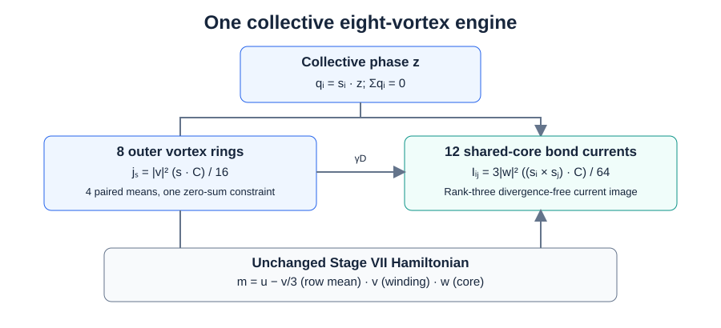
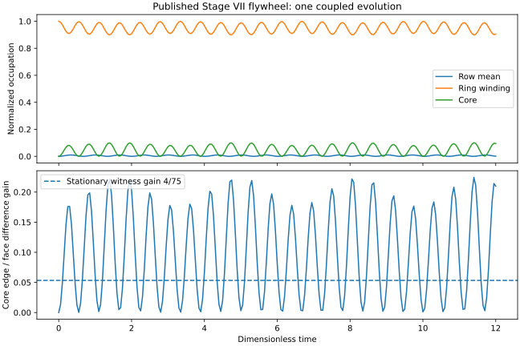

# One collective flywheel: faces, edges and core

*Field Dynamics Research · 26 November 2026 · research continuation, based on `d69739e984e5f1f8de5e4639d8fd0e7a2a8214b8`.*

This note returns to the established [Stage VII sustained flywheel](../../hadamard-null-cone-vortex-flywheel/SUSTAINED_TRIFORCE_FLYWHEEL.md) and [original vortex proof](../../../proofs/vortices-of-the-stellated-octahedron/). The [core-flywheel study](../core-flywheel/) extends the Stage VII current identities; the [core-Hodge study](../core-hodge/) classifies mathematically possible refined currents. Here the question is narrower: how much of the actual collective flywheel can be understood without extending its Hamiltonian? The results concern the existing inversion-even collective solution with symmetric chamber couplings, not all states of the graph or a physical derivation of gravity. The 15-site vertex-core model and the 33-site face-current model remain distinct; we use the latter.



> **Further exact simplification.** [The collective flywheel in its simplest coordinates](closed-algebra/) derives the two-link chain form of the same three-amplitude Hamiltonian, sharp bounds on winding/core occupation, and a combined current vector read. This continuation uses no new dynamical variables.

## 1. The existing phase read is already a minimal lift

Let the four sign corners be the rows of A and write q=Az, so A^T A=4I and the four entries of q sum to zero. In the original 12 lateral tiles of one chamber, index the amplitudes by (i,j), i≠j, with i the stellation and j the omitted original-face corner. Let R sum rows and Q sum columns. The row-zero projector is P=I−R^T R/3. Direct multiplication gives Q P Q^T=(8/3)(I−11^T/4). Therefore every zero-sum column record c has a unique least-Euclidean-norm row-zero lift X=(3/8)P Q^T c. All other row-zero lifts differ by a vector in ker R ∩ ker Q, which has dimension five. Explicitly X_ij=(3/8)(c_j+c_i/3). Substituting c=(8ρ/3)q yields precisely the published initial outer pattern X_ij=ρ(q_j+q_i/3). This is an algebraic characterization of the original choice, not a claim the dynamics select the minimum-norm lift from arbitrary initial conditions. The five null directions are possible amplitude patterns, not an asserted extra energy reservoir.

## 2. Edges express differences of the face currents

Keep the published ansatz X^±_ij=ρ(u q_i+v q_j), y^±_i=ρ w q_i, ρ=√3/8, and unit z. Put C=−i conjugate(z)×z. For the Stage VII weights r=k=−1, the outward mean current j_s of each ring is A0 s·C, A0=|v|²/16; the twelve actual central bonds from y_i^+ to y_j^- carry I_ij=B0(s_i×s_j)·C, B0=3|w|²/64. These are the inherited physical bond-current laws in dimensionless model units.

For distinct i,j, let k,l be the other two labels. There is a unique sign ε_ij such that s_i×s_j=ε_ij(s_k−s_l). Define D on four face means by (Dj)_ij=ε_ij(j_k−j_l). Thus A0 I=B0 Dj, including when v=0. When v≠0,

```
I = γ Dj,       γ = (3/4)|w/v|².
```

D has rank three, its kernel consists of constant records, D^T D=8I−2 11^T, and its image is divergence-free at all eight core faces. This means all twelve directed edge currents are derived from three independent combinations of four face means, times a common amplitude gain. In the collective sector, j_B=−j_A. The sum of squares obeys ||I||²=4γ²||j_all8||². The angular moment is −|w|² C/6, as in the original research. Neither a new independent edge oscillator nor another phase inventory has been introduced. Outside the collective sector, the complete current space is larger.

## 3. Three orthogonal amplitude coordinates, rather than new degrees of freedom

Write m=u−v/3, the row-mean coordinate; v is the winding coordinate; w is the core coordinate. This is an invertible change of variables on the published three-amplitude reduction, with no new states. The exact equations are

```
i ṁ = (e+2r−d/3)m + (8d/9)v + (b−a/3)w
i v̇ = d m + (e−r+d/3)v + a w
i ẇ = (3b−a)m + (8a/3)v + (e_c−k)w
```

The norm of the full state is exactly (9/8)|m|²+|v|²+(3/8)|w|². Rescaling by (3/√8,1,√(3/8)) makes the reduced matrix real symmetric. In particular, an initially row-closed, empty-core state has i ẇ=(8a/3)v: the original-face (column) coupling a activates the core directly, regardless of the base coupling b. The row closure does not imply the column read vanishes. No separate core drive is imposed. The current gain is not generally constant: both |v| and |w| are governed by these same equations.

The original stationary witness has m=0, w/v=−4/15, eigenvalue 11/10 and normalized core occupation 2/77. Its exact edge gain is 4/75. In the general parameter family a stationary row-closed branch with v≠0 and 3b−a≠0 must have w/v=−8d/[3(3b−a)], and the remaining eigenvalue equations must also hold. The witness is a particular model choice, not a universal constant. For the original initially empty-core trajectory, |w|² starts as (64/9)t², so the core occupation starts as (8/3)t² and γ starts as (16/3)t². No irreversible relaxation is claimed.



## 4. What the current read does and does not measure

The instantaneous current read is simpler than the full phase dynamics. For example, take m=0, v real and nonzero, and w=±i times a fixed nonzero real magnitude, with the same z and normalized amplitudes. All 24 ring bond currents and all 12 core currents are identical for these two states, yet their core occupation derivatives are opposite, since

```
d/dt [(3/8)|w|²] = (3/4) Im(conjugate(w)[(3b−a)m+(8a/3)v]).
```

Thus it is the relative phase of the existing winding and core amplitudes that is necessary to determine instantaneous exchange; we need not postulate an extra energy reservoir. This counterexample concerns the instantaneous current read, not a complete time history. The prior read-observability result was about a specified incomplete measurement of the full Hilbert space, not proof of an independent physical energy store.

The refined 17-cycle space is a geometric capacity. The actual collective solution uses a three-dimensional current image; neither its other mathematically possible patterns nor the five null row-column amplitude directions need to be independently occupied. The scalar centre O is dark in the Stage VII winding solution, whereas the central octahedral faces can circulate. Do not equate the centre point with the whole core or infer a through-flow, source charge, or gravity from a divergence-free circulation. No identification of the 17 circulation dimension with the proposed 17/13 gravity normalization is established.

## Reproduce

Run `python verify_collective_engine.py` (NumPy, SciPy, SymPy, Matplotlib). 126 checks passed: exact rank/geometry/matrix identities, exact reconstruction of the original 104-bond graph and reduced Hamiltonian, and numerical current and time-evolution comparisons. The CSV and two figure formats are generated by the script. The new architecture SVG is schematic. Existing figures are preserved upstream; this package adds a continuation rather than replacing the original flywheel solution.

## Geometry bridge

[From the collective flywheel to the tetrahedral Gram matrix](geometry-bridge/README.md) derives the common Gram from oriented cycles and the original column read, with the axial reflection twist and the remaining physical geometry-selection condition.
