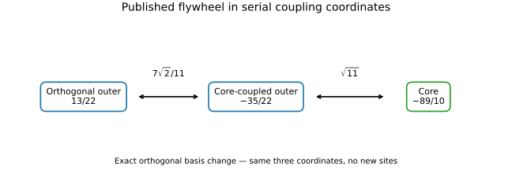
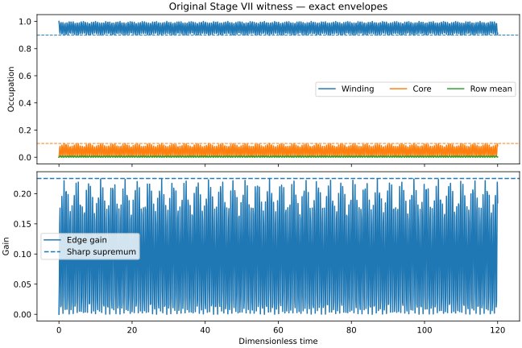

# The collective flywheel in its simplest coordinates

*Field Dynamics Research · 26 November 2026 · continuation of the native Stage VII eight-vortex flywheel.*

This note develops the algebra of the established [sustained flywheel](../../../hadamard-null-cone-vortex-flywheel/SUSTAINED_TRIFORCE_FLYWHEEL.md) and [collective face–edge relation](../README.md), without modifying the 33-site, 104-bond Hamiltonian. The construction is a particular invariant collective sector, not a description of every graph state. No new oscillator, energy store, physical parameter, gravitational normalization or assumption about through-flow is introduced. Results involving the specific numerical coefficients are exact for the published dimensionless witness, not universal physical predictions. The repository basis is `d69739e984e5f1f8de5e4639d8fd0e7a2a8214b8`.

## 1. A common current record

The eight stellations have normals s in the cube corners {±1}³, and the twelve central bonds join the eight triangular octahedral faces. Let the four reference tetrahedral corners be s_i and let q_i=s_i·z, with ||z||=1. In the inversion-even collective sector, the outer and central amplitudes remain X_ij^±=ρ(u q_i+v q_j) and y_i^±=ρ w q_i, where ρ=√3/8. The centre O remains dark, even when the central faces carry genuine circulation. The common axial vector C=−i z̄×z is fixed during evolution within this ansatz.

Write m=u−v/3 and use normalized coordinates x=(3m/√8,v,√(3/8)w). Their occupations are N_m,N_v,N_c, respectively, and N_m+N_v+N_c=1 for a unit initial state. This conserved occupation is the norm of the finite model; it is not established as physical rest energy. For the published r=k=−1, the inherited current formulae simplify to

```
j_s   = (N_v/16) s·C,
I_ij  = (N_c/8) (s_i×s_j)·C,
L_c   = −(4/9) N_c C.
```

Here j_s is the mean of the three outward-directed ring bond currents and I_ij is the actual central bond current oriented from the positive face i to the negative face j. L_c is their angular current moment using the actual centroid positions ±s_i/3. The identity s_i×s_j=ε_ij(s_k−s_l), where {i,j,k,l} is the full set of four labels, gives

```
N_v I_ij = 2 N_c ε_ij (j_k−j_l).
```

The undivided formula remains valid when N_v vanishes. When N_v>0 the gain is precisely 2N_c/N_v. No edge phase independent of the collective phase has entered the formula. This does not eliminate the possibility of other current patterns outside the specified sector.

The tight-frame identities Σ_s ssᵀ=8I and Σ_{i≠j}(s_i×s_j)(s_i×s_j)ᵀ=32I give two particularly economical vector reads:

```
2 Σ_s s j_s = N_v C,
−(9/4)L_c   = N_c C.
```

Their sum is `(1−N_m) C`. Thus the eight outer mean currents and twelve central currents jointly reconstruct the occupation-weighted collective orientation, missing only the fraction in the existing row-mean coordinate. On any row-closed state they reconstruct C exactly. The individual ring bond currents may differ from their mean when m≠0; the formula concerns the actual means and all actual central currents. It does not assert a universal conservation law for a general coherent state outside the collective ansatz. The squared current norms are ||j||²=N_v²||C||²/32 and ||I||²=N_c²||C||²/2; these are current diagnostics, not energies.

## 2. The three amplitudes form a serial chain

With the original dimensionless bond weights r,d,b,a,k and on-site energies e,e_c, the normalized Hamiltonian is real symmetric:

```
H = [[ e+2r−d/3,  2√2 d/3,      √3(b−a/3) ],
     [ 2√2 d/3,    e−r+d/3,      2√6 a/3   ],
     [ √3(b−a/3),  2√6 a/3,      e_c−k    ]].
```

Partition it as H=[[A,g],[gᵀ,h_c]], where A is the outer two-by-two block. If g≠0, the normalized outer direction B=g/||g|| is the unique line directly coupled to the core. The perpendicular direction D=(-g₂,g₁)/||g|| has no direct coupling to the core. This is a change of basis on the existing two-dimensional outer multiplicity space, not an identification of additional physical sites. In coordinates (D,B,c), H is tridiagonal, with two real links. The core link is

```
||g||² = 3a²−2ab+3b² = 2(a²+b²)+(a−b)².
```

The outer link is det[g,Ag]/||g||², since (-g₂,g₁)·Ag=det[g,Ag]. In the native model,

```
Δ = det[g,Ag] = 2√2[(b²−a²)d+(a²−3ab)r].
```

The determinant of the three columns e_c,H e_c,H² e_c is also Δ. Thus for nonzero g, the entire three-coordinate multiplicity space is accessible from the core exactly when Δ≠0. If Δ=0, the orthogonal outer line is invariant and the remaining two coordinates form a closed subsystem. The equality of base and column couplings b=a, as in the conditional shared-edge model, gives Δ=−4√2 a²r and ||g||²=4a². For nonzero a and r, even that equality does not collapse the engine to two amplitudes. Row-mean zero is a different condition: the entire plane m=0 is invariant precisely if d=0 and b=a/3. A particular stationary solution can be row-closed even when the plane is not invariant.

For the original Stage VII witness, the exact chain matrix is

```
H_chain = [[ 13/22,       7√2/11,  0     ],
           [ 7√2/11,     −35/22,   √11   ],
           [ 0,           √11,    −89/10 ]].
```



Both links are nonzero. It is therefore impossible to discard the orthogonal outer combination as dynamically dark to the core in this witness; it is only instantaneously orthogonal to direct coupling. The published initial state has nonzero projections on both outer combinations. No new coupling was chosen to obtain this representation.

If the three chain amplitudes are d_b,b_b,c_b, their occupation derivatives are `(J_DB, −J_DB+J_BC, −J_BC)`, with `J_DB=2H_DB Im(conj(d_b)b_b)` and `J_BC=2H_BC Im(conj(b_b)c_b)`. This sign convention defines signed influx into the first member of each pair. In polar coordinates each exchange is its existing link strength times twice the geometric mean of its two occupations and the sine of their relative phase. There are two relative phases after removing the common U(1) phase. At an amplitude zero, use the complex expression instead of a phase angle. This provides a closed accounting of the three existing amplitudes without an independent hidden reservoir.

## 3. Sharp bounds for the original empty-core solution

Take the published initial condition (m,v,w)=(0,1,0), with the exact Stage VII eigenvalues λ₀=11/10 and λ_±=−11/2±√22. The previously published spectral coefficients have the following structure. The winding coefficients are positive, with dominant coefficient 75/77 and sum of the other two 2/77. The core coefficients consist of −20/77 and two positive coefficients summing to 20/77. The row-mean coefficients are zero at λ₀ and opposite values of magnitude √22/99 at the two other eigenvalues.

The triangle inequality therefore yields

```
|v| ≥ 73/77,    |w| ≤ 40/77,    |m| ≤ 2√22/99.
```

In occupation variables the exact bounds are

```
N_v ≥ 5329/5929  ≈ 0.8988025,
N_c ≤  600/5929  ≈ 0.1011975,
N_m ≤ 1/99      ≈ 0.0101010.
```

The two relative phases have irrational frequency ratio `(33/5+√22)/(33/5−√22)`. By the density of an irrational linear flow on the two-torus, their pair approaches any prescribed pair of phases at arbitrarily late positive times. In particular, when both satellite phases approach −1 relative to the dominant one, the winding lower bound and core upper bound are approached together, with m→0. At the limiting phase pair the state is (0,73/77,−40/77) in a frame with the dominant phase removed. The winding and core occupations sum to one exactly there. When the two satellite phases are opposite, the row-mean bound is approached. These bounds are sharp infima/suprema; the nonzero-time phase pair (−1,−1) is not attained exactly because the ratio is irrational. Numerical sampling is a corroboration, not the proof of sharpness.

Consequently the instantaneous edge gain has sharp supremum `1200/5329 ≈ 0.225183`, and the combined current vector differs from C by at most ||C||/99. This is a uniform bound in the specified witness, for the original initial condition; it neither applies to arbitrary initial conditions nor establishes a universal field parameter. The stationary witness is a different initial state and has N_c=2/77 and gain 4/75. It must not be confused with a late-time attractor of the conservative dynamics.



## 4. Scope and the next algebraic question

The essential structure is the same three-coordinate Hamiltonian already derived from the eight rings and twelve shared core edges. The edges give the spatial difference of the outer currents, while the common occupation gain is controlled by the existing amplitudes. The chain form shows the precise conditions for a simpler two-coordinate subsystem, and proves that the original witness does not satisfy them. The dimension seventeen of the refined cycle space is a capacity, not a claim of seventeen independent circulating objects. None of these results requires the trace-13 operator, and the 17/13 gravitational normalization is not derived.

The remaining physically meaningful question is whether an independently derived junction law fixes the ratio of the existing couplings and the relative-phase evolution. A useful next test is to derive the allowed (r,d,b,a,k,e,e_c) from a physical action rather than tune them to the witness; then check the exact two-mode criterion, stability of the current envelope, and actual through-flow separately. The present result should first be used to simplify the existing collective model, not to introduce further state coordinates.

## Reproduce

Run `python verify_closed_algebra.py` with NumPy, SciPy, SymPy and Matplotlib. The parent verifier reruns the 126 original checks (including exact graph reconstruction); this script passed 146 additional checks including general symbolic identities, exact witness spectra, torus extrema and numerical comparisons with actual bond currents and chain dynamics. It produces the CSV and both SVG/PNG figures. The 146 checks are not 146 independent theorems; numerical samples do not prove the exact all-time inequalities. No Lean build is claimed.
