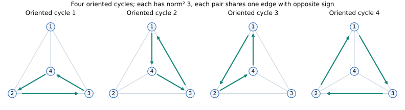
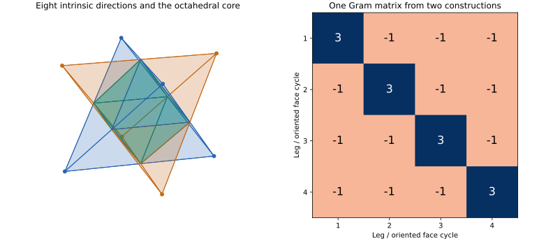

# From the collective flywheel to the tetrahedral Gram matrix

*Field Dynamics Research · November 2026 · continuation of the collective engine*

**Status:** Exact finite algebra for the established labelled flywheel, its Euclidean amplitude norm, and consistently oriented edge space. The intrinsic regular frame is derived without importing its spatial coordinates into either Gram calculation. This is not yet a dynamical proof that vortices generate an embedded spacetime geometry, or that the Lorentz metric emerges from a positive graph norm. No new couplings, oscillator, energy reservoir, field action, or G normalization is introduced.

## 1. Starting point and scope

The [tetrad geometry Letter](https://github.com/fielddynamics/research/tree/main/papers/letter-1-tetrad-frame-geometry) and [Gram matrix paper](https://github.com/fielddynamics/research/tree/main/papers/gram-matrix-of-tetrad-equation) construct the dual regular tetrahedra from the specified frame. The [vortex proof](https://github.com/fielddynamics/research/tree/main/proofs/vortices-of-the-stellated-octahedron) shows that the corresponding graphs support circulating states. The [sustained Stage VII flywheel](https://github.com/fielddynamics/research/blob/main/research/hadamard-null-cone-vortex-flywheel/SUSTAINED_TRIFORCE_FLYWHEEL.md) shows that eight outer rings can activate a shared core circulation. The aim here is a reverse algebraic bridge from those existing labelled currents and phase reads to the frame. We do not assume the spatial vectors until comparing the intrinsic result with Letter 1. The incidence pattern, equal norm, four labels and consistent cycle orientation are inputs inherited from the existing model. The core circulation is not a separate oscillator.

## 2. The cycle Gram matrix

Let W be the zero-sum real subspace of R^4. On the complete graph K4 orient each unordered pair i<j from i to j. Let B be its 4×6 vertex-edge incidence, with -1 at tail and +1 at head. For each omitted label i let d_i be the oriented boundary of the complementary triangle, with the alternating sign (-1)^i in zero-based indexing. Let D be the 6×4 matrix of the four d_i. These are ordinary oriented triangular boundary chains; they correspond to the triples read around the outer stellations in the collective state, not four extra physical loops.



Every column contains three entries ±1, and every two distinct columns have one shared entry with opposite sign. Therefore

```
G = D^T D = 4I - J,
D 1 = 0, B D = 0,
rank D = 3,
D D^T/4 = I_6 - B^T B/4.
```

The last equality follows from rank(B)=3, BB^T=G, and equality of im D with ker B. Four oriented cycles thus form a regular tetrahedral tight frame in the three-dimensional cycle space. Their common norm is sqrt(3), and their normalized mutual inner products are -1/3. This result requires no coordinates for the four labels and no hopping coefficient.

## 3. Independent derivation from the row-closed outer flywheel

In one chamber use the twelve existing ordered pairs (i,j), i != j. Let R sum rows, Q sum columns. The three entries of each row are exactly the ring around the apex i. Its row-closed orthogonal projector in the native amplitude norm is P_r=I_12-R^T R/3. Set C=Q P_r. There are three entries in each column; each individual diagonal of P_r is 2/3. For two distinct columns, two rows contain both, with entry -1/3 each. Hence

```
C C^T = (2/3) (4I-J).
F = sqrt(3/2) C^T,
F^T F = 4I-J.
```

The four columns of F are the normalized read covectors of the actual column-active row-closed sector. The normalization only fixes the conventional length sqrt(3), not a physical length or frequency. The row-closed space has dimension eight; its column-active part has dimension three, and the kernel of C restricted to that space has dimension five. This is a statement of mathematical capacity, not additional occupied states or energy.

The two frames have an explicit partial isometry L=D F^T/4, satisfying LF=D, L^T L=FF^T/4, LL^T=DD^T/4. This is stronger than matching dimensions. There is an orientation qualification: under a leg permutation p, if T acts on the four labels, U acts on the ordered pairs, and V acts on oriented edges, then UF=FT and VD=sgn(p)DT. Thus the equivalence is equivariant under A4 and intertwines the axial sign twist under odd permutations, rather than identifying a polar and axial representation under all of S4. All 24 elements are checked.

Any permutation-invariant real symmetric form on the four label coordinates has equal diagonals and equal off-diagonals (transitivity on ordered distinct pairs). If its nullspace is the constants, it is a positive multiple of G; fixing the scale fixes that form uniquely. A mere zero-sum constraint alone does not imply this norm. The counterexample A diag(2,1,1) preserves zero-sum and rank but not the Gram. An independent physical identification of the native metric with spatial lengths, or a dynamics selecting it, remains necessary.

## 4. The actual current law is the boundary identity

Take q=x+iy in complex W. Define the six antisymmetric products a_ij=Im(conj(q_i) q_j)=x_i y_j-y_i x_j on i<j. Extend by antisymmetry. Since sum q_i=0, sum_j a_ij=0; hence B a=0. Define the complementary triangle sums j0=D^T a. The boundary identity gives

```
D j0 = 4 a,
||a||² = ||x||² ||y||² - (x dot y)².
```

The latter is the standard squared area identity for the exterior product. Every element of the 3-dimensional real cycle space is an alternating two-form on W, and every two-form on a real three-dimensional space is decomposable, so this exhausts the possible directions of the phase-wedge read (not arbitrary independently chosen currents). Scaling q changes the current magnitude quadratically. Real or common-phase q produces zero current. A single state gives only one such axial vector; it does not by itself reconstruct the whole frame experimentally.

For the published Stage VII amplitudes X_ij=ρ(u q_i+v q_j), y_i=ρ w q_i, the common row shift cancels in the oriented cyclic sum of Im products. With the existing current convention J_ij=2 Im(ψ_i H_ji conj(ψ_j)), and r=k=-1, the mean outer ring currents on the four positive stellations, consistently oriented by D, and the core bond currents on the six pairs i<j are

```
j = (2ρ² |v|²/3) D^T a,
I = 2ρ² |w|² a,
|v|² I = (3/4)|w|² D j.
```

This is the original twelve-edge relation restricted to six ordered pairs; the remaining six are determined by antisymmetry in the inversion-even collective sector. The sign on each complementary face difference is fixed by its oriented boundary; reversing the global ring convention reverses the corresponding matrix. No division is needed when the outer winding vanishes. This proof uses only four phase labels and the existing current law, and derives the complementary-difference formula from the topology. For general nonzero ring hopping r and core hopping k, the ratio in the divided relation is multiplied by k/r.

## 5. Compare with the tetrad geometry

Only now choose the standard orthonormal realization with rows A=(1,1,1),(1,-1,-1),(-1,1,-1),(-1,-1,1). Then AA^T=G, A^TA=4I. The maps F A/4 and D A/4 are isometries from R^3 into the two read spaces. The six cross-product rows of the A realization equal ±D A with one global orientation sign. This recovers the earlier complementary-edge identity. The four frame directions and their negatives are the eight cube corners. Their pairwise same-chamber midpoints are the six octahedral vertices ±e_i. For a point in the positive tetrahedron its barycentric coordinates are λ_i=(1+s_i dot x)/4. Belonging also to the opposite tetrahedron is equivalent to all λ_i≤1/2. The overlap is exactly |x_1|+|x_2|+|x_3|≤1. Outside the overlap in one chamber there can be only one λ_i>1/2, giving the corner tetrahedron with apex s_i and three edge midpoints. Its opposite chamber supplies the four inverted corner tetrahedra. Hence the read frame and its inverted copy realize the same octahedral core with eight attached stellations. This is a reconstruction from the abstract normed frame; it does not establish an evolving physical embedding.



## 6. The existing dynamics already acts in the intrinsic frame

The verifier constructs the same 33-site, 104-bond Stage VII Hamiltonian using just signed chamber and ordered-pair labels. No vertex coordinates or new edge rules are used in the construction. The abstract embedding of the three collective amplitudes on W satisfies H E=E(M⊗I_4), with the projectors onto W built into E. Its rank is nine, and its Gram is 2 G_mult⊗P_W. This proves that the established three-amplitude reduction can be expressed without any spatial coordinate chart. The original full trajectory is compared with this reduction and with the actual bond-current identity at eight times. The original Stage VII parameter choices and physical-selection limitations are unchanged. This derivation still assumes the labelled adjacency and permutation symmetry: it does not show that arbitrary initial vortices spontaneously assemble that graph. The normed read is an intrinsic geometry of the existing model.

## 7. What comes next

The direct bridge is now between the original tetrad Gram matrix and the normalized column and current-cycle Gram matrices of the flywheel. The missing physical step is a geometry-selection principle: derive the four-leg incidence and Euclidean read metric from the underlying field action, or show that an independently formulated vortex dynamics selects the same intrinsic frame. In particular, the discrete equal-edge metric is not the Lorentz metric, and the phase-wedge vector is axial, not a polar acceleration. Test the response to geometric deformations using an independently justified spatial coupling law; do not invent an energy functional whose minimum is the intended tetrahedron by construction. The 17/13 gravity normalization remains open. Keep the common frame, the eight rings and collective core as one engine.

## Reproduce

`python verify_geometry_bridge.py` (SymPy, NumPy, SciPy, Matplotlib). The [recorded output](verification_output.txt) contains 167 passing assertions, including 48 permutation covariance checks, exact rational/algebraic identities, phase-wedge checks and full numerical Hamiltonian evolution. These are not 167 distinct theorems. Earlier diagrams and verification scripts are preserved in the parent folders.
