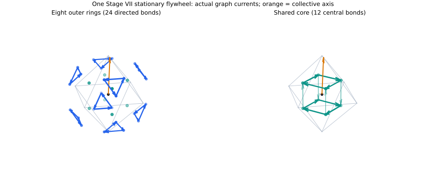
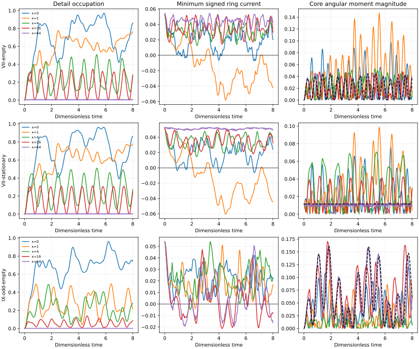

# Eight-vortex flywheel, octahedral core and recursive refinement

*Field Dynamics Research · continuation of the vortex-induced Triforce refinement · 26 November 2026*

**Status.** [T] exact geometry and algebra within the specified finite models; [D] conditional dynamical deductions; [N] numerical exploration; [O] open physical interpretation. Source commit `c5647f66505246a0169b1008bdadc0a4edbdfe45` (Proof 23 promoted after the Lean build). The source research remains intact. This note corrects the inference that the core-dark global helicity sector is the only available orientation carrier; it is not. No SST modification, physical calibration, or gravity derivation is claimed.


> **Continuation and stronger limitation:** [Core circulation and the settlement read](../core-hodge/README.md) separates divergence-associated current from visible and invisible circulation. It proves that an odd tetrahedral element preserves the ray of the axis-aligned circular state, so every global-phase-invariant sign scalar vanishes there, not just the two polynomials below. The earlier axis-aligned counterexample is therefore a symmetry obstruction, rather than a defect of the selected cubic read.

## 1. Which vortices are being studied?

The [original vortex proof](../../../proofs/vortices-of-the-stellated-octahedron/) treats both the 15-position vertex graph (eight corners, six octahedron vertices, centre) and the 33-position tile graph (24 lateral tiles, eight central triangular tiles, centre). Its core equatorial-ring solution on the vertex graph and the later central-face current on the tile graph should not be identified as the same Hamiltonian. The [Triforce vortex research](../../diamond-tetrad-lattice/triforce-vortex/PROOF.md) distinguishes generic winding states and the doubled exceptional sector. The [Stage VII sustained flywheel](../../hadamard-null-cone-vortex-flywheel/SUSTAINED_TRIFORCE_FLYWHEEL.md) uses the actual 104 tile-graph bonds, including the outer transpose links, and establishes simultaneous sustained eight-ring circulation and nonzero inner currents. The [Stage IX synthesis](../../hadamard-null-cone-vortex-flywheel/UNIFIED_HADAMARD_FIELD_DYNAMICS.md) adds three polar Origin amplitudes and uses different dimensionless weights. It does not inherit Stage VII's particular all-time inequalities simply by having the same geometry.



The eight stellations have normals s in the eight cube corners. Each has an outer ring of three lateral triangles; its base is a central tile with centroid s/3. The eight bases together constitute the faces of the octahedron. The core vortex in Stage VII is the circulating current on the twelve central shared-edge bonds, not circulation at the single point O. There is no independent imposed core oscillator. Swirl is not axial through-flow or a drain. The current convention is the sustained proof's J_ij=2 Im(psi_i H_ji conjugate(psi_j)), positive from i to j. The figure draws exact-model stationary currents numerically, scaling arrow widths separately in each panel; orange is the collective C axis, not the sign of the core moment.

## 2. Reconstruct the inherited Hamiltonians before extending them [T]

Use the corner vectors s_i=(1,1,1),(1,-1,-1),(-1,1,-1),(-1,-1,1). The original tile indexing is X^+_ij at apex s_i, face opposite s_j, with i!=j, and y^+_i at s_i/3; the minus copies are inverted. For q_i=s_i dot z and chamber parity eps=+/-1, write X^+_ij=rho(u q_i+v q_j), y^+_i=rho w q_i, and X^-=eps X^+, y^-=eps y^+. Here rho=sqrt(3)/8 as in Stage VII, with separate normalization when needed. The polar Origin coordinate in the odd Stage IX sector is rho p z. All coefficients are dimensionless.

The script reconstructs the exact Stage VII witness r=-1,d=-1/2,b=-2,a=k=o=-1, outer and origin energies zero, central energy -99/10. All 104 published scalar graph bonds are retained. It verifies H B = B(M tensor I3) with

```
M_VII = [[-2, 1/2,-2],[-1/2,1,-1],[-5,-1,-89/10]]
```

and the existing stationary solution (u,v,w)=(1/3,1,-4/15) at eigenvalue 11/10. This reproduces the established result rather than choosing a new model. For Stage IX, using the exact uniform -1 tile weights and the existing -[1,s] centre-to-base row, the two collective reductions are

```
M_even = [[-2,0,-1],[-1,1,-1],[-2,-2,1]]
M_odd  = [[-2,2,-1,0],[1,1,1,0],[-4,4,-1,-1],[0,0,-8,0]]
```

Both reductions are verified in integer arithmetic, including orthogonality and self-adjointness in the embedding Gram metric. Their characteristic polynomials are lambda^3-7 lambda+2 and lambda^4+2 lambda^3-19 lambda^2-4 lambda+32. The Stage VII witness is not the same as either Stage IX model. The scalar O is dark on these collective vector sectors; the odd Stage IX sector can excite the polar O. The earlier global A4 helicity sector remains a valid but distinct core-dark sector.

## 3. Orientation information in the sustained eight-ring solution [T]

Let C=-i conjugate(z) cross z. For the two parity sectors in the specified models, the mean outward-directed current of each ring is j_s=A(s dot C), A=|v|^2/16. Each chamber has zero mean winding, since the four s sum to zero. In particular the earlier chamber-difference *linear* winding read is identically zero on this collective ansatz. The representation reason is that the sign representation of S4 is absent from T2 tensor T2, even when the spatial triplet has multiple copies. The character sum is tested directly.

The third moment of the same physical ring currents is different:

```
Q3=(sum_{s in A} j_s^3 - sum_{s in B} j_s^3)/8
  =6 A^3 C_x C_y C_z.
```

Proof: expand the cube, sum the four sign vectors, and use sum s_i=0 and s_x s_y s_z=1 on TetA. Only the mixed monomial survives. For Td, the spatial matrix R is a signed permutation with product of its coordinate signs +1; C transforms axially as det(R) R C. Consequently C_x C_y C_z transforms by det(R), as required. The exact identity and all 24 group elements are verified. Complex conjugation reverses C and Q3; full spatial inversion leaves C unchanged and exchanges/reverses the outward ring currents, so Q3 is inversion-even, not the TetA/TetB root-exchange sign. On Stage VII's stationary and sustained branch, the cubic read has constant sign for C_x C_y C_z nonzero, because |v(t)| is bounded away from zero. It does not require a second, core-dark state. The test uses a tilted circular axis (0.05,0.08,1), satisfying the earlier sufficient all-bond condition. The normalized stationary example gives Q3 approximately 5.3430683e-6.

An independent U(1)-invariant pseudoscalar of degree four in the collective phase is Im(z_x^2 conjugate(z_y)^2+z_y^2 conjugate(z_z)^2+z_z^2 conjugate(z_x)^2). Under signed coordinate permutations, the squares remove the coordinate signs and odd permutations reverse the cyclic ordering, hence reverse the imaginary part. On a normalized circular state z=(u+i v)/sqrt(2), with orthonormal u,v and C=u cross v, Re(z_i conjugate(z_j))=-C_i C_j/2 for distinct i,j and Im(z_i conjugate(z_j))=-epsilon_ijk C_k/2. Thus the quartic pseudoscalar is (3/2) C_x C_y C_z. This is a separate read, not a new physical interaction or proof of lowest possible degree for every field representation.

**Counterexample.** C=(0,0,1) gives nonzero ring means on every stellation and nonzero core angular moment when w!=0, yet both pseudoscalar reads vanish. Therefore eight-ring/core circulation alone does not guarantee a nonzero pseudoscalar. In addition, a scalar repair T(h)=P_++h P_- from the preceding research is singular at h=0. The physical normalization, field law selecting a dictionary, and possible alternative orientation carriers remain open; do not set h=sign Q3 without deriving how it acts or what happens at its zeros.

## 4. The actual core vortex has a primal-octahedron stream function [T]

With k=-1 the actual central bond currents from y_i^+ to y_j^- (i!=j) are

```
I_ij = -k eps rho^2 |w|^2 (s_i cross s_j) dot C
L_core = k eps |w|^2 C/6.
```

These follow by inserting the complex amplitudes into J and using the cross-product Gram sum 32 I3. The sum over j of the currents is zero, and likewise the sum over i; the inner current is separately divergence-free in the original ansatz. In the inversion-even Stage VII branch the core moment is antiparallel to C, whereas in the inversion-odd branch the sign changes. This is an angular current, not through-flow. The script checks these relations for random complex inputs and all three model/parity choices.

There is a stronger geometric relation to the earlier octahedron-vertex vortex research. For each adjacent pair of central faces with normals n=s_i, m=-s_j, their actual common primal octahedral edge has oriented endpoints a,b with n cross m=2(b-a); this is tested on all twelve edges. Put sigma(v)=2 k eps rho^2 |w|^2 v dot C on the six primal vertices v=+/-e_l. Then the dual-face current is exactly

```
I_ij=sigma(b)-sigma(a).
```

This discrete stream function expresses the divergence-free face-to-face circulation in terms of the original six octahedral vertices. It relates the primal and dual geometries without asserting equality of their dynamical Hamiltonians. It also makes the core's orientation read explicit: product of the three components of L_core is proportional to C_x C_y C_z, with a parity-sensitive sign. The core can carry that read even though the point O stays dark. If w=0 the core read vanishes while the outer read may survive.

## 5. Secondary mesh and what persists [D/N]

The secondary refinement is the already established full medial subdivision on both surfaces, giving 128 actual child triangles and four Origin coordinates (three inert polar slots are used for the Stage VII embedding). The 64 paired addresses of Proof 23 do not reduce the physical amplitude dimension by fiat. There are 96 intra-parent and 192 inter-parent edges; each original tile-to-tile edge splits into two actual child edges. With normalized uniform prolongation E, assign each inter-parent child edge twice its coarse hopping, each child the parent's site energy, each Origin coupling half the coarse coupling, and add kappa times the within-parent graph Laplacian. This is a conditional local fine model, not a derived physical Hamiltonian. It exactly satisfies E* H_f E=H_coarse and leaves the same leakage irrespective of kappa. The doubled weights are determined by compression under this prolongation, not a fundamental physical law. Symmetry under all 24 tetrahedral permutations is checked with scaled integer matrices on the actual child vertices.

At the uniform embedding instant the sum of currents on the two child edges equals the original parent-bond current, exactly by the factors 2 and 1/2. At later times this need not hold. The collective T2 isotypic sector remains invariant. Since the group action is real, a fixed spatial vector z factors from the multiplicity coefficients, and an axial bilinear read on these states must be proportional to -i conjugate(z) cross z: T2 tensor T2 contains exactly one axial T1, while the signed four-ring representation is A2+T1 and A2 is absent. The ring means are therefore proportional to s dot C (a possibly time-dependent real factor per chamber), and the core angular moment stays collinear with C, possibly zero or reversed. This symmetry argument does not lock the individual edge-current signs. All fifteen trajectories confirm these statements to 2e-11. The central cross-parent row divergences are generally nonzero after refinement, so one must not assume an autonomous divergence-free inner circulation in the new model. The CSV separately records aggregated parent core moment and the moment on the actual fine cross-boundary edges; the latter excludes internal child edges and is not the total moment of the fine central region.



The initial conditions are the exact published Stage VII empty-core and stationary witnesses (tilted axis), and the odd Stage IX row-closed empty-core state. All have initially circulating eight rings. For kappa=0,1,4,16,64, sample 321 times on [0,8]; no frequency or parameter fitting. All trajectories conserve norm and energy numerically. For Stage VII stationary initial conditions, peak detail probability at kappa=1 is 0.78376, with all 24 original aggregate ring signs preserved at only 31.15% of samples. At kappa=4 and 16 all 24 signs survive at every sample despite significant detail occupation. At 64, peak detail occupation is 0.00742, and all 24 signs survive. These are finite-time samples, not an all-time stability theorem. In the odd Stage IX initial state, even kappa=64 does not ensure all-bond persistence: the fraction is 60.75%, despite a 0.00377 peak detail occupation. Its unrefined dynamics are different; the old Stage VII bound cannot be transferred to it. The cubic read can retain its sign even when individual bond signs fail. A nonzero angular moment alone also does not prove pure circulation or axial flux.

## 6. Effective response and the next proof [T/D]

Let Q be an orthonormal basis for the detail complement, L=Q*H_f E, H_d=Q*H_f Q. For nonreal spectral parameter omega,

```
E* (omega I-H_f)^(-1) E = (omega I-H_coarse-Sigma(omega))^(-1)
Sigma(omega)=L* (omega I-H_d)^(-1) L.
```

For Im omega>0, Im Sigma is negative semidefinite and ||Sigma|| <= ||L||^2/Im omega. These follow from the spectral theorem; the numeric test uses omega=3i and each model. The detail space has dimension 96; the within-parent star Laplacian has positive detail eigenvalues 1,1,4, so H_d=kappa D_d+B, min spec(H_d)>=kappa-||B||. For real bounded omega below that gap the bound becomes ||Sigma||<=||L||^2/(kappa-||B||-omega) when the denominator is positive. This gives a controlled large-kappa limit at fixed spectral parameter without claiming a physical value of kappa. The exact coarse dynamics is generally a memory equation; compression is not autonomous time evolution. No alpha or G factor follows.

Next: (i) derive the fine Hamiltonian from a field action or controlled discretization rather than tuning kappa; (ii) decompose the actual fine T2 multiplicity spaces and derive the core response and circulating stream function after eliminating details; (iii) separate divergence-free cycle flow from storage and transfer in the refined core using graph Hodge decomposition; (iv) derive a dynamical, nonsingular orientation-dependent dictionary rather than merely supply a symmetry-allowed pseudoscalar. These are candidates for the next physical proof, not established physical laws.

## Reproduction

```
python -m pip install numpy scipy sympy matplotlib
OPENBLAS_NUM_THREADS=1 OMP_NUM_THREADS=1 python explore_core_flywheel.py
```

397/397 assertions passed in the current execution. `exploration_output.txt` records all checks; `core_flywheel_dynamics.csv` and `core_flywheel_summary.csv` contain the sampled diagnostics; SVG and PNG figures are regenerated by the script. No old checks counted as new. Some assertions use exact integer or symbolic arithmetic and others are numerical diagnostics (including time sampling and floating-point solid/current quantities); do not confuse the total with independent formal theorems. No Lean or remote repository update performed.
