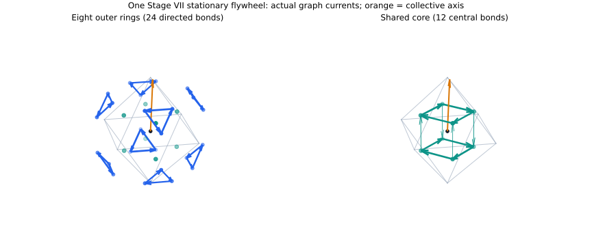
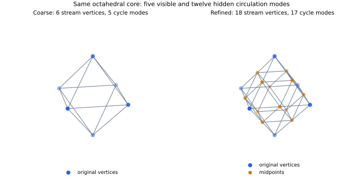
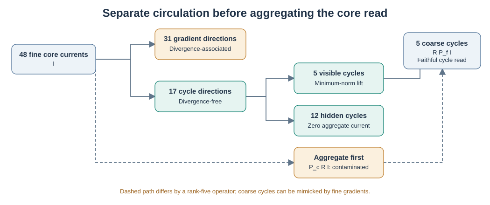
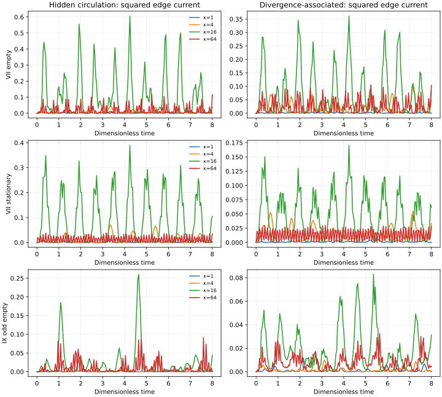

# The refined octahedral core: circulation, exchange and the settlement read

*Field Dynamics Research · eight-vortex flywheel continuation · 26 November 2026*

**Status.** [T] exact finite geometry and algebra; [D] conclusions for a stated current norm or Hamiltonian; [N] numerical diagnostics; [O] outstanding physical bridge. Repository basis `c5647f66505246a0169b1008bdadc0a4edbdfe45`. Proof 23 has passed Lean CI; this continuation is research, not a new Lean-verified proof or a modification of SST. The earlier [local refinement](../README.md) and [eight-ring/core study](../core-flywheel/README.md) are included together with this note and their figures.

## 1. The question and the model

The eight outer vortices of the stellated octahedron are organized around the eight core faces. Their twenty-four outer tiles circulate in eight three-bond rings. The eight central tiles are the actual faces of the octahedron; their twelve shared-edge currents constitute the core vortex in the [Stage VII sustained flywheel](../../hadamard-null-cone-vortex-flywheel/SUSTAINED_TRIFORCE_FLYWHEEL.md). This is a collective core response, not an extra independently prescribed oscillator at O. The earlier vertex-graph vortex and the face-dual current are related by the stream function, but remain distinct Hamiltonians. The Stage IX model adds three polar Origin coordinates and has different dimensionless coefficients.



In the preceding work the native collective axial vector is C=-i conjugate(z) cross z. The outer ring mean is proportional to s dot C and the core angular current is proportional to C. Their cubic read gives a pseudoscalar for generic orientations. The unresolved questions are whether secondary channels support internal circulation, how that circulation is visible at the original boundary, and whether an aggregate current can distinguish swirl from amplitude exchange. These can be answered at the geometric level before assigning a physical fine Hamiltonian.

## 2. Exact Hodge decomposition of the closed core [T]

Let the vertices of the primal octahedron be ±e_i. The dual graph has one vertex per triangular face, with one edge per shared primal edge. Orient every dual edge from its first face to its second face. Orient the corresponding primal edge by the outward boundary orientation of the first face. Let B be the face-by-edge incidence matrix, +1 at the outgoing face and −1 at the incoming face. Let D be the edge-by-primal-vertex difference matrix, with −1 at the first endpoint and +1 at the second.

The boundary of a boundary is zero, so BD=0. Both the primal and dual graphs are connected. The ranks are rank B=F−1 and rank D=V−1. Euler's sphere identity V−E+F=2 therefore gives dim ker B=E−F+1=V−1=rank D. The containment im D ⊆ ker B is consequently an equality. Every divergence-free current is the difference of a scalar stream potential on the primal vertices, unique modulo an additive constant. This is a finite-dimensional statement on the triangulated sphere, not a claim about hydrodynamic vorticity or fluid density.

At the original resolution the counts (V,E,F)=(6,12,8) give five circulation modes. At the first medial refinement of the core faces (the second subdivision of the original tetrahedral faces), the counts (18,48,32) give seventeen. At further complete medial depth m measured from the original octahedron, F_m=8·4^m, E_m=12·4^m and V_m=4·4^m+2. Thus the cycle dimension is 4·4^m+1. Only m=1 is relevant to the candidate fixed midpoint lattice of Proof 23; the general combinatorial formula does not override the physical depth premise.



## 3. An exact conservative coarse read and twelve hidden circulation patterns [T]

Use subscript f for fine, c for coarse. Define R by summing the two signed fine currents crossing each original edge, U by summing the four fine face divergences within each parent face, and V by restricting a fine stream potential to the six original vertices. Direct orientation gives two commuting identities:

```
B_c R = U B_f,
R D_f = D_c V.
```

The first identity is cancellation of internal face currents. The second is telescoping along the two segments of each original primal edge. R maps the 17-dimensional fine cycle space onto the five-dimensional coarse cycle space; the kernel has dimension 12. A basis is D_f δ_m for the twelve midpoint vertices m, where δ_m is zero at every other primal vertex. Each such current is a loop around the midpoint on the face-dual graph. Its two contributions on the subdivided old edge cancel and its other fine edges are internal to the parent faces. These are independent current patterns, not twelve additional physical vortices, occupation variables, or a second ledger. Any combination of them is invisible to the twelve aggregate edge currents. The count is topological and does not rely on H36 or a choice of coupling.

## 4. Canonical visible/hidden split for a specified norm [T/D]

For the unweighted Euclidean squared-current functional ||D_f σ||², let K=D_f^T D_f be the primal graph Laplacian. Separate the six old vertices o and twelve new midpoints m. With old stream values σ_o fixed, the unique minimum-norm harmonic extension is σ_m=−K_mm^−1 K_mo σ_o. K_mm is positive definite because the graph is connected and a function vanishing on the old vertices cannot have zero edge difference unless it vanishes everywhere. Denote the extension by J. Then VJ=I, and D_f J is orthogonal to the hidden loop space D_f Z, where Z embeds the midpoint potentials with zero old values. Every fine cycle therefore has a unique orthogonal decomposition into a minimum-norm representative of its aggregate stream and an invisible residual. The representative is fixed by the norm; a different physical edge metric could choose a different representative, while the kernel and commuting identities stay the same.

The reduced stream stiffness is the exact Schur complement

```
K_eff = K_oo − K_om K_mm^−1 K_mo = J^T K J.
```

Its diagonal entries are 11/4, its entries for adjacent original vertices are −5/8, and its entries for opposite vertices are −1/4. The original primal octahedron Laplacian has eigenvalues 0 (constant), 4 (three axial/dipole stream modes) and 6 (two axis-pair/quadrupole modes). The reduced one has 0, 3 and 15/4 in the same sectors. Hence the squared-current cost of the minimum-norm fine lift of a given original stream is 3/4 of the coarse cost for dipole streams and 5/8 for quadrupole streams. This is exact for unit edge weights. Neither ratio is a measured stiffness, an electromagnetic attenuation factor, nor the gravitational coupling. The physical norm must be derived separately from the field action.

## 5. A coarse-only circulation read can be contaminated by exchange [T]

Let P_f and P_c be the Euclidean orthogonal projectors onto ker B_f and ker B_c. For any oriented fine current I, write I=P_f I+(I−P_f)I. The second term is the discrete gradient current associated with the internal divergence B_f I, and is orthogonal to the cycle term. It is not necessarily a physical through-flow; internal occupation change and exchange with external sites must be measured independently.

Although R P_f I is divergence-free on the coarse graph, P_c R I need not equal it. In fact

```
A = P_c R − R P_f = P_c R (I−P_f).
```

The exact matrix has rank five. The nonzero eigenvalues of AA^T are 2/3 (multiplicity three, dipole) and 2/5 (multiplicity two, quadrupole). One way to derive them without diagonalizing a large matrix is to note RR^T=2I. On the coarse cycle space the minimum-norm right inverse of R restricted to fine cycles is the harmonic stream lift from section 4. Its squared norm ratios are 3/4 and 5/8, so R P_f R^T has eigenvalues 4/3 and 8/5 on the corresponding coarse sectors. Subtraction from 2I yields the stated spectrum of AA^T. Exact rational calculations also verify it directly. For a coarse cycle j in either sector, the pure fine gradient g=A^T j/λ (where λ is the corresponding nonzero eigenvalue of AA^T) satisfies P_f g=0 and P_c Rg=j. Thus every coarse cycle can be mimicked algebraically by a purely gradient fine current if the aggregation is performed first. This does not assert that arbitrary gradients are realizable as Hamiltonian bond currents in a single coherent state.

This obstruction is important for snapshot settlement. Coarse divergence conservation is exact, yet a coarse projection is not automatically a faithful read of physical swirl. The fine circulation must be separated before aggregation, or an equivalent correction derived. If only aggregate edge currents are available, the hidden component and the contamination are not identifiable in general. The uniform current lift R^T/2 preserves R but fails to preserve fine divergence-free circulation; hence even a perfectly faithful aggregate cannot choose the fine lift by itself.



## 6. The chirality obstruction is stronger than the zero of one polynomial [T]

For the normalized circular state z=(1,i,0)/√2, an odd tetrahedral permutation has spatial matrix

```
R_g = [[0,1,0],[-1,0,0],[0,0,-1]],    R_g z=i z.
```

The determinant is −1. This improper rotation preserves the physical ray. A scalar read h that is invariant under global phase and transforms by sign(g) must obey h(z)=h(i z)=−h(z), so h(z)=0. This rules out *every* such scalar orientation read at that axis-aligned collective ray, not merely the previously proposed cubic and quartic polynomials. The all-eight-ring and core vortex state can be nonzero at this ray. The earlier smooth scalar dictionary T(h)=P_++hP_- must therefore become singular there; selecting the sign of a winding polynomial does not solve the degeneracy. Tensor-valued orientation data, locally compatible frames, or an additional physical symmetry-breaking state remain possibilities, but no law selecting them has been proved. A physical map must respect the stabilizer of the actual state, and not identify an improper tetrahedral permutation with chamber inversion.

## 7. Test the separation on actual flywheel trajectories [D/N]

The script reuses the pinned Stage VII/IX reconstruction from the preceding package and its local 132-coordinate fine Hamiltonian. The fine model's 128 triangles and four Origin coordinates are distinct from the 64 paired geometric addresses. Inter-parent hoppings are fixed by uniform compression; the within-parent graph Laplacian scale κ remains an illustrative dimensionless parameter. No new model coefficients were fitted. We evolve the Stage VII empty-core input, its coarse stationary state (not assumed stationary after refinement), and the Stage IX odd empty-core input at κ∈{0,1,4,16,64}. For each of 201 samples on [0,8] per trajectory we compute the actual 48 core bond currents and the flux to all non-core sites, including any active Origin coordinates. The exact current convention gives

```
d p_core/dt + B_f I + b_out = 0
```

at each fine core face, where p=|ψ|² and b_out is total signed outward bond current. Summation gives dN_core/dt=−sum b_out. This is a storage/exchange identity, not a drain law. A through-flow may have zero net outflow while entering and leaving different ports; resolving that requires port-by-port boundary currents and an externally specified open-system condition. A closed Hermitian Hamiltonian conserves total occupation and cannot by itself sustain permanent net loss.

For each trajectory the script checks local continuity, the orthogonality identity ||I||²=||I_grad||²+||I_visible||²+||I_hidden||², and zero aggregate hidden current. The sampled data contain nonzero hidden circulation and nonzero projection-order discrepancy. For example Stage VII empty-core at κ=16 has peak hidden squared current ≈0.6061 and peak projection discrepancy ≈0.4906; Stage VII coarse stationary input at κ=16 has corresponding values ≈0.3900 and ≈0.3369. These are dimensionless current diagnostics, not energy or matter occupation fractions; their peaks need not coincide, and κ is not selected physically. All sampled scenarios preserve the stated continuity law, not necessarily the direction of every outer ring bond. See the prior [flywheel trajectory study](../core-flywheel/README.md) for those separate sign tests.



## 8. The next proof obligation

The geometric cycle decomposition is ready for a standalone finite algebra theorem after an independent review. The dynamical bridge is not ready: derive a fine action that supplies an edge metric and Hamiltonian independently of the coarse fit. Compute its frequency-dependent Schur response and determine how the visible and hidden current channels enter the boundary registration. Derive how the physical orientation data transform, including the axis-aligned stabilizer. Then establish a port-resolved through-flow law rather than inferring a drain from a local vortex. The existing 40/24 connection dictionary, 64 paired addresses and 21 reader count should not be identified with these 5+12 core cycle modes; they describe different mathematical objects. No derivation of μ, G, α, physical torsion or the full covariant response follows yet.

## Reproduce

Run `OPENBLAS_NUM_THREADS=1 python explore_core_hodge.py` with NumPy, SciPy, SymPy and Matplotlib. The script reads the reconstruction prefix of `../core-flywheel/explore_core_flywheel.py`, stopping before its trajectory tests. [Output](exploration_output.txt) records 69 new passing checks and 16 rerun reconstruction checks. [Trajectory CSV](hodge_dynamics.csv) and [summary CSV](hodge_summary.csv) distinguish the finite numerical results from the exact rational identities. The mesh and dynamics figures are generated in SVG and PNG. The read-order diagram is a separate vector illustration. The earlier 330 and 397 test suites are preserved with their recorded logs, not rerun as part of this continuation. No new Lean certification or physical experiment is claimed.
